::: {custom-style="Ghichu"}
**Cách dùng tài liệu.** Đây là sổ tay "cầm tay chỉ việc" của người làm thiết kế: mỗi bước có **công thức → giải thích ký hiệu → trình tự → ví dụ thay số → kết quả → cách chọn thép**. Toàn bộ ví dụ dùng **một bộ số liệu duy nhất** (nhà trường học 6 tầng, Ninh Bình, khung trục 3 – xem Chương 1.5). Nội dung kết quả của ví dụ được **tính lại bằng chương trình kiểm tra** để loại các lỗi in/ghi nhầm của tài liệu gốc (xem Phụ lục B).
:::

# Phần mở đầu – nguyên tắc tổng hợp 4 tài liệu {-}

## 0.1. Bốn tài liệu và vai trò của từng tài liệu {-}

| Mã | Tài liệu | Tiêu chuẩn viện dẫn | Vai trò khi tổng hợp |
|:--:|:-------------------------|:-------------------|:------------------------------|
| **A** | *Thiết kế khung bê tông cốt thép* (bản 4-9-2024) – có ví dụ khung trục 3 trường học 6 tầng | TCVN 5574:2018, **TCVN 2737:2023**, QCVN 02:2022 | **Trục chính về quy trình**: tải trọng, tổ hợp, nội lực, trình tự thép dầm/cột, cấu tạo nút khung, ví dụ hoàn chỉnh |
| **D** | *Kết cấu bê tông cốt thép – Cấu kiện cơ bản* (bản theo **TCVN 5574:2018**) | TCVN 5574:2018 | **Nguồn công thức chuẩn hiện hành**: uốn, cắt, nén lệch tâm, kéo, xoắn, nứt – võng, bảng vật liệu (Phụ lục 1–14) |
| **B** | *Kết cấu BTCT – Phần kết cấu nhà cửa* (Ngô Thế Phong, 2008) | TCVN 5574:1991, tiêu chuẩn kháng chấn châu Âu | **Đối chiếu / bổ sung cấu tạo**: nút khung, xà gãy khúc, nách khung, cột–móng, cấu tạo kháng chấn dầm–cột. Gắn cờ *tiêu chuẩn cũ* |
| **C** | *Kết cấu BTCT – Phần cấu kiện cơ bản* (Phan Quang Minh chủ biên, 2006) | TCXDVN 356:2005 | **Đối chiếu / bổ sung cấu tạo**: lớp bảo vệ, khoảng hở, neo–nối, μmin cột, đai cột, cốt cấu tạo. Gắn cờ *tiêu chuẩn cũ* |

## 0.2. Quy tắc xử lý khi các tài liệu khác nhau {-}

1. **Công thức và hệ số** lấy theo bản *hiện hành* (TCVN 5574:2018 – tài liệu D, A). Tài liệu B, C chỉ dùng để đối chiếu hoặc lấy chi tiết cấu tạo mà bản hiện hành không nhắc lại.
2. **Tải trọng, tổ hợp** lấy theo **TCVN 2737:2023** (tài liệu A); các hệ số $\gamma_f$, $\psi$ của bản 1995 (B, C) *không dùng*.
3. Khi hai nguồn cho **hai giá trị khác nhau**, tài liệu chọn một giá trị chính (in đậm trong bảng) và nêu giá trị kia trong khung **Đối chiếu**. Giá trị chính luôn là giá trị **an toàn hơn** nếu hai tiêu chuẩn cùng còn hiệu lực.
4. Nội dung nào lấy từ tiêu chuẩn cũ được đánh dấu bằng khung xám nghiêng:

::: {custom-style="Cu"}
**[TC cũ]** Ví dụ: TCVN 5574:1991 / TCXDVN 356:2005 (sách B, C) – chỉ để đối chiếu, không dùng làm căn cứ chọn thép nếu đã có quy định mới.
:::

5. Giá trị mà sách không cung cấp được ghi **"tra theo tiêu chuẩn"** kèm điều/bảng nếu biết. Không tự đặt công thức hay hệ số mới.

## 0.3. Các khung đánh dấu trong tài liệu {-}

::: {custom-style="Vidu"}
**Ví dụ (khung xanh)** – thay số bằng bộ số liệu thống nhất của ví dụ trường học.
:::

::: {custom-style="Ghichu"}
**Ghi chú / Đối chiếu (khung vàng)** – điểm khác nhau giữa các tài liệu, lưu ý khi áp dụng.
:::

::: {custom-style="Canhbao"}
**Lỗi thường gặp (khung đỏ)** – các sai sót hay xảy ra khi đọc ETABS, tra bảng, đổi đơn vị.
:::

::: {custom-style="Ketqua"}
Kết quả cuối của một bước (khung xanh lá).
:::

## 0.4. Đơn vị và quy ước dấu {-}

| Đại lượng | Đơn vị khi thay vào công thức | Đổi từ ETABS |
|:--------------|:--------------------|:--------------------------|
| Chiều dài tiết diện $b, h, h_0, a$ | mm | m × 1000 |
| Lực $N, Q$ | N (khi nhân với MPa·mm²) | kN × 1000 |
| Mô men $M$ | N·mm | kN·m × $10^6$ |
| Cường độ $R_b, R_{bt}, R_s, R_{sw}$ | MPa = N/mm² | — |
| Diện tích cốt thép $A_s$ | mm² | cm² × 100 |
| Tải phân bố | kN/m | kN/m² × bề rộng truyền tải (m) |

- **Dấu mô men dầm:** mô men *âm* (căng thớ trên) → thép trên ở gối; mô men *dương* (căng thớ dưới) → thép dưới ở nhịp. Khi thay số vào công thức dùng **trị tuyệt đối** của $M$.
- **Dấu lực dọc cột:** ETABS cho nén là **âm**; trong tài liệu này $N$ lấy **dương khi nén**.
- Mọi phép nhân MPa × mm² cho kết quả bằng **N**; chia cho $10^3$ để ra kN.

## 0.5. Tiêu chuẩn và tài liệu căn cứ {-}

| Tiêu chuẩn | Nội dung dùng trong tài liệu |
|:----------------|:-----------------------------------------|
| TCVN 5574:2018 | Thiết kế kết cấu bê tông và bê tông cốt thép: cường độ vật liệu, uốn, cắt, nén lệch tâm, neo–nối, nứt–võng |
| TCVN 2737:2023 | Tải trọng và tác động: hoạt tải sàn, gió, tổ hợp tải trọng, hệ số độ tin cậy, hệ số tầm quan trọng |
| QCVN 02:2022/BXD | Số liệu tự nhiên dùng trong xây dựng: vùng áp lực gió $W_0$ |
| TCVN 1651-1:2008, 1651-2:2008 | Thép cốt bê tông tròn trơn (CB240-T, CB300-T), thép thanh vằn (CB300-V, CB400-V, CB500-V), diện tích và khối lượng |
| TCVN 9386:2012 | Thiết kế công trình chịu động đất (chỉ nhắc khi công trình thuộc vùng có động đất, "tra theo tiêu chuẩn") |

::: {custom-style="Canhbao"}
**Cảnh báo phạm vi.** Tài liệu này hướng dẫn *chọn thép cho khung phẳng BTCT toàn khối* từ kết quả ETABS/SAP2000. Với công trình có yêu cầu kháng chấn (vùng động đất), khung–vách hỗn hợp, nhà cao tầng, kết cấu đặc biệt, phải bổ sung kiểm tra theo TCVN 9386:2012 và hồ sơ thiết kế riêng; phần cấu tạo kháng chấn ở **Chương 13** (theo EN 1998-1:2004, cơ sở của TCVN 9386:2012; hệ số kiểm chứng ở 13.9) là *chỉ dẫn thiết kế sơ bộ và kiểm tra nhanh*, không thay thế tiêu chuẩn: hồ sơ thật phải đối chiếu từng điều khoản với TCVN 9386:2012. **Chương 14** nêu rõ những trường hợp tài liệu này *không* đủ (xoắn, lỗ mở, dầm cao, vách, động đất…) và cổng kiểm tra hình học nút trước khi phát hành bản vẽ; **Chương 15** lấp phần xoắn (theo D) và sàng lọc dầm cao, lỗ mở.
:::

\newpage


# CHƯƠNG 1. DỮ LIỆU ĐẦU VÀO

::: {custom-style="Ghichu"}
**Nguyên tắc số 1:** thiếu một dữ liệu đầu vào là không thể chọn thép đúng. Chương này liệt kê *đầy đủ* những gì phải có trước khi bắt đầu, cách kiểm tra từng dữ liệu, và định nghĩa **bộ số liệu ví dụ** dùng xuyên suốt tài liệu.
:::

## 1.1. Dữ liệu đầu vào gồm những nhóm nào

| Nhóm | Nội dung | Nếu thiếu thì sai ở đâu |
|:--|:--------------------------|:-------------------------------|
| **A. Công trình** | công năng, địa điểm, số tầng, cấp công trình, môi trường, bậc chịu lửa | sai hoạt tải, gió, $\gamma_n$, lớp bảo vệ |
| **B. Hình học** | lưới trục, nhịp, bước khung, chiều cao tầng, tiết diện, liên kết chân cột | sai sơ đồ tính, chiều dài tính toán $l_0$, tải truyền |
| **C. Vật liệu** | cấp bền bê tông, mác thép dọc/đai, mô đun, độ ẩm | sai $R_b, R_s, \xi_R$, $\varphi_{b,cr}$ |
| **D. Tải trọng** | cấu tạo sàn, tường, hoạt tải, gió, (động đất) | sai nội lực toàn khung |
| **E. Mô hình & kết quả ETABS** | đơn vị, tên tổ hợp, tên phần tử, bảng xuất | đọc nhầm phần tử/tổ hợp/dấu |
| **F. Yêu cầu thiết kế riêng** | mác/đường kính ưu tiên, hàm lượng mục tiêu, giới hạn võng–nứt | chọn thép không thi công được hoặc vượt chỉ tiêu |
| **G. Quy định cấu tạo của dự án** | lớp bảo vệ, kiểu nối, chiều dài nối–neo, tiêu chuẩn áp dụng | bản vẽ không khớp tính toán |

## 1.2. Bảng điền dữ liệu đầu vào (dùng cho mọi dự án)

Cột **"Ví dụ"** là giá trị của bộ số liệu thống nhất (mục 1.5). Cột **"Dự án"** để người dùng điền khi áp dụng cho công trình thật. Cột **"Dùng ở"** cho biết dữ liệu ảnh hưởng đến chương nào.

### A. Công trình và môi trường

| Hạng mục (ký hiệu, đơn vị) | Cách lấy / nguồn | Ví dụ | Dự án | Dùng ở |
|:-------------|:-----------------|:--------------|:---------|:-----:|
| Công năng | hồ sơ kiến trúc | Trường học (phòng học, hành lang) | | 4, 5 |
| Địa điểm, vùng gió $W_0$ (kN/m²) | QCVN 02:2022 / TCVN 2737:2023, Bảng vùng áp lực gió | TP Ninh Bình – vùng IV, $W_0 = 1{,}55$ | | 4 |
| Dạng địa hình (A/B/C) | TCVN 2737:2023 – mô tả địa hình | C (thành phố, che chắn mạnh) | | 4 |
| Số tầng $n$; chiều cao tầng $H_t$ (m) | hồ sơ kiến trúc | 6 tầng + mái; $H_t = 3{,}9$ | | 2, 4 |
| Cốt mặt móng/ngàm so với cốt $\pm 0{,}000$ (m) | hồ sơ nền móng | $-1{,}3$ | | 3, 8 |
| Cấp hậu quả (cấp công trình) $\to$ $\gamma_n$ | TCVN 2737:2023, Bảng hệ số tầm quan trọng | C2 $\to \gamma_n = 1{,}0$ | | 5 |
| Vùng động đất ($a_{gR}$) | QCVN 02:2022, TCVN 9386:2012 | Không xét trong ví dụ | | 5 |
| Điều kiện môi trường (khô/ẩm/ngoài trời/xâm thực) | khảo sát, hồ sơ | Trong nhà, ẩm thông thường | | 9 |
| Độ ẩm tương đối $RH$ (%) | khí hậu địa phương | $>75\%$ (miền Bắc) | | 8 (từ biến) |
| Bậc chịu lửa / yêu cầu lớp bảo vệ chống cháy | QCVN 06, hồ sơ PCCC | Không yêu cầu thêm | | 9 |

### B. Hình học

| Hạng mục | Cách lấy / nguồn | Ví dụ | Dự án | Dùng ở |
|:-------------|:-----------------|:--------------|:---------|:-----:|
| Lưới trục, nhịp dầm khung $L_i$ (m) | mặt bằng kết cấu | C–D 3,45; D–B 3,45; B–A 2,1; console A–E 2,1 | | 2, 3 |
| Bước khung $B$ (m) | mặt bằng kết cấu | 3,9 | | 4 |
| Kích thước ô sàn $L_1 \times L_2$ (m) | mặt bằng kết cấu | 3,45 × 3,9 (bản kê 4 cạnh) | | 2 |
| Tiết diện dầm $b \times h$ (mm) | chọn sơ bộ (Ch.2) | CB: 250×700; AB: 250×400; dầm dọc/phụ: 220×300 | | 3, 7 |
| Tiết diện cột $b_c \times h_c$ (mm) | chọn sơ bộ (Ch.2) | cột B, C: 250×600; cột A: 250×250 | | 3, 8 |
| Chiều dày sàn $h_b$ (mm) | chọn sơ bộ (Ch.2) | 100 | | 4 |
| Liên kết chân cột | địa chất, móng | Ngàm tại mặt móng | | 3 |
| Chiều cao tầng 1 tính từ ngàm (m) | $H_t$ + chiều sâu ngàm | $3{,}9 + 1{,}3 = 5{,}2$ | | 3, 8 |
| Độ dốc mái | kiến trúc | $13^{\circ}$ | | 4 |

### C. Vật liệu

| Hạng mục | Cách lấy / nguồn | Ví dụ | Dự án | Dùng ở |
|:-------------|:-----------------|:--------------|:---------|:-----:|
| Cấp độ bền bê tông | thiết kế | B30: $R_b = 17$; $R_{bt} = 1{,}15$; $E_b = 32\,500$ MPa | | 7, 8 |
| Thép dọc | thiết kế | CB500-V: $R_s = R_{sc} = 435$ MPa; $E_s = 2\cdot 10^5$ MPa | | 7, 8 |
| Thép đai, cốt treo | thiết kế | CB240-T: $R_{sw} = 170$ MPa ($R_s = 210$ MPa) | | 7 |
| Hệ số điều kiện làm việc của bê tông $\gamma_{b2}$ | TCVN 5574:2018 (tải trọng tác dụng ngắn hạn/dài hạn) | 1,0 | | 7, 8 |
| Kích thước cốt liệu lớn nhất $d_{max}$ (mm) | đơn vị thi công | 20 | | 9 |

### D. Tải trọng

| Hạng mục | Cách lấy / nguồn | Ví dụ | Dự án | Dùng ở |
|:-------------|:-----------------|:--------------|:---------|:-----:|
| Cấu tạo các lớp sàn, mái, tường | hồ sơ kiến trúc | Bảng 4.1–4.6 | | 4 |
| Hoạt tải sàn $p_{tc}$ (kN/m²) | TCVN 2737:2023 mục 8 (theo công năng) | phòng học 2,0; hành lang 3,0; mái không sử dụng 0,3 | | 4 |
| Hệ số độ tin cậy $\gamma_f$ | TCVN 2737:2023 | xem Bảng 5.1 | | 4, 5 |
| Gió: $W_{3s,10}$, $k(z_e)$, $c$, $G_f$ | TCVN 2737:2023 | $1{,}32$; $0{,}93$; $+0{,}8/-0{,}59$; $0{,}85$ | | 4 |
| Tải đặc biệt (nước sê nô, thiết bị, ...) | hồ sơ | Nước sê nô 10 kN/m² × 0,3 m | | 4 |

### E. Mô hình và kết quả ETABS/SAP2000

| Hạng mục | Cách lấy / nguồn | Ví dụ | Dự án | Dùng ở |
|:-------------|:-----------------|:--------------|:---------|:-----:|
| Hệ đơn vị xuất kết quả | cài đặt chương trình | kN, m (kN·m) | | 6 |
| Tên các trường hợp tải (Load Case/Pattern) | mô hình | TT, HT1, HT2, GIOT, GIOP | | 5, 6 |
| Tên các tổ hợp (Combo) | mô hình | TH1 … TH17, THBAO | | 5, 6 |
| Tên/số hiệu phần tử dầm, cột | mô hình | dầm 40–41, 9, 15; cột 22 | | 6 |
| Các bảng nội lực đã xuất | ETABS | Element Forces – Beams/Columns | | 6 |

### F. Yêu cầu thiết kế riêng của dự án

| Hạng mục | Cách lấy / nguồn | Ví dụ | Dự án | Dùng ở |
|:-------------|:-----------------|:--------------|:---------|:-----:|
| Đường kính ưu tiên, đường kính tối đa trong dầm/cột | quy định thi công | dầm: Ø16–Ø25; cột: Ø16–Ø25 | | 7, 8 |
| Số lớp cốt thép tối đa trong dầm | quy định thi công | ≤ 2 hàng | | 7 |
| Hàm lượng mục tiêu | kinh nghiệm | dầm $\approx 1{,}0$–$1{,}5\%$; cột $\mu_t \approx 1$–$2\%$ | | 7, 8 |
| Giới hạn võng, bề rộng khe nứt | TCVN 5574:2018 (Phụ lục) | $a_{crc,\,dài\,hạn} \le 0{,}3$ mm | | 7 |

### G. Quy định cấu tạo của dự án

| Hạng mục | Cách lấy / nguồn | Ví dụ | Dự án | Dùng ở |
|:-------------|:-----------------|:--------------|:---------|:-----:|
| Lớp bảo vệ cốt đai $c$ (mm) | TCVN 5574:2018 theo môi trường | dầm, cột: 20 | | 9 |
| Kiểu nối cốt dọc | thi công | nối buộc (nối chồng) | | 9 |
| Chiều dài thanh thép thương phẩm (m) | nhà cung cấp | 11,7 | | 9 |
| Tiêu chuẩn thiết kế | hồ sơ | TCVN 5574:2018; TCVN 2737:2023 | | tất cả |

::: {custom-style="Canhbao"}
**Lỗi thường gặp ở dữ liệu đầu vào.** (1) Lấy hoạt tải theo công năng cũ (nhà ở) trong khi phòng đã đổi chức năng; (2) quên tính chiều sâu ngàm vào chiều cao tầng 1 nên $l_0$ cột tầng 1 sai; (3) nhập mác thép đai bằng mác thép dọc ($R_{sw}$ khác $R_s$); (4) chọn $\gamma_n$ theo công trình thấp tầng cho nhà quan trọng; (5) không ghi dạng địa hình khi tính gió.
:::

## 1.3. Cách kiểm tra dữ liệu đầu vào trước khi tính

1. **Kiểm tra nhất quán đơn vị:** toàn bộ ETABS đặt kN–m; tiết diện bằng mm khi thay vào công thức (xem 0.4).
2. **Kiểm tra tiết diện theo ván khuôn:** cạnh $\le 600$ mm làm tròn bội số 50; $>600$ mm bội số 100 (tài liệu A).
3. **Kiểm tra vật liệu ghi trong mô hình = vật liệu thiết kế:** ETABS có thể gán bê tông B25 trong khi thiết kế B30.
4. **Kiểm tra tải trọng:** tổng tải đứng ETABS ($\sum$ phản lực chân cột) so với tải tính tay (xem 6.4).
5. **Kiểm tra tên phần tử:** vẽ ra sơ đồ phần tử (Hình 6.23 của A) và chép tên dầm/cột cần thiết kế trước khi đọc bảng.

## 1.4. Dữ liệu cần để chương trình/AI tự động chọn thép

Muốn tự động hoá chọn thép từ file ETABS, mỗi phần tử cần có đủ các trường sau (đây là *giao diện dữ liệu* giữa mô hình và bước chọn thép):

| Trường | Ví dụ | Ghi chú |
|:--|:--|:--|
| `story`, `element`, `section` | Tầng 1, C22, 250×600 | tên theo mô hình |
| `b, h, a, a', L, l0` | 250, 600, 40, 40, 5200, 3640 | mm |
| `Rb, Rbt, Rs, Rsc, Rsw, Es, Eb` | 17, 1,15, 435, 435, 170, ... | MPa |
| `combo, station, M, N, Q` | TH12, chân cột, 417,74; −1514,38; ... | M kNm; N kN; Q kN |
| `Mdh, Ndh` | 18,06; 1168,39 | nội lực do tải dài hạn (tĩnh tải) |
| `loại cấu kiện` | cột / dầm / console | quyết định thuật toán |
| `ràng buộc cấu tạo` | cover, spacing, diameters | từ nhóm F, G |

## 1.5. Bộ số liệu ví dụ thống nhất (dùng xuyên suốt tài liệu)

::: {custom-style="Vidu"}
**ĐỀ BÀI (lấy từ tài liệu A, ví dụ 1 chương 6).** Thiết kế khung ngang (khung trục 3) của một nhà trường học 6 tầng tại thành phố Ninh Bình. Kết cấu khung BTCT toàn khối, sàn sườn toàn khối; chiều dài nhà khoảng 50 m (có khe biến dạng tại trục 7–8); bước khung 3,9 m; mái dốc $13^{\circ}$ lợp tôn, tường thu hồi xây 110.

- **Sơ đồ khung trục 3:** các trục C, B, A là cột, D là điểm giữa nhịp CB; C–D = D–B = 3,45 m (D **không phải cột**: là vị trí dầm phụ 220×300 gác lên dầm khung CB, truyền lực tập trung $G_D$, $P_D$); B–A = 2,1 m; console A–E = 2,1 m (chỉ ở tầng 2).
- **Chiều cao:** tầng 1: 3,9 m cộng 1,3 m từ mặt ngàm lên $\pm 0{,}000$ = 5,2 m; tầng 2–6: 3,9 m; chiều cao nhà từ cốt ngoài nhà $h = 25{,}05$ m; từ mặt móng $H = 26{,}35$ m.
- **Vật liệu:** B30; CB500-V (thép dọc); CB240-T (thép đai).
- **Tiết diện:** dầm CB 250×700, dầm AB 250×400, dầm dọc và dầm phụ 220×300, cột 250×600 (trục B, C), cột 250×250 (trục A), sàn dày 100.
- **Nội lực:** do ETABS giải khung phẳng trục 3; giá trị lấy từ tài liệu A (xem Chương 11).
:::

::: {custom-style="Ghichu"}
**Vì sao chọn ví dụ này?** Đây là ví dụ duy nhất trong 4 tài liệu có *đủ* chuỗi: mặt bằng → tải trọng → tổ hợp TCVN 2737:2023 → nội lực ETABS → thép dầm, cột, cốt treo, nút khung. Số liệu nội lực ETABS không thể tính lại bằng tay nên giữ nguyên; **mọi phép tính tiết diện (thép dọc, đai, neo) được tính lại hoàn toàn** và các sai khác với tài liệu gốc được liệt kê ở Phụ lục B.
:::


# CHƯƠNG 2. CHỌN SƠ BỘ KÍCH THƯỚC CẤU KIỆN

::: {custom-style="Ghichu"}
**Mục đích.** Kích thước chọn ở đây chỉ là *giả thiết ban đầu* để chạy ETABS. Sau khi có nội lực (Chương 7–8) phải quay lại kiểm tra: $\alpha_m \le \alpha_R$, hàm lượng thép hợp lý, cột không quá mảnh. Nếu không đạt thì sửa tiết diện và chạy lại. Nguồn: A (mục 1.4, ví dụ 6.2), C (kích thước dầm), B (tiết diện cột nhà khung).
:::

## 2.1. Thứ tự chọn

1. Chiều dày sàn $h_b$ (quyết định tải trọng bản thân và truyền tải).
2. Tiết diện dầm: dầm khung, dầm dọc, dầm phụ, dầm console.
3. Tiết diện cột (theo lực dọc sơ bộ).
4. Kiểm tra: tỷ lệ độ cứng dầm/cột, độ mảnh cột, bội số ván khuôn.

## 2.2. Chiều dày bản sàn

**Công thức (A, 6.2b):**

$$h_b = \frac{D}{m}\,L_1 \qquad (\text{mm})$$

| Ký hiệu | Ý nghĩa | Giá trị |
|:--|:----------------------|:---------------------|
| $L_1$ | cạnh ngắn của ô bản (tính theo tim dầm) | mm |
| $D$ | hệ số phụ thuộc tải trọng | $0{,}8$–$1{,}4$; tải bình thường lấy $D = 1$ |
| $m$ | hệ số theo loại ô bản | bản kê 4 cạnh $m = 40$–$45$ (A); loại khác tra tài liệu thiết kế sàn |

Điều kiện làm việc hai phương: $L_2/L_1 \le 2$ (bản kê 4 cạnh); $L_2/L_1 > 2$ là bản làm việc một phương (bản dầm).

::: {custom-style="Vidu"}
**Ví dụ.** Ô bản điển hình $L_1 \times L_2 = 3{,}45 \times 3{,}9$ m, $L_2/L_1 = 3{,}9/3{,}45 = 1{,}13 < 2$ → bản kê 4 cạnh. Với $D = 1$, $m = 40$:

$$h_b = \frac{1}{40}\times 3450 = 86{,}25\ \text{mm}$$

**Kết quả:** chọn $h_b = 100$ mm cho toàn sàn (thống nhất để thi công thuận tiện).
:::

Quy tắc làm tròn: bội số của 10 mm đối với sàn; không chọn nhỏ hơn giá trị tối thiểu của tiêu chuẩn (**tra TCVN 5574:2018, phần cấu tạo bản**).

## 2.3. Tiết diện dầm

**Công thức kinh nghiệm (A; C cho phạm vi rộng hơn):**

$$h_d = \left(\frac{1}{10}\div\frac{1}{14}\right)L \qquad b_d = \left(\frac{1}{3}\div\frac{1}{2}\right)h_d$$

Trong đó $L$ là nhịp dầm (m→mm). **Đối chiếu:** tài liệu C cho $h = (1/8 \div 1/20)L$ và $h/b = 2\div 4$ — khoảng rộng hơn, dùng cho dầm phụ, dầm ít tải; với dầm *khung* chịu cả tải ngang nên dùng khoảng $(1/10\div 1/14)L$ của A.

**Các nguyên tắc chọn (A):**

- $b_d \le b_c$ (bề rộng cột) để đơn giản cấu tạo thép và ván khuôn tại nút.
- Dầm nhịp không chênh lệch nhiều → dùng cùng tiết diện để luân chuyển ván khuôn.
- Dầm nhịp ngắn kề nhịp dài (như AB cạnh CB): chọn theo **tỷ lệ độ cứng đơn vị** $i = EI/L$ giữa các nhịp trong khoảng $1\div 2$:

$$\frac{i_{CB}}{i_{AB}} = \frac{I_{CB}/L_{CB}}{I_{AB}/L_{AB}} \in (1;\,2)$$

- Dầm cao hơn thì khả năng chịu lực và độ cứng lớn hơn, nên ưu tiên chiều cao lớn nếu kiến trúc cho phép.
- Hàm lượng thép kinh tế của dầm khoảng $\tfrac13\div\tfrac12$ của $\mu_{max}$ (xem 7.4).

::: {custom-style="Vidu"}
**Ví dụ.**

- Dầm CB (nhịp ~ 6,9 m): $h_d = (1/14 \div 1/10)\times 6900 = 493\div 690$ mm → chọn $h = 700$ mm; $b = 250$ mm ($= 0{,}36 h$ nằm trong $1/3\div 1/2$). **Dầm CB 250×700.**
- Dầm AB (nhịp 2,1 m): chọn $h = 400$ mm, $b = 250$. Kiểm tra độ cứng đơn vị:

$$I_{CB} = \frac{250\cdot 700^3}{12} = 7{,}146\cdot 10^{9}\ \text{mm}^4,\quad I_{AB} = \frac{250\cdot 400^3}{12} = 1{,}333\cdot 10^{9}\ \text{mm}^4$$

$$\frac{i_{CB}}{i_{AB}} = \frac{7{,}146\cdot 10^{9}/6900}{1{,}333\cdot 10^{9}/2100} = \frac{1{,}036\cdot 10^{6}}{0{,}635\cdot 10^{6}} = 1{,}63 \in (1;2)\ \Rightarrow\ \text{đạt}$$

- Dầm dọc và dầm phụ nhịp 3,9 m: $h = 300$ mm ($\approx L/13$), $b = 220$ mm → **220×300**.
:::

## 2.4. Tiết diện cột

### 2.4.1. Diện tích sơ bộ theo lực dọc

$$A_{sb} = k\,\frac{N}{R_b}\ ,\qquad N = n\,S\,q$$

| Ký hiệu | Ý nghĩa | Giá trị |
|:--|:----------------------|:---------------------|
| $k$ | hệ số kể mô men | cột trong: $1{,}2$–$1{,}3$; cột biên và cột tầng trên cùng: lấy lớn hơn, đến $1{,}5$ |
| $N$ | lực dọc sơ bộ chân cột (kN) | |
| $n$ | số tầng | |
| $S$ | diện tích chịu tải của cột (m²) — tính từ **tim** dầm | |
| $q$ | tải sơ bộ trên 1 m² sàn (kN/m²) | nhà ở riêng lẻ $8$–$10$; văn phòng, trường học, loại khác $10$–$13$; trung tâm thương mại, chung cư, khách sạn $13$–$16$ |
| $R_b$ | cường độ chịu nén của bê tông (kN/m² khi $N$ tính kN và $A$ tính m²) | B30: 17 000 kN/m² |

### 2.4.2. Điều kiện về độ mảnh

- Cột nhà: $\lambda = l_0/i \le 120$; với cột tiết diện chữ nhật: $\lambda_b = l_0/b \le 35$ (A trích TCVN 5574:2012, mục 8.2 — *kiểm tra lại điều tương ứng trong bản 2018 trước khi đóng dấu hồ sơ*).
- Chiều dài tính toán của khung toàn khối nhiều tầng, nhiều nhịp: $l_0 = 0{,}7\,H$ ($H$ = chiều cao tầng; riêng tầng 1 lấy từ mặt ngàm).

### 2.4.3. Thống nhất hoá

- Cạnh $\le 600$ mm làm tròn bội số của 50; cạnh $> 600$ mm bội số của 100.
- Giữ tiết diện cột không đổi suốt chiều cao (tiết kiệm ván khuôn); khi cần giảm thì giảm *cấp bền bê tông* và hàm lượng thép ở tầng trên: $\mu_t \approx 2\%$ cho cột nén lớn, $\mu_t \approx 1\%$ cho cột nén nhỏ ở tầng trên (A).

::: {custom-style="Vidu"}
**Ví dụ – cột trục B (cột trong).** Diện truyền tải $S = \left(\dfrac{6{,}9}{2} + \dfrac{2{,}1}{2}\right)\times 3{,}9 = 17{,}55$ m²; trường học lấy $q = 10$ kN/m², $n = 6$:

$$N = 6\times 17{,}55\times 10 = 1053\ \text{kN},\qquad A_{sb} = 1{,}3\times\frac{1053}{17\,000} = 0{,}0805\ \text{m}^2 = 805\ \text{cm}^2$$

Chọn **250×600** ($A = 1500$ cm²) cho cột B và cột C (cột C diện tải nhỏ hơn nhưng lấy bằng B để định hình ván khuôn).

**Cột trục A:** $S = \dfrac{2{,}1}{2}\times 3{,}9 = 4{,}095$ m²; $N = 6\times 4{,}095\times 10 = 245{,}7$ kN; $A_{sb} = 1{,}3\times 245{,}7/17\,000 = 0{,}0188$ m² = 188 cm². Chọn **250×250** ($A = 625$ cm²).

*(Tài liệu A in $N = 6\cdot 11\cdot 4{,}095 = 270$ kN; với $q = 10$ như đã giả thiết thì $N = 245{,}7$ kN. Hai giá trị đều cho cùng kết luận chọn 250×250.)*

**Kiểm tra độ mảnh cột tầng 1:** $l_0 = 0{,}7\times(3{,}9 + 1{,}3) = 3{,}64$ m; $\lambda_b = 3640/250 = 14{,}56 \le 35$ → đạt.
:::

## 2.5. Kiểm tra lại sau khi có nội lực

| Kiểm tra | Điều kiện | Nếu không đạt |
|:----------------|:----------------------|:----------------------------|
| Dầm chịu uốn | $\alpha_m \le \alpha_R$ ($\approx 0{,}37$ cho CB500-V/B30); nên $\alpha_m \le 0{,}3$ | tăng $h$ dầm, hoặc đặt cốt kép |
| Dầm chịu cắt | $Q \le 0{,}3R_b b h_0$ | tăng $b$, $h$ hoặc cấp bền bê tông |
| Hàm lượng dầm | $\mu_{min} \le \mu \le \mu_{max}$; kinh tế $\approx \tfrac13$–$\tfrac12 \mu_{max}$ | đổi tiết diện |
| Cột nén lệch tâm | $\mu_t$ không vượt 3–4% (8% tại chỗ nối) | tăng tiết diện hoặc cấp bền |
| Chuyển vị ngang đỉnh nhà | theo giới hạn của tiêu chuẩn (**tra TCVN 2737/TCVN 5574**) | tăng độ cứng cột, dầm |
| Tỷ lệ độ cứng đơn vị | $i_{dầm}/i_{cột}$ trong khoảng $1\div 2$ | điều chỉnh $h$ dầm hoặc cột |

::: {custom-style="Canhbao"}
**Lỗi thường gặp.** (1) Chọn cột theo $N$ chân cột nhưng quên tầng 1 có chiều cao lớn hơn nên độ mảnh vượt; (2) chọn $b_d > b_c$ làm nút khung không đặt được thép; (3) chọn tiết diện không phải bội số ván khuôn rồi phải sửa lại toàn bộ mô hình; (4) quên rằng sửa tiết diện làm thay đổi tải trọng bản thân.
:::


# CHƯƠNG 3. LẬP SƠ ĐỒ TÍNH KHUNG

::: {custom-style="Ghichu"}
**Phạm vi.** Chương này quyết định *bài toán nào sẽ đưa vào ETABS/SAP2000*. Sơ đồ tính sai thì mọi bước sau (tải, tổ hợp, thép) đều sai dù tính toán tiết diện chính xác. Nguồn: A (chương 2, 4.2.2), B (mục sơ đồ tính khung).
:::

## 3.1. Khung phẳng hay khung không gian

| Tiêu chí | Chọn **khung phẳng** (tách khung ngang) | Chọn **khung không gian** |
|:----------------|:----------------------------|:--------------------------|
| Hệ chịu lực | thuần khung; tải đứng và tải ngang truyền chủ yếu theo phương ngang | khung kết hợp vách, lõi cứng; hệ thay đổi theo chiều cao |
| Hình dạng mặt bằng | chữ nhật đều đặn, $L/B \ge 2$; bước cột phương dọc đều | mặt bằng không đều đặn, có lùi, lệch |
| Số khung | số khung dọc nhiều hơn rất nhiều số nhịp khung ngang | tương đương hai phương |
| Xoắn | nhỏ (tâm cứng ≈ tâm khối lượng) | lớn → bắt buộc khung không gian |
| Tải đặc biệt | không có | có (động đất mạnh, nhà cao tầng) |

Khi chọn khung phẳng: **phải chọn khung ngang nguy hiểm nhất** để thiết kế — khung có số nhịp ít, diện tích chịu tải sàn lớn, chiều cao lớn (A, 2.3). Các khung đầu hồi và khung ở gian cầu thang tính riêng. Dầm dọc tính như dầm liên tục (hoặc tính trong khung dọc).

::: {custom-style="Vidu"}
**Ví dụ.** Nhà thuần khung, $L \approx 50$ m, $B \approx 9$ m, số nhịp dọc ≫ số nhịp ngang → **khung phẳng**. Trừ khung đầu hồi và khung gian cầu thang, các khung trong nhà có diện chịu tải gần như nhau và lớn nhất → **chọn khung trục 3** làm đại diện.
:::

## 3.2. Quy tắc lập sơ đồ tính

1. **Phần tử thanh:** cột và dầm là phần tử thanh có trục trùng *trục hình học*. Nguyên tắc này đúng khi kích thước cấu kiện nhỏ so với chiều dài; với dầm cao/cột to thì phải xét vùng cứng nút.
2. **Liên kết cột–dầm:** nút cứng.
3. **Liên kết chân cột–móng:** ngàm tại **mặt móng** (mặt đài). Chân cột liên kết khớp chỉ dùng cho khung lắp ghép hoặc nền đất yếu (khi đó phải thêm giằng chéo hoặc tường chèn để hạn chế chuyển vị ngang).
4. **Nhịp tính toán:** khoảng cách giữa các **trục cột**; độ lệch trục dầm–cột bỏ qua (không đưa mô men lệch tâm vào nút).
5. **Chiều cao tầng:** khoảng cách giữa trục hình học các dầm của hai tầng liền kề. Tầng 1: từ mặt ngàm lên cốt sàn tầng 2.
6. **Trục dầm:** nếu các dầm cùng tầng có chiều cao khác nhau thì coi các trục dầm cùng cao độ.
7. **Độ cứng khi giải:** bỏ qua độ cứng chống uốn của sàn; dùng tiết diện nguyên của bê tông (không tính cốt thép); mô đun biến dạng lấy bằng mô đun đàn hồi ban đầu $E_b$ (A, 4.2.2). Nếu cần xét nứt (ví dụ kiểm tra chuyển vị): **tra theo tiêu chuẩn**.
8. **Tải trọng:** đưa về trục dầm, tải bề mặt đưa về nút hoặc đường trục thanh.

## 3.3. Các phép đơn giản hoá cho phép (A, theo [7])

| Điều kiện | Được phép |
|:---------------------------------|:--------------------------------------|
| Nhịp các dầm khác nhau $< 10\%$ | coi nhịp bằng nhau, nhịp tính toán = trung bình |
| Trục cột tầng trên và dưới lệch $\le 5\%$ nhịp | dịch về cùng một đường thẳng; nhịp tính toán lấy trung bình |
| Vị trí tải trong nhịp | dịch trái/phải $\le 5\%$ nhịp để tận dụng đối xứng |
| Độ dốc xà ngang $< 1/8$ | coi xà nằm ngang, chiều dài cột lấy trung bình |
| Xà ngang có từ **5 lực tập trung** trở lên | đổi thành tải phân bố |
| Khung nhiều nhịp bằng nhau, tải giống nhau | đổi thành khung 3 nhịp, nội lực nhịp giữa lấy như nhau |

*Hiện nay với ETABS/SAP2000 các phép đơn giản hoá này ít khi cần, nhưng vẫn dùng để dựng nhanh mô hình kiểm tra tay.*

## 3.4. Mô hình hoá trong ETABS/SAP2000 (checklist dựng mô hình)

1. Chọn hệ đơn vị **kN–m**.
2. Dựng lưới trục theo nhịp tính toán và cao độ tầng (xem Bảng 3.1).
3. Khai báo vật liệu: bê tông (B30, $E_b$), thép (chỉ để thiết kế — nội lực không phụ thuộc).
4. Khai báo tiết diện thanh: đúng $b \times h$ đã chọn (Chương 2); gán *Frame* cho dầm và cột.
5. Gán liên kết chân cột: **Fixed** tại cốt ngàm.
6. Định nghĩa trường hợp tải: **TT** (tĩnh tải), **HT1**, **HT2** (hoạt tải xếp lệch tầng, lệch nhịp), **GIOT** (gió trái), **GIOP** (gió phải) — xem Chương 4.
7. Khai báo tải trọng bản thân dầm, cột bằng hệ số *Self Weight Multiplier* (khi đó **không** nhập lại bản thân dầm/cột vào tĩnh tải; phần bản thân sàn đã nằm trong tải sàn nhập tay, và bỏ qua vữa trát dầm).
8. Khai báo tổ hợp (Chương 5), chạy phân tích.
9. Kiểm tra mô hình (Chương 6.4) rồi mới xuất nội lực.

## 3.5. Sơ đồ tính của khung trục 3 (ví dụ)

**Bảng 3.1. Sơ đồ hình học – sơ đồ tính khung trục 3 (ví dụ).**

| Thông số | Giá trị |
|:----------------------|:-------------------------------|
| Hệ khung | Khung phẳng, 6 tầng, nút cứng, chân cột ngàm tại mặt móng (cốt $-1{,}3$ so với $\pm 0{,}000$) |
| Nhịp tính toán (tim cột) | C–D: 3,45 m; D–B: 3,45 m (hai đoạn ghép thành dầm CB dài 6,9 m; D là vị trí dầm phụ gác lên, không phải cột); B–A: 2,1 m; console A–E: 2,1 m (tầng 2) |
| Chiều cao các tầng (cột) | Tầng 1: 5,2 m (từ ngàm); tầng 2–6: 3,9 m |
| Tiết diện | dầm CB 250×700; dầm AB 250×400; cột B, C 250×600 (suốt chiều cao); cột A 250×250 |
| Chiều dài tính toán cột tầng 1 | $l_0 = 0{,}7\times 5{,}2 = 3{,}64$ m |
| Bước khung $B$ | 3,9 m |
| Tải | TT, HT1, HT2, GIOT, GIOP; hệ số tổ hợp theo Chương 5 |
| Chuẩn bị chạy | ETABS: tải bản thân dầm/cột do chương trình tính; tải sàn, tường nhập tay |

::: {custom-style="Ghichu"}
**Ghi chú về điểm D.** Điểm D ở giữa nhịp dầm CB là nơi dầm phụ (nhà vệ sinh/sàn) gác lên; trong sơ đồ khung phẳng nó thể hiện bằng *lực tập trung* $G_D$, $P_D$ (Chương 4) chứ không phải gối cột. Vì vậy dầm CB được thiết kế như một dầm 1 nhịp 6,9 m giữa hai cột B và C, kèm cốt treo tại D (mục 7.14).
:::

::: {custom-style="Canhbao"}
**Lỗi thường gặp khi lập sơ đồ tính.** (1) Đặt ngàm ở cốt $\pm 0{,}000$ trong khi móng sâu 1,3 m → $l_0$ và mô men chân cột sai; (2) vừa để chương trình tự tính bản thân dầm, vừa nhập bản thân dầm vào tĩnh tải → tính trùng; (3) quên khai báo tải gió ở mái (tường thu hồi/mái dốc) hoặc đặt sai hướng; (4) chọn khung phẳng cho nhà có lõi thang máy lệch tâm; (5) dầm phụ gác lên dầm khung nhưng không đưa tải tập trung vào khung.
:::


# CHƯƠNG 4. XÁC ĐỊNH VÀ ĐƯA TẢI TRỌNG VÀO MÔ HÌNH

::: {custom-style="Ghichu"}
**Cách trình bày mỗi loại tải:** Dữ liệu → Công thức → Thay số → Kết quả → Đưa vào mô hình. Nguồn chính: A (chương 3 và ví dụ 6.3), TCVN 2737:2023. Các tải ở đây là **giá trị tiêu chuẩn**; các hệ số độ tin cậy $\gamma_f$ và hệ số tổ hợp được nhân khi lập tổ hợp (Chương 5).
:::

## 4.1. Quy trình xác định tải trọng

1. Lập bảng **tải đơn vị** trên 1 m² sàn/mái/tường (tĩnh tải) và trên 1 m² (hoạt tải).
2. Vẽ **mặt bằng truyền tải** từ sàn lên các dầm của khung đang xét (đường phân giác từ các góc ô bản).
3. Tính **tải phân bố** (tam giác, hình thang, chữ nhật) và **tải tập trung** (phản lực của dầm dọc, dầm phụ) lên khung.
4. Tính **gió** theo TCVN 2737:2023.
5. Lập **bảng tải tiêu chuẩn** theo từng trường hợp (TT, HT1, HT2, GIOT, GIOP) rồi nhập vào mô hình.

## 4.2. Tải trọng thường xuyên (tĩnh tải) đơn vị

**Công thức cho một lớp cấu tạo:**

$$g^{tc}_i = \delta_i\,\gamma_i\quad(\text{kN/m}^2),\qquad g^{tt}_i = g^{tc}_i\,\gamma_{f,i}\quad;\qquad g^{tc} = \sum g^{tc}_i$$

| Ký hiệu | Ý nghĩa |
|:--|:--------------------------|
| $\delta_i$ | chiều dày lớp (m) |
| $\gamma_i$ | trọng lượng riêng vật liệu (kN/m³) |
| $\gamma_{f,i}$ | hệ số độ tin cậy của lớp (Bảng 4.1) |

**Bảng 4.1. Trọng lượng riêng và hệ số độ tin cậy $\gamma_f$ của vật liệu thông dụng (A, bảng 3.1 – TCVN 2737:2023).**

| Vật liệu | Đơn vị | Giá trị | $\gamma_f$ |
|:----------------------------|:-----|:-------|:-----:|
| Bê tông cốt thép | kN/m³ | 25 | 1,1 |
| Bê tông không cốt thép | kN/m³ | 22 | 1,1 |
| Bê tông gạch vỡ | kN/m³ | 16 | 1,1 |
| Khối xây gạch nung đặc | kN/m³ | 18 | 1,1 |
| Khối xây gạch nung rỗng | kN/m³ | 15 | 1,3 |
| Khối xây gạch đặc không nung xi măng | kN/m³ | 19 | 1,1 |
| Khối xây gạch rỗng không nung xi măng | kN/m³ | 14 | 1,3 |
| Khối xây gạch bê tông khí chưng áp (AAC) | kN/m³ | 4–8,5 | 1,3 |
| Khối xây đá hộc | kN/m³ | 24 | 1,1 |
| Khối xây gạch xỉ than | kN/m³ | 13 | 1,3 |
| Vữa xi măng–cát | kN/m³ | 18 | 1,3 |
| Gạch gốm | kN/m³ | 20 | 1,1 |
| Gỗ nhóm I–II / III–IV–V | kN/m³ | 8–14 / 6–8 | 1,1 |
| Mái ngói đỏ xà gồ gỗ | kN/m² | 0,6 | 1,3 |
| Mái fibro xi măng | kN/m² | 0,3 | 1,1 |
| Mái tôn xà gồ thép hình | kN/m² | 0,2 | 1,05 |
| Trần ván ép dầm gỗ / gỗ dán dầm gỗ | kN/m² | 0,3 / 0,2 | 1,1 |
| Trần thạch cao và khung xương | kN/m² | 0,25 | 1,3 |
| Cửa kính khung gỗ / khung thép | kN/m² | 0,25 / 0,4 | 1,1 |

Vách ngăn tạm thời: tải phân bố đều, **không nhỏ hơn 1,0 kN/m²** (A, theo TCVN 2737:2023).

::: {custom-style="Vidu"}
**Ví dụ – Bảng 4.2. Sàn phòng học và hành lang.**
:::

| Lớp | $\delta$ (m) | $\gamma$ (kN/m³) | $g^{tc}$ (kN/m²) | $\gamma_f$ | $g^{tt}$ (kN/m²) |
|:------------------|:-----:|:-----:|:-------:|:----:|:--------:|
| Gạch lát nền | 0,008 | 20 | 0,160 | 1,1 | 0,176 |
| Vữa lót | 0,020 | 18 | 0,360 | 1,3 | 0,468 |
| Bản sàn BTCT | 0,100 | 25 | 2,500 | 1,1 | 2,750 |
| Vữa trát trần | 0,020 | 18 | 0,360 | 1,3 | 0,468 |
| **Tổng** | | | **3,38** | | 3,862 |

Hệ số $\gamma_f$ chung $= 3{,}862/3{,}38 = 1{,}14$. Sàn vệ sinh: 4,49 kN/m² (lớp vữa lót–chống thấm 40 mm, thiết bị vệ sinh 0,75 kN/m²); sàn mái: 3,22 kN/m²; sàn console (mái tôn xà gồ 0,2 kN/m²): 3,42 kN/m².

**Bảng 4.3. Tổng hợp tải đơn vị (kết quả tính lại).**

| Loại | $g^{tc}$ (kN/m²) | $g^{tt}$ (kN/m²) | $\gamma_f$ chung |
|:--------------------------|:----:|:----:|:----:|
| Sàn phòng học, hành lang | 3,38 | 3,862 | 1,14 |
| Sàn vệ sinh | 4,49 | 5,155 | 1,15 |
| Sàn mái | 3,22 | 3,686 | 1,14 |
| Sàn console (có mái tôn) | 3,42 | 3,896 | 1,14 |
| Tường gạch đặc 220 (có trát 2 mặt, 15 mm) | 4,50 | 5,058 | 1,12 |
| Tường gạch đặc 110 (có trát 2 mặt) | 2,52 | 2,88 | 1,14 |
| Tường thu hồi 110 + mái tôn xà gồ (trên 1 m² mặt đứng) | 2,72 | 3,10 | 1,14 |

::: {custom-style="Ketqua"}
**Quy ước dùng trong ví dụ (A):** các $\gamma_f$ chung đều xấp xỉ 1,14–1,15 nên **lấy $\gamma_f = 1{,}15$ cho tải các lớp cấu tạo và tường** (thiên về an toàn) và $\gamma_f = 1{,}1$ cho bản thân kết cấu (dầm, cột, ETABS tự tính).
:::

## 4.3. Tải trọng tạm thời (hoạt tải) đơn vị

Hoạt tải sàn lấy theo TCVN 2737:2023, mục 8.3 (theo công năng của từng phòng) hoặc theo yêu cầu công nghệ; $\gamma_f = 1{,}3$ (hoạt tải phân bố); riêng tải do phương tiện giao thông $\gamma_f = 1{,}2$. Việc *giảm hoạt tải* theo diện tích sàn (mục 6.8 của TCVN 2737:2023) phụ thuộc chức năng và diện tích phòng — **tra theo tiêu chuẩn**, ví dụ này không giảm.

**Bảng 4.4. Hoạt tải tiêu chuẩn dùng trong ví dụ (A, bảng 6.10).**

| Khu vực | $p^{tc}$ | $\gamma_f$ | Ghi chú |
|:--------------------------|:------:|:----:|:------------------|
| Phòng học (khu vực C) | 2,0 kN/m² | 1,3 | |
| Hành lang, cầu thang (khu vực C) | 3,0 kN/m² | 1,3 | |
| Mái không sử dụng, chỉ có người sửa chữa (khu vực H) | 0,3 kN/m² | 1,3 | |
| Nước đọng trong sê nô | $\gamma_{nước} = 10$ kN/m³ × chiều sâu 0,3 m | 1,0 | A ghi "10 kN/m²" ở bảng 6.10 nhưng nhân thêm 0,3 m khi tính $P_{Cm}$: đơn vị đúng là kN/m³ |

## 4.4. Truyền tải từ sàn lên khung

### 4.4.1. Nguyên tắc

- Tải truyền theo **đường phân giác** từ các góc ô bản; lấy kích thước tính từ **tim dầm** (thiên về an toàn).
- Dầm theo phương **cạnh ngắn** $L_1$ nhận tải dạng **tam giác**; dầm theo phương **cạnh dài** $L_2$ nhận tải dạng **hình thang**; ô vuông cho tam giác ở mọi cạnh.
- Bản làm việc một phương (như sàn WC): tải truyền theo *chữ nhật* lên hai dầm đỡ cạnh dài.
- Cho phép bỏ qua tính liên tục của dầm dọc, dầm phụ: **tải tập trung lên khung = phản lực gối của dầm đơn giản** (A, 3.3).

### 4.4.2. Công thức

Tung độ lớn nhất của tải tam giác/hình thang do tĩnh tải $g_S$ một bên ô bản:

$$q_{max} = \frac{g_S\,L_1}{2}\quad(\text{kN/m})\qquad(\text{A, 3.16–3.17})$$

Nếu cần đổi sang tải phân bố đều tương đương (chỉ **tương đương về mô men**):

$$q_{td}^{\,\triangle} = \frac{5}{8}\,q_{max},\qquad q_{td}^{\,\text{thang}} = \left(1 - 2\beta^2 + \beta^3\right)q_{max},\qquad \beta = \frac{L_1}{2L_2}\qquad(\text{A, 3.18–3.19})$$

::: {custom-style="Canhbao"}
**Không dùng $q_{td}$ để nhập vào mô hình** khi tính nội lực khung: nó không tương đương về lực cắt và lực dọc truyền xuống cột và dầm. Giữ **nguyên dạng tam giác/hình thang** (A, 3.3.1.1). Chỉ dùng $q_{td}$ để kiểm tra tay.
:::

Tải tập trung tại nút khung (từ dầm dọc) và tại điểm dầm phụ gác lên:

$$G_C = V_1 + V_2 + g_c\ ,\qquad G_{CB} = V_3\qquad(\text{A, 3.20–3.21})$$

trong đó $V_1, V_2$ là phản lực gối của dầm dọc do tải tam giác, tải hình thang của các ô bản kề, cộng bản thân dầm dọc và tường trên dầm; $g_c$ là trọng lượng bản thân cột (nếu ETABS không tự tính).

### 4.4.3. Ví dụ – tĩnh tải sàn tầng 2 lên khung trục 3

::: {custom-style="Vidu"}
**Dữ liệu:** ô S1 3,45 × 3,9 (bản kê 4 cạnh), S2 hành lang $2{,}1 \times 3{,}9$, WC S3 (bản một phương, cạnh 1,95 m), console S4; tường 220 cao $3{,}9 - 0{,}7 = 3{,}2$ m trên dầm CB; tường 110 cao 0,7 m trên console; dầm dọc/phụ 220×300 (bước 3,9 m).
:::

**Bảng 4.5. Tĩnh tải phân bố tiêu chuẩn – khung trục 3 (tính lại; cột "A" là giá trị trong sách).**

| Vị trí | Nguồn tải | Công thức, thay số | Kết quả (kN/m) | A |
|:--------|:------------------|:------------------------|:--------:|:---:|
| Nhịp CB | Tường 220 (cao 3,2 m) | $4{,}5 \times 3{,}2$ | 14,40 | 14,40 |
| | Sàn S1 → tam giác (1 phía) | $q_{max} = 3{,}38 \times 3{,}45/2$ | 5,83 | 5,83 (tầng 3–6: 6,662, dùng $g^{tt}$) |
| | Sàn vệ sinh S3 → chữ nhật | $4{,}49 \times 1{,}95/2$ | 4,38 | 4,38 |
| Nhịp BA | Sàn S2 → tam giác (2 phía) | $q_{max} = 3{,}38 \times 2{,}1$ | 7,10 | 7,10 |
| Console AE (tầng 2) | Tường 110 cao 0,7 m | $2{,}52 \times 0{,}7$ | 1,76 | 1,76 |
| | Sàn console → tam giác | $3{,}42 \times 2{,}1/2$ | 3,59 | 3,59 |
| Mái – nhịp CB | Tường thu hồi 110 (cao tb 0,83 m) + mái tôn nghiêng $13^{\circ}$ | $2{,}52\times 0{,}83 + 0{,}2\times 3{,}9/\cos 13^{\circ}$ | 2,89 | 2,89 |
| | Sàn mái → tam giác (2 phía) | $3{,}22 \times 3{,}45$ | 11,11 | 12,11 |
| Mái – nhịp BA | Tường thu hồi (cao tb 0,3 m) + mái tôn | $2{,}52\times 0{,}3 + 0{,}2\times 3{,}9/\cos 13^{\circ}$ | 1,56 | 1,55 |
| | Sàn mái → tam giác (2 phía) | $3{,}22 \times 2{,}1$ | 6,76 | 6,76 |

*(Chiều cao trung bình tường thu hồi $h_{th} = S_{th}/L$: nhịp CB $5{,}7/6{,}9 = 0{,}83$ m; nhịp BA $0{,}63/2{,}1 = 0{,}30$ m, với $S_{th}$ lấy từ mặt cắt kiến trúc.)*

**Bảng 4.6. Tĩnh tải tập trung tiêu chuẩn tại các nút/điểm của khung trục 3 (kN).**

| Điểm | Thành phần và công thức | Tầng 2 | Tầng 3–6 | Mái |
|:-----|:-----------------------------------|:-----:|:-----:|:-----:|
| **$G_C$** | dầm dọc $25\times0{,}22\times0{,}3\times3{,}9 = 6{,}44$; tường 220 trên dầm dọc $4{,}5\times3{,}6\times3{,}9\times0{,}7 = 44{,}23$; sàn S1 $3{,}38\times\frac{(3{,}9+0{,}45)\times1{,}725}{2\cdot 2}=6{,}34$; WC qua dầm phụ $4{,}49\times1{,}95\times6{,}9/4 = 15{,}10$ | **72,11** | **72,11** | $G_{Cm}$ = 33,25 |
| **$G_B$** | như $G_C$ nhưng không tính phần 4 → 57,01; cộng sàn hành lang S2 $3{,}38\times\frac{(3{,}9+1{,}8)\times1{,}05}{2}=10{,}11$ và WC 15,10 | **82,22** | **82,22** | $G_{Bm}$ = 28,16 |
| **$G_A$** | dầm dọc 6,44; sàn S2 10,11; sàn console S4 $3{,}42\times\frac{5{,}7\times1{,}05}{4}=5{,}12$ (chỉ tầng 2); lan can tường 110 cao 0,9 m: $2{,}52\times0{,}9\times3{,}9=8{,}85$ | **30,51** | **25,40** | $G_{Am}$ = 30,81 |
| **$G_D$** | nửa dầm phụ $25\times0{,}22\times0{,}3\times3{,}9/2=3{,}22$; sàn S1 $3{,}38\times\frac{4{,}35\times1{,}725}{2} = 12{,}68$ | **15,90** | **15,90** | $G_{Dm}$ = 30,60 |
| **$G_E$** | nửa dầm 3,22 (A dùng nhầm $h=0{,}33$ → 3,54) + sàn console 5,12 | **8,33** (A: 8,66) | — | — |

*Mái:* $G_{Cm} = 6{,}44 + 12{,}08 + 10{,}05 + 4{,}68 = 33{,}25$ (dầm dọc + sàn Sm1 + sê nô $3{,}22\times0{,}8\times3{,}9$ + tường chắn nước sê nô $25\times0{,}08\times0{,}6\times3{,}9$). Mô men lệch tâm do tường sê nô: $M_m = 4{,}68\times 0{,}8 = 3{,}74$ kN·m đặt tại đỉnh cột C và A.

::: {custom-style="Ghichu"}
**Đối chiếu sai khác của A (chi tiết ở Phụ lục B):** (a) $q_{max}$ sàn mái nhịp CB: $3{,}22\times3{,}45 = 11{,}11$ (A in 12,11); (b) $G_E$: 8,33 (A 8,66 do dùng $h$ dầm 0,33 m); (c) $q_{max}$ sàn S1 tầng 3–6: 5,83 (A in 6,662 – đã nhân $g^{tt}$ thay vì $g^{tc}$). Sai khác nhỏ (<5%), nội lực ETABS trích từ A được giữ nguyên để làm số liệu đầu vào cho Chương 7–8.
:::

### 4.4.4. Hoạt tải đứng – hai phương án xếp lệch

Xét hai phương án chất tải để tìm nội lực nguy hiểm (A, 4.2.3 và Hình 4.1): **HT1** — hoạt tải đặt cách tầng, cách nhịp (kiểu bàn cờ); **HT2** — phương án bù (đặt ở các nhịp/tầng còn lại). Hoạt tải chất đầy mọi nhịp, mọi tầng cho **lực dọc lớn nhất của cột**; xếp cách nhịp, cách tầng cho **mô men dương lớn nhất ở nhịp** và có thể gây mô men âm ở nhịp không chất tải khi tĩnh tải nhỏ (khi đó nhịp phải được thiết kế chịu cả hai dấu mô men).

**Bảng 4.7. Hoạt tải phân bố tiêu chuẩn phương án HT1 (kN/m).**

| Tầng | Vị trí | Công thức | Kết quả |
|:-----|:--------------|:------------------------|:------:|
| 2, 4, 6 | Nhịp CB – S1 (tam giác) | $2{,}0\times 3{,}45/2$ | 3,45 *(A in 3,97)* |
| 2, 4, 6 | Nhịp CB – WC S3 (chữ nhật) | $2{,}0\times 1{,}95/2$ | 1,95 |
| 2 | Console S4 (tam giác) | $0{,}3\times 2{,}1/2$ | 0,32 |
| 3, 5 | Nhịp BA – S2 (tam giác 2 phía) | $3{,}0\times 2{,}1$ | 6,30 |
| Mái | Nhịp BA – Sm2 (tam giác 2 phía) | $0{,}3\times 2{,}1$ | 0,63 |

**Bảng 4.8. Hoạt tải tập trung tiêu chuẩn phương án HT1 (kN).**

| Tầng | Điểm | Công thức | Kết quả |
|:-----|:-------|:-----------------------------------|:------:|
| 2, 4, 6 | $P_C = P_B$ | $2{,}0\times\frac{(3{,}9+0{,}45)\times 1{,}725}{2\cdot 2} + 2{,}0\times 1{,}95\times 6{,}9/4 = 3{,}75 + 6{,}73$ | 10,48 |
| 2, 4, 6 | $P_D$ | $2{,}0\times\frac{4{,}35\times 1{,}725}{2}$ | 7,50 |
| 2 | $P_A = P_E$ | $0{,}3\times\frac{5{,}7\times 1{,}05}{4}$ | 0,45 |
| 3, 5 | $P_A = P_B$ | $3{,}0\times\frac{5{,}7\times 1{,}05}{2}$ | 8,98 |
| Mái | $P_{Am} = P_{Bm}$ | $0{,}3\times\frac{5{,}7\times 1{,}05}{2}$ | 0,90 |
| Mái | $P_{Cm}$ (nước sê nô) | $10\times 0{,}3\times(0{,}8-0{,}08)\times 3{,}9$ | 8,42 |

Mô men do nước sê nô: $M_{pm} = 8{,}42\times 0{,}4 = 3{,}37$ kN·m (A: 3,36). **HT2** là phương án bù của HT1 (các tầng 3, 5, mái chất tải nhịp CB; các tầng 2, 4, 6 chất tải nhịp BA — Hình 6.17 của A), cách tính hoàn toàn tương tự.

## 4.5. Tải trọng gió

### 4.5.1. Công thức (TCVN 2737:2023; A, 3.2.3)

$$W_k = W_{3s,10}\;k(z_e)\;c\;G_f\qquad(\text{kN/m}^2)$$

$$W_{3s,10} = \alpha_T\,W_0\quad;\qquad k(z_e) = 2{,}01\left(\frac{z_e}{z_g}\right)^{2/\alpha}$$

| Ký hiệu | Ý nghĩa | Cách lấy |
|:--|:---------------------------|:---------------------------------|
| $W_0$ | áp lực gió cơ sở (kN/m²) | theo vùng gió: I 0,65; II 0,95; III 1,25; IV 1,55; V 1,85 (A, bảng 3.6; đối chiếu QCVN 02:2022 khi lập hồ sơ) |
| $\alpha_T$ | hệ số chuyển đổi chu kỳ lặp 20 năm → 10 năm | **0,852** (dùng trong ví dụ A); mục 3.2.3 của A in 0,864 — *tra TCVN 2737:2023 để xác nhận trước khi dùng* |
| $z_e$ | độ cao tương đương | nhà có $h \le b$: $z_e = h$ (với $b$ là bề rộng nhà vuông góc hướng gió) |
| $z_g,\ \alpha$ | độ cao gradient, hệ số mũ | địa hình A: 213,36 m, 11,5; B: 274,32 m, 9,5; **C: 365,76 m, 7,0** |
| $k(z_e)$ | hệ số độ cao | công thức hoặc nội suy bảng (C: $z=20 \to 0{,}88$; $30 \to 0{,}98$); $\le 1{,}99$ (A, C); $\le 1{,}97$ (B) |
| $c$ | hệ số khí động | TCVN 2737:2023 Phụ lục F: vùng D (đón gió), E (hút gió), mái |
| $G_f$ | hệ số hiệu ứng giật | $T_1 \le 1$ s: $G_f = 0{,}85$; $T_1 > 1$ s: tính theo (3.4)–(3.15) của A hoặc Phụ lục E |

Chu kỳ dao động gần đúng của khung: $T_1 = C_t H^{3/4}$, $C_t = 0{,}075$ (khung BTCT), $H$ chiều cao nhà tính từ mặt móng (m).

Tải gió tính toán: $W = \gamma_f\,W_k$ với $\gamma_f = 2{,}1$ (A, 3.22). Gió phân bố lên khung phẳng: $q = W_k \times B$ ($B$ = bề rộng diện chịu gió của khung).

### 4.5.2. Thay số – gió lên khung trục 3

::: {custom-style="Vidu"}
**Dữ liệu:** Ninh Bình – vùng IV: $W_0 = 1{,}55$ kN/m²; địa hình C; $h = 25{,}05$ m ($H = 26{,}35$ m từ mặt móng); $b = 50{,}05$ m (vuông góc hướng gió), $d = 9$ m; $B = 3{,}9$ m; mái dốc $13^{\circ}$.

1. $W_{3s,10} = 0{,}852\times 1{,}55 = 1{,}32$ kN/m².
2. $h = 25{,}05 < b = 50{,}05 \Rightarrow z_e = h = 25{,}05$ m; địa hình C: $k(z_e) = 2{,}01\,(25{,}05/365{,}76)^{2/7} = 0{,}93$ (kiểm tra bảng: nội suy $20 \to 0{,}88$, $30 \to 0{,}98$ cho $0{,}93$ ✓).
3. Tỷ số $h/d = 25{,}05/9 = 2{,}78$ ⇒ $c_D = +0{,}8$; $c_E = -0{,}59$ (A – tra Phụ lục F theo $h/d$, mặt đón và mặt hút gió).
4. $T_1 = 0{,}075\times 26{,}35^{3/4} = 0{,}87$ s $\le 1$ s ⇒ $G_f = 0{,}85$.
5. $W_{k,D} = 1{,}32\times 0{,}93\times 0{,}8\times 0{,}85 = +0{,}83$ kN/m²; $W_{k,E} = 1{,}32\times 0{,}93\times(-0{,}59)\times 0{,}85 = -0{,}62$ kN/m².
6. Lên khung ($B = 3{,}9$ m): $q_{k,D} = 0{,}83\times 3{,}9 = +3{,}24$ kN/m; $q_{k,E} = -0{,}62\times 3{,}9 = -2{,}42$ kN/m.
:::

**Tải gió trên mái dốc $13^{\circ}$ (đặt tập trung ở đỉnh cột):** $S = W_{3s,10}\,k(z_e)\,c_e\,G_f\,h_m\,B$ với $h_m = 1{,}2$ m (chiều cao phần mái), $e = \min(b;\,2h) = 50{,}1$ m; vùng F rộng $e/4 = 12{,}5$ m (khung trục 3 nằm trong vùng F). Hai trường hợp (đón gió F/G/H; hút gió I/J):

| Trường hợp | $c_e$ (đón gió) | $c_e$ (hút gió) | $S_1$ (kN) | $S_2$ (kN) |
|:--|:--:|:--:|:--:|:--:|
| 1 | $-1{,}06$ | $-0{,}92$ | 5,18 | 4,49 |
| 2 | $+0{,}16$ | $-0{,}76$ | 0,78 | 3,71 |

Trường hợp 1 cho hai lực ngược chiều, gần bằng nhau ⇒ mô men cột nhỏ; **chỉ xét trường hợp 2** (hai lực cùng chiều) khi tính khung (A).

::: {custom-style="Ghichu"}
**Đối chiếu:** Bảng 6.22 của A ghi $J = -0{,}76$ (trường hợp 1) và $-0{,}92$ (trường hợp 2) nhưng các giá trị tính $S_2$ (4,49 và 3,71) tương ứng với thứ tự ngược lại ($-0{,}92$ và $-0{,}76$); hình 6.19–6.20 của A khớp với giá trị tính. Khi áp dụng cho công trình khác phải **tra lại bảng F.5a TCVN 2737:2023 theo góc dốc và vùng mái**.
:::

### 4.5.3. Gió lên cột khung phẳng

- Gió đẩy (mặt đón gió) $q_D$ đặt lên cột biên phía đón gió (cột C hoặc cột A tuỳ hướng).
- Gió hút $q_E$ đặt lên cột phía khuất gió. Trường hợp dọc hàng cột biên không xây tường (trục A là hành lang, ban công) thì tải gió được truyền vào **cột bên trong** (cột B).
- Tải gió phân bố đều theo chiều cao từng tầng, tính từ mặt ngàm đến đỉnh cột tầng trên cùng; hai trường hợp **GIOT** (gió trái → phải) và **GIOP** (gió phải → trái) là hai trường hợp tải riêng; không cộng gió trái và gió phải cùng một tổ hợp.
- Nếu các khung ngang có độ cứng khác nhau: phân phối tải gió theo độ cứng (tra tài liệu [2, 29] của A).

## 4.6. Bảng tổng hợp tải đưa vào ETABS (khung trục 3)

| Load Pattern / Case | Nội dung | Loại tải trong ETABS | Giá trị tiêu chuẩn | Dấu/hướng |
|:--|:--------------------------|:--------------|:--------------------|:----------------|
| **TT** (Dead) | bản thân dầm, cột (Self Weight Multiplier = 1) | tự động | — | $-Z$ |
| | tải sàn tam giác, hình thang, chữ nhật lên dầm | Distributed (Frame) | Bảng 4.5 | $-Z$ (Gravity) |
| | tường xây trên dầm, tải mái, lan can | Distributed / Point | Bảng 4.5, 4.6 | $-Z$ |
| | lực tập trung $G_C, G_B, G_A, G_D, G_E$ | Point on Frame / Joint | Bảng 4.6 | $-Z$ |
| | mô men sê nô $M_m = 3{,}74$ kN·m | Joint moment | đỉnh cột C, A | theo chiều lệch tâm |
| **HT1** (Live) | hoạt tải phương án 1 | Distributed + Point | Bảng 4.7, 4.8 | $-Z$ |
| **HT2** (Live) | hoạt tải phương án 2 (bù) | Distributed + Point | tương tự | $-Z$ |
| **GIOT** (Wind) | $q_D = +3{,}24$ lên cột C; $q_E = -2{,}42$ lên cột B; $S_1 = 0{,}78$, $S_2 = 3{,}71$ kN tại đỉnh | Distributed + Point (ngang) | | $+X$ |
| **GIOP** (Wind) | đối xứng của GIOT | | | $-X$ |

::: {custom-style="Canhbao"}
**Lỗi thường gặp khi lập tải.** (1) Nhập tải tính toán (đã nhân $\gamma_f$) vào mô hình rồi lại nhân $\gamma_f$ trong tổ hợp → tải bị nhân hai lần; (2) dùng $q_{td}$ thay cho dạng tam giác/hình thang; (3) tính tải tường lên dầm không trừ lỗ cửa (A dùng hệ số 0,7 cho tường trên dầm dọc) hoặc trừ sai chiều cao (3,9 − $h_{dầm}$); (4) quên tải sê nô, lan can, tường thu hồi, mô men lệch tâm ở đỉnh cột; (5) tính gió bằng $z_e$ của từng tầng thay vì $z_e = h$ như A; (6) đưa tải gió vào cột nhưng sai chiều dương.
:::

::: {custom-style="Ketqua"}
**Kiểm tra hợp lý (nhanh):** tổng tải đứng trên khung trục 3 (tĩnh + hoạt) phải xấp xỉ $\sum q \times$ diện tích chịu tải $= 10$–$13$ kN/m² × (9 m × 3,9 m) mỗi tầng cho trường học — dùng để đối chiếu với tổng phản lực chân cột (mục 6.4).
:::


# CHƯƠNG 5. TỔ HỢP TẢI TRỌNG THEO TCVN 2737:2023

::: {custom-style="Ghichu"}
**Nguồn:** A (4.5.1 và ví dụ 6.4) theo TCVN 2737:2023 mục 6. Các hệ số $\gamma_f$ và $\psi$ của tiêu chuẩn cũ TCVN 2737:1995 (trong tài liệu B, C: hoạt tải hệ số 0,9 khi từ 2 hoạt tải trở lên, gió 1,2) **không dùng** cho thiết kế mới.
:::

## 5.1. Hai loại tổ hợp

- **Tổ hợp cơ bản** (trạng thái giới hạn thứ nhất – bền): dùng để tính thép chịu lực (Chương 7–8). *Chương này trình bày tổ hợp cơ bản.*
- **Tổ hợp đặc biệt** (động đất, nổ, va chạm, sự cố…): chỉ xét khi công trình có yêu cầu → **tra TCVN 2737:2023 mục 6 và TCVN 9386:2012**.
- **Tổ hợp tiêu chuẩn** (trạng thái giới hạn thứ hai: nứt, võng): $\gamma_f = 1$, hệ số tổ hợp theo tiêu chuẩn → **tra TCVN 2737:2023** (không trình bày trong 4 tài liệu).

## 5.2. Công thức tổng quát

$$E_d = \gamma_n\left[\sum_{j}\gamma_{fj}\,G_{k,j} + \sum_{i}\gamma_{fi}\,\psi_{Li}\,Q_{k,Li} + \sum_{k}\gamma_{fk}\,\psi_{tk}\,Q_{k,tk}\right]\qquad (\text{A, 4.1})$$

| Ký hiệu | Ý nghĩa |
|:--|:----------------------------------|
| $\gamma_n$ | hệ số tầm quan trọng của công trình (Bảng 5.1) |
| $G_{k,j}$ | giá trị tiêu chuẩn của tải thường xuyên thứ $j$ |
| $Q_{k,Li}$ | giá trị tiêu chuẩn của tải tạm thời **dài hạn** thứ $i$ |
| $Q_{k,tk}$ | giá trị tiêu chuẩn của tải tạm thời **ngắn hạn** thứ $k$ (hoạt tải sử dụng, gió) |
| $\gamma_{fj}, \gamma_{fi}, \gamma_{fk}$ | hệ số độ tin cậy về tải trọng |
| $\psi_{Li}$ | hệ số tổ hợp của tải tạm thời dài hạn: $\psi_{L1} = 1{,}0$; $\psi_{L2}, \psi_{L3}, \ldots = 0{,}95$ |
| $\psi_{tk}$ | hệ số tổ hợp của tải tạm thời ngắn hạn: $\psi_{t1} = 1{,}0$ (chủ đạo); $\psi_{t2} = 0{,}9$; $\psi_{t3}, \psi_{t4}, \ldots = 0{,}7$ |

Có hai cách khai triển: (1) dùng giá trị **tính toán** của tải; (2) dùng giá trị **tiêu chuẩn** nhân $\gamma_f$ và $\psi$ ngay trong tổ hợp. Tài liệu này dùng **cách 2** — nhập tải *tiêu chuẩn* vào mô hình, hệ số nằm trong từng tổ hợp.

**Bảng 5.1. Hệ số tầm quan trọng $\gamma_n$ (TCVN 2737:2023).**

| Cấp hậu quả | Mức độ tầm quan trọng | $\gamma_n$ | Ví dụ |
|:----:|:--------|:---:|:---------------------------------------|
| C1 | Thấp | 0,87 | nhà và công trình dân dụng, công nghiệp cao < 6 m; công trình tạm |
| **C2** | **Trung bình** | **1,00** | công trình không thuộc C1, C3 |
| C3 | Cao | 1,15 | công trình quan trọng, nơi sơ tán trú bão, nhà > 75 m (> 25 tầng), bệnh viện ≥ 1000 giường, trụ sở UBND tỉnh trở lên…; nhà cao > 250 m, mái nhịp > 120 m lấy $\gamma_n \ge 1{,}2$ |

**Bảng 5.2. Hệ số độ tin cậy $\gamma_f$ và hệ số nhân dùng trong ví dụ (C2, $\gamma_n = 1{,}0$).**

| Loại tải | $\gamma_f$ | Hệ số tổ hợp $\gamma_n\gamma_f\psi$ khi **chủ đạo** | khi **không chủ đạo** ($\psi = 0{,}9$) |
|:------------------------------|:----:|:--------:|:--------:|
| Bản thân kết cấu BTCT (dầm, cột…) | 1,1 | 1,10 | 1,10 |
| Các lớp cấu tạo (sàn, mái, trần…) | 1,15 | 1,15 | 1,15 |
| Tường xây | 1,15 | 1,15 | 1,15 |
| Hoạt tải sàn (tạm thời ngắn hạn) | 1,3 | $1{,}3\times 1{,}0 = 1{,}3$ | $1{,}3\times 0{,}9 = 1{,}17$ |
| Gió | 2,1 | $2{,}1\times 1{,}0 = 2{,}1$ | $2{,}1\times 0{,}9 = 1{,}89$ |

Tải thường xuyên không nhân $\psi$ (luôn có trong mọi tổ hợp). Hệ số của các lớp cấu tạo, tường lấy chung 1,15 là quy ước của A (xem 4.2).

::: {custom-style="Ghichu"}
Khi công trình có nhiều nguồn tải tạm thời độc lập, số tổ hợp tăng nhanh. Với công trình thấp tầng, ít quan trọng (trụ sở, trường học, nhà điều dưỡng…), A cho phép bỏ qua phần dài hạn của hoạt tải ngắn hạn (TCVN 2737:2023 mục 4.1) và dùng bảng tổ hợp đơn giản hoá dưới đây. Nếu cần xét từ biến/nứt dài hạn, phải tách riêng phần dài hạn của hoạt tải.
:::

## 5.3. Bảng tổ hợp cho khung phẳng (đơn giản hoá)

Các trường hợp tải: **TT** = tải thường xuyên ($G_{bt}$ bản thân, $G_{cs}$ lớp cấu tạo, $G_{tg}$ tường); **Q1, Q2** = hoạt tải hai phương án xếp lệch (bù nhau, nên $Q_1 + Q_2$ là chất đầy); **Wt, Wp** = gió trái, gió phải.

**Bảng 5.3. 17 tổ hợp cơ bản + tổ hợp bao (A, bảng 4.2 và 6.23).**

| Tổ hợp | $G_{bt}$ | $G_{cs}$ | $G_{tg}$ | Q1 | Q2 | Wt | Wp | Ý nghĩa |
|:-----:|:---:|:---:|:---:|:----:|:----:|:----:|:----:|:----------------------|
| TH1 | 1,1 | 1,15 | 1,15 | 1,3 | 1,3 | – | – | chất đầy hoạt tải → $N_{max}$ cột |
| TH2 | 1,1 | 1,15 | 1,15 | 1,3 | – | – | – | hoạt tải phương án 1 |
| TH3 | 1,1 | 1,15 | 1,15 | – | 1,3 | – | – | hoạt tải phương án 2 |
| TH4 | 1,1 | 1,15 | 1,15 | – | – | 2,1 | – | tĩnh + gió trái |
| TH5 | 1,1 | 1,15 | 1,15 | – | – | – | 2,1 | tĩnh + gió phải |
| TH6 | 1,1 | 1,15 | 1,15 | 1,3 | 1,3 | 1,89 | – | hoạt tải chủ đạo + gió trái |
| TH7 | 1,1 | 1,15 | 1,15 | 1,3 | 1,3 | – | 1,89 | hoạt tải chủ đạo + gió phải |
| TH8 | 1,1 | 1,15 | 1,15 | – | 1,3 | 1,89 | – | Q2 chủ đạo + gió trái |
| TH9 | 1,1 | 1,15 | 1,15 | 1,3 | – | 1,89 | – | Q1 chủ đạo + gió trái |
| TH10 | 1,1 | 1,15 | 1,15 | – | 1,3 | – | 1,89 | Q2 chủ đạo + gió phải |
| TH11 | 1,1 | 1,15 | 1,15 | 1,3 | – | – | 1,89 | Q1 chủ đạo + gió phải |
| TH12 | 1,1 | 1,15 | 1,15 | 1,17 | 1,17 | 2,1 | – | gió trái chủ đạo + hoạt tải đầy |
| TH13 | 1,1 | 1,15 | 1,15 | 1,17 | 1,17 | – | 2,1 | gió phải chủ đạo + hoạt tải đầy |
| TH14 | 1,1 | 1,15 | 1,15 | – | 1,17 | 2,1 | – | gió trái chủ đạo + Q2 |
| TH15 | 1,1 | 1,15 | 1,15 | 1,17 | – | 2,1 | – | gió trái chủ đạo + Q1 |
| TH16 | 1,1 | 1,15 | 1,15 | – | 1,17 | – | 2,1 | gió phải chủ đạo + Q2 |
| TH17 | 1,1 | 1,15 | 1,15 | 1,17 | – | – | 2,1 | gió phải chủ đạo + Q1 |
| **THBAO** | | | | | | | | **bao** (Envelope) của TH1…TH17 |

## 5.4. Nguyên tắc lập tổ hợp

1. **Tải thường xuyên có mặt trong mọi tổ hợp**, bất kể nó làm tăng hay giảm nội lực.
2. Mỗi tổ hợp chỉ có **một** tải tạm thời chủ đạo (hệ số $\psi = 1{,}0$); các tải tạm thời khác nhân $\psi = 0{,}9$ (thứ hai) hoặc $0{,}7$ (từ thứ ba trở đi).
3. **Không trùng lặp hoạt tải:** Q1 và Q2 là hai phương án chất tải *bổ sung nhau*; hoạt tải tại một vị trí không được lặp hai lần.
4. **Gió trái và gió phải không xuất hiện cùng một tổ hợp.**
5. Mỗi tổ hợp là một *Load Combination* kiểu **Linear Add** trong ETABS/SAP2000; tổ hợp bao là kiểu **Envelope** (chọn Max/Min) dùng để lấy hình bao và xác định điểm cắt thép.
6. Cặp nội lực nguy hiểm của cột chỉ được lấy **trong cùng một tổ hợp**, không ghép $M_{max}$ của tổ hợp này với $N$ của tổ hợp khác.

## 5.5. Nội lực dài hạn $M_{dh}, N_{dh}$ (cho cột)

Tính uốn dọc cột (mục 8.8) cần phần nội lực do **tải dài hạn**: $M_L, N_L$ (TCVN 5574:2018). Tính bằng *tổ hợp chỉ có tải thường xuyên* (và phần dài hạn của hoạt tải nếu tách), với *cùng hệ số* $\gamma_f$ như các tổ hợp trên:

$$\text{Tổ hợp dài hạn} = 1{,}1\,G_{bt} + 1{,}15\,G_{cs} + 1{,}15\,G_{tg}$$

Trong ví dụ A: cột 22 tầng 1 có $M_{dh} = 18{,}06$ kN·m, $N_{dh} = 1168{,}39$ kN (chỉ từ tĩnh tải).

## 5.6. Ví dụ – tổ hợp TH12 cho cột 22

::: {custom-style="Vidu"}
TH12 = $1{,}1\,G_{bt} + 1{,}15\,G_{cs} + 1{,}15\,G_{tg} + 1{,}17\,Q_1 + 1{,}17\,Q_2 + 2{,}1\,W_t$. Chương trình trả về tại chân cột 22 (tầng 1, 250×600):

$$M = 417{,}74\ \text{kN·m},\qquad N = 1514{,}38\ \text{kN (nén)}$$

Phần dài hạn (chỉ tĩnh tải): $M_{dh} = 18{,}06$ kN·m; $N_{dh} = 1168{,}39$ kN → $N_{dh}/N = 0{,}77$. Hai cặp nội lực này là đầu vào của bước tính cột (Chương 8, ví dụ ở Chương 11).
:::

::: {custom-style="Canhbao"}
**Lỗi thường gặp khi tổ hợp.** (1) Quên tải thường xuyên ở tổ hợp gió; (2) dùng $\psi = 0{,}9$ cho **mọi** hoạt tải thay vì chỉ cho tải không chủ đạo; (3) cho gió hai chiều vào cùng một tổ hợp; (4) tính $M_{dh}$ bằng tải tiêu chuẩn trong khi $M$ dùng tải tính toán; (5) dùng nhầm hệ số tiêu chuẩn cũ (hoạt tải 1,2; gió 1,2; $n_c = 0{,}9$); (6) quên tổ hợp THBAO nên không có hình bao để cắt thép.
:::


# CHƯƠNG 6. NỘI LỰC: ĐỌC, KIỂM TRA VÀ CHỌN CẶP NỘI LỰC TỪ ETABS/SAP2000

::: {custom-style="Ghichu"}
**Nguồn:** A (chương 4 và ví dụ 6.4.2). Phần đường dẫn menu ETABS/SAP2000 là hướng dẫn thao tác chung — tên menu/bảng có thể khác theo phiên bản chương trình; luôn kiểm tra lại trên phiên bản đang dùng.
:::

## 6.1. Quy trình xác định nội lực bằng phần mềm

1. **Chuẩn bị:** hệ đơn vị, hình học, vật liệu, tiết diện, trường hợp tải, tải trọng, liên kết (Chương 3–4).
2. **Phân tích:** chạy từng trường hợp tải (TT, HT1, HT2, GIOT, GIOP), sau đó các tổ hợp (Chương 5).
3. **Xử lý kết quả:** xem biểu đồ, kiểm tra, xuất bảng, chọn cặp nội lực.

Phần mềm dựa trên phân tích đàn hồi tuyến tính: bê tông đồng nhất, đẳng hướng, tiết diện nguyên, không xét cốt thép, vết nứt, từ biến, phân phối lại mô men do khớp dẻo. Sai khác này được chấp nhận (thiên về an toàn) trong thiết kế theo trạng thái giới hạn.

## 6.2. Cách xuất nội lực

| Việc cần làm | ETABS | SAP2000 |
|:--------------------|:----------------------------|:----------------------------|
| Xem biểu đồ mô men, lực cắt, lực dọc | *Display → Force/Stress Diagram → Frame/Pier/Spandrel Forces*; chọn tổ hợp, thành phần *Axial / Shear 2-2 / Moment 3-3* | *Display → Show Forces/Stresses → Frames/Cables* |
| Xuất bảng nội lực thanh | *Display → Show Tables* (hoặc *Tables → Analysis → Results → Frame Output*) → **Element Forces – Beams / Columns**; chọn Load Cases/Combos, xuất Excel | *Display → Show Tables → Analysis Results → Frame Output → Element Forces – Frames* |
| Các cột của bảng | Story, Element, Unique Name, Output Case, **Station**, **P**, **V2**, V3, T, M2, **M3** | Frame, Station, OutputCase, **P**, **V2**, V3, T, M2, **M3** |
| Xem hình bao | tổ hợp THBAO (Envelope), hiển thị Max/Min | tương tự |
| Xem phản lực chân cột | *Joint Reactions* (cho từng Load Case) | *Joint Reactions* |

**Thành phần nào là mô men uốn trong mặt phẳng khung?** Với khung phẳng nằm trong mặt phẳng X–Z (hoặc Y–Z), mô men uốn trong mặt phẳng đó thường là **M3** và lực cắt **V2** (trục 3 địa phương vuông góc mặt phẳng uốn). Cách chắc chắn: vẽ biểu đồ từng thành phần; thành phần có giá trị khác 0 là thành phần cần dùng; thành phần còn lại bằng 0 (khung phẳng).

**Quy ước dấu của chương trình:**

- Lực dọc $P$: **nén âm, kéo dương** (trong tài liệu này đổi thành $N$ dương khi nén).
- Mô men $M3$: đọc theo chiều quy ước của phần tử; **không dùng dấu để suy ra thớ căng** mà phải xem biểu đồ (thớ căng nằm phía biểu đồ mô men vẽ). Với dầm: mô men âm ở gối, dương ở nhịp (tài liệu A đánh dấu mô men âm là căng thớ trên).
- **Station:** vị trí trên phần tử, 0 = đầu I, giá trị lớn nhất = đầu J. Phải xuất đủ các station: hai đầu và giữa nhịp (và vị trí lực tập trung).

**Đổi đơn vị:** ETABS (kN, m) → công thức (N, mm): $M$ (kN·m) $\times 10^6$ = N·mm; $N, Q$ (kN) $\times 10^3$ = N.

## 6.3. Cách chọn cặp nội lực nguy hiểm cho thiết kế

**Tiết diện cần lấy (A, 4.5.2):**

- **Cột:** mỗi tầng 2 tiết diện — chân cột và đầu cột (chân cột tổ hợp thêm lực cắt $Q_{tu}$ để tính móng).
- **Dầm:** tối thiểu 3 tiết diện — hai đầu dầm (gối) và giữa dầm; dầm có lực tập trung trong nhịp thì thêm tiết diện tại lực tập trung.

**Các cặp nội lực nguy hiểm:**

| Cấu kiện | Cặp/ giá trị cần lấy | Mục đích |
|:--------|:-------------------------------|:------------------------|
| **Cột** | (1) $M_{max}^{(+)}$ và $N_{tu}$; (2) $M_{min}^{(-)}$ và $N_{tu}$; (3) $N_{max}$ và $M_{tu}$ | thép cột; cốt đối xứng thì chỉ cần tìm $|M|_{max}$ trong cặp (1), (2); cặp (3) dùng để kiểm tra bằng biểu đồ tương tác |
| **Cột** (thêm) | cặp có độ lệch tâm $e_0 = M/N$ lớn nhất | chọn kiểu cấu tạo nút khung góc (Chương 9) |
| **Dầm** | (1) $M_{max}^{(+)}$ (nhịp); (2) $M_{min}^{(-)}$ (gối); (3) $|Q|_{max}$ | thép dọc nhịp, thép dọc gối, cốt đai |
| **Dầm** (thêm) | lực dọc $N$ nếu $|N| > 0{,}1R_b b h_0$; $Q$ tại chỗ lực tập trung | tính như cấu kiện nén lệch tâm; cốt treo |

Dầm có lực dọc nén đáng kể ($N > 0{,}1R_b b h_0$) thì thiết kế như **cấu kiện nén lệch tâm** (Chương 8), không dùng công thức uốn thuần tuý.

**Giá trị mô men tại gối:** A lấy mô men tại **tim nút** (station đầu/cuối của phần tử) để tính thép gối — thiên về an toàn. Nếu mô hình khai báo vùng cứng (*end length offset*) thì dùng giá trị mép gối do chương trình xuất.

**Hình bao nội lực:** từ tổ hợp THBAO vẽ hình bao mô men và lực cắt cho từng dầm; hình bao dùng để chọn điểm cắt thép (mục 7.12) và bố trí cốt đai (7.9).

**Phân phối lại mô men (A, 4.4)** — chỉ dùng khi thép gối quá dày, khó đổ bê tông; điều kiện: (1) cân bằng tĩnh học thoả mãn sau khi phân phối; (2) mô men thiết kế lớn nhất không giảm quá nhiều (thường $20\div 30\%$ tuỳ tiêu chuẩn → **tra TCVN 5574:2018**); (3) góc xoay dẻo yêu cầu ≤ khả năng của tiết diện. Chỉ điều chỉnh ở vài đầu dầm biên hoặc nơi dầm nối với vách/lõi.

## 6.4. Kiểm tra kết quả ETABS (bắt buộc trước khi tính thép)

**Kiểm tra định tính (A, 6.4.2):**

| Kiểm tra | Yêu cầu |
|:--------------------------|:-------------------------------------|
| Biểu đồ mô men do tải đứng (TT, HT) | gần như **đối xứng** nếu công trình/ tải gần đối xứng; dầm: âm ở gối, dương ở nhịp |
| Biểu đồ do gió | cột: âm ở phần dưới, dương ở phần trên (hoặc ngược lại tuỳ chiều gió) và đổi dấu ở khoảng giữa cột; dầm: dấu đổi từ đầu sang cuối thanh theo hướng gió |
| Chuyển vị | chuyển vị ngang tăng dần theo chiều cao, không có bước nhảy bất thường |

**Kiểm tra định lượng:**

1. **Cân bằng đứng:** $\sum N_{chân\ cột}$ (từ *Joint Reactions*) = tổng tải đứng trên khung của trường hợp tải đó.
2. **Cân bằng ngang:** tổng lực cắt chân cột tầng $i$ = tổng lực ngang từ tầng $i$ trở lên.
3. **Dầm chịu tải phân bố đều $q$, nhịp $L$** (cùng một trường hợp tải, cùng một vị trí lực cắt = 0): mô men dương giữa nhịp cộng với trung bình hai mô men gối (lấy trị số tuyệt đối) bằng mô men của dầm đơn giản:

$$M_{nhịp} + \frac{|M_{gối\,trái}| + |M_{gối\,phải}|}{2} \approx \frac{qL^2}{8}$$

(khoảng cách thẳng đứng từ đường nối hai tung độ mô men gối đến tung độ mô men giữa nhịp bằng $qL^2/8$.)

4. **So sánh tay (phương pháp gần đúng)** để phát hiện lỗi lớn: dầm chịu tải đứng — phương pháp điểm không mô men (A, 4.3.1): giả thiết điểm uốn cách mỗi đầu dầm $0{,}1L$; khi đó dầm giữa là dầm đơn giản nhịp $0{,}8L$ ($M_{nhịp} = q(0{,}8L)^2/8 = 0{,}08\,qL^2$), phản lực $V = 0{,}4qL$ và mô men gối $M_{gối} = 0{,}4qL\cdot 0{,}1L - q(0{,}1L)^2/2 = 0{,}035\,qL^2$; khung chịu gió — phương pháp khung cổng hoặc phương pháp công xôn (A, 4.3.2). Đây chỉ là kiểm tra bậc độ lớn: sai khác lớn (vài chục phần trăm) vẫn có thể bình thường; sai khác gấp nhiều lần phải kiểm tra lại mô hình.

::: {custom-style="Vidu"}
**Ví dụ kiểm tra lực ngang do gió (trường hợp GIOT, tải tiêu chuẩn).** Gió phân bố lên cột: $q_D = 3{,}24$ kN/m và $|q_E| = 2{,}42$ kN/m trên chiều cao cột từ ngàm đến đỉnh $5{,}2 + 5\times 3{,}9 = 24{,}7$ m; hai lực tập trung ở mái $S_1 + S_2 = 0{,}78 + 3{,}71 = 4{,}49$ kN.

$$\sum H = (3{,}24 + 2{,}42)\times 24{,}7 + 4{,}49 = 139{,}8 + 4{,}49 = 144{,}3\ \text{kN}$$

Tổng lực cắt tại chân các cột tầng 1 (cột C, B, A) của trường hợp GIOT trong ETABS phải bằng **≈ 144,3 kN**. Nếu sai lệch lớn hơn vài phần trăm → kiểm tra hướng gió, đơn vị, điểm đặt lực.

**Kiểm tra $qL^2/8$ (số minh hoạ giả định, không phải số liệu dự án):** dầm CB $L = 6{,}9$ m chịu $q = 30$ kN/m: $qL^2/8 = 30\times 6{,}9^2/8 = 178{,}5$ kN·m. Nếu ETABS cho $M_{gối} = -130$ và $-130$ kN·m thì $M_{nhịp}$ phải $\approx 178{,}5 - 130 = 48{,}5$ kN·m (dương).
:::

## 6.5. Bảng nội lực dùng trong ví dụ (ETABS – khung trục 3)

**Bảng 6.1. Nội lực nguy hiểm trích từ ETABS (A, mục 6.4–6.5).**

| Cấu kiện | Tiết diện | Tổ hợp | $M$ (kN·m) | $N$ (kN) | $Q$ (kN) |
|:--------------|:-----------|:------|:-------:|:-------:|:------:|
| Cột 22, tầng 1 (250×600) | chân cột | TH12 | 417,74 | 1514,38 (nén) | – |
| Cột 22 – dài hạn | chân cột | tĩnh tải | 18,06 | 1168,39 | – |
| Dầm 40–41 (CB 250×700) | gối C | bao | $-462{,}37$ | – | – |
| | gối B | bao | $-434{,}67$ | – | $Q_{max}$ = 240,3 |
| | nhịp | bao | $+315{,}47$ | – | – |
| Dầm 9 (BA 250×400) | nhịp | bao | $+99{,}37$ | – | – |
| | gối B | bao | $-106{,}99$ | – | 117,99 |
| Dầm 15 (console) | ngàm | bao | $-35{,}43$ | – | 24,89 |
| Nút góc mái – cột 17 / dầm 50 | đầu cột | TH17 | 8,71 (*) | 119,5 | – |
| Nút góc – cột 29 / dầm 10 | đầu cột | – | 8,1 | 56,01 | – |
| Lực treo tại D (dầm CB) | – | – | – | – | $F = G_D\cdot 1{,}15 + P_D\cdot 1{,}3 = 28{,}035$ |

::: {custom-style="Ghichu"}
(*) Số liệu của A không khớp: $e_0$ in là 57,5 cm nhưng $8{,}71/119{,}5 = 7{,}3$ cm (xem mục 11.5 và Phụ lục B).

Sách A chỉ in các cặp nội lực nguy hiểm đã chọn, không in toàn bộ bảng ETABS. Vì vậy ở Chương 11, các bước kiểm tra của cột 22 được thực hiện cho cặp TH12 và các điểm của biểu đồ tương tác; với dự án thực, phải đưa **toàn bộ** các cặp $(M_{max}^{+}, N_{tu})$, $(M_{max}^{-}, N_{tu})$, $(N_{max}, M_{tu})$ của hai đầu cột vào biểu đồ.
:::

::: {custom-style="Canhbao"}
**Lỗi thường gặp khi đọc nội lực.** (1) Đọc nén là dương (ETABS nén âm); (2) lấy $M$ của thành phần M2 trong khi mặt phẳng uốn là M3; (3) ghép $M_{max}$ của tổ hợp này với $N$ của tổ hợp khác; (4) chỉ đọc hai đầu dầm mà bỏ sót mô men giữa nhịp (hoặc điểm có lực tập trung); (5) dùng giá trị tại *Output Case* là tải đơn thay vì tổ hợp; (6) không kiểm tra $\sum N$ chân cột và $\sum Q$ chân cột; (7) lấy $Q_{max}$ ở giữa nhịp thay vì ở mép gối; (8) quên đổi đơn vị kN·m → N·mm.
:::


# CHƯƠNG 7. CHỌN THÉP DẦM – 16 BƯỚC

::: {custom-style="Ghichu"}
**Nguồn và thứ bậc.** Công thức uốn, cắt, neo: D (TCVN 5574:2018) — trình tự tính đai dạng "đóng" (có $q_{sw}$ từ $Q^2$) và ví dụ: A. Cấu tạo bổ sung: C, B (gắn cờ *tiêu chuẩn cũ*). Mỗi bước có: **Công thức → Giải thích ký hiệu → Trình tự → Ví dụ thay số → Kết quả → Cách chọn thép**. Dữ liệu ví dụ: dầm CB 250×700 (khung trục 3, tầng 1) và dầm BA 250×400 — xem Bảng 6.1.
:::

**Sơ đồ 16 bước:**

| Nhóm | Bước | Nội dung |
|:--|:--:|:----------------------------------------|
| **Thép dọc** | 1 | Chốt dữ liệu: nội lực, tiết diện, vật liệu |
| | 2 | Hệ số vật liệu $\xi_R$, $\alpha_R$, $\mu_{max}$ |
| | 3 | Giả thiết $a$, $h_0$ |
| | 4 | Phân loại tiết diện: chữ nhật hay chữ T |
| | 5 | Tính $\alpha_m$, chọn cốt đơn / cốt kép |
| | 6 | Tính $A_s$ (và $A_s'$) |
| | 7 | Kiểm tra hàm lượng $\mu_{min}\le\mu\le\mu_{max}$ |
| | 8 | Chọn đường kính, số thanh, hàng; kiểm tra $h_0$ thực và $M_u\ge M$ |
| **Thép ngang** | 9 | Kiểm tra ứng suất nén chính $Q\le 0{,}3R_bbh_0$ |
| | 10 | Bê tông có tự chịu cắt không ($Q$ so với $Q_{b,min}$) |
| | 11 | Tính cốt đai: $s_{max}$, $q_{sw}$, $s_{tt}$, $s_{ct}$, kiểm tra tiết diện nghiêng |
| | 12 | Cốt xiên (khi đai + bê tông không đủ) |
| | 13 | Cốt treo/giật đứt tại chỗ dầm phụ, lực tập trung |
| **Bố trí – kiểm tra** | 14 | Cắt/uốn cốt dọc, hình bao vật liệu |
| | 15 | Neo cốt dọc vào gối và nút |
| | 16 | Các kiểm tra cuối: lực dọc/xoắn, nứt, võng; lập bảng thống kê thép |

---

## Bước 1. Chốt dữ liệu đầu vào cho từng dầm

**Cần có** (từ Chương 1 và 6): $b, h$; $R_b, R_{bt}, R_s, R_{sc}, R_{sw}, E_s$; $M^{+}_{max}$ (nhịp), $M^{-}_{min}$ (từng gối), $Q_{max}$ (từng đầu dầm); lực tập trung trong nhịp; $L$; hình bao.

**Trình tự:** lập bảng cho mỗi dầm: tên phần tử — tầng — tiết diện — $M$ (kN·m) — $Q$ (kN) — tổ hợp. Nếu gối trái và gối phải có $M$ gần bằng nhau, **thiết kế chung theo giá trị lớn** (như A với gối C, B: $-462{,}37$ và $-434{,}67$) để bố trí đồng nhất.

::: {custom-style="Vidu"}
**Ví dụ – dầm CB 250×700 (phần tử 40–41, tầng 1):** gối C: $-462{,}37$; gối B: $-434{,}67$; nhịp: $+315{,}47$ kN·m; $Q_{max} = 240{,}3$ kN (đầu phải, gối B). Vật liệu: B30, CB500-V, CB240-T. Thiết kế chung cho hai gối theo $M = 462{,}37$ kN·m.
:::

## Bước 2. Hệ số vật liệu

$$\xi_R = \frac{0{,}8}{1 + \dfrac{\varepsilon_{s,el}}{\varepsilon_{b2}}},\quad \varepsilon_{s,el}=\frac{R_s}{E_s},\quad \varepsilon_{b2}=0{,}0035$$

$$\alpha_R = \xi_R\,(1 - 0{,}5\,\xi_R),\qquad \mu_{max} = \xi_R\,\frac{R_b}{R_s}$$

($\varepsilon_{b2} = 0{,}0035$ khi tải ngắn hạn và bê tông ≤ B60; các trường hợp khác tra TCVN 5574:2018 mục 6.1.4.2.) Hệ số $\gamma_{b2} = 1{,}0$ trong ví dụ.

::: {custom-style="Vidu"}
CB500-V: $\varepsilon_{s,el} = 435/200\,000 = 0{,}002175$; $\xi_R = 0{,}8/(1 + 0{,}002175/0{,}0035) = 0{,}493$; $\alpha_R = 0{,}493\times(1 - 0{,}2465) = 0{,}371$; $\mu_{max} = 0{,}493\times 17/435 = 1{,}93\%$.
:::

::: {custom-style="Ghichu"}
**Đối chiếu:** bảng $\xi_R$ của D (Phụ lục 9, theo mác thép) cho CB500-V: $\xi_R = 0{,}481$, $\alpha_R = 0{,}365$ (làm tròn theo bảng, nhỏ hơn 2%). Tài liệu này dùng **giá trị theo công thức** như A ($0{,}493$/$0{,}371$) và nêu giá trị bảng để đối chiếu. Giá trị bảng thiên về an toàn hơn một chút (chọn bảng khi cần hồ sơ thẩm tra kiểm tra từng số).
**Giá trị tra nhanh (D):** CB240-T $\xi_R = 0{,}615$, $\alpha_R = 0{,}426$; CB300 $0{,}583/0{,}413$; CB400-V $0{,}533/0{,}391$.
:::

## Bước 3. Giả thiết $a$, $h_0$

$$h_0 = h - a$$

| Trường hợp | $a$ giả thiết (mm) |
|:--------------------------|:------------------------------|
| Một hàng thép (dầm $h\le 500$) | $a \approx 35$–$45$ ($\approx 40$) |
| Hai hàng thép | $a \approx 55$–$70$ ($\approx h/10$) |
| Bản sàn / dầm nhỏ | $a \approx 20$–$30$ |

Thông thường giả thiết $a \approx h/10$ (A). Sau khi chọn thép phải **tính lại $a$ thực** (Bước 8); nếu sai khác nhiều so với giả thiết thì tính lại.

::: {custom-style="Vidu"}
Gối CB (hai hàng thép): $a = 55$ mm, $h_0 = 700 - 55 = 645$ mm. Nhịp CB (một hàng): $a = 40$ mm, $h_0 = 660$ mm. Dầm BA: $a = 40$, $h_0 = 360$ mm.
:::

## Bước 4. Phân loại tiết diện: chữ nhật hay chữ T

- **Mô men âm (gối):** cánh sàn nằm vùng **kéo** → tính như **tiết diện chữ nhật** $b \times h$.
- **Mô men dương (nhịp):** cánh nằm vùng **nén** → tính theo **tiết diện chữ T** với bề rộng cánh $b_f'$.

**Bề rộng cánh tính toán $b_f' = b + 2S_f'$** ($S_f'$ lấy giá trị **nhỏ nhất** của các điều kiện sau — D mục 4.5.3, A 5.2.1.2):

| Điều kiện | $S_f'$ |
|:---------------------------------|:------------------------------|
| Mọi trường hợp | $\le \dfrac{1}{6}L$ ($L$ = nhịp dầm) |
| Có dầm ngang, hoặc $h_f' \ge 0{,}1h$ | $\le \dfrac{1}{2}$ khoảng hở thông thủy giữa hai dầm dọc |
| Không có dầm ngang (hoặc khoảng cách dầm ngang lớn hơn khoảng cách dầm dọc), $h_f' < 0{,}1h$ | $S_f' = 6h_f'$ |
| Cánh dạng console, $h_f' \ge 0{,}1h$ | $6h_f'$ |
| Cánh console, $0{,}05h \le h_f' < 0{,}1h$ | $3h_f'$ |
| Cánh console, $h_f' < 0{,}05h$ | bỏ qua cánh |

**Vị trí trục trung hoà** (giả thiết $x = h_f'$):

$$M_f = R_b\,b_f'\,h_f'\,(h_0 - 0{,}5h_f')$$

- $M \le M_f$: trục trung hoà qua cánh → tính như tiết diện **chữ nhật $b_f' \times h$**.
- $M > M_f$: trục trung hoà qua sườn → tính chữ T đúng nghĩa: phần cánh nhô ra chịu $R_b(b_f'-b)h_f'$, phần sườn tính như tiết diện chữ nhật $b\times h$ với mô men còn lại (Bước 5–6, D mục 4.5.3).

::: {custom-style="Vidu"}
**Nhịp CB:** $h_f' = 100$ mm $\ge 0{,}1h = 70$ mm → $S_f' \le \min\left(\tfrac12(3900 - 220);\ \tfrac16\times 6620\right) = \min(1840;\ 1103) \to 1100$ mm. $b_f' = 250 + 2\times 1100 = 2450$ mm.
$M_f = 17\times 2450\times 100\times(660 - 50) = 2540{,}7$ kN·m $\gg 315{,}47$ → trục trung hoà qua cánh → tính chữ nhật $2450\times 700$.

**Nhịp BA:** $L = 2{,}1$ m → $S_f' = \min(1840;\ 2100/6 = 350) = 350$ mm; $b_f' = 250 + 700 = 950$ mm; $M_f = 17\times 950\times 100\times(360 - 50) = 500{,}7$ kN·m $> 99{,}37$ → chữ nhật $950\times 400$.
(Tài liệu A dùng $L = 2225$ cho dầm BA nên $S_f' = 370$, $b_f' = 990$ – chênh nhỏ, thiên về không an toàn; ở đây lấy theo nhịp tim trục.)
:::

## Bước 5. Tính $\alpha_m$ và chọn loại cốt thép

$$\alpha_m = \frac{M}{R_b\,b\,h_0^2}\qquad(\text{với tiết diện chữ T qua cánh thay } b \text{ bằng } b_f')$$

| Điều kiện | Kết luận |
|:------------------------------|:--------------------------------------------|
| $\alpha_m \le \alpha_R$ | **cốt đơn** (chỉ cần $A_s$); phá hoại dẻo |
| $\alpha_R < \alpha_m \le 0{,}5$ | **cốt kép** ($A_s$ và $A_s'$) hoặc tăng tiết diện |
| $\alpha_m > 0{,}5$ | **bắt buộc tăng tiết diện** (hoặc tăng cấp bền bê tông) |

Vế $\alpha_m > \alpha_R$ nghĩa là vùng nén yếu (nén vỡ giòn trước); khắc phục bằng: tăng tiết diện (ảnh hưởng nội lực toàn khung), tăng cấp bền bê tông (ít hiệu quả với cấu kiện uốn), hoặc đặt thêm cốt nén. Điều kiện kinh tế để tính cốt kép là $\alpha_R < \alpha_m \le 0{,}5$ (A 5.3).

::: {custom-style="Vidu"}
Gối C (CB): $\alpha_m = \dfrac{462{,}37\times 10^6}{17\times 250\times 645^2} = 0{,}2615 < \alpha_R = 0{,}371$ → **cốt đơn**.
Nhịp CB (chữ T qua cánh): $\alpha_m = \dfrac{315{,}47\times10^6}{17\times 2450\times 660^2} = 0{,}0174$ → cốt đơn.
:::

## Bước 6. Tính diện tích cốt thép

### 6a. Cốt đơn (Bài toán 1 – A, D 4.30–4.31)

$$\xi = 1 - \sqrt{1 - 2\alpha_m},\qquad A_s = \xi\,\frac{R_b\,b\,h_0}{R_s}\quad\left(\text{hoặc } A_s = \frac{M}{\zeta\,R_s\,h_0},\ \zeta = 1 - 0{,}5\xi\right)$$

### 6b. Cốt kép (Bài toán 2 – biết $M$, chưa biết $A_s'$)

Chọn $\xi = \xi_R$ (tận dụng tối đa bê tông vùng nén), tức $\alpha_m = \alpha_R$:

$$A_s' = \frac{M - \alpha_R R_b b h_0^2}{R_{sc}\,(h_0 - a')},\qquad A_s = \frac{\xi_R R_b b h_0}{R_s} + \frac{R_{sc}}{R_s}A_s'\qquad(\text{D 4.28–4.29})$$

### 6c. Biết sẵn $A_s'$ (Bài toán 3 – tận dụng thép nén có sẵn, ví dụ thép gối/ thép giá)

$$\alpha_m = \frac{M - R_{sc}A_s'(h_0 - a')}{R_b b h_0^2}\quad(\text{D 4.30})$$

- $\alpha_m > \alpha_R$: $A_s'$ cho trước quá ít → xem như chưa biết $A_s'$, tính 6b.
- $\alpha_m \le \alpha_R$ và $x = \xi h_0 \ge 2a'$: $A_s = \xi\dfrac{R_b b h_0}{R_s} + \dfrac{R_{sc}}{R_s}A_s'$ (4.31).
- $x < 2a'$: $A_s = \dfrac{M}{R_s\,(h_0 - a')}$ (4.33) (thép nén chưa đạt $R_{sc}$).

**Tiết diện chữ T, trục trung hoà qua sườn** ($M > M_f$):

$$\alpha_m = \frac{M - R_b(b_f' - b)h_f'(h_0 - 0{,}5h_f')}{R_b b h_0^2},\qquad A_s = \frac{R_b}{R_s}\left[\xi\,b\,h_0 + (b_f' - b)h_f'\right]\qquad(\text{A 5.12–5.13})$$

(nếu $\xi > \xi_R$ phải tăng tiết diện hoặc đặt $A_s'$).

::: {custom-style="Vidu"}
**Gối C:** $\xi = 1 - \sqrt{1 - 2\times0{,}2615} = 0{,}309$; $A_s = 0{,}309\times 17\times 250\times 645/435 = \mathbf{1950}$ mm² *(A: 1954; chênh do làm tròn).*
**Gối B** (nếu tính riêng): $\alpha_m = 0{,}2458$, $\xi = 0{,}287$, $A_s = 1809$ mm².
**Nhịp CB:** $\xi = 0{,}0175$; $A_s = 0{,}0175\times 17\times 2450\times 660/435 = \mathbf{1109}$ mm² (chữ T); nếu tính (thiên về an toàn) chữ nhật $250\times 700$: $A_s = 1213$ mm².
:::

::: {custom-style="Ghichu"}
**Đối chiếu:** tài liệu A tính nhịp CB với $h_0 = 645$ (đồng nhất với gối) và được $1074$–$1136$ mm²; ở đây dùng $h_0 = 660$ đúng với một hàng thép ($a = 40$): $1109$ mm². Đồng thời A in $M = 31{,}47$ thay cho $315{,}47$ ở bước thay số $\alpha_m$ — lỗi in; kết quả cuối đúng với $M = 315{,}47$.
:::

## Bước 7. Kiểm tra hàm lượng cốt thép

$$\mu = \frac{A_s}{b\,h_0}\times 100\%,\qquad \mu_{min}\le \mu \le \mu_{max} = \xi_R\frac{R_b}{R_s}$$

| Tiêu chuẩn / nguồn | $\mu_{min}$ dầm |
|:----------------------|:------------------:|
| **TCVN 5574:2018 (D)** | **0,1%** |
| A (số liệu cũ, TCXDVN 356:2005 [C]) | 0,05% |

Dùng **0,1%** (thiên về an toàn và theo tiêu chuẩn hiện hành). Nếu $\mu < \mu_{min}$ thì lấy $A_s = \mu_{min}bh_0$.

**Hàm lượng hợp lý:** A khuyên $\mu_{dầm} \approx 0{,}6$–$1{,}2\%$ (hoặc $\approx \tfrac13$–$\tfrac12\mu_{max}$ = $0{,}64$–$0{,}96\%$ với CB500-V/B30); ngoài khoảng này xem xét lại tiết diện: $\mu$ quá nhỏ → dầm thừa tiết diện; $\mu$ gần $\mu_{max}$ → dễ nén vỡ, khó đổ bê tông.

::: {custom-style="Vidu"}
Gối: $\mu = 1950/(250\times645)\times 100 = 1{,}21\%$ ($>\mu_{min} = 0{,}1\%$; $<\mu_{max} = 1{,}93\%$; hơi cao hơn khoảng khuyên dùng nhưng chấp nhận được với gối).
Nhịp: $\mu = 1109/(250\times 660) = 0{,}67\%$ ✓.
:::

## Bước 8. Chọn thép, bố trí hàng, kiểm tra $h_0$ thực và khả năng chịu lực

### 8a. Bảng diện tích thép (mm²)

| Số thanh | Ø12 | Ø14 | Ø16 | Ø18 | Ø20 | Ø22 | Ø25 | Ø28 | Ø32 |
|:--|--:|--:|--:|--:|--:|--:|--:|--:|--:|
| 1 | 113 | 154 | 201 | 255 | 314 | 380 | 491 | 616 | 804 |
| 2 | 226 | 308 | 402 | 509 | 628 | 760 | 982 | 1232 | 1608 |
| 3 | 339 | 462 | 603 | 763 | 942 | 1140 | 1473 | 1847 | 2413 |
| 4 | 452 | 616 | 804 | 1018 | 1257 | 1521 | 1963 | 2463 | 3217 |
| 5 | 565 | 770 | 1005 | 1272 | 1571 | 1901 | 2454 | 3079 | 4021 |
| 6 | 679 | 924 | 1206 | 1527 | 1885 | 2281 | 2945 | 3695 | 4825 |

### 8b. Nguyên tắc chọn (A 5.4.1, C, TCVN 5574:2018)

1. **Đường kính cốt chịu lực dầm:** $\varnothing 12$–$\varnothing 32$ (C: 10–30); dầm khung thường $\varnothing 16$–$\varnothing 25$.
2. **Không quá 3 loại đường kính** cho cốt chịu lực trong một dầm.
3. **Trong cùng một miền chịu lực** của một tiết diện, đường kính chênh nhau **không quá 6 mm**; thanh lớn đặt **xa trục trung hoà** hơn (hàng ngoài cùng).
4. **Không chọn hai đường kính chênh nhau 1 mm** (dễ nhầm khi thi công; ví dụ không dùng đồng thời Ø20 và Ø21 – thực tế thép Việt Nam không có, nhưng tránh Ø18/Ø19, Ø22/Ø20 nếu có thể thay bằng một cỡ).
5. Mỗi dầm có $b \ge 150$ mm đặt **tối thiểu 2 thanh** chịu lực (C); thanh cấu tạo/cốt giá Ø10–Ø12 (C).
6. **Tối đa 2 hàng thép** trong dầm khung; ưu tiên số thanh đối xứng qua trục dầm; thanh lớn nằm ở góc.
7. **Phối hợp thép gối–nhịp:** thép gối trên và thép nhịp dưới của các dầm liên tục phải khớp nhau để uốn/cắt, neo thuận tiện (ví dụ 2Ø25 của gối B dầm BA nối tiếp 2Ø25 của gối B dầm CB).
8. Số thanh chọn sao cho $A_{s,chọn} \ge A_{s,tt}$, vượt không quá khoảng 5–10% (tránh lãng phí).

**Số thanh tối đa trong một hàng** $n \le \dfrac{b - 2(c + d_{đai}) + t}{d + t}$, với $c = 20$ mm (lớp bảo vệ đai), $t$ = khoảng hở thông thủy giữa hai thanh liền kề $\ge \max(d;\ 25$ mm$)$ khi đặt thép dưới và $\ge \max(d;\ 30$ mm$)$ khi đặt thép trên (đổ bê tông từ trên xuống; C và TCVN 5574:2018 — kiểm tra điều khoản khi lập hồ sơ).

| $b$ (mm) | Thép dưới Ø16–Ø20 | Thép dưới Ø22–Ø25 | Thép trên Ø16–Ø20 | Thép trên Ø22–Ø25 |
|:--:|:--:|:--:|:--:|:--:|
| 220 | 3 | 3 | 3 | 3 |
| 250 | 4 | 4 | 3–4 | 3 |
| 300 | 5 | 4 | 4–5 | 4 |
| 350 | 6 | 5 | 5–6 | 5 |
| 400 | 7 | 6 | 6 | 5 |

(Tính với đai Ø8, $c = 20$ mm; giá trị cụ thể phải kiểm tra lại theo từng tổ hợp đường kính — bảng chỉ để chọn nhanh.)

### 8c. Tính lại $a$ thực và kiểm tra khả năng chịu lực

$$a = \frac{\sum A_{si}\,y_i}{\sum A_{si}},\qquad h_0^{thực} = h - a,\qquad x = \frac{R_s A_s}{R_b b},\qquad M_u = R_s A_s\left(h_0 - \frac{x}{2}\right)\ \ge\ M$$

($y_i$: khoảng cách từ trọng tâm hàng thanh thứ $i$ đến mép chịu kéo.) Với $x > h_f'$ (chữ T qua sườn) dùng công thức chữ T. Điều kiện: $x \le \xi_R h_0$.

::: {custom-style="Vidu"}
**Gối CB.** $A_{s,tt} = 1950$ mm². Chọn **2Ø25 + 3Ø22 = 982 + 1140 = 2122 mm²** ($+8{,}8\%$), đặt 2 hàng: hàng ngoài 2Ø25 + 1Ø22 (1362 mm²), hàng trong 2Ø22 (760 mm²).

*Kiểm tra bố trí một hàng 3 thanh (Ø25, Ø22, Ø25), $b = 250$, đai Ø8, $c = 20$:* bề rộng khả dụng $250 - 2\times 28 = 194$ mm; tổng đường kính $25 + 22 + 25 = 72$ → tổng hở $122$ mm, mỗi khe $61$ mm $\ge 30$ ✓.
*$a$ thực:* trọng tâm hàng ngoài cách mép $20 + 8 + 12{,}5 = 40{,}5$; hàng trong cách $40{,}5 + 12{,}5 + 25 + 11 = 89$ mm (hở giữa hai hàng 25 mm).
$a = \dfrac{1362\times 40{,}5 + 760\times 89}{2122} = 57{,}9$ mm → $h_0^{thực} = 642{,}1$ mm ($\approx$ giả thiết 645; chênh 0,5%).
$x = \dfrac{435\times 2122}{17\times 250} = 217$ mm $< \xi_Rh_0 = 0{,}493\times 642 = 317$ ✓.
$M_u = 435\times 2122\times(642{,}1 - 108{,}6) = 492{,}5$ kN·m $\ge 462{,}37$ ✓ (dư 6,5%).

**Nhịp CB.** $A_{s,tt} = 1109$ → chọn **3Ø22 = 1140 mm²** một hàng (dư 2,8%): $a = 20+8+11 = 39$, $h_0 = 661$; $x = 11{,}9$ mm; $M_u = 435\times 1140\times(661 - 6) = 325{,}0$ kN·m $\ge 315{,}47$ ✓.
:::

::: {custom-style="Ketqua"}
**Kết quả thép dọc dầm CB 250×700:** gối B, C: **2Ø25 + 3Ø22 (2122 mm²), 2 hàng**; nhịp: **3Ø22 (1140 mm²), 1 hàng**.
:::

**Thép cạnh bên và thép giá.** Dầm cao: khi $h$ lớn (C: $h > 700$ mm) phải đặt **cốt cấu tạo dọc cạnh bên**, tổng diện tích $0{,}1$–$0{,}2\%$ tiết diện sườn, bước $\le 400$ mm. Dầm CB có $h = 700$ mm nằm đúng ngưỡng → nên đặt **2Ø12 mỗi bên** (không bắt buộc theo C nhưng nên làm; **tra TCVN 5574:2018 mục cấu tạo dầm** để chốt). Thép chịu nén cấu tạo (cốt giá) ở nhịp: tối thiểu 2Ø12–Ø14 (tận dụng làm thép giá để buộc đai).

::: {custom-style="Canhbao"}
**Lỗi thường gặp ở thép dọc dầm.** (1) Lấy $h_0 = h - a$ với $a$ của một hàng nhưng thực tế có hai hàng; (2) dùng chữ T cho mô men âm; (3) bề rộng cánh $b_f'$ không đúng điều kiện nhỏ nhất; (4) chọn 5 thanh Ø25 trong $b = 250$ (không đủ khoảng hở); (5) quên kiểm tra $x \le \xi_Rh_0$ sau khi chọn thép; (6) dùng $\mu_{min} = 0{,}05\%$ của tiêu chuẩn cũ; (7) thép gối hai dầm liên tiếp không phối hợp được.
:::

---

## Bước 9. Kiểm tra ứng suất nén chính trên dải nghiêng

$$Q \le 0{,}3\,\varphi_n\,R_b\,b\,h_0\qquad(\text{D 4.49; A 5.14})$$

$\varphi_n = 1$ khi không có lực dọc đáng kể. Nếu không thoả → tăng tiết diện hoặc cấp bền bê tông (không bổ sung được bằng cốt đai).

::: {custom-style="Vidu"}
CB: $0{,}3\times 17\times 250\times 645 = 822{,}4$ kN $\ge Q = 240{,}3$ ✓. BA: $0{,}3\times17\times250\times360 = 459{,}0 \ge 117{,}99$ ✓.
:::

## Bước 10. Bê tông có tự chịu cắt được không

$$Q_{b,min} = 0{,}5\,R_{bt}\,b\,h_0\qquad(\text{D 4.55; A 5.15a})$$

- $Q \le Q_{b,min}$: **không phải tính đai**; đặt đai **theo cấu tạo** (Bước 11d).
- $Q > Q_{b,min}$: phải tính cốt đai (Bước 11).

*Giới hạn trên-dưới của $Q_b$:* $0{,}5R_{bt}bh_0 \le Q_b = \varphi_{b2}R_{bt}bh_0^2/C \le 2{,}5R_{bt}bh_0$ với $\varphi_{b2} = 1{,}5$ và $0{,}6h_0 \le C \le 3h_0$ (D 4.54–4.56).

::: {custom-style="Vidu"}
CB: $Q_{b,min} = 0{,}5\times1{,}15\times250\times645 = 92{,}7$ kN $< 240{,}3$ → **tính đai**. BA: $Q_{b,min} = 51{,}75 < 117{,}99$ → **tính đai**. Console: $Q = 24{,}89 < 51{,}75$ → **đai cấu tạo**.
:::

## Bước 11. Tính cốt đai (cốt đai không có cốt xiên)

### 11a. Phương pháp A (đơn giản – dùng cho ví dụ; thiên về an toàn)

| Bước nhỏ | Công thức | Ghi chú |
|:--|:----------------------------------|:-----------------------------|
| 1 | $s_{max} = \dfrac{R_{bt}\,b\,h_0^2}{Q}$ | bước đai tối đa để vết nứt nghiêng không lọt giữa hai đai (D 4.62) |
| 2 | $q_{sw} = \dfrac{Q^2}{4{,}5\,R_{bt}\,b\,h_0^2}$ | lực đai trên 1 mm dầm (A 5.19); phải $\ge q_{sw,min} = 0{,}25R_{bt}b$ (D 4.60) → lấy $q_{sw} = \max(\cdot)$ |
| 3 | $s_{tt} = \dfrac{R_{sw}\,A_{sw}}{q_{sw}}$ | $A_{sw} = n\,a_{sw}$ ($n$ nhánh đai) |
| 4 | $s_{ct}$: đoạn đầu dầm ($L/4$ mỗi đầu, có tính đai): $\min(h/2;\ 300)$ — A dùng $\min(h_0/2;\ 300)$ cho an toàn; giữa dầm (không phải tính): $\min(3h/4;\ 500)$ | $h$ = chiều cao dầm (> 150 mm) |
| 5 | $s = \min(s_{max};\ s_{tt};\ s_{ct})$ rồi **làm tròn xuống bội số 50 mm** | |
| 6 | Kiểm tra tiết diện nghiêng: $C_0 = \sqrt{\dfrac{2R_{bt}bh_0^2}{q_{sw}}}$; $C = \min(\max(C_0;\ h_0);\ 2h_0)$; $Q_{u,min} = \dfrac{1{,}5R_{bt}bh_0^2}{C} + 0{,}75\,q_{sw}\,C \ge Q$ | $q_{sw}$ lấy theo **bước đai đã chọn**: $q_{sw} = R_{sw}A_{sw}/s$ (D 4.65a, A 5.17–5.18) |

Nếu $Q_{u,min} < Q$: giảm bước đai $s$, tăng $\varnothing$ đai hoặc số nhánh; nếu vẫn chưa đủ mới dùng cốt xiên (Bước 12).

::: {custom-style="Vidu"}
**Đai dầm CB (đầu phải, $Q = 240{,}3$ kN, $h_0 = 645$ mm).** Đai Ø8 hai nhánh CB240-T: $A_{sw} = 2\times 50{,}3 = 100{,}5$ mm²; $R_{sw} = 170$ MPa.

- $s_{max} = 1{,}15\times 250\times 645^2/240\,300 = 497{,}7$ mm.
- $q_{sw} = 240\,300^2/(4{,}5\times 1{,}15\times 250\times 645^2) = 107{,}3$ N/mm $\ge 0{,}25\times 1{,}15\times 250 = 71{,}9$ → lấy $107{,}3$. *(A in $0{,}25R_{bt}b = 57{,}5$: nhầm số, không ảnh hưởng kết quả.)*
- $s_{tt} = 170\times 100{,}5/107{,}3 = 159{,}2$ mm.
- $s_{ct} = \min(645/2;\ 300) = 300$ mm.
- $s = \min(497{,}7;\ 159{,}2;\ 300) = 159$ → **chọn Ø8a150** ở đoạn $L/4$ hai đầu dầm.
- Kiểm tra: $q_{sw}(s{=}150) = 170\times100{,}5/150 = 113{,}9$ N/mm; $C_0 = \sqrt{2\times1{,}15\times250\times645^2/113{,}9} = 1459 > 2h_0 = 1290$ → $C = 1290$ mm; $Q_{u,min} = 1{,}5\times1{,}15\times250\times645^2/1290 + 0{,}75\times113{,}9\times1290 = 139{,}1 + 110{,}2 = 249{,}3$ kN $\ge 240{,}3$ ✓ (với $q_{sw} = 107{,}3$ như A: 242,9 kN ✓).
- **Đoạn giữa dầm** (không phải tính): $s_{ct} = \min(3\times645/4;\ 500) = 483$ → **chọn Ø8a250** (A).

**Đai dầm BA (đầu gối B, $Q = 117{,}99$ kN, $h_0 = 360$).**
$s_{max} = 315{,}8$; $q_{sw} = 83{,}0$ N/mm; $s_{tt} = 170\times100{,}5/83{,}0 = 205{,}8$; $s_{ct} = \min(360/2;\ 300) = 180$ → $s = 180$ → **chọn Ø8a150** (đầu) và **Ø8a250** (giữa; $s_{ct} = 270$).
Kiểm tra ($s = 150$, $q_{sw} = 113{,}9$): $C_0 = 825 > 2h_0 = 720$ → $C = 720$; $Q_{u,min} = 77{,}6 + 61{,}5 = 139{,}1 \ge 117{,}99$ ✓.
*(A ghi $\min(s_{max}, s_{tt}, s_{ct}) = 200$ — không đúng, giá trị đúng ≈ 180; và trong biểu thức $Q_{u,min}$ in hệ số $1{,}15$ thay cho $0{,}75$; kết quả cuối vẫn đạt.)*
:::

### 11b. Phương pháp D chính xác hơn (có kể tải phân bố trên đoạn nghiêng)

Dùng khi phương pháp A cho đai quá dày. Với dầm chịu tải phân bố $q = g + p$, lấy $q_1 = g + 0{,}5p$; $Q_{max}$ tại gối.

$$Q_{max} \le Q_u(C) = \frac{1{,}5R_{bt}bh_0^2}{C} + \left(0{,}75\,q_{sw} + q_1\right)C\ \ \text{khi }0{,}6h_0 \le C \le 2h_0\qquad(\text{D 4.65a})$$

$$Q_{max} \le Q_u(C) = \frac{1{,}5R_{bt}bh_0^2}{C} + q_1 C + 1{,}5\,q_{sw}h_0\ \ \text{khi }2h_0 < C \le 3h_0\qquad(\text{D 4.65b})$$

(Ý nghĩa: tại tiết diện nghiêng dài $C$ kể từ mép gối, lực cắt giảm đi $q_1C$ do tải phân bố trên đoạn đó; phần còn lại do bê tông và cốt đai chịu.) Các giá trị $C$ làm hàm đạt cực tiểu:
$C_2 = \sqrt{\dfrac{1{,}5R_{bt}bh_0^2}{0{,}75q_{sw} + q_1}}$ (4.67), $C_3 = \sqrt{\dfrac{1{,}5R_{bt}bh_0^2}{q_1}}$ (4.68); kiểm tra $Q_{max} \le Q_{u,2}$ nếu $C_2 \in (0{,}6h_0;\ 2h_0)$, $Q_{max} \le Q_{u,3}$ nếu $C_3 \in (2h_0;\ 3h_0)$; ngoài ra kiểm tra tại $C = 0$: $Q_u(0) = 2{,}5R_{bt}bh_0$, $C = 2h_0$, $C = 3h_0$ (4.66).

### 11c. Phương pháp gần đúng của D (tiết diện thẳng góc cách gối $a$)

1. Chọn $a \in [h_0;\ 2{,}5h_0]$ (có thể lấy $a = 1{,}5h_0$); $Q_1 = Q_{max} - q_1 a$.
2. $Q_{b,1} = \dfrac{1{,}25R_{bt}bh_0^2}{a}$, giới hạn $0{,}5R_{bt}bh_0 \le Q_{b,1} \le 2{,}5R_{bt}bh_0$ (4.82).
3. $Q_{sw,1} = Q_1 - Q_{b,1}$; nếu $<0$: đai cấu tạo; nếu $\ge 0$: $q_{sw} = Q_{sw,1}/h_0$ (4.83) và $q_{sw} \ge 0{,}25R_{bt}b$. (Với tải tập trung: $q_{sw} = (Q_1 - Q_{b,1})/(\lambda h_0)$, $\lambda = 0{,}75;\ 1;\ 1{,}5$ tuỳ $a/h_0$ — D 4.84.)

### 11d. Cốt đai cấu tạo và các yêu cầu chung (A 5.2.2; D 4.7.2; C)

| Yêu cầu | Giá trị |
|:----------------------------|:--------------------------------------------|
| Dầm/bản $h \le 150$ mm | không cần đai |
| Dầm $h > 150$ mm, **có tính đai** | $s_{ct} \le \min(h/2;\ 300)$ trong đoạn $L/4$ gần gối; |
| Dầm $h > 150$ mm, **không phải tính đai** | $s_{ct} \le \min(3h/4;\ 500)$ |
| Đường kính đai | $\ge 6$ mm; C: Ø6–Ø10; $h \ge 800$ mm → Ø $\ge 8$ |
| Số nhánh đai | $b \le 400$: 2 nhánh; $b > 400$ hoặc nhiều hơn 5 thanh dọc chịu nén một hàng: ≥ 3–4 nhánh |
| Có cốt dọc chịu nén được kể trong tính toán | đai kín, bước $\le 15d$ ($d$ nhỏ nhất của thép nén) và $\le 500$ (như cột; **tra TCVN 5574:2018 mục 10.3**) |
| Vị trí đai đầu tiên | cách mép cột/mép gối $\approx 50$ mm (A 5.4.3) |

::: {custom-style="Canhbao"}
**Lỗi thường gặp ở cốt đai.** (1) Lấy $Q$ ở giữa dầm thay vì $Q_{max}$ ở mép gối; (2) dùng $R_s$ (210) thay cho $R_{sw}$ (170) hoặc dùng $R_s = 225$; (3) quên nhân số nhánh đai ($A_{sw} = n\,a_{sw}$); (4) chọn $s$ không phải bội số làm tròn xuống; (5) không kiểm tra $q_{sw} \ge 0{,}25R_{bt}b$; (6) đai giữa dầm dày bằng đai đầu dầm (lãng phí) hoặc đai đầu dầm chỉ đặt $L/6$ khi cần $L/4$; (7) bỏ qua đai bổ sung tại chỗ dầm phụ (Bước 13).
:::

## Bước 12. Cốt xiên (khi bê tông + đai chưa đủ)

Cốt xiên **ít dùng** vì thi công phức tạp; chỉ dùng khi lực cắt lớn mà tăng đai/tiết diện không hợp lý. Điều kiện: $Q \le Q_b + Q_{sw} + Q_{sw,inc}$ (D 4.51) với

$$Q_{sw,inc} = \sum \varphi_{sw}\,R_{sw}\,A_{s,inc}\,\sin\theta,\qquad \varphi_{sw} = 0{,}75\qquad(\text{D 4.85})$$

| Chiều cao dầm $h$ | Góc xiên $\theta$ |
|:--|:--:|
| $h < 400$ mm | $30^{\circ}$ |
| $400 \le h \le 800$ mm | $45^{\circ}$ |
| $h > 800$ mm | $60^{\circ}$ |

**Trình tự:** (1) tính $Q_{u,min}$ chỉ với bê tông + đai (Bước 11); (2) $Q_{sw,inc,yc} = Q - Q_{b} - Q_{sw}$; (3) $A_{s,inc} = Q_{sw,inc,yc}/(0{,}75R_{sw}\sin\theta)$; (4) bố trí cốt xiên sao cho khoảng cách từ gối đến điểm đầu lớp cốt xiên thứ nhất, giữa các lớp, và từ lớp cuối đến lực tập trung đều $\le s_{max}$ (D 4.17); (5) kiểm tra mọi tiết diện nghiêng nguy hiểm $0{,}6h_0 \le C \le 3h_0$ có kể tải phân bố $q - 0{,}5p$.

::: {custom-style="Ghichu"}
Trong ví dụ, cả dầm CB và BA đều đạt không cần cốt xiên (xem Bước 11). Khi cần, ưu tiên **uốn xiên từ cốt dọc chịu mô men** (kết hợp uốn từ nhịp lên gối) và kiểm tra thêm điều kiện cường độ trên tiết diện nghiêng theo mô men (D 4.52, 4.86).
:::

## Bước 13. Cốt treo (giật đứt) tại chỗ dầm phụ gác lên dầm chính

**Điều kiện** (A 5.2.3 theo TCVN 5574:2012 — bản 2018 không còn công thức tính, chỉ yêu cầu cấu tạo ở mục 10.4.12):

$$F\left(1 - \frac{h_s}{h_0}\right) \le \sum R_{sw}\,A_{sw}\qquad(\text{A 5.22a})$$

| Ký hiệu | Ý nghĩa |
|:--|:----------------------------|
| $F$ | lực giật đứt = phản lực tính toán của dầm phụ tác dụng lên dầm chính ($F = \gamma_{f1}G + \gamma_{f2}P$) |
| $h_s$ | khoảng cách từ **trọng tâm lực $F$** (đáy dầm phụ) đến trọng tâm cốt dọc dầm chính: $h_s = h_0 - h_{0,phụ}$ hoặc $h_s = h_0 - (\text{chiều cao đặt lực})$ |
| $\sum R_{sw}A_{sw}$ | tổng khả năng chịu của các đai phụ đặt thêm trong đoạn $a = 2h_s + b_{phụ}$ ($b_{phụ}$ = bề rộng dầm phụ) |

Hai dầm giao nhau cùng chiều cao: đoạn bố trí $a = 3b$, $F \le \sum R_{sw}A_{sw}$ (A 5.22b). **Cấu tạo:** khoảng cách đai treo $40$–$80$ mm; mỗi bên dầm phụ **ít nhất 4 đai**; trên dầm phụ đặt thêm cốt ngang trong đoạn dài $h/3$ ($h$ chiều cao dầm phụ).

{width=14.5cm}

{width=14.5cm}


::: {custom-style="Vidu"}
Tại D (CB): $F = G_D\times1{,}15 + P_D\times1{,}3 = 15{,}9\times 1{,}15 + 7{,}5\times 1{,}3 = 28{,}035$ kN. Dầm phụ 220×300, $h_{0,phụ} \approx 270$ mm → $h_s = 645 - 270 = 375$ mm.
$F(1 - h_s/h_0) = 28{,}035\times(1 - 375/645) = 11{,}74$ kN $\Rightarrow \sum A_{sw} \ge 11\,736/170 = 69{,}0$ mm² (đai Ø8, hai nhánh = 100,5 mm² → 0,69 đai).
Vùng $a = 2\times 375 + 220 = 970$ mm. **Chọn 5 đai Ø8 mỗi bên dầm phụ** (theo cấu tạo ≥ 4; bước 50–80 mm trong phạm vi vùng $a$).
:::

## Bước 14. Cắt hoặc uốn cốt dọc – hình bao vật liệu

### 14a. Nguyên tắc (D 4.6.8; A 5.4.1)

- Cốt dọc chỉ được cắt khi khả năng chịu mô men của phần thép **còn lại** đủ với mô men tại tiết diện đó **và** cốt phải kéo dài thêm một đoạn $W$ qua **tiết diện cắt lý thuyết** (điểm mà phần thép bị cắt không còn cần thiết).
- Cách chuẩn xác nhất: vẽ **biểu đồ bao vật liệu** (hình bao khả năng chịu mô men $M_u$ của các cụm thanh) đặt lên hình bao mô men $M$; tiết diện cắt lý thuyết là giao điểm.

### 14b. Đoạn kéo dài $W$

$$W = \frac{Q}{2q_{sw}} + 5d \ge 20d\qquad(\text{D 4.98})$$

Khi vùng cắt có cốt xiên: $W = \dfrac{Q - Q_{s,inc}}{2q_{sw}} + 5d \ge 20d$ (D 4.99). $Q$ là lực cắt **tại tiết diện cắt lý thuyết** (độ dốc biểu đồ mô men); $d$ là đường kính thanh bị cắt; $q_{sw} = R_{sw}A_{sw}/s$ tại đoạn cắt. Khi chưa có $Q$ tại điểm cắt, lấy $Q_{max}$ ở gối làm giá trị an toàn (như dưới).

### 14c. Điều kiện kéo vào gối (D 4.6.8)

- Thép dọc nhịp kéo vào gối tựa: **tối thiểu 2 thanh** và tổng diện tích **$\ge \tfrac12 A_s$ nhịp** (dầm); **$\ge\tfrac13 A_s$** nhịp trên 1 m bề rộng (bản).
- Neo vào gối biên: $\ge 15d$ và $\ge 200$ mm (xem Bước 15).

### 14d. Quy tắc thực hành khi chưa có hình bao (A, Hình 5.7–5.9)

Các hình 5.7–5.9 của A trích từ AS3600:1994, BS8110-1:1997, ACI 318-2011, dùng cho nhà thấp tầng tải ngang bé (**không phải TCVN**): ví dụ ACI — ít nhất $\tfrac13A_s$(gối) trên kéo qua điểm uốn một đoạn $\ge\max(d;\ 12\varnothing;\ L_n/16)$ và tới ít nhất $0{,}25L_n$ tính từ mép gối; ít nhất $\tfrac14A_s$(nhịp) dưới chạy suốt vào gối (≥ 15 cm). Với khung chịu tải ngang (gió, động đất) **không dùng** quy tắc này mà phải vẽ biểu đồ bao vật liệu.

::: {custom-style="Vidu"}
**Cắt 3Ø22 trên ở gối CB.** Khi chỉ còn 2Ø25 (hàng ngoài): $x = 435\times 981{,}7/(17\times 250) = 100{,}5$ mm; $h_0 = 700 - 40{,}5 = 659{,}5$; $M_u = 435\times 981{,}7\times(659{,}5 - 50{,}2) = 260{,}2$ kN·m. Vậy 3Ø22 có thể cắt tại tiết diện mà $|M| \le 260$ kN·m (đọc trên hình bao $M$ âm).
$q_{sw}(s = 150) = 113{,}9$ N/mm; lấy an toàn $Q = Q_{max} = 240{,}3$ kN: $W = \dfrac{240\,300}{2\times 113{,}9} + 5\times 22 = 1055 + 110 = 1165$ mm $\ge 20d = 440$ ✓.
→ Cắt thanh Ø22 tại cách tiết diện cắt lý thuyết **$\ge 1165$ mm** về phía nhịp (làm tròn 1200 mm); vì đoạn gối đai a150 dài $L/4 = 1725$ mm nên tính bằng $q_{sw}$ của đai a150 là hợp lý. Nếu có $Q$ thực tại điểm cắt (nhỏ hơn $Q_{max}$) thì $W$ giảm.
:::

## Bước 15. Neo cốt dọc vào gối và nút khung

**Chiều dài neo cơ sở và neo tính toán** (D 4.88–4.90; A 5.4.4; TCVN 5574:2018 mục 10.3.5.4):

$$L_{0,an} = \frac{R_s\,A_s}{R_{bond}\,u_s},\qquad R_{bond} = \eta_1\eta_2R_{bt},\qquad L_{an} = \alpha\,L_{0,an}\,\frac{A_{s,cal}}{A_{s,ef}} \ \ge\ \max(15d;\ 200\ \text{mm};\ 0{,}3L_{0,an})$$

| Hệ số | Ý nghĩa | Giá trị |
|:--|:---------------------------|:----------------------------|
| $u_s$ | chu vi thanh thép $= \pi d$ | mm |
| $\eta_1$ | ảnh hưởng bề mặt cốt thép | **2,5** (thép có gờ, cán nóng, không ứng suất trước); 1,5 thép tròn trơn |
| $\eta_2$ | ảnh hưởng đường kính | **1,0** khi $d \le 32$ mm; 0,9 khi $d > 32$ mm |
| $\alpha$ | trạng thái ứng suất và giải pháp neo | **1,0** chịu kéo (thanh gờ không móc / trơn có móc); **0,75** chịu nén |
| $A_{s,cal}/A_{s,ef}$ | diện tích thép theo tính toán / theo thực tế | $\le 1$ |

Với $R_s = 435$, B30 ($R_{bt} = 1{,}15$): $R_{bond} = 2{,}5\times 1{,}0\times 1{,}15 = 2{,}875$ MPa; $L_{0,an} = \dfrac{R_s d}{4R_{bond}} = 37{,}8\,d$.

**Bảng neo nhanh (CB500-V, B30, thép gờ, $d \le 32$):**

| $d$ (mm) | 16 | 18 | 20 | 22 | 25 | 28 |
|:--|:--:|:--:|:--:|:--:|:--:|:--:|
| $L_{0,an}$ = 37,8$d$ (mm) | 605 | 681 | 757 | 832 | 946 | 1059 |
| $L_{an,min} = \max(15d;\ 200;\ 0{,}3L_{0,an})$ (mm) | 240 | 270 | 300 | 330 | 375 | 420 |

Neo khi $A_{s,cal} = A_{s,ef}$ (đủ toàn bộ cường độ): $L_{an} = L_{0,an}$ (thanh kéo). Khi dư thép ($A_{s,cal}<A_{s,ef}$) có thể rút ngắn nhưng không dưới $L_{an,min}$.

::: {custom-style="Ghichu"}
**Đối chiếu:** (i) Tài liệu A, ví dụ nút góc, tính $R_{bond} = 2{,}5\times 1\times 0{,}75 = 1{,}875$ (thiếu $R_{bt}$, thay bằng $0{,}75$) nên $L_{0,an} = 928{,}7$ mm cho Ø16 → $L_{an} = 686$; tính lại đúng $R_{bond} = 2{,}875$: $L_{0,an} = 605$ mm, $L_{an} = 605\times297/402 = 447$ mm ($\ge 240$) → chọn **450 mm** (A chọn 700). (ii) Tài liệu C (TCXDVN 356:2005) tính $l_{an} = (\omega_{an}R_s/R_b + \Delta\lambda_{an})\,d \ge \lambda_{an}d$, $l_{min}$: thép gờ kéo $\omega_{an} = 0{,}7$, $\Delta\lambda = 11$, $\lambda_{an} = 20$, $l_{min} = 250$ — cho B30, $R_s = 435$: $l_{an} = (0{,}7\times 435/17 + 11)d = 28{,}9d$ — **nhỏ hơn** 37,8$d$ của bản 2018; dùng bản 2018 (an toàn hơn).
:::

Phần cấu tạo nút khung (neo trong cột, móc, bán kính uốn, nối) xem **Chương 9**.

## Bước 16. Kiểm tra cuối và lập bảng thống kê thép

### 16a. Dầm có lực dọc đáng kể, xoắn

- Lực dọc nén $N > 0{,}1R_bbh_0$ → thiết kế như **cấu kiện nén lệch tâm** (Chương 8); lực dọc kéo đáng kể → kéo lệch tâm (D chương cấu kiện chịu kéo).
- **Xoắn** (dầm biên có console, dầm chịu tải lệch tâm): điều kiện không phá hoại bê tông $T \le 0{,}1R_bb^2h$; D (mục 7.5–7.7, phần đã đọc) **không nêu ngưỡng** để bỏ qua xoắn nên không tự đặt ngưỡng. Khi có $T\ne0$ ở dầm: tính theo **Chương 15.1** (phân loại cân bằng/tương thích, chọn đai và cốt dọc chống xoắn, kiểm tra uốn–xoắn và cắt–xoắn).

### 16b. Trạng thái giới hạn thứ hai: nứt và võng

Khung nhà dân dụng thường chỉ cần kiểm tra khi: nhịp lớn, tiết diện chọn mỏng hơn $L/14$, hoặc yêu cầu chống thấm/thẩm mỹ.

**Bề rộng khe nứt (D chương nứt, TCVN 5574:2018):**

$$a_{crc} = \varphi_1\,\varphi_2\,\varphi_3\,\psi_s\,\frac{\sigma_s}{E_s}\,L_s\ \le\ a_{crc,u}$$

| Ký hiệu | Giá trị |
|:--|:-----------------------------|
| $\varphi_1$ | 1,0 (tải ngắn hạn); 1,4 (tải dài hạn) |
| $\varphi_2$ | 0,5 (thép có gờ); 0,8 (trơn) |
| $\varphi_3$ | 1,0 (uốn, nén lệch tâm); 1,2 (kéo) |
| $\psi_s = 1 - 0{,}8\,\sigma_{s,crc}/\sigma_s$ | hệ số kể đến sự làm việc của bê tông vùng kéo giữa khe nứt ($\le 1$) |
| $\sigma_s \approx \dfrac{M_{tc}}{z_s A_s}$ | ứng suất trong cốt kéo; gần đúng $z_s \approx 0{,}8h_0$ |
| $L_s = 0{,}5\,\dfrac{A_{bt}}{A_s}\,d$ | khoảng cách giữa các khe nứt; $10d \le L_s \le 40d$ và $100 \le L_s \le 400$ mm |
| $a_{crc,u}$ (giới hạn, thép CB240–CB500) | **0,3 mm** (dài hạn) và 0,4 mm (ngắn hạn); điều kiện chống thấm 0,2/0,3 mm |

Độ võng giới hạn (D, Phụ lục 14): $L \le 1$ m: $L/120$; $3$ m: $L/150$; $6$ m: $L/200$; $12$ m: $L/250$; $24$ m: $L/300$ (nội suy); cấu tạo $L/150$; vách ngăn 40 mm. $M_{tc}$ lấy theo **tổ hợp tiêu chuẩn** (tra TCVN 2737:2023); $\sigma_{s,crc}$ và $M_{crc}$: tra D.

::: {custom-style="Ghichu"}
**Minh hoạ nhanh (số giả định để thấy bậc độ lớn):** nếu $M_{tc}^{(gối\,C)} \approx 340$ kN·m (chưa tra tổ hợp tiêu chuẩn), $A_s = 2122$, $h_0 = 642$: $\sigma_s = 340\times10^6/(0{,}8\times 642\times 2122) = 312$ MPa; với $\psi_s = 1$ (thiên về an toàn), $L_s$ lấy cận dưới $10d = 250$ mm (với $d = 25$), $\varphi_1 = 1{,}4$, $\varphi_2 = 0{,}5$, $\varphi_3 = 1$: $a_{crc} = 1{,}4\times 0{,}5\times 1\times 1\times 312/200\,000\times 250 = 0{,}27$ mm $\le 0{,}3$ ✓ (sát giới hạn; thực tế $\psi_s < 1$ nên nhỏ hơn). Chỉ để minh hoạ phương pháp; thiết kế thật phải tính $A_{bt}$, $\sigma_{s,crc}$ và $M_{tc}$ đúng.
:::

### 16c. Bảng thống kê thép dầm (mẫu)

| Dầm | Tiết diện | Vị trí | $M$ (kN·m) | $A_{s,tt}$ (mm²) | Chọn | $A_{s,chọn}$ | $\mu$ (%) | Đai đầu / giữa |
|:--|:--|:--|:-:|:-:|:----------|:-:|:-:|:--|
| 40–41 | 250×700 | gối C, B (trên) | $-462{,}37$ | 1950 | 2Ø25+3Ø22 (2 hàng) | 2122 | 1,21 | Ø8a150 / Ø8a250 |
| 40–41 | 250×700 | nhịp (dưới) | $+315{,}47$ | 1109 | 3Ø22 | 1140 | 0,67 | |
| 9 | 250×400 | nhịp BA (dưới) | $+99{,}37$ | 650 | 2Ø18+1Ø16 | 710 | 0,79 | Ø8a150 / Ø8a250 |
| 9 | 250×400 | gối B (trên) | $-106{,}99$ | 767 | 2Ø25 | 982 | 1,09 | |
| 15 | 250×400 | console (trên) | $-35{,}43$ | 234 | 2Ø25 (theo thép gối B) | 982 | 1,09 | Ø8a250 |

Kết quả cuối của Chương 7 được bố trí cụ thể trên mặt cắt và mặt đứng ở Chương 11.


\newpage

# CHƯƠNG 8. CHỌN THÉP CỘT – 14 BƯỚC

::: {custom-style="Ghichu"}
**Nguồn và thứ bậc.** Công thức: D (TCVN 5574:2018, chương 6 và 7) và A (mục 5.3, ví dụ cột 22). Cấu tạo bổ sung: C, B (gắn cờ *tiêu chuẩn cũ*) và chương 9 của tài liệu này. Cột trong khung phẳng chịu **nén lệch tâm phẳng** (cặp $M$–$N$ trong mặt phẳng khung); mỗi bước có: **Công thức → Giải thích ký hiệu → Trình tự → Ví dụ thay số → Kết quả → Cách chọn thép**. Ví dụ xuyên suốt: **cột 22, tầng 1, 250×600**, cặp TH12 (Bảng 6.1).
:::

## 8.0. Chọn phương pháp tính — làm trước khi tính

Cùng một cột có thể tính bằng nhiều cách; chọn sai cách thì mất thời gian hoặc bỏ sót kiểm tra. Bảng dưới đây là kết luận đối chiếu 4 tài liệu.

| Phương pháp | Nguồn | Dùng khi | Ưu / nhược |
|:----------------|:-------|:------------------------|:------------------------------|
| **(1) Công thức, cốt đối xứng $A_s = A_s'$** | A 5.30–5.31; D (6.20)–(6.22) | **Mặc định** cho cột khung: gió đổi chiều nên $M$ đổi dấu, cột phải đối xứng; một cặp nội lực nguy hiểm | Nhanh, ra ngay $A_s$ để chọn thép; chỉ xét **một cặp** mỗi lần |
| **(2) Biểu đồ tương tác (BĐTT) $N$–$M$** | A bài toán 2 (5.32–5.33); D 6.4.5 và hình 6.11 | **Kiểm tra** thép đã chọn với **tất cả** các cặp nội lực của cột; dùng khi có nhiều tổ hợp | Một biểu đồ cho mọi cặp; không cho trực tiếp $A_s$ (phải giả thiết thép rồi thử) |
| **(3) Cốt không đối xứng $A_s \ne A_s'$** | D (6.23)–(6.29) | Cột chịu mô men luôn **một chiều** (hiếm trong khung nhiều tầng có gió) hoặc cột tầng mái/biên có $M$ rất lớn một phía | Tiết kiệm thép; nhưng dễ **đặt nhầm phía** khi thi công, gió đổi chiều thì sai |
| **(4) Mô hình biến dạng phi tuyến** | D 6.5 (hình 6.12–6.16) | Tiết diện phức tạp, nén lệch tâm xiên, tra mặt tương tác | Tính bằng phần mềm (ETABS/SAP Section Designer, PCACOL…); không tính tay |
| **(5) Nén đúng tâm** | D 6.3, công thức (6.3)–(6.4) | Chỉ dùng cho $e_0 \le h/30$ và $L_0/h \le 20$; trong khung chủ yếu để **kiểm tra phương ngoài mặt phẳng** (Bước 10b) | Rất đơn giản |

**Kết luận dùng trong tài liệu này (quy trình khuyến nghị cho cột khung):**

1. Chọn cặp nội lực nguy hiểm nhất → tính **phương pháp (1)** ra $A_s$ → chọn thép (Bước 1–9).
2. Dựng **(2) biểu đồ tương tác** cho thép đã chọn, đưa **mọi cặp** vào kiểm tra (Bước 10–11).
3. Kiểm tra phương ngoài mặt phẳng bằng **(5)**.
4. Chỉ dùng (3) khi có lý do kinh tế rõ ràng; chỉ dùng (4) khi cột không phẳng.

**Hai điều kiện áp dụng của biểu đồ tương tác dạng không thứ nguyên của D (hình 6.11, $\alpha_n$–$\alpha_m$):** cốt thép đối xứng $A_s = A_s'$ và $a' \le 0{,}15h_0$. Với cột 22: $a'/h_0 = 40/560 = 0{,}071$ → thoả. Biểu đồ hình 6.11 là hình vẽ đọc bằng mắt; trong tài liệu này đường tương tác được **tính bằng công thức** (Bước 11) nên không phụ thuộc vào việc đọc đồ thị.

::: {custom-style="Canhbao"}
**Với AI Agent:** luồng tự động nên là (1) → chọn thép → (2) kiểm tra toàn bộ cặp nội lực → nếu một cặp nằm ngoài đường tương tác thì **tăng thép** (hoặc tiết diện) rồi kiểm tra lại. Không dùng đồ thị đọc bằng mắt (hình 6.11) trong chương trình.
:::

**Sơ đồ 14 bước:**

| Nhóm | Bước | Nội dung |
|:--|:--:|:----------------------------------------|
| **Dữ liệu** | 1 | Chốt các cặp nội lực nguy hiểm của cột ($M$, $N$, $M_{dh}$, $N_{dh}$) |
| | 2 | Vật liệu và hệ số $\xi_R$, $\alpha_R$ |
| | 3 | Hình học: $a$, $h_0$, $l_0$, độ mảnh, điều kiện kích thước |
| **Nội lực tính toán** | 4 | Độ lệch tâm $e_1$, $e_a$, $e_0$ |
| | 5 | Ảnh hưởng uốn dọc: $\eta$ |
| **Thép dọc** | 6 | Phân loại lệch tâm lớn / bé |
| | 7 | Tính $A_s = A_s'$ |
| | 8 | Xử lý kết quả: $\mu_{min}$, $\mu_{max}$, thép tối thiểu |
| | 9 | Chọn đường kính, số thanh; cốt cấu tạo; khoảng hở |
| **Kiểm tra** | 10 | Kiểm tra khả năng chịu lực: trong và ngoài mặt phẳng |
| | 11 | Biểu đồ tương tác và kiểm tra mọi cặp nội lực |
| **Thép ngang – bố trí** | 12 | Cốt đai: đường kính, khoảng cách, đai phụ, $\varphi_n$ |
| | 13 | Nối, neo; thay đổi thép theo chiều cao |
| | 14 | Trường hợp đặc biệt và bảng thống kê thép cột |

---

## Bước 1. Chốt các cặp nội lực nguy hiểm của cột

**Cần có** (từ Chương 5–6): với mỗi đầu cột (chân, đỉnh) và từng tổ hợp: $M$, $N$, $Q$ — lấy trị tuyệt đối đã đổi dấu theo quy ước nén dương. Phân tách **nội lực dài hạn** $M_{dh}$, $N_{dh}$ (chỉ tĩnh tải và phần hoạt tải dài hạn).

**Ba cặp cần chọn cho mỗi đầu cột:**

| Cặp | Đặc điểm | Hay gây ra |
|:--------------------|:----------------------|:------------------------|
| $M_{max}$ và $N$ tương ứng | $e_1 = M/N$ lớn nhất | lệch tâm lớn (thường tổ hợp có gió) |
| $N_{max}$ và $M$ tương ứng | nén lớn nhất | lệch tâm bé |
| $e_1$ lớn nhất và $N$ nhỏ | $N$ bé, $M$ lớn | lệch tâm lớn, thép kéo cực đại |

Quy ước: tính cột cho **cả hai đầu** (chân cột và đỉnh cột, và nếu cần giữa cột); thép dọc chọn theo cặp **không lợi nhất**, đặt cho cả chiều dài cột trong cùng một tầng. Cột đối xứng (gió đổi chiều): mô men ở hai dấu đều dùng giá trị tuyệt đối lớn nhất.

::: {custom-style="Vidu"}
**Cột 22, tầng 1 (250×600), cặp tổ hợp TH12 — chân cột:** $M = 417{,}74$ kN·m; $N = 1514{,}38$ kN (nén). Nội lực dài hạn: $M_{dh} = 18{,}06$ kN·m; $N_{dh} = 1168{,}39$ kN. $l = 3{,}9 + 1{,}3 = 5{,}2$ m (chiều cao tầng 1 tính từ mặt ngàm).
:::

## Bước 2. Vật liệu và hệ số

Giống Bước 2 của dầm: $\xi_R = \dfrac{0{,}8}{1 + \varepsilon_{s,el}/0{,}0035}$, $\alpha_R = \xi_R(1 - 0{,}5\xi_R)$, với $\varepsilon_{s,el} = R_s/E_s$. Cho cột dùng **cường độ chịu nén tính toán của cốt thép $R_{sc}$**: với CB240-T, CB300-V, CB400-V, CB500-V thì $R_{sc} = R_s$ (D, mục 6.4.4, trích bảng) — ở đây $R_{sc} = 435$ MPa.

::: {custom-style="Vidu"}
B30: $R_b = 17$; $E_b = 32\,500$ MPa. CB500-V: $R_s = R_{sc} = 435$; $E_s = 200\,000$ MPa; $\xi_R = 0{,}493$; $\alpha_R = 0{,}371$.
:::

## Bước 3. Hình học, chiều dài tính toán, độ mảnh

**Giả thiết** $a = a'$ (khoảng cách từ trọng tâm thép đến mép bê tông gần nhất): $a \approx c_{min} + d_{đai} + d/2$, thường **40 mm** cho cột (cover 20, đai Ø8, thép Ø20–25). $h_0 = h - a$; $z_s = h_0 - a'$.

**Chiều dài tính toán $l_0$** (A; D 6.1.2):

| Loại liên kết | $l_0$ |
|:------------------------------|:---------------------|
| Khung toàn khối nhiều tầng, nhiều nhịp (A, B) | $0{,}7H$ ($H$ = chiều cao tầng; **tầng 1 tính từ mặt ngàm / mặt móng**) |
| Khung nhiều tầng **một nhịp**, nhà công nghiệp, cột có liên kết khác | **tra TCVN 5574:2018 mục 8.1.2** (B chỉ nêu $0{,}7H$ cho khung từ 2 nhịp trở lên) |
| Cột một đầu ngàm, một đầu khớp (D, $\psi = 0{,}7$) | $0{,}7L$ |
| Cột hai đầu ngàm (D, $\psi = 0{,}5$) | $0{,}5L$ |
| Cột công xôn (một đầu ngàm, đầu kia tự do) | $2{,}0L$ — **tra TCVN 5574:2018 mục 8.1.2** |

**Độ mảnh:** $\lambda = l_0/i$ ($i$ bán kính quán tính; chữ nhật $i = h/\sqrt{12} = 0{,}289h$), $\lambda_h = l_0/h$, $\lambda_b = l_0/b$.

| Điều kiện | Giá trị | Ghi chú |
|:--------------------------|:--------------|:-------------------------------|
| $\lambda \le 120$ (cột nhà) | D 6.1.2, A 1.4 | |
| $\lambda_b = l_0/b \le 35$ | A (trích TCVN 5574:2012 mục 8.2) | **D (2018) in $\lambda_b \le 31$ cho cột nhà** — dùng **31** để thiên về an toàn; kiểm tra lại điều tương ứng trong bản gốc trước khi đóng dấu hồ sơ |
| $\lambda_h \le 4$ | bỏ qua uốn dọc, $\eta = 1$ | A 5.3.1 |
| $\lambda_h > 4$ | phải kể đến $\eta$ (Bước 5) | |

::: {custom-style="Vidu"}
$l_0 = 0{,}7 \times 5200 = 3640$ mm. $a = a' = 40$ → $h_0 = 560$ mm, $z_s = 520$ mm. $\lambda_h = 3640/600 = 6{,}07 > 4$ → có kể uốn dọc. $\lambda_b = 3640/250 = 14{,}56 \le 31$ ✓. $\lambda = 3640/(0{,}289\times 600) = 21 \le 120$ ✓.
:::

## Bước 4. Độ lệch tâm $e_1$, $e_a$, $e_0$

$$e_1 = \frac{M}{N},\qquad e_a \ge \max\left(\frac{h}{30};\ \frac{l}{600};\ 10\ \text{mm}\right),\qquad e_0 = \begin{cases}\max(e_1;\ e_a) & \text{kết cấu siêu tĩnh (khung)}\\ e_1 + e_a & \text{kết cấu tĩnh định}\end{cases}$$

| Ký hiệu | Ý nghĩa |
|:--|:----------------------------------------|
| $e_1$ | độ lệch tâm tĩnh học (D 6.5) |
| $e_a$ | độ lệch tâm ngẫu nhiên do sai số thi công (D 6.4.1a). **$l$ là chiều dài cột (hoặc khoảng cách giữa các liên kết chặn chuyển vị)** — không phải $l_0$; $h$ là cạnh tiết diện **trong mặt phẳng uốn** |
| $e_0$ | độ lệch tâm ban đầu của lực dọc. Khung là hệ siêu tĩnh nên lấy $\max(e_1, e_a)$; $e_a$ chỉ cần khi $e_1$ rất nhỏ |

::: {custom-style="Vidu"}
$e_1 = 417{,}74\times 10^6 / 1514{,}38\times 10^3 = 275{,}85$ mm. $e_a = \max(600/30;\ 5200/600;\ 10) = \max(20;\ 8{,}67;\ 10) = 20$ mm. $e_0 = \max(275{,}85;\ 20) = \mathbf{275{,}85}$ mm.
:::

## Bước 5. Kể ảnh hưởng uốn dọc — hệ số $\eta$

Chỉ làm khi $\lambda_h = l_0/h > 4$.

$$\eta = \frac{1}{1 - N/N_{cr}},\qquad N_{cr} = \frac{\pi^2 D}{l_0^2},\qquad D = k_b E_b I + 0{,}7E_s I_s$$

$$k_b = \frac{0{,}15}{\varphi_L(0{,}3 + \delta_e)},\quad \varphi_L = 1 + \frac{M_{L1}}{M_L} \le 2,\quad \delta_e = \frac{e_0}{h},\ 0{,}15 \le \delta_e \le 1{,}5$$

$$M_{L1} = M_{dh} + N_{dh}\left(\frac{h}{2} - a\right),\qquad M_{L} = M + N\left(\frac{h}{2} - a\right)$$

| Ký hiệu | Ý nghĩa | Đơn vị |
|:--|:----------------------------------------|:--|
| $D$ | độ cứng quy ước của cột ở trạng thái giới hạn về độ bền (D 6.8, A) | N·mm² |
| $I = bh^3/12$ | mô men quán tính của tiết diện bê tông | mm⁴ |
| $I_s$ | mô men quán tính của **toàn bộ** thép dọc đối với trọng tâm tiết diện: $I_s = \mu_t\,b h_0\,(0{,}5h - a)^2$ | mm⁴ |
| $\mu_t$ | hàm lượng thép tổng, **giả thiết** (thường 1–2%), kiểm tra lại sau Bước 8 | – |
| $\varphi_L$ | hệ số kể tải trọng dài hạn; **cho phép lấy $\varphi_L = 2$ để đơn giản và an toàn** (D) | – |
| $M_{L1}$, $M_L$ | mô men đối với trọng tâm thép chịu kéo nhiều nhất do tải dài hạn / toàn bộ tải | N·mm |
| $E_b$, $E_s$ | mô đun đàn hồi bê tông, thép | MPa |

Trong thực hành A cho phép lấy $\eta = 1{,}03\div 1{,}08$ khi $4 < l_0/h \le 7$ (đã kiểm tra: cột 22 cho $\eta = 1{,}045$ — nằm trong khoảng này). Có thể thay $M_{dh}$ bằng mô men do tĩnh tải.

**Sau khi tính xong** $\eta$, phải **nhân vào độ lệch tâm**: $\eta\,e_0$ dùng trong Bước 6–7 (ở đây $M$ tính lại $= \eta M$). **Nếu bỏ qua bước nhân $\eta$ thì thép thiếu.**

::: {custom-style="Vidu"}
Giả thiết $\mu_t = 2\%$: $I_s = 0{,}02\times 250\times 560\times(300 - 40)^2 = 1{,}893\times 10^8$ mm⁴; $I = 250\times 600^3/12 = 4{,}5\times 10^9$ mm⁴.

$M_{L1} = 18{,}06 + 1168{,}39\times 0{,}26 = 321{,}9$ kN·m; $M_L = 417{,}74 + 1514{,}38\times 0{,}26 = 811{,}4$ kN·m → $\varphi_L = 1 + 321{,}9/811{,}4 = 1{,}397 \le 2$ (A in 1,42 do làm tròn khi thay số; chênh không đáng kể).

$\delta_e = 275{,}85/600 = 0{,}46 \in [0{,}15;\ 1{,}5]$; $k_b = 0{,}15/[1{,}397\times(0{,}3 + 0{,}46)] = 0{,}1414$.

$D = 0{,}1414\times 32\,500\times 4{,}5\times 10^9 + 0{,}7\times 200\,000\times 1{,}893\times 10^8 = 2{,}068\times 10^{13} + 2{,}650\times 10^{13} = 4{,}717\times 10^{13}$ N·mm² $= 47\,170$ kN·m².

$N_{cr} = \pi^2\times 4{,}717\times 10^{13}/3640^2 = 35\,140$ kN; $\eta = 1/(1 - 1514{,}38/35\,140) = \mathbf{1{,}045}$ (A: 1,05).

**Kiểm tra hợp lý:** $N/N_{cr} = 4{,}3\%$ rất nhỏ → cột thấp, ngắn, uốn dọc ít (ví dụ tầng 1 cao 5,2 m nhưng tiết diện 250×600 lớn) → $\eta$ gần 1 là đúng.
:::

::: {custom-style="Canhbao"}
**Kiểm tra $N < N_{cr}$:** nếu $N \ge N_{cr}$ thì $\eta$ âm hoặc vô cùng — cột **mất ổn định**: phải tăng tiết diện, không được tính tiếp. Cột nhà khung thông thường $N/N_{cr}$ nên $< 0{,}5$ ($\eta < 2$).
:::

## Bước 6. Phân loại lệch tâm lớn / bé

$$e = \eta e_0 + \frac{h}{2} - a\ \ (\text{D 6.12}),\qquad e' = \eta e_0 - \frac{h}{2} + a'\ \ (\text{dùng khi } x < 2a')$$

$$\alpha_n = \frac{N}{R_b b h_0}\ (\text{D}),\qquad x_1 = \frac{N}{R_b b} = \alpha_n h_0$$

| Điều kiện | Kết luận | Cơ chế |
|:-------------------------|:-----------------------|:------------------------------|
| $\alpha_n \le \xi_R$ (hay $x_1 \le \xi_R h_0$) | **Lệch tâm lớn** | thép chịu kéo chảy dẻo trước khi bê tông vùng nén vỡ — phá hoại dẻo |
| $\alpha_n > \xi_R$ (hay $x_1 > \xi_R h_0$) | **Lệch tâm bé** | bê tông nén vỡ trước; thép phía ít nén có thể chưa chảy — phá hoại giòn |

::: {custom-style="Vidu"}
$e = 1{,}045\times 275{,}85 + 300 - 40 = 548{,}3$ mm (A: 550). $x_1 = 1514{,}38\times 10^3/(17\times 250) = 356{,}3$ mm; $\xi_R h_0 = 0{,}493\times 560 = 276{,}3$ mm → $x_1 > \xi_R h_0$ → **lệch tâm bé** ($\alpha_n = 0{,}636 > 0{,}493$).
:::

## Bước 7. Tính $A_s = A_s'$ (cốt đối xứng)

### 7a. Lệch tâm lớn ($x_1 \le \xi_R h_0$)

- Nếu $2a' \le x_1 \le \xi_R h_0$ (A 5.30; D 6.20):

$$A_s = A_s' = \frac{N e - R_b b x_1 (h_0 - 0{,}5x_1)}{R_{sc}(h_0 - a')}$$

Dạng tương đương của D (không thứ nguyên): $A_s = A_s' = \dfrac{R_b b h_0}{R_s}\cdot\dfrac{\alpha_{m1} - \alpha_n(1 - \alpha_n/2)}{1 - \delta}$ với $\alpha_{m1} = \dfrac{N e}{R_b b h_0^2}$, $\delta = a'/h_0$ (D 6.20: $\alpha_{m1}$ viết theo $M\!\eta + 0{,}5N(h_0 - a')$, cùng giá trị).

- Nếu $x_1 < 2a'$ (thép nén chưa chảy — A 5.31):

$$A_s = A_s' = \frac{N e'}{R_s (h_0 - a')}\qquad (e' = \eta e_0 - 0{,}5h + a')$$

### 7b. Lệch tâm bé ($x_1 > \xi_R h_0$) — ba cách

**Cách 1 — Công thức thực nghiệm của A (nhanh nhất, dùng cho tính tay):**

$$x = h_0\,\frac{(1 - \xi_R)\,\alpha\,n + 2\xi_R\,(n - 0{,}48)}{(1 - \xi_R)\,\alpha + 2(n - 0{,}48)},\qquad n = \frac{N}{R_b b h_0},\quad \alpha = \frac{e}{h_0}$$

Phải thoả $\xi_R h_0 < x \le h_0$ (nếu $x > h_0$ lấy $x = h_0$). Rồi tính $A_s = A_s' = \dfrac{Ne - R_b b x(h_0 - 0{,}5x)}{R_{sc}(h_0 - a')}$ (5.30).

**Cách 2 — D (6.22), dạng không thứ nguyên có $\alpha_s$:**

$$\xi_1 = \min\!\left(\frac{\alpha_n + \xi_R}{2};\ 1\right),\quad \alpha_{m1} = \frac{N e}{R_b b h_0^2},\quad \alpha_s = \frac{\alpha_{m1} - \xi_1(1 - \xi_1/2)}{1 - \delta}$$

$$\xi = \frac{\alpha_n(1 - \xi_R) + 2\alpha_s\xi_R}{1 - \xi_R + 2\alpha_s},\qquad A_s = A_s' = \frac{R_b b h_0}{R_{sc}}\cdot\frac{\alpha_{m1} - \xi(1 - \xi/2)}{1 - \delta}\ \ (\text{D 6.21})$$

**Cách 3 — Chính xác (giải đồng thời), khi cần kiểm chứng:** ứng suất thép chịu kéo/ít nén tuyến tính theo $x$ (D 6.17–6.19):

$$\sigma_s = R_s\left[\frac{2(1 - \xi)}{1 - \xi_R} - 1\right],\ \ -R_{sc} \le \sigma_s \le R_s \ (\sigma_s>0\text{ là kéo}),\qquad x = \frac{N + R_s A_s\dfrac{1 + \xi_R}{1 - \xi_R} - R_{sc}A_s'}{R_b b + \dfrac{2R_s A_s}{h_0(1 - \xi_R)}}$$

Giải đồng thời với phương trình mô men $Ne = R_b b x(h_0 - 0{,}5x) + R_{sc}A_s'(h_0 - a')$. Dùng khi chương trình (AI Agent) cần số chính xác.

::: {custom-style="Vidu"}
**Cách 1:** $n = 1514{,}38\times 10^3/(17\times 250\times 560) = 0{,}636$; $\alpha = 548{,}3/560 = 0{,}979$:

$x = 560\times\dfrac{0{,}507\times 0{,}979\times 0{,}636 + 2\times 0{,}493\times(0{,}636 - 0{,}48)}{0{,}507\times 0{,}979 + 2\times(0{,}636 - 0{,}48)} = 560\times\dfrac{0{,}3157 + 0{,}1538}{0{,}4964 + 0{,}312} = 325$ mm $\in (276;\ 560]$ ✓

$A_s = A_s' = \dfrac{1514{,}38\times 10^3\times 548{,}3 - 17\times 250\times 325\times(560 - 162{,}5)}{435\times 520} = \dfrac{830{,}3\times 10^6 - 549{,}1\times 10^6}{226\,200} = \mathbf{1243}$ mm² (A in 1250 với $e = 550$, $x = 326$).

**Cách 2 (D):** $\alpha_n = 0{,}636$; $\xi_1 = \min(0{,}5648; 1) = 0{,}565$; $\alpha_{m1} = 830{,}3\times 10^6/(17\times 250\times 560^2) = 0{,}623$; $\delta = 40/560 = 0{,}0714$; $\alpha_s = (0{,}623 - 0{,}565\times 0{,}7176)/0{,}9286 = 0{,}2344$; $\xi = (0{,}636\times 0{,}507 + 2\times 0{,}2344\times 0{,}493)/(0{,}507 + 0{,}4688) = 0{,}5676$ → $x = 318$ mm; $A_s = \dfrac{17\times 250\times 560}{435}\times\dfrac{0{,}623 - 0{,}5676\times 0{,}7162}{0{,}9286} = 5471\times 0{,}2331 = \mathbf{1275}$ mm².

**Cách 3 (giải chính xác):** $x = 318$ mm; $\sigma_s = +311$ MPa (thép phía ít nén **chịu kéo nhẹ**, chưa chảy); $A_s = \mathbf{1275}$ mm².

**Đối chiếu:** ba cách cho $A_s = 1243;\ 1275;\ 1275$ mm² (chênh $\le 2{,}6\%$). Công thức thực nghiệm của A hơi **thiên không an toàn** (thấp hơn $\approx 2{,}5\%$) so với nghiệm chính xác. **Khuyến nghị:** dùng Cách 2 (D) làm kết quả chính (bằng nghiệm chính xác), Cách 1 để ước nhanh. Lấy **$A_{s,tt} = 1275$ mm²**.
:::

## Bước 8. Xử lý kết quả: hàm lượng thép tối thiểu, tối đa

**Hàm lượng từng phía:** $\mu = \dfrac{A_s}{b h_0} \times 100\%$ ($\mu'$ tương tự); **tổng:** $\mu_t = \dfrac{A_{s,tot}}{b h}\times 100\%$.

**Hàm lượng tối thiểu** (D 6.2.1; A) — theo độ mảnh $\lambda = l_0/i$ hoặc $l_0/h$ (chữ nhật):

| Độ mảnh | $l_0/h$ (chữ nhật) | $\mu_{min}$ mỗi phía |
|:----------------|:---------------|:-------------------|
| $\lambda \le 17$ | $\le 5$ | **0,10%** |
| $17 < \lambda < 87$ | $5 < l_0/h < 25$ | **nội suy tuyến tính** |
| $\lambda \ge 87$ | $\ge 25$ | **0,25%** |

Khi thép đặt **đều quanh chu vi**: $\mu_{t,min}$ lấy **gấp đôi** các giá trị trên (D 6.2.1). Với dạng nội suy: $\mu_{min} = 0{,}10 + 0{,}15\times\dfrac{l_0/h - 5}{20}$ (%).

**Hàm lượng tối đa** (D 6.2.1): $\mu_{t,max} = 4\%$ nói chung; tại **chỗ nối chồng** cho phép tới **8%**. A giới hạn $\mu \le 3\%$ mỗi phía ($\mu_t \le 6\%$ tổng) và nên **$\mu_t = 1 \div 2\%$** vì kinh tế và dễ thi công; **$\mu_t > 1{,}5\%$ nên tăng tiết diện hoặc cấp bền bê tông** (với cột nén, tăng cấp bền bê tông hiệu quả hơn tăng thép).

**Thép tối thiểu thực hành (A):** kết quả tính ra âm hoặc nhỏ hơn $\mu_{min}b h_0$ → lấy thép cấu tạo $A_s = A_s' = \mu_{min} b h_0$ nhưng **không nhỏ hơn**:

| Bề rộng $b$ | $A_{s,min}$ mỗi phía |
|:-------------------------|:------------------------------|
| $b \le 400$ mm | **402 mm²** (2Ø16) |
| $b > 400$ mm | **603 mm²** (3Ø16) |

**Xử lý dấu:**

- $A_s$ tính ra âm: tiết diện thừa lớn → đặt theo cấu tạo ($\mu_{min}$ và bảng trên).
- $A_s'$ (lệch tâm lớn, cốt không đối xứng, D 6.25–6.27): nếu $A_{s,min}$ âm thì tính $A_s'$ theo (6.26); nếu dương thì $A_s' = N/R_{sc} - R_bbh/R_{sc} - A_{s,min}$ (6.27).

::: {custom-style="Vidu"}
$\mu = 1275/(250\times 560) = 0{,}91\%$ mỗi phía. $\lambda_h = 6{,}07$ → $\mu_{min} = 0{,}10 + 0{,}15\times(6{,}07 - 5)/20 = 0{,}108\%$ → $\mu = 0{,}91\% > 0{,}108\%$ ✓; $\mu_t \approx 1{,}8\%$ (giả thiết ban đầu $2\%$ ✓, sai lệch nhỏ nên $\eta$ không phải tính lại) $\ge 2\mu_{min} = 0{,}22\%$ ✓ và $\le 4\%$ ✓; $\mu < 3\%$ ✓. $A_{s,tt} = 1275 \ge 402$ ✓ (không phải dùng thép tối thiểu).

**Kiểm tra hợp lý:** $\mu_t = 1{,}8\%$ nằm trong dải kinh tế $1\div 2\%$ → tiết diện 250×600 phù hợp.
:::

::: {custom-style="Cu"}
**Tiêu chuẩn cũ (C, TCXDVN 356:2005):** $\mu_{min} = 0{,}05\% / 0{,}1\% / 0{,}2\% / 0{,}25\%$ theo $\lambda < 17;\ 17\div 35;\ 35\div 83;\ > 83$; $\mu_{max} = 3\%$ (6% khi cần). Bản 2018 (D) thay bằng nội suy liên tục như trên; dùng bản 2018.
:::


## Bước 9. Chọn thép dọc: đường kính, số thanh, cốt cấu tạo

**Quy định** (D 6.2.1; A 5.4.2; C, B gắn cờ):

| Hạng mục | Quy định | Nguồn |
|:----------------------|:-------------------------------------|:-------|
| Đường kính thép dọc chịu lực | **12 ≤ d ≤ 40 mm** (thực hành Ø16–Ø32) | D, A |
| Số thanh tối thiểu | mỗi phía ≥ 2 thanh; tiết diện chữ nhật ≥ 4 thanh (mỗi góc 1 thanh) | thực hành (các tài liệu không ghi số thanh tối thiểu cho cột) |
| Dùng các đường kính | không quá **3 loại**; chênh nhau **≤ 6 mm**; tránh hai loại chênh 1–2 mm (dễ nhầm) | A (nguyên tắc chọn thép dầm áp dụng cho cột) |
| Khoảng cách tim thép dọc **vuông góc mặt phẳng uốn** | **≤ 400 mm** (300 mm khi bê tông B70–B100) | D, A |
| Khoảng cách tim thép dọc **trong mặt phẳng uốn** | **≤ 500 mm** (400 mm khi B70–B100) | D, A |
| Cốt cấu tạo khi cạnh trong mặt phẳng uốn $h > 500$ | đặt thêm thanh ở **giữa cạnh dài** để thoả khoảng cách ≤ 500; $d \ge 12$ mm | C (cũ), D (qua điều kiện khoảng cách) |
| Khoảng hở thông thủy giữa hai thanh | $\ge \max(d_{max};\ 50\ \text{mm})$ đối với thanh đặt theo **phương đứng** khi đổ bê tông (thanh cột) | D 3.4.5 (25 mm đáy dầm 1–2 lớp; 30 mm lớp trên; 50 mm khi từ 3 lớp trở lên hoặc thanh đứng); C |
| Lớp bảo vệ | D Bảng 3.1: **20 mm** (trong nhà, độ ẩm ≤ 75%); 25 mm (trong nhà, ẩm > 75%); **30 mm** (ngoài trời); 40 mm (trong đất, móng có lớp lót); và $\ge d$, $\ge 10$ mm; tính tới mép gần nhất của cốt thép (kể cả đai); thêm yêu cầu chống cháy nếu có | D 3.4.4; A ($C_{min} = 20/30$); C: cột 20 (25) |
| Khoảng cách thép cột lấy theo $a$ | $a = C + d_{đai} + d/2$ | – |

**Bảng diện tích thép thông dụng cho một phía của cột (mm²):**

| Tổ hợp | Diện tích | Tổ hợp | Diện tích | Tổ hợp | Diện tích |
|:--|--:|:--|--:|:--|--:|
| 2Ø16 | 402 | 2Ø20 | 628 | 2Ø25 | 982 |
| 3Ø16 | 603 | 3Ø20 | 942 | 3Ø25 | 1473 |
| 2Ø18 | 509 | 2Ø22 | 760 | 4Ø25 | 1963 |
| 3Ø18 | 763 | 3Ø22 | 1140 | 2Ø28 | 1232 |
| 2Ø20+1Ø16 | 829 | 2Ø22+1Ø20 | 1074 | 2Ø25+1Ø22 | 1362 |
| 2Ø25+1Ø20 | 1296 | 2Ø25+1Ø18 | 1236 | 2Ø28+1Ø25 | 1722 |

**Bề rộng cột tối thiểu cho $n$ thanh cùng đường kính trên một cạnh** (khoảng hở thông thủy $\ge \max(d;\ 50)$ mm, lớp bảo vệ 20, đai Ø8): $b_{min} = 2\times 28 + n\,d + (n - 1)\max(d;\ 50)$.

| $d$ (mm) | $n = 2$ | $n = 3$ | $n = 4$ | $n = 5$ |
|:--|:--:|:--:|:--:|:--:|
| 16 | 138 | 204 | 270 | 336 |
| 20 | 146 | 216 | 286 | 356 |
| 25 | 156 | 231 | 306 | 381 |
| 28 | 162 | 240 | 318 | 396 |
| 32 | 170 | 252 | 334 | 416 |

**Quy tắc chọn (kinh nghiệm):**

1. $A_{s,chọn} \ge A_{s,tt}$ và không vượt quá khoảng **+10 ÷ 15%** (dư quá nhiều là lãng phí và làm tăng $\mu_t$).
2. Ưu tiên **số lẻ thanh đối xứng**: 2Ø lớn ở góc + 1Ø nhỏ hơn ở giữa; hoặc 3–4 thanh cùng đường kính.
3. Đặt thanh **lớn ở góc** (đai ôm đủ chặt), thanh nhỏ ở giữa cạnh.
4. Tầng trên giảm thép bằng cách **giảm đường kính**, giữ nguyên số thanh để định vị thuận tiện.
5. Sau khi chọn: **tính lại $a$ thực**: $a = \dfrac{\sum A_{si}\,a_i}{\sum A_{si}}$; nếu $|a_{thực} - a_{giả\,thiết}| > 5$ mm thì quay về Bước 5–7 với $a$ thực.
6. Kiểm tra **khoảng hở** theo bảng trên; nếu không đủ chỗ (nhiều thanh), tăng $b$ hoặc đổi sang đường kính lớn hơn — không đặt thanh chồng hàng trừ khi tính lại $a$.

::: {custom-style="Vidu"}
$A_{s,tt} = 1275$ mm² → chọn **2Ø25 + 1Ø22 = 1362 mm²** mỗi phía (A): $1362/1275 = 1{,}068$ → dư $6{,}8\%$ ✓.

**$a$ thực:** tim thép Ø25 cách mép bê tông $20 + 8 + 12{,}5 = 40{,}5$ mm; Ø22: $20 + 8 + 11 = 39$ mm → $a = (2\times 490{,}9\times 40{,}5 + 380{,}1\times 39)/1362 = 40{,}1$ mm ≈ 40 ✓ (không phải tính lại).

**Khoảng hở:** Ø25 tại $x = 40{,}5$ và $209{,}5$ mm, Ø22 tại $x = 125$ mm: hở giữa Ø25 và Ø22 $= 84{,}5 - 12{,}5 - 11 = 61$ mm $\ge 50$ ✓. Bề rộng cần $b_{min} = 231$ ($n = 3$, Ø25) $\le 250$ ✓.

**Cốt cấu tạo cạnh dài:** khoảng cách tim giữa hai hàng thép chịu lực $= 600 - 2\times 40{,}5 = 519$ mm $> 500$ → **phải đặt thanh giữa cạnh dài** (A **không** nêu thanh này). Chọn **1Ø16 mỗi cạnh dài** (khoảng cách tim thành 259,5 mm $\le 500$ ✓). Tổng thép: $A_{s,tot} = 2\times 1362 + 2\times 201 = 3126$ mm² → $\mu_t = 3126/(250\times 600) = 2{,}08\%$ ($\le 4\%$ ✓; trong khoảng kinh tế $\le 2{,}5\%$). Cốt cấu tạo **không tính vào khả năng chịu lực** (thiên về an toàn).
:::

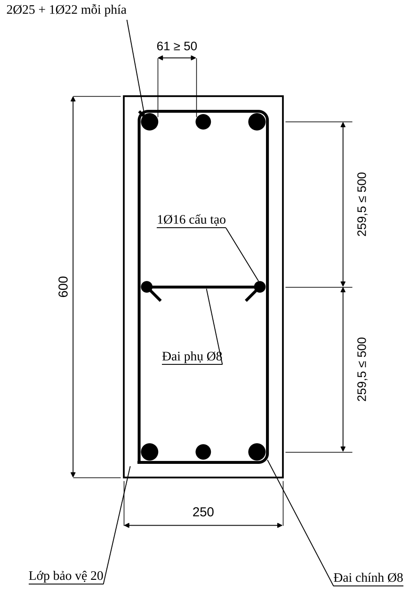{width=7.5cm}

## Bước 10. Kiểm tra khả năng chịu lực của tiết diện đã chọn

### 10a. Trong mặt phẳng uốn (D 6.13)

Với $A_s = A_s'$ **thực chọn**: tính lại $x$ (D 6.19, chính xác) rồi so sánh $Ne$ với khả năng:

$$x = \frac{N + R_s A_s\dfrac{1 + \xi_R}{1 - \xi_R} - R_{sc}A_s'}{R_b b + \dfrac{2R_s A_s}{h_0(1 - \xi_R)}}\ \ \text{(lệch tâm bé)};\quad x = \frac{N}{R_b b}\ \ \text{(lệch tâm lớn)}$$

$$N\,e \ \le\ R_b b x\,(h_0 - 0{,}5x) + R_{sc}A_s'(h_0 - a')\qquad\Longleftrightarrow\qquad \eta M \le M_{gh}$$

với $e = \eta e_0 + 0{,}5h - a$ và $\eta$ **tính lại theo thép thực** ($\mu_t$ thực thay giả thiết). Cột chỉ đạt khi **tất cả** cặp nội lực đều thoả (Bước 11).

::: {custom-style="Vidu"}
$I_s = 2\times 1362\times 260^2 = 1{,}842\times 10^8$ mm⁴ (bỏ qua cốt cấu tạo) → $D = 4{,}645\times 10^{13}$ N·mm², $N_{cr} = 34\,600$ kN, $\eta = 1{,}046$ (khác 1,045 không đáng kể) → $e = 548{,}5$ mm.

$x = \dfrac{1514{,}38\times 10^3 + 435\times 1362\times 2{,}948 - 435\times 1362}{17\times 250 + 2\times 435\times 1362/(560\times 0{,}5066)} = \dfrac{1514{,}38 + 1746{,}8 - 592{,}5}{4{,}250 + 4{,}177}\times 10^3 = 316{,}7$ mm $> \xi_R h_0 = 276{,}3$ ✓ (lệch tâm bé, đúng giả thiết). $\sigma_s = 435\times[2(1 - 0{,}5655)/0{,}5066 - 1] = +311$ MPa (kéo nhẹ, chưa chảy ✓ $|\sigma_s| < R_s$).

$Ne_{gh} = 17\times 250\times 316{,}7\times(560 - 158{,}3) + 435\times 1362\times 520 = 540{,}6 + 308{,}1 = 848{,}7$ kN·m $\ge Ne = 1514{,}38\times 0{,}5485 = 830{,}6$ kN·m ✓ (dùng **97,9%** khả năng). Quy về mô men: $M_{gh} = 454{,}9$ kN·m $\ge \eta M = 436{,}5$ kN·m ✓ (96%).

**Nhận xét hợp lý:** dư 6,8% thép chỉ cho dư $\approx 2\%$ khả năng — đúng với nén lệch tâm bé (khả năng phụ thuộc bê tông nhiều hơn thép); với lệch tâm lớn thì dư thép và dư khả năng gần tỷ lệ với nhau.
:::

### 10b. Ngoài mặt phẳng uốn (nén đúng tâm theo cạnh nhỏ $b$)

Nếu khung dọc (hướng vuông góc) không đủ cứng để giữ cột, kiểm tra cột như cấu kiện nén theo cạnh nhỏ (D 6.3):

$$N \le N_u = \varphi\left(R_b A + R_{sc}A_{s,tot}\right),\qquad A_{s,tot} = \text{toàn bộ thép dọc}$$

$\varphi$ tra **D Bảng 6.1** theo $l_0/b$ (nội suy tuyến tính): B20–B55: 0,92 ($l_0/h = 6$); 0,90 (10); 0,83 (15); 0,70 (20). Giá trị trong bảng dành cho **tải dài hạn** (an toàn); khi chỉ có tải ngắn hạn tra theo luật tuyến tính D 6.3.3 ($\varphi = 0{,}9$ khi $l_0/h = 10$ và $0{,}85$ khi $l_0/h = 20$).

Điều kiện: $l_0/b \le 20$ và độ lệch tâm $e_0 \le b/30$ (D 6.3.3) — nếu có mô men ngoài mặt phẳng đáng kể (cột góc, cột biên chịu dầm dọc) phải tính **nén lệch tâm xiên** (Bước 14b).

::: {custom-style="Vidu"}
$l_0/b = 3640/250 = 14{,}56$ → nội suy giữa 10 (0,90) và 15 (0,83): $\varphi = 0{,}90 - (4{,}56/5)\times 0{,}07 = 0{,}836$. $N_u = 0{,}836\times(17\times 250\times 600 + 435\times 2\times 1362)/1000 = 0{,}836\times(2550 + 1185) = 3123$ kN $\ge N = 1514{,}38$ kN ✓ (dùng 48%).
:::

## Bước 11. Biểu đồ tương tác và kiểm tra mọi cặp nội lực

Biểu đồ tương tác là đường bao các cặp $(M,\ N)$ mà tiết diện chịu được. Tiết diện đạt khi mọi cặp nội lực nằm **trong** đường bao. **Nhân $\eta$ vào $M$ trước khi vẽ điểm nội lực**, vì đường bao được tính khi chưa kể uốn dọc (A không nhân $\eta$; kết quả thiên về không an toàn, ở ví dụ chênh 4,5%).

**Phương trình (A 5.32–5.33, cốt đối xứng; $\sigma_s$ dương = kéo):**

$$N = R_b b x + R_{sc}A_s' - \sigma_s A_s,\qquad M = R_b b x\left(\frac{h}{2} - \frac{x}{2}\right) + R_{sc}A_s'\left(\frac{h}{2} - a'\right) + \sigma_s A_s\left(\frac{h}{2} - a\right)$$

Cho $x$ biến đổi từ $2a'$ đến $h$ (với $x > h$ lấy $x_{bd} = h$ cho bê tông); $M$ lấy đối với **trọng tâm tiết diện**.

$$\sigma_s = \begin{cases} R_s & x \le \xi_R h_0 \\[2pt] R_s\left[\dfrac{2(1 - x/h_0)}{1 - \xi_R} - 1\right],\ \ -R_{sc} \le \sigma_s \le R_s & x > \xi_R h_0\end{cases}$$

**Bảy điểm đặc trưng:**

| Điểm | Vị trí $x$ | $N$ | $M$ | Ý nghĩa |
|:--|:----------|:--------|:--------|:---------------------|
| **A** | – | $N_{max} = \varphi_N\left[R_b(A - A_{s,tot}) + R_{sc}A_{s,tot}\right]$ | 0 | nén đúng tâm ($\varphi_N$ tra D Bảng 6.1 theo $l_0/h$) |
| **D** | $x = 1{,}3\,\xi_R h_0$ | từ công thức | từ công thức | đoạn lệch tâm bé |
| **C** | $x = \xi_R h_0$ | $R_b b\,\xi_R h_0$ | từ công thức | **phá hoại cân bằng**, $M$ lớn nhất |
| **F** | $x = 0{,}5\,\xi_R h_0$ | từ công thức | từ công thức | đoạn lệch tâm lớn |
| **E** | $x = 2a'$ | $2a'R_b b$ | từ công thức | ranh giới thép nén bắt đầu chảy |
| **G** | $x = h_0$ | từ công thức ($\sigma_s = -R_{sc}$) | từ công thức | thép dưới nén đến chảy, điểm trung gian nén lớn |
| **B** | – | 0 | $R_s A_s(h_0 - a')$ | uốn thuần tuý |

**Lưu ý với điểm E của A:** A chọn $x_E = 0{,}2\xi_R h_0 = 55$ mm $< 2a' = 80$ mm — khi đó thép nén **chưa chảy**, công thức dùng $R_{sc}$ cho thép nén làm điểm hơi thiên về không an toàn. Tài liệu này dùng $x_E = 2a'$.

::: {custom-style="Vidu"}
**Cột 22, thép thực $A_s = A_s' = 1362$ mm²** (Bảng tính trên, $R_b = 17$, $R_s = R_{sc} = 435$, $a = 40$):

| Điểm | $x$ (mm) | $\sigma_s$ (MPa) | $N$ (kN) | $M$ (kN·m) | A (bản gốc) |
|:--|--:|--:|--:|--:|:--------|
| A | – | – | 3689 (kể $\varphi_N = 0{,}92$: **3392**) | 0 | 3209 |
| G | 560 | −435 | 3565 | 47,6 | – |
| D | 359 | +181 | 1873 | 401,9 | 1878 / 403,8 |
| **C** | 276 | +435 | **1174** | **498,1** | 1179 / 501,2 |
| F | 138 | +435 | 587 | 443,7 | – |
| E | 80 | +435 | 340 | 396,5 | 236 / 375,2 |
| B | – | – | 0 | 308,1 | 311,1 |

Sai khác với A chỉ ở $a = 40$ (A dùng 37,5 trong biểu đồ) và ở điểm A (A nhân hệ số $\varphi$ theo công thức cũ $1{,}028 - 0{,}0000288\lambda_r^2 - 0{,}0016\lambda_r$; ở đây dùng bảng D 6.1).
:::

{width=12cm}

**Kiểm tra cặp TH12:** điểm $(\eta M,\ N) = (436{,}5;\ 1514{,}4)$ nằm **trong** đường bao (ở $N = 1514$ kN khả năng $M_{gh} = 454{,}9$ kN·m; tỉ số $= 436{,}5/454{,}9 = 0{,}96$). Điểm chưa nhân $\eta$ ($M = 417{,}7$) cho tỉ số $0{,}92$ — chênh 4,5%, đủ lớn để xem là sai nếu hệ số sử dụng gần 1.

**Quy trình kiểm tra tất cả cặp (cho AI Agent):**

1. Với mỗi phần tử cột, lập danh sách mọi cặp $(M_i, N_i)$ của hai đầu cột × mọi tổ hợp; nhân $\eta$ (tính với $N_i$ của từng cặp hoặc lấy $\eta$ lớn nhất cho an toàn).
2. Nội suy $M_{gh}(N_i)$ trên đường bao (đoạn D–C–B).
3. Hệ số sử dụng $k_i = \eta M_i / M_{gh}(N_i)$; đạt khi $\max k_i \le 1{,}0$. Với $N_i > N_{max}$: không đạt.
4. $N_i < 0$ (kéo): chuyển sang tính kéo lệch tâm (Bước 14a).
5. Nếu $\max k_i > 1$: tăng thép hoặc tiết diện; nếu $\max k_i < 0{,}7$: có thể giảm thép/ chuyển sang tầng trên.

## Bước 12. Cốt đai

**Lực cắt trong cột** thường nhỏ khi thiết kế với tổ hợp cơ bản — cốt đai đặt theo **cấu tạo** sau khi kiểm tra điều kiện không cần tính.

### 12a. Điều kiện kiểm tra cắt (A 5.3.2)

$$Q \le Q_{b,min} = 0{,}5\,\varphi_n\,R_{bt}\,b\,h_0\ \ \Rightarrow\ \text{đai cấu tạo}$$

$$Q \le 0{,}3\,R_b\,b\,h_0\ \ \text{(điều kiện ứng suất nén chính, giống dầm)}$$

**Hệ số kể lực dọc $\varphi_n$ (A 5.38):** $\sigma_m = N/A$ (ứng suất nén trung bình, dương; có thể bỏ qua cốt dọc nếu $\mu_t \le 3\%$):

| Điều kiện | $\varphi_n$ |
|:----------------------------|:-------------------------|
| $0 \le \sigma_m \le 0{,}25R_b$ | $1 + \sigma_m/R_b$ |
| $0{,}25R_b < \sigma_m \le 0{,}75R_b$ | $1{,}25$ |
| $0{,}75R_b < \sigma_m \le R_b$ | $5(1 - \sigma_m/R_b)$ |
| Kéo: $0 \le \sigma_t \le R_{bt}$ | $1 - \sigma_t/(2R_{bt})$ |

Nếu $Q > Q_{b,min}$: tính đai như dầm (Chương 7, Bước 11) với $R_{bt}$ được nhân $\varphi_n$ trong các số hạng bê tông.

::: {custom-style="Vidu"}
$\sigma_m = 1514{,}38\times 10^3/(250\times 600) = 10{,}1$ MPa; $0{,}25R_b = 4{,}25$; $0{,}75R_b = 12{,}75$ → $\varphi_n = 1{,}25$. $Q_{b,min} = 0{,}5\times 1{,}25\times 1{,}15\times 250\times 560 = 100{,}6$ kN. Lực cắt chân cột 22 lấy từ ETABS (V2); bậc độ lớn: lực ngang gió tầng 1 $\sum H = 144{,}3$ kN chia cho 5 cột $\approx 29$ kN $\ll 100{,}6$ kN → **đai theo cấu tạo** (đúng như A). $0{,}3R_bbh_0 = 0{,}3\times 17\times 250\times 560 = 714$ kN $\gg Q$ ✓.
:::

### 12b. Cấu tạo cốt đai (D 6.2.1; A 5.4.2; C)

| Hạng mục | Quy định | Nguồn |
|:------------------------------|:-------------------------------------|:-------|
| Đường kính đai | $d_{sw} \ge \max(0{,}25\,d_{max};\ 6\ \text{mm})$ ($d_{max}$ = thép dọc lớn nhất) | D (6 mm), A (5 mm) — dùng **6 mm** |
| Khoảng cách đai ngoài đoạn nối | $s \le \min(15\,d_{min};\ 500\ \text{mm})$ ($d_{min}$ = thép dọc chịu nén **nhỏ nhất**) | D, A |
| Khoảng cách đai trong đoạn nối chồng thép dọc | $s \le \min(10\,d_{min};\ 300\ \text{mm})$ | A |
| Khi hàm lượng thép chịu nén lớn | A: $\mu_t > 3\%$; **D (2018): diện tích thép dọc chịu nén $> 1{,}5\%$** → $s \le \min(10\,d_{min};\ 300)$ | A, D — lấy theo D (chặt hơn) |
| Đai phải bao | **toàn bộ** thép dọc; thanh thép dọc (ít nhất **cách một thanh**) nằm ở **chỗ uốn** của đai | D, A |
| Khoảng cách giữa các chỗ uốn của đai theo cạnh | $\le 400$ mm | D, A |
| Cạnh $\le 400$ mm và $\le 4$ thanh trên cạnh | **cho phép dùng một đai** ôm tất cả | D, A |
| Cạnh $> 400$ mm hoặc $> 4$ thanh/cạnh | thêm **đai phụ** (đai móc, đai chữ U kết hợp) | A hình 5.10 |
| Đường kính đai phụ | $\ge \max(d_{max}/4;\ 5\ \text{mm})$ | A |
| Đai tại **nút khung** và **vùng nối** | không bỏ đai trong nút; đai dày hơn trong chiều cao dầm | B, A (xem Chương 9) |

Các dạng đai phụ theo kích thước tiết diện: xem Hình 9.2 (Chương 9). Bố trí đai quanh đoạn nối và chỗ bẻ khuỷu thép: Hình 9.3, 9.4.

**Quy ước $d_{min}$ khi có cốt cấu tạo:** thanh nhỏ nhất **kể cả cốt cấu tạo** (an toàn nhất, vì thanh nhỏ ổn định kém hơn). Với A không có cốt cấu tạo nên $d_{min} = 25$ mm; ở đây có Ø16 nên $d_{min} = 16$ mm.

::: {custom-style="Vidu"}
**Đai cột 22.** $d_{sw} \ge \max(25/4 = 6{,}25;\ 6) \to$ chọn **Ø8** (CB240-T). Thép dọc chịu nén ở phía bê tông nén: $\mu' = 1362/(250\times 600) = 0{,}91\% < 1{,}5\%$ → áp dụng $15d$ ngoài đoạn nối.

- Ngoài đoạn nối: $s \le \min(15\times 16;\ 500) = 240$ → chọn **s = 200 mm** (A: 350, vì A không đặt Ø16; ở đây $d_{min} = 16$).
- Trong đoạn nối chồng và (để an toàn) **hai đầu cột**: $s \le \min(10\times 16;\ 300) = 160$ → chọn **s = 150 mm**.
- Dạng đai: **1 đai chính Ø8 hình chữ nhật** ôm 6 thanh chịu lực (mỗi cạnh 250 chỉ có 3 thanh, thoả "$\le 4$ thanh") **+ 1 đai phụ Ø8** nối hai thanh Ø16 ở giữa cạnh dài để chỗ uốn theo cạnh 600 cách nhau $\le 400$ (khoảng cách thực 259,5 mm) — xem hình mặt cắt.
:::

## Bước 13. Nối cốt thép, neo, thay đổi thép theo chiều cao

### 13a. Chiều dài nối chồng

Cùng công thức với chiều dài neo (Chương 7, Bước 15) nhưng thay hệ số $\alpha$ bằng $\alpha_{ov}$ (D 3.4.7: nối chồng dùng cho thanh $d \le 40$ mm; **$\alpha = 1{,}2$ chịu kéo, $0{,}9$ chịu nén**). Các trị số dưới cột «nối 100%» và các giá trị tối thiểu $0{,}4\alpha L_{0,an}$, 20$d$, 250 mm **không có trong 4 tài liệu**; được kiểm tra qua nguồn công khai thứ cấp (trích TCVN 5574:2018 mục 10.3.6) — cần đối chiếu bản gốc trước khi đóng dấu hồ sơ:

$$L_{ov} = \alpha_{ov}\,L_{0,an}\,\frac{A_{s,cal}}{A_{s,ef}}\ \ge\ \max\left(0{,}4\,\alpha_{ov}L_{0,an};\ 20\,d;\ 250\ \text{mm}\right)$$

| Thanh nối | Nối so le, $\le 50\%$ trong một tiết diện | Nối 100% một vị trí |
|:--------------|:-------------------:|:-------------------:|
| Chịu kéo (thép gờ, không móc) | $\alpha_{ov} = 1{,}2$ | $2{,}0$ |
| Chịu nén | $\alpha_{ov} = 0{,}9$ | $1{,}2$ |

Nội suy tuyến tính cho tỷ lệ nối trung gian. Thanh $d > 40$ mm không nối chồng (D); thực hành $d \ge 32$ mm nên nối hàn hoặc nối cơ khí (C cũ: không nối chồng $d > 30$ mm, tuyệt đối $> 36$ mm); cốt chịu kéo của cấu kiện **kéo** phải nối hàn/cơ khí (D 7.2).

**Bảng nhanh (CB500-V, B30, $A_{s,cal}/A_{s,ef} = 1$, $L_{0,an} = 37{,}8d$):**

| $d$ (mm) | $L_{0,an}$ | Nén, ≤50% ($0{,}9$) | Nén, 100% ($1{,}2$) | Kéo, ≤50% ($1{,}2$) | Kéo, 100% ($2{,}0$) |
|:--|--:|--:|--:|--:|--:|
| 16 | 605 | 544 | 726 | 726 | 1210 |
| 18 | 680 | 612 | 816 | 816 | 1361 |
| 20 | 756 | 680 | 907 | 907 | 1512 |
| 22 | 832 | 748 | 998 | 998 | 1664 |
| 25 | 945 | 850 | 1134 | 1134 | 1890 |
| 28 | 1058 | 953 | 1270 | 1270 | 2116 |

::: {custom-style="Cu"}
**Tiêu chuẩn cũ (C, TCXDVN 356:2005):** $l_{an} = (\omega_{an}R_s/R_b + \Delta\lambda)\,d$; nối chồng thép gờ: kéo $\omega = 0{,}9$, $\Delta\lambda = 11$, $\lambda_{an} = 20$, $l_{min} = 250$ mm; nén $\omega = 0{,}65$, $\Delta\lambda = 8$, $\lambda_{an} = 15$, $l_{min} = 200$ mm. Tính cho $R_s = 435$, $R_b = 17$: kéo $34{,}0d$; nén $24{,}6d$ — **ngắn hơn** bản 2018 (nén ≤50%: $34{,}0d$; kéo ≤50%: $45{,}4d$). Dùng bản 2018.
:::

### 13b. Vị trí nối và tỷ lệ nối (A, B, C)

| Quy định | Nội dung |
|:---------------------------------|:---------------------------------------|
| Vị trí mối nối | ở **gần mặt sàn** (chân cột mỗi tầng), nơi mô men nhỏ nhất; **không nối trong vùng nút khung** và không nối giữa cột nơi mô men lớn |
| Thanh ≤ 4 thanh trên mỗi cạnh cột | cho phép nối **tại một vị trí** (A) |
| Nhiều hơn 4 thanh/cạnh | nối **so le** tại mặt sàn các tầng hoặc cách tầng; mỗi lần ≤ **50%** diện tích thép; khoảng cách trục hai mối nối kề nhau ≥ $1{,}5L_{an}$ (A) |
| Thép trơn | tại một tiết diện ≤ 25% (B, tiêu chuẩn cũ); thép gờ ≤ 50% |
| Khi $>4$ thanh | không cắt thép ở cùng một chiều cao (B) |
| Hàm lượng tại chỗ nối | $\mu_t \le 8\%$ (D); kiểm tra $\mu_t$ đoạn nối $= (A_{s,tầng\,dưới} + A_{s,tầng\,trên})/A$ |
| Khi tiết diện cột không đổi | trục thép tầng trên và tầng dưới phải trùng đường thẳng → **thép tầng trên bẻ khuỷu** để nối với thép chờ tầng dưới (A hình 5.11a) |
| Khi tiết diện tầng trên nhỏ hơn: $\tan\theta = (h_2 - h_1)/h_d \le 1/6$ | thép tầng dưới **bẻ nghiêng** lên chờ nối với thép tầng trên (không cắt) |
| $\tan\theta > 1/6$ | cắt thép tầng dưới ở mặt dầm, neo vào nút một đoạn $L_{an}$; thép tầng trên chờ riêng (A hình 5.17c) |
| Đai trong đoạn nối | $s \le \min(10d_{min};\ 300)$ (A) |

::: {custom-style="Vidu"}
**Cột 22:** 3 thanh/cạnh ($\le 4$) → nối tại một vị trí ở chân cột tầng trên: thép chờ nhô lên khỏi mặt sàn một đoạn $\ge L_{ov}$ (mạch ngừng bê tông cột ở mặt dưới dầm — A), mối nối nằm ngoài vùng nút. Nối 100% thép chịu nén ($\mu_t = 2{,}08\%$) → $\alpha_{ov} = 1{,}2$: Ø25: $L_{ov} = 1134$ mm → **chọn 1150 mm**; Ø22: $998 \to$ chọn **1000 mm**; thống nhất lấy **1150 mm** cho cả hai để tiện thi công. Hàm lượng tại chỗ nối: $\mu_t = 2\times 2{,}08 = 4{,}2\% \le 8\%$ ✓. Đai trong đoạn nối **Ø8 a150** (đoạn 1150 mm → 8 đai).
:::

### 13c. Thay đổi thép theo chiều cao

- Nội lực giảm dần lên các tầng trên → **giảm thép** tầng trên nhưng **giữ tiết diện**. Nên gom nhóm 2–3 tầng cùng thép (A) để thi công thuận lợi: ví dụ tầng 1–2; 3–4; 5–6.
- Khi giảm thép: giảm **đường kính** trước, giữ số thanh để định vị thuận tiện; hàm lượng tầng trên $\mu_t \approx 1\%$ cho cột nén nhỏ (A).
- Khi giảm tiết diện cột: giảm **cấp bền bê tông** trước (D, A), nếu phải giảm tiết diện thì theo tiêu chí $\tan\theta \le 1/6$ ở trên.

**Neo thép chờ vào móng và thép cột vào dầm tầng mái:** xem Chương 9 (liên kết cột–móng, nút góc tầng mái).

## Bước 14. Trường hợp đặc biệt và bảng thống kê thép cột

### 14a. Cột chịu kéo (lực dọc $N < 0$) — D chương 7

Cột góc, cột biên tầng trên của nhà cao có gió lớn, cột tầng mái nhà công nghiệp, có thể có tổ hợp $N < 0$.

| Trường hợp | Điều kiện | Công thức kiểm tra |
|:----------------------|:----------------------|:---------------------------------------------|
| Kéo đúng tâm | $e_0 = 0$ | $N \le R_s A_{s,tot}$ (D 7.1) |
| Kéo lệch tâm bé | $e_0 = M/N \le 0{,}5h - a$ | $Ne \le R_s A_s'(h_0 - a')$; $Ne' \le R_s A_s(h_0 - a')$ với $e = 0{,}5h - e_0 - a$; $e' = 0{,}5h + e_0 - a'$ (D 7.4–7.7) |
| Kéo lệch tâm lớn | $e_0 > 0{,}5h - a$ | $Ne \le R_b b x(h_0 - 0{,}5x) + R_{sc}A_s'(h_0 - a')$; $N = R_s A_s - R_b b x - R_{sc}A_s'$; điều kiện $2a' \le x \le \xi_R h_0$ (D 7.3, 7.8) |

Cấu tạo: $\mu, \mu' \ge \mu_{min} = 0{,}1\%$; $\mu_t \ge 2\mu_{min}$ (D 7.2); thép dọc chịu kéo phải **nối hàn hoặc nối cơ khí** (ống ren, ép dập), **không nối chồng**; neo chắc chắn ở hai đầu; cốt đai ngang bố trí cấu tạo, khoảng cách $\le 500$ mm; kéo lệch tâm lớn có thép nén thì đai phải theo yêu cầu cột nén.

### 14b. Nén lệch tâm xiên và cột góc

Khung phẳng chỉ cho $M_x$ (trong mặt phẳng khung). Cột góc/cột biên của khung không gian chịu $M_x$ và $M_y$ cùng lúc: **không có công thức tính tay đơn giản trong D** — D 6.5.6 dùng **mặt tương tác $N$–$M_x$–$M_y$** (hình 6.15–6.16) tính bằng phần mềm. Quy trình thực hành: (1) lấy $N$, $M_x$, $M_y$ cùng tổ hợp từ mô hình không gian; (2) kiểm tra bằng phần mềm (ETABS/SAP Section Designer, PCACOL…) hoặc (3) nếu một phương $M$ rất nhỏ thì tính theo phương lớn và kiểm tra phương kia theo Bước 10b.

### 14c. Cột nén đúng tâm (D 6.3)

Chỉ khi $e_0 \le h/30$ và $l_0/h \le 20$ (hiếm trong khung):

$$A_{s,tot} = \frac{N/\varphi - R_b A}{R_{sc}}\qquad (\text{D 6.4}),\qquad N_u = \varphi(R_b A + R_{sc}A_{s,tot})\qquad (\text{D 6.3})$$

### 14d. Các điều kiện còn lại cần kiểm tra

- $N > N_{max}$ (điểm A của biểu đồ tương tác): **tăng tiết diện hoặc cấp bền bê tông**, không tăng thép.
- Cột có $\lambda_h > 25$ hoặc $\lambda > 120$: quá mảnh → tăng tiết diện hoặc thêm dầm giằng.
- Kiểm tra **bề rộng khe nứt** của cột nén lệch tâm (D, phần tính nứt: $\varphi_3 = 1{,}0$ cho uốn và nén lệch tâm) chỉ khi độ lệch tâm lớn và tiêu chuẩn yêu cầu.
- Cột chịu **lực cắt lớn** (cột ngắn, khung có tường chèn): tính đai như dầm (Bước 12a).
- Tầng 1 **có chiều cao lớn** hơn tầng điển hình: tính $l_0$ riêng (A: $l = 5{,}2$ m); kiểm tra lại $\lambda_b$ và $\eta$.

### 14e. Bảng thống kê thép cột (mẫu)

| Cột | Tầng | Tiết diện | Cặp $M$ (kN·m) / $N$ (kN) | $A_{s,tt}$ (mm²) | Thép dọc mỗi phía | Cấu tạo cạnh dài | $\mu_t$ (%) | Đai (ngoài nối / nối) | $k_{max}$ |
|:--|:--:|:--:|:--------------|:--:|:------------|:------|:--:|:------------|:--:|
| 22 | 1 | 250×600 | 417,74 / 1514,38 | 1275 | 2Ø25+1Ø22 (1362) | 1Ø16 mỗi cạnh | 2,08 | Ø8a200 / Ø8a150 | 0,96 |
| *Các cột khác* | … | … | … | … | … | … | … | … | … |

**Kiểm tra cuối của cột (checklist 12 điểm):**

1. $\lambda_b \le 31$ ($35$ theo A cũ) và $\lambda \le 120$.
2. $\eta$ tính với $\mu_t$ thực; $N < N_{cr}$.
3. $x$ và loại lệch tâm xác định đúng; kết quả $A_s$ có dấu dương, $\ge A_{s,min}$.
4. $\mu_{min}(\lambda) \le \mu \le 3\%$ mỗi phía; $\mu_t \le 4\%$ ($8\%$ tại chỗ nối).
5. $d \in [12;\ 40]$; hiệu đường kính $\le 6$ mm; $\le 3$ loại.
6. Khoảng hở $\ge \max(d;\ 50)$; $a$ thực $\approx a$ giả thiết ($\pm 5$ mm).
7. Khoảng cách tim thép: $\le 400$ (⊥) và $\le 500$ (//); cốt cấu tạo khi $h > 500$.
8. Mọi cặp $(\eta M,\ N)$ nằm trong biểu đồ tương tác; $k_{max} \le 1$.
9. Kiểm tra ngoài mặt phẳng $N \le N_u$.
10. Đai: $d_{sw} \ge \max(d_{max}/4;\ 6)$; $s \le 15d_{min}$ / $10d_{min}$ (nối); đai phụ khi cần; $Q \le 0{,}3R_bbh_0$.
11. Mối nối: vị trí, % thép, $L_{ov}$, đai trong đoạn nối.
12. Nút khung và neo vào móng: xem Chương 9.

::: {custom-style="Canhbao"}
**Lỗi thường gặp ở thép cột.** (1) Quên nhân $\eta$ vào $M$; (2) dùng $l_0 = H$ thay vì $0{,}7H$ (hoặc quên cộng đoạn ngàm ở tầng 1); (3) chọn thép đối xứng nhưng chỉ kiểm tra một cặp nội lực; (4) $e_a$ lấy theo $l_0$ thay vì $l$; (5) $a$ thực khác $a$ giả thiết hơn 5 mm mà không tính lại; (6) bỏ cốt cấu tạo khi $h > 500$; (7) đai ngoài đoạn nối lấy $15d$ theo thanh lớn nhất thay vì thanh **nhỏ nhất**; (8) $\mu_t > 3{-}4\%$ ở chỗ nối mà không kiểm tra; (9) cột góc chỉ tính theo một phương.
:::


\newpage

# CHƯƠNG 9. YÊU CẦU CẤU TẠO CỐT THÉP

::: {custom-style="Ghichu"}
**Nguồn và thứ bậc.** Quy định chung: D (TCVN 5574:2018, mục 3.4, 4.1, 6.2) và A (mục 5.4, hình 5.4–5.20). Cấu tạo nút khung và cột–móng: A, B (hình 3.9–3.15) — B dựa trên TCVN 5574:1991 nên các **trị số** của B gắn cờ *tiêu chuẩn cũ*. Nhà chịu động đất: B (theo Eurocode 8) chỉ để tham khảo; thiết kế kháng chấn thật phải theo **TCVN 9386:2012** (tra thêm — không nằm trong 4 tài liệu). Chương này là phần **không được bỏ sót**: tính đúng $A_s$ mà cấu tạo sai vẫn là thiết kế sai.
:::

## 9.1. Bảng tổng hợp nhanh các con số cấu tạo

| Nhóm | Hạng mục | Giá trị | Nguồn |
|:--|:--------------------------|:--------------------------------------|:------|
| Lớp bảo vệ | Trong nhà, độ ẩm ≤ 75% | **20 mm** | D Bảng 3.1; A |
| | Trong nhà, độ ẩm > 75% | 25 mm | D Bảng 3.1 |
| | Ngoài trời | **30 mm** | D, A |
| | Trong đất, móng có lớp lót | 40 mm | D |
| | Giới hạn thêm | $\ge d$ và $\ge 10$ mm; kiểm tra chống cháy | D 3.4.4 |
| Khoảng hở | Thép đáy dầm (1–2 lớp, nằm ngang) | $\ge \max(d;\ 25)$ mm | D 3.4.5 |
| | Thép lớp trên dầm | $\ge \max(d;\ 30)$ mm | D |
| | Thép từ 3 lớp trở lên, hoặc thanh đặt đứng khi đổ bê tông (**cột**) | $\ge \max(d;\ 50)$ mm | D |
| Dầm | Đường kính cốt chịu lực | 12–32 mm | D 4.1.1; A |
| | $b < 150$: số thanh | ≥ 1; $b \ge 150$: ≥ **2 thanh** | D |
| | Cốt cấu tạo (giá) | Ø10–14 | D |
| | Cốt giá phụ cạnh bên | khi $h > 700$ mm; tổng $\ge 0{,}1\%\,b'h'$, $b' = \min(0{,}5b;\ 200)$, $h' \le 400$ | D |
| | Đai | Ø6–10; $h \ge 800$: Ø8 trở lên | D |
| | Cốt xiên | 30° ($h<400$), 45° ($400\le h\le 800$), 60° ($h>800$) | D |
| | Tỉ lệ $h/b$ | 2–4; $h = (1/8 \div 1/20)L$ | D, C |
| Bản | Đường kính | 6–12 mm; khoảng cách $\le 200$ ($h_b<150$), $\le 1{,}5h_b$ ($h_b\ge 150$); $\ge 70$ mm | D 4.1.2 |
| | Cốt phân bố | Ø6–8, $\ge 10\%$ cốt chịu lực; khoảng cách 250–300, $\le 350$ mm | D |
| Cột | Đường kính cốt dọc | 12–40 mm | D 6.2.1 |
| | Khoảng cách tim thép dọc | ⊥ mặt phẳng uốn $\le 400$; trong mặt phẳng uốn $\le 500$ | D, A |
| | Đai | $d_{sw}\ge\max(d/4;\ 6)$; $s\le\min(15d;\ 500)$; nối hoặc $\mu'>1{,}5\%$: $\min(10d;\ 300)$ | D, A |
| | $\mu_{min}$, $\mu_{max}$ | 0,10–0,25% (nội suy theo $l_0/h$); 4% (8% tại chỗ nối) | D |
| Neo | $L_{an} = \alpha L_{0,an}A_{s,cal}/A_{s,ef}$ | $\ge \max(15d;\ 200;\ 0{,}3L_{0,an})$; $\alpha = 1{,}0$ kéo, $0{,}75$ nén | D 3.4.6; A |
| Nối chồng | $L_{ov} = \alpha_{ov}L_{0,an}A_{s,cal}/A_{s,ef}$ | $\alpha_{ov} = 1{,}2$ kéo; $0{,}9$ nén; thanh $d \le 40$ mm | D 3.4.7 |
| Uốn cong | Bán kính uốn thanh dọc | $r \ge 5d$ ($d < 20$); $r \ge 8d$ ($d \ge 20$) | A (B cũ: $r\ge 10d$) |

## 9.2. Lớp bảo vệ bê tông

**Định nghĩa (D 3.4.4):** chiều dày lớp bê tông từ **mặt ngoài cùng** của bê tông đến mép **gần nhất** của cốt thép (kể cả cốt đai). Lớp bảo vệ vừa bảo vệ chống ăn mòn, chống cháy, vừa bảo đảm lực dính.

**Bảng 3.1 của D (điều kiện làm việc của kết cấu nhà → chiều dày tối thiểu):**

| Điều kiện | Lớp bảo vệ tối thiểu (mm) |
|:------------------------------------------------|:--:|
| Trong các gian phòng được che phủ, độ ẩm bình thường và thấp ($\le 75\%$) | 20 |
| Trong các gian phòng được che phủ, độ ẩm cao ($> 75\%$), không có biện pháp bảo vệ bổ sung | 25 |
| Ngoài trời, không có biện pháp bảo vệ bổ sung | 30 |
| Trong đất (không có biện pháp bảo vệ bổ sung); trong móng có lớp bê tông lót | 40 |

**Quy tắc thực hành:**

1. Với cốt dọc chịu lực: $C \ge \max(d;\ 10\ \text{mm};\ \text{giá trị Bảng 3.1})$. Với $d = 32$ thì $C \ge 32$ mm kể cả khi bảng cho 20 mm.
2. Cốt đai: lớp bảo vệ của đai cũng không nhỏ hơn bảng trên; vì đai nằm ngoài, **lớp bảo vệ của cốt dọc = $C_{đai} + d_{đai}$** (ví dụ $20 + 8 = 28$ mm).
3. Dầm, cột trong nhà thông thường: lấy **$C = 20$ mm** đến mặt đai; $a = 20 + 8 + d/2$ (dầm 1 hàng $\approx 40$–45 mm, hai hàng $\approx 65$–70 mm).
4. Sàn mái, ban công, dầm ngoài trời, sê nô: **30 mm** (hoặc 25 nếu có lớp chống thấm bảo vệ — tra thiết kế).
5. Móng, dầm giằng móng, cột chôn đất: 40 mm; không có lớp lót bê tông thì phải tăng (tra TCVN 5574:2018 mục 10.3.2 và tiêu chuẩn chống cháy).

::: {custom-style="Cu"}
**Tiêu chuẩn cũ (C, TCXDVN 356:2005):** cốt chịu lực — bản $h\le 100$: 10 (15); $h > 100$: 15 (20); dầm $h<250$: 15 (20), $h \ge 250$: 20 (25); cột 20 (25); dầm móng 30; móng lắp ghép 30, móng toàn khối có lót 35, không lót 70. Cốt đai: dầm $h<250$: 10 (15); $h\ge 250$: 15 (20). (Giá trị trong ngoặc cho điều kiện ngoài trời/độ ẩm cao.) **Bản 2018 chặt hơn đối với bản sàn mỏng (20 mm thay vì 10–15 mm)**; dùng bản 2018.
:::

## 9.3. Khoảng hở thông thủy và bố trí thép trên tiết diện

**Khoảng hở $t$ giữa hai thanh liền kề** (D 3.4.5; A hình 5.4): $t \ge d_{max}$ (đường kính thanh lớn nhất) và không nhỏ hơn:

| Vị trí | Điều kiện đổ bê tông | $t_{min}$ (mm) |
|:------------------------------|:------------------------|:--:|
| Phía **dưới** tiết diện, 1 hoặc 2 lớp | thanh nằm ngang hoặc nghiêng | **25** |
| Phía **trên** tiết diện, 1 hoặc 2 lớp | thanh nằm ngang hoặc nghiêng | **30** |
| Phía dưới, từ **3 lớp trở lên** (trừ hai lớp cuối) | thanh nằm ngang hoặc nghiêng | **50** |
| Thanh đặt **theo phương đứng** khi đổ bê tông (**cột**) | đứng | **50** |

**Khoảng cách giữa các lớp thép dầm** (A hình 5.4): $t_0 \ge \max(d;\ 25)$ theo phương đứng; thanh lớp trên của hàng sau đặt **ngay trên** thanh hàng dưới (không so le, trừ khi tính lại $a$).


{width=11cm}

**Bố trí nhiều hàng:** thanh đường kính lớn đặt **xa trục trung hoà hơn** (hàng ngoài cùng, cách mép chịu kéo nhỏ nhất) — A; **đường kính các thanh trong cùng một miền chịu lực chênh nhau $\le 6$ mm**; một dầm **không quá 3 loại đường kính** cho cốt chịu lực; **tránh dùng hai loại đường kính chênh nhau 1–2 mm** (dễ nhầm tại công trường).

**Số thanh tối đa trên một hàng** của dầm — xem Chương 7 (Bước 8). Quy tắc nhanh: $b \ge 2C_{đai} + 2d_{đai} + n\,d + (n - 1)\,t_{min}$.

**Cặp thanh (không có khe hở):** C cho phép ghép hai thanh sát nhau khi bó thanh, với $t \ge 1{,}5d$ giữa các cặp (cũ). Tài liệu này **không dùng** bó thanh; chỉ dùng thanh đơn có khe hở theo D.

## 9.4. Cấu tạo dầm khung

### 9.4.1. Cốt dọc

- **Cốt chịu lực** Ø12–Ø32; tại một tiết diện ít nhất **2 thanh** khi $b \ge 150$ mm (D); thanh góc đặt tại góc đai để định vị.
- **Cốt cấu tạo phía nén (cốt giá):** Ø10–14 chạy suốt chiều dài dầm (hoặc $\ge 2$ thanh Ø12 mặt trên và mặt dưới suốt chiều dài — B/EC8, khi chịu động đất).
- **Cốt giá phụ cạnh bên** khi $h > 700$ mm (D; C: $h > 700$): tổng diện tích $\ge 0{,}1\%\,b'h'$ với $b' = \min(0{,}5b;\ 200\ \text{mm})$, $h'$ là khoảng cách giữa các lớp giá phụ ($\le 400$ mm khi $h > 1000$). Chức năng: chịu co ngót, chênh lệch nhiệt, giữ khung thép khi đổ bê tông. Với dầm CB 250×700 ($h = 700$ — **bằng** giới hạn): nên đặt 2Ø12 cấu tạo ở giữa chiều cao (A không đặt; để an toàn đặt khi $h \ge 700$).
- **Thép dọc gối** chạy qua nút và neo vào cột; nhịp thì chạy suốt hoặc cắt theo hình bao vật liệu (xem Chương 7, Bước 14).
- **Tối thiểu 1/4 thép chịu lực đầu mút phía trên chạy suốt chiều dài dầm** (B/EC8 — tham khảo; ACI: $\ge 1/3$ thép gối kéo dài quá điểm uốn một đoạn $\max(d;\ 12d_s;\ L_n/16)$ và $\ge 1/4$ thép nhịp kéo vào gối).

### 9.4.2. Cốt đai và cốt xiên

- Ø đai: **6–10 mm**; $h \ge 800$ mm thì Ø $\ge 8$ (D); số nhánh đai theo $b$ (2 nhánh khi $b \le 350$; 3–4 nhánh khi $b > 350$ hoặc lực cắt lớn) — tra thiết kế.
- Khoảng cách đai: $s_{ct}$ ở đoạn gần gối $L/4$: $s \le \min(h/2\ \text{hoặc}\ h_0/2;\ 300)$ khi $h \le 450$ mm / $h > 450$: $\min(h/3;\ 500)$ — xem Bảng cấu tạo ở Chương 7 (Bước 11d). Đoạn giữa nhịp: $s \le \min(3h/4;\ 500)$.
- **Đai kín**, móc đai uốn 135° (kháng chấn) hoặc 90° cắm đủ vào lõi bê tông.
- **Cốt xiên:** góc nghiêng 30°/45°/60° theo $h$; thường tạo bằng cách **uốn cốt dọc nhịp** lên gối; điểm cuối uốn nằm trong vùng nén hoặc neo đủ $\ge 20d$ ở vùng nén ($\ge 10d$ nếu hàn hai phía).
- **Cốt treo/giật đứt** tại chỗ dầm phụ gác lên dầm chính: bố trí **trong phạm vi $S = b_{dp} + 2h_s$** hai bên dầm phụ — xem Chương 7, Bước 13.

### 9.4.3. Dầm console và dầm biên

- Console ($L \le 1{,}5$ m): thép gối trên neo vào dầm khung $\ge L_{an}$ kể từ mặt cột/dầm; mặt dưới chỉ cần thép cấu tạo; **đai dày ở sát ngàm**.
- Dầm biên chịu tải lệch tâm của sàn/console: **xoắn** — xem Chương 7, Bước 16a; khi $T$ nhỏ thì đai kín thông thường là đủ.

## 9.5. Neo, nối, uốn cốt thép

### 9.5.1. Chiều dài neo $L_{an}$

Công thức và bảng $L_{0,an}$ xem **Chương 7, Bước 15** ($L_{0,an} = 37{,}8d$ cho CB500-V, B30). Điều kiện bổ sung của D 3.4.6:

- $L_{an} \ge \max(15d;\ 200\ \text{mm};\ 0{,}3L_{0,an})$ trong mọi trường hợp.
- Cốt thép **tròn trơn** chịu kéo **phải có móc** (chữ U hoặc chữ L, hình 3.9 của D); cốt **có gờ** **không** cần móc vì lực dính đã đủ (nếu có uốn móc thì $L_{an}$ giảm bớt, **giảm không quá 30%** — tra TCVN 5574:2018 mục 10.3.5).
- Hệ số $\eta_1$ = 1,5 (thép trơn), 2,0 (cán nguội có gờ), 2,5 (cán nóng có gờ); $\eta_2$ = 1,0 khi $d \le 32$, 0,9 khi $d > 32$ (D 3.39; **D in "0,9 khi $d<32$" là lỗi in**).

### 9.5.2. Nối cốt thép

| Cách nối | Quy định | Nguồn |
|:----------------|:---------------------------------------------------------|:---|
| **Nối chồng** (buộc) | dùng cho $d \le 40$ mm; $L_{ov} = \alpha_{ov}L_{0,an}A_{s,cal}/A_{s,ef}$, $\alpha_{ov} = 1{,}2$ kéo, $0{,}9$ nén (nối so le ≤ 50%); xem Bước 13a Chương 8 | D 3.4.7 |
| **Hàn đối đầu** | ép hai đầu, cho dòng điện lớn; chủ yếu trong nhà máy | D |
| **Hàn chập** | hai thanh sát nhau, chập đoạn $l_h = 5d$ (hàn hai phía) hoặc $10d$ (hàn một phía) | D |
| **Hàn máng** | đặt hai đầu vào lòng thép chữ U, khe $\ge 1$ mm | D |
| **Ống ren (coupler)** | tạo ren đầu thanh, vặn vào ống; kiểm tra bằng cờ lê lực | D |

**Tỷ lệ nối trong một tiết diện:**

- Thép gờ chịu kéo: $\le 50\%$ diện tích thép; thép trơn: $\le 25\%$ (B cũ); khi nối 100%, hệ số $\alpha_{ov}$ tăng (Bước 13a Chương 8).
- Cột có $>4$ thanh trên một cạnh: **không cắt/nối ở cùng một chiều cao**; cột chỉ có 4 thanh cho phép nối tại một tiết diện (B, A).
- Khoảng cách trục hai mối nối kề nhau (so le) $\ge 1{,}5L_{an}$ (A).

**Vị trí nối (thực hành, không nằm trong 4 tài liệu; áp dụng khi không có yêu cầu riêng của dự án):**

| Cấu kiện | Vị trí nối nên chọn | Không nối ở |
|:--------------|:------------------------------|:---------------------------|
| Thép **dưới** dầm | gần gối (vùng mô men dương nhỏ nhất) | giữa nhịp |
| Thép **trên** dầm | giữa nhịp (vùng mô men âm nhỏ nhất) | gần gối, trong nút |
| Thép cột | trên mặt sàn, ngoài vùng nút | trong nút; vùng có mô men lớn |

### 9.5.3. Uốn cong và móc

| Hạng mục | Quy định | Nguồn |
|:------------------------------|:----------------------------------------------|:----|
| Bán kính trong của gối uốn cốt chịu lực | $r \ge 5d$ khi $d < 20$ mm; $r \ge 8d$ khi $d \ge 20$ mm | A (hình 5.13) |
| Bán kính uốn (cũ) | $r \ge 10d$ | B (TCVN 5574:1991) |
| Đoạn thẳng sau chỗ uốn | $\ge 5d$ (đầu nhánh) | thực hành |
| Chỗ uốn cong của cốt thép trong đoạn neo | **cốt đai phụ đặt $\le 100$ mm** để gia cường | B |
| Thép dầm uốn xuống cột (nút góc) | đoạn thẳng đứng sau uốn $\ge L_{an}$ | A, B |

## 9.6. Cấu tạo cột

Xem đầy đủ ở **Chương 8** (Bước 9, 12, 13). Tóm tắt các điểm thường bị bỏ sót:

1. **Cạnh trong mặt phẳng uốn $h > 500$ mm** → bắt buộc thanh cấu tạo giữa cạnh dài (khoảng cách tim $\le 500$).
2. Mọi thanh dọc **cách một thanh** phải nằm ở chỗ uốn của đai, và các chỗ uốn cách nhau $\le 400$ mm; cạnh $> 400$ mm hoặc $> 4$ thanh/cạnh phải có đai phụ (hình 5.10 A, xem Hình 9.2; hình 3.5 B: khi $\mu > 3\%$ **mọi** thanh dọc phải được giằng bằng đai hoặc thanh giằng).
3. Đai **không được cắt** trong nút khung; trong đoạn nối chồng $s \le 10d_{min}$ và $\le 300$.
4. Tiết diện thay đổi: $\tan\theta = (h_2 - h_1)/h_d \le 1/6$ thì bẻ nghiêng thép; lớn hơn thì cắt và neo (A hình 5.17).
5. Hàm lượng thép tổng: $\mu_t \ge 2\mu_{min}$ khi thép đặt quanh chu vi; $\le 4\%$ ($8\%$ tại chỗ nối).
6. Chân cột: thép chờ từ móng, diện tích và số thanh **bằng** thép cột tầng 1 (A hình 5.19); đai trong móng đặt theo cấu tạo, ít nhất 2 đai ở đầu thép chờ (B).

{width=16cm}

{width=13cm}

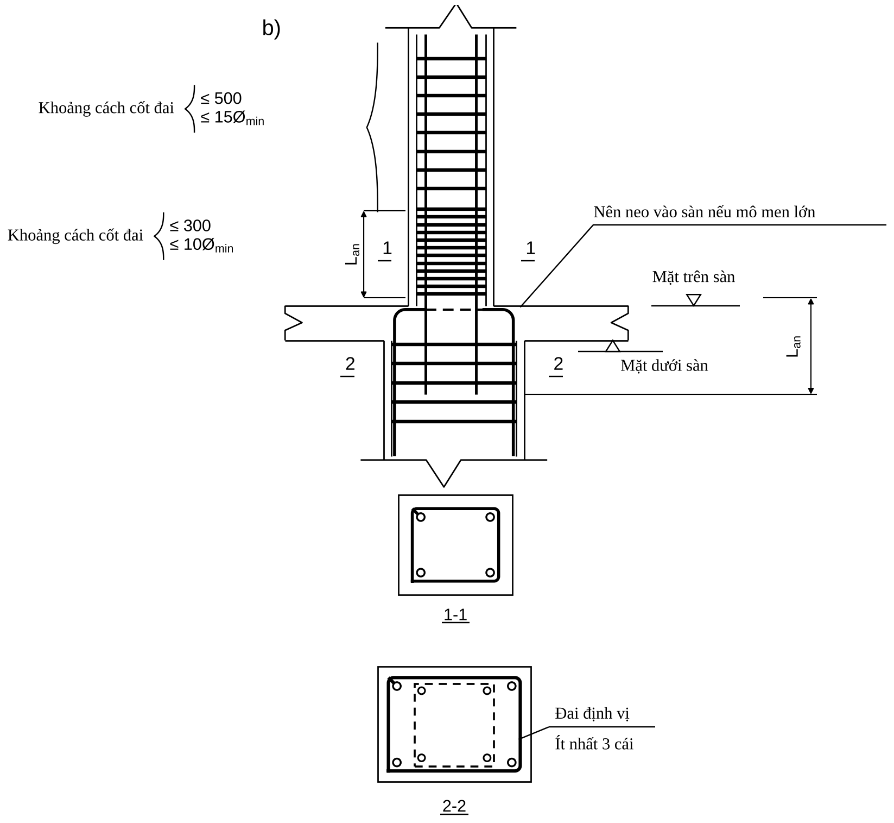{width=13cm}


## 9.7. Cấu tạo nút khung

**Nguyên tắc chung (A 5.4.3; B):** nút khung phải (i) neo đủ $L_{an}$ cho **mọi** thanh quy tụ về nút, thanh kéo phải được neo vào vùng bê tông chịu nén; (ii) tránh tập trung quá nhiều thép; (iii) đủ khoảng hở thi công, đầm bê tông; (iv) **mạch ngừng bê tông cột đặt ở mặt dưới dầm**; (v) bê tông vùng nút bị ép cục bộ → phải có đai.

### 9.7.1. Nút góc tầng mái (nút đóng — mô men đầu dầm làm nút nén)

Cấu tạo phụ thuộc $e_0/h$ tại đầu cột ($e_0 = M/N$ của cột tại nút, $h$ chiều cao tiết diện cột):

| $e_0/h$ | Cấu tạo | Hình |
|:------------|:-------------------------------------------------------|:------|
| $\le 0{,}25$ | Thép kéo dầm kéo ra sát mặt ngoài cột và **uốn xuống một đoạn $L_{an}$**; đai cột đặt đến dưới mặt dưới sàn; đai dầm bắt đầu cách mép trong cột 50 mm | A 5.13a; B 3.9a |
| $0{,}25 < e_0/h \le 0{,}5$ | Như trên **và** ít nhất **2 thanh** thép dầm kéo xuống quá đáy dầm một đoạn $L_{an}$ | A 5.13b; B 3.9b |
| $> 0{,}5$ | Một số thanh thép cột phải **kéo lên mép trên dầm** đồng thời một số thanh thép dầm neo sâu vào cột; thép kéo dầm kéo xuống quá đáy dầm $L_{an}$; **không cắt quá 2 thanh trên cùng một tiết diện**, các tiết diện cắt cách nhau $30d$ (B); hoặc mở rộng nút bằng **nách khung** | A 5.13c, d; B 3.9c |


{width=15.5cm}

{width=15.5cm}

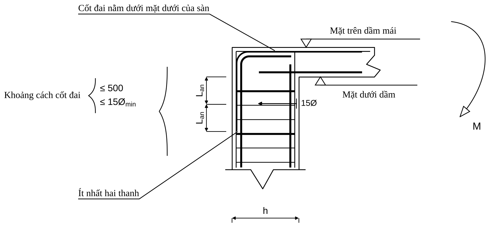{width=15.5cm}

{width=16cm}

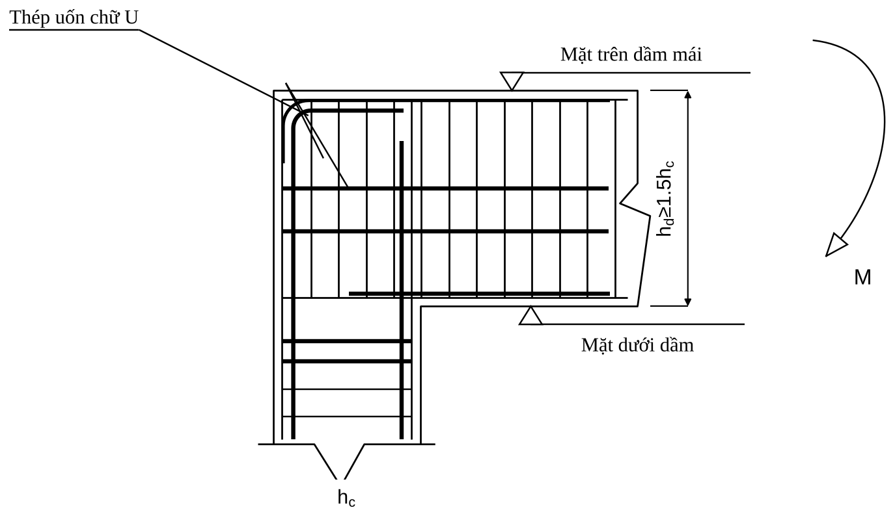{width=14cm}

**Nách khung (B):** chiều dài nách $\ge 1/10$ nhịp; chiều cao nách $\le 0{,}4h_{xà}$; độ dốc từ **1:3 trở lên** thì có hiệu quả; dọc mép nách đặt cốt cấu tạo.

**Điều kiện bổ sung (A, TCVN 5574:2018 mục 10.4.11):** khi chiều cao dầm $> 1{,}5$ chiều cao cột, đặt **đai kín hoặc đai chữ U** trong vùng nút mở rộng để tăng khả năng neo (hình 5.13e).

**Bán kính uốn:** $r \ge 5d$ ($d<20$); $r \ge 8d$ ($d \ge 20$) — tăng $r$ để truyền lực vào bê tông bên trong nút (A). Chỗ uốn có đai phụ $\le 100$ mm (B).

::: {custom-style="Vidu"}
**Nút góc mái — cột 17 và dầm 50 (A).** Theo A: $e_0 = M/N = 575$ mm *(số $M$, $N$ A in không khớp $e_0$ — xem mục 11.5)*; $h = 600$ mm → $e_0/h = 0{,}96 > 0{,}5$ → áp dụng trường hợp **c**.

Thép dầm tại nút (thép cột trục D, dầm mái): $A_{s,cal} = 297$ mm²; thép chọn 2Ø16 ($A_{s,ef} = 402$ mm²). $L_{0,an} = 435\times 201{,}1/(2{,}875\times\pi\times 16) = 605$ mm (với $R_{bond} = 2{,}5\times 1{,}0\times 1{,}15 = 2{,}875$ MPa);

$$L_{an} = 1{,}0\times 605\times\frac{297}{402} = 447\ \text{mm} \ \ge \max(15\times 16;\ 200;\ 0{,}3\times 605) = \max(240;\ 200;\ 182)$$

→ **chọn $L_{an} = 450$ mm** (A chọn 700 vì dùng $R_{bt} = 0{,}75$ thay cho 1,15 — xem phụ lục B). Thép dầm uốn xuống cột một đoạn $\ge 450$ mm, $r \ge 5d = 80$ mm ($d = 16 < 20$); đai cột chạy đến sát đáy dầm, đai dầm bắt đầu cách mép trong cột 50 mm.
:::

### 9.7.2. Nút góc tầng mái chịu kéo (nút mở — mô men đầu dầm làm nút kéo)

Ứng suất kéo tập trung ở góc nút và lan vào giữa nút → nứt chéo (A hình 5.14). Cấu tạo (A hình 5.15):

- Hàm lượng thép dọc dầm $\mu < 2\%$: dạng hình 5.15a (Hình 9.6a); $\mu \ge 2\%$: dạng hình 5.15b (Hình 9.6b) — theo A.
- Thép chịu kéo của dầm và cột uốn dạng **chữ U**, bán kính uốn tùy kích thước nút.
- Đặt thêm **thanh thép chéo gia cường** có diện tích $\approx 20\%$ thép chịu lực đầu dầm.

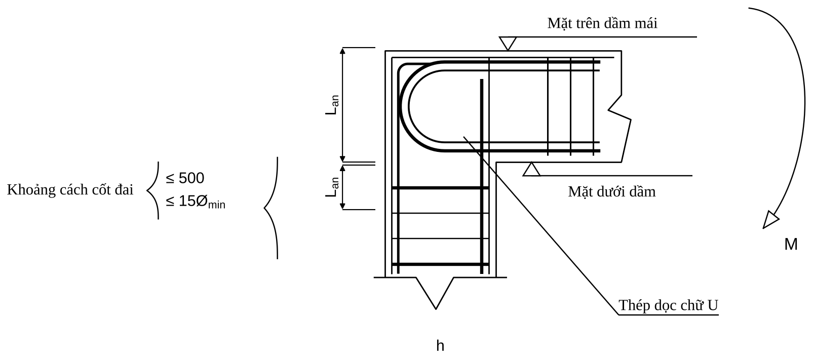{width=15.5cm}

{width=15.5cm}


### 9.7.3. Nút giữa tầng mái

Thép dọc của cột phải **kéo lên trên mặt dầm một đoạn $L_{an}$** (A hình 5.16); thép dầm tại nút giữa chạy qua hoặc neo $\ge L_{an}$ vào cột; đai cột dày hơn tại nút nếu có.

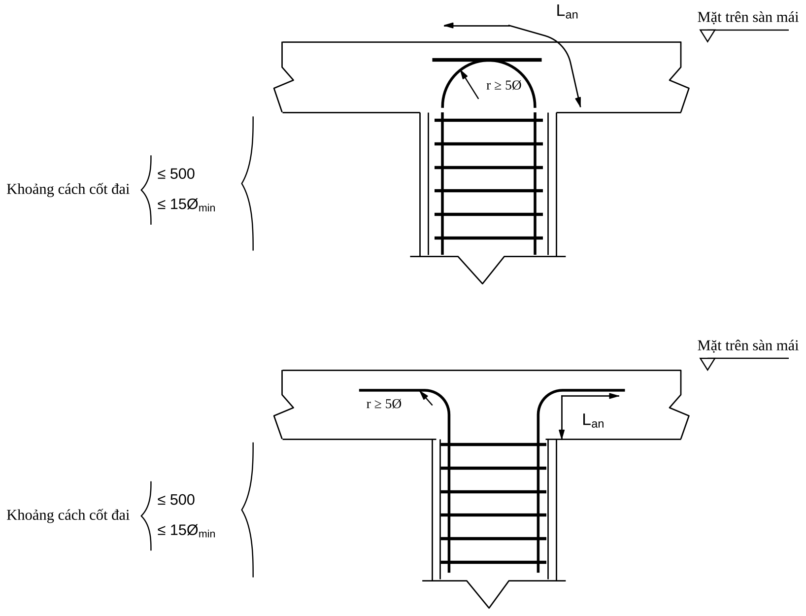{width=14cm}


### 9.7.4. Nút biên tầng trung gian

| Điều kiện | Cấu tạo | Hình |
|:----------------------------|:---------------------------------------------------|:------|
| Tiết diện cột trên = cột dưới | thép cột liên tục qua nút; thép dầm uốn xuống/lên neo $\ge L_{an}$ | A 5.17a |
| Cột trên nhỏ hơn cột dưới, $\tan\theta = (h_2 - h_1)/h_d \le 1/6$ | thép cột dưới **bẻ nghiêng** lên chờ nối với thép cột trên | A 5.17b |
| $\tan\theta > 1/6$ | thép cột dưới **kéo lên mặt dầm, neo một đoạn $L_{an}$** rồi cắt; thép cột trên có thép chờ riêng | A 5.17c |
| Chiều cao dầm hai bên khác nhau | neo sâu thép dầm vào nút | A 5.18 |


{width=14.5cm}

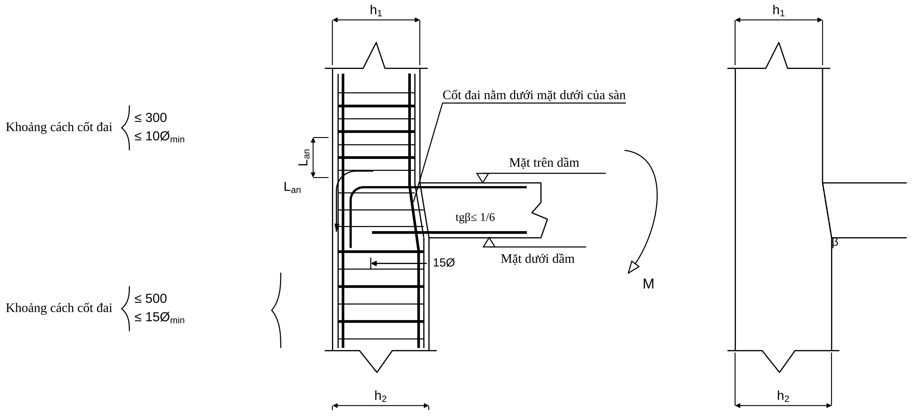{width=16cm}

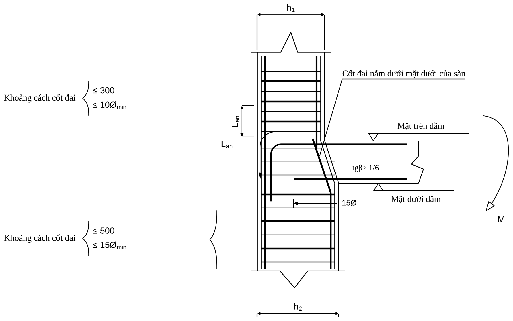{width=14.5cm}

Thép kéo của xà ngang phải neo trong cột một đoạn $L_{an}$; **thép dầm không cần kéo dài hết cột**, được cắt/uốn theo biểu đồ mô men như dầm liên tục (B 3.10). **Ngay tại nút, trong chiều cao dầm, vẫn phải có đai** để giữ ổn định thép dọc cột (B).

### 9.7.5. Nút giữa tầng trung gian

Thép dọc dầm có thể **chạy liên tục qua nút**; nếu tiết diện cột thay đổi nhiều ($\tan\theta > 1/6$) bố trí như nút biên; nếu hai dầm hai bên có chiều cao khác nhau thì neo sâu thép dầm vào nút (A 5.18). Đối với khung chịu động đất, **đai nút dày như vùng tới hạn của cột** (B).

{width=14cm}


### 9.7.6. Nút xà ngang gãy khúc

Dưới mô men dương, hợp lực của thép kéo và nén ở chỗ gãy hướng **ra ngoài** → có thể làm bật thép:

- Góc lõm $\alpha \ge 160°$: cho phép thép kéo dầm chạy **liên tục** qua nút, chỉ cần đai gia cường (A 5.20a; B 3.12b).
- $\alpha < 160°$: **tách một số hoặc toàn bộ thép kéo**, neo vào vùng nén, và đặt **cốt đai/thanh ngang ôm toàn bộ thép kéo** (A 5.20b, c; B 3.12c). Thép dọc gia cường lấy $\ge 20\%$ thép chịu lực đầu dầm (A).

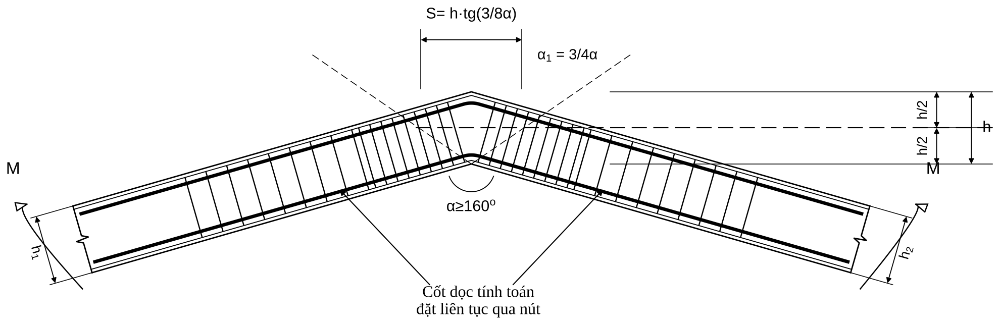{width=16cm}

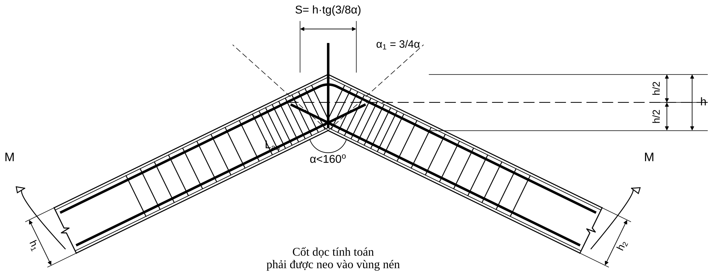{width=16cm}

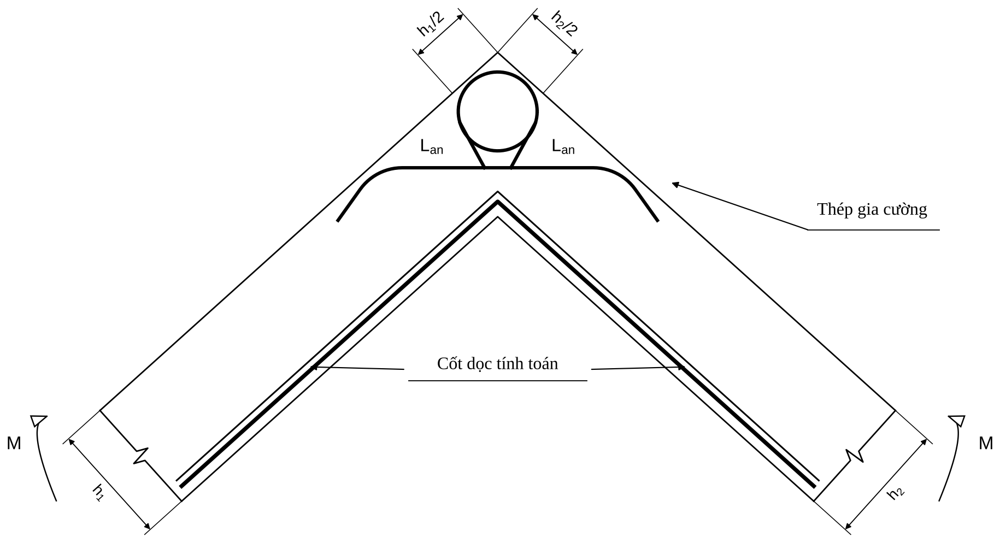{width=14.5cm}

- Diện tích đai giằng thanh dọc (B, công thức 3.1; cũ): $\sum R_{sw}A_{sw}\cos\beta \ge (2F_{a1} + 0{,}7F_{a2})\,R_s\cos\dfrac{\alpha}{2}$; $F_{a1}$ — diện tích thanh dọc **không** được neo trong vùng nén; $F_{a2}$ — thanh đã neo trong vùng nén; $\beta$ — góc giữa phân giác góc lõm và trục đai. Đoạn đặt đai gia cường: $S = h\tan\dfrac{3\alpha}{8}$ (B 3.2). **Tra D/TCVN 5574:2018 (mục xà gãy khúc) cho công thức hiện hành.**

### 9.7.7. Liên kết cột – móng (A 5.19; B 3.14–3.15)

| Hạng mục | Quy định |
|:----------------------------|:------------------------------------------------|
| Thép chờ | từ móng, **diện tích và số thanh bằng thép cột tầng 1** |
| Cao trình ngàm | mặt trên móng (B), $\pm 0{,}00$ nếu móng nằm dưới nền |
| Nối thép chờ | so le dọc chiều cao; $\le 50\%$ thép gờ (B: $\le 25\%$ thép trơn) trong một tiết diện hoặc trên đoạn $< L_{an}$ |
| Thép cột $>4$ thanh | **không** cắt cùng chiều dài; cột 4 thanh cho phép nối tại một tiết diện |
| Đai trong móng | đặt ít nhất **2–3 đai** trong chiều cao móng ở đoạn thép chờ để giữ vị trí (B: khoảng cách $\le 10d$ hoặc 100 mm gần mặt móng); bố trí thêm đai gia cường khi ép mặt lớn |
| Neo thép cột vào móng | $\ge L_{an}$ (nén, $\alpha = 0{,}75$) và hết chiều cao móng nếu móng mỏng; móc uốn ra để định vị |
| Mối nối khớp (cũ) | tiết diện cột giảm còn $1/3$–$1/2$; cốt đặt chéo hoặc thẳng; khe 2–4 cm lấp bằng chì/sợi nhựa; lưới thép ép mặt $F_a = P/8000$ cm² ($P$ tính bằng kG) — **tiêu chuẩn cũ, chỉ để nhận biết**; khung bê tông toàn khối thường dùng liên kết cứng |

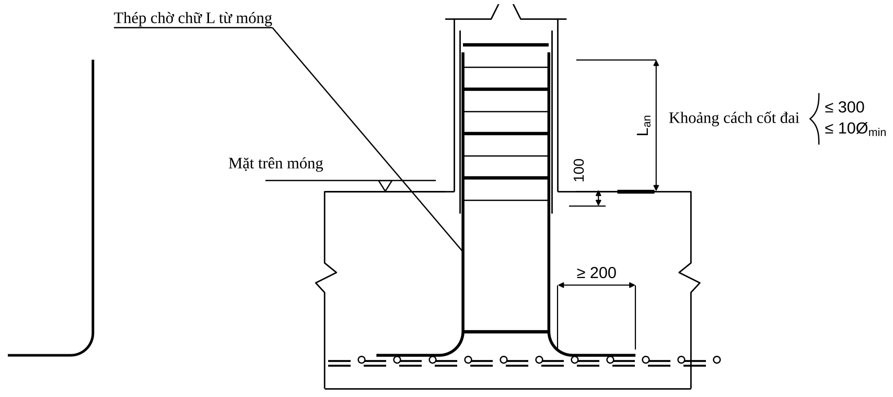{width=15.5cm}

## 9.8. Yêu cầu bổ sung khi nhà chịu động đất (tham khảo từ B)

::: {custom-style="Canhbao"}
**Phạm vi.** Các số liệu dưới đây do B (Ngô Thế Phong, theo Eurocode 8 bản cũ) nêu; **chỉ để đối chiếu và đã được thay bằng Chương 13** (theo EN 1998-1:2004, cơ sở của TCVN 9386:2012). Một số giá trị của B **khác** Chương 13: vùng tới hạn dầm ($2h$ so với $h_w$ / $1{,}5h_w$), lệch tâm dầm–cột ($b/2$ so với $b_c/4$), đường kính đai tối thiểu, bước đai cột. **Khi có khác biệt, dùng Chương 13.** Thiết kế kháng chấn ở Việt Nam bắt buộc theo **TCVN 9386:2012** (cấp dẻo, vùng tới hạn, hệ số ứng xử…).
:::

**Dầm (B):**

| Hạng mục | Quy định |
|:---------------------------|:------------------------------------------------|
| Bề rộng $b$ | $\ge 200$ mm; $b \le \min(b_c + h_c/2;\ 2b_c)$ |
| Tỷ số $b/h$ | $\ge 0{,}25$; $l/h \ge 4$ |
| Lệch tâm dầm–cột | $\le b/2$ |
| Hàm lượng thép kéo | $\dfrac{1{,}4}{R_s} \le \mu \le \dfrac{7}{R_s}$ ($R_s$ tính bằng MPa) |
| Thép chạy suốt | **2Ø12** ở mặt trên và mặt dưới suốt chiều dài dầm |
| Vùng dẻo | $\mu' \ge \mu/2$ |
| Thép đầu mút | ít nhất **1/4** thép chịu lực mặt trên ở mỗi đầu mút kéo dài suốt chiều dài dầm |
| Vùng tới hạn | $2h$ từ mặt cột |
| Đai vùng tới hạn | $d_{sw}\ge 6$; $u \le \min(h/4;\ 8d;\ 24d_{sw};\ 200)$ (cấp dẻo III: $\le 6d$; 150) |

**Cột (B):**

| Hạng mục | Quy định |
|:----------------------------|:------------------------------------------------|
| Kích thước | cạnh nhỏ $\ge 250$; $l/b \le 25$ (cấp dẻo III: $\ge 300$; $l/b \le 16$; công xôn $l/b \le 10$) |
| Hàm lượng | $1\% \le \mu \le 6\%$ (kể cả vùng nối); khoảng cách tim thép dọc $\le 200$ mm |
| Vùng tới hạn | $l_c = \max(h;\ l/6;\ 450)$ ở hai đầu cột; cột liên tục tiếp xúc tường chèn: toàn chiều cao |
| Đai trong vùng tới hạn | $u = \min(8d;\ b/2;\ 200)$; cấp dẻo III: $\min(6d;\ b/4;\ 150)$ |
| Đai ngoài vùng tới hạn | $u = \min(12d;\ b;\ 300)$ hoặc $\min(8d;\ b/2;\ 200)$ |
| Đường kính đai | $\ge 8$ mm |
| Nút khung | đai trong nút như vùng tới hạn; nút giữa (4 dầm quy tụ) giảm một nửa nhưng $\le 10d$ hoặc 200 mm (ACI qua B) |

## 9.9. Lỗi cấu tạo thường gặp

::: {custom-style="Canhbao"}
(1) Cột có $h > 500$ nhưng không đặt thanh giữa cạnh dài. (2) Đai cột không ôm đủ thanh, thanh giữa không nằm ở chỗ uốn. (3) Khoảng hở giữa các thanh nhỏ hơn 25/30/50 mm — bê tông không chui vào được. (4) Nối 100% thép ở một mặt cắt với số thanh $> 4$/cạnh. (5) Nối thép trong nút khung hoặc vùng mô men lớn. (6) Lớp bảo vệ lấy tới mặt thép dọc thay vì mặt đai ⇒ $a$ giả thiết sai. (7) Neo thép dầm vào cột biên thiếu $L_{an}$ do dùng $R_{bt}$ sai (xem phụ lục B). (8) Quên đai trong đoạn nút khung. (9) Quên cốt treo tại chỗ dầm phụ gác lên dầm chính. (10) Thép gối trên cắt quá sớm, thiếu đoạn kéo dài $\max(h_0;\ 12d)$ sau điểm cắt lý thuyết (xem Chương 7, Bước 14). (11) Thanh $d \ge 32$ vẫn nối chồng. (12) Không có cốt giá phụ cho dầm $h > 700$ (CB $h=700$ nên đặt).
:::


\newpage

# CHƯƠNG 10. CHECKLIST QUY TRÌNH CHỌN THÉP

::: {custom-style="Ghichu"}
**Cách dùng chương này.** Đây là chương "tra nhanh – kiểm soát chất lượng": mỗi bước của quy trình có **đầu vào cần có → việc phải làm → đầu ra phải ghi lại → lỗi thường gặp**. Dùng như phiếu kiểm tra trước khi ký hồ sơ: chưa có đủ *đầu ra* của bước trước thì **không sang bước sau**. Mọi con số dẫn về chương, mục tương ứng của tài liệu này.
:::

## 10.1. Sơ đồ quy trình tổng thể

{width=13cm}

**Ba "cổng" bắt buộc không được bỏ qua:**

1. **Cổng ETABS (cuối Chương 6):** kiểm tra $\sum N$ chân cột = tổng tải đứng; $\sum Q$ chân cột = tổng gió; chuyển vị, chu kỳ hợp lý. Không qua cổng này thì mọi con số thép phía sau vô nghĩa.
2. **Cổng khả năng chịu lực (cuối từng cấu kiện):** $M_u \ge M$, $x \le \xi_R h_0$, $\mu_{min}\le\mu\le\mu_{max}$ (dầm); mọi cặp $(\eta M, N)$ nằm trong biểu đồ tương tác (cột).
3. **Cổng cấu tạo (Chương 9):** lớp bảo vệ, khoảng hở, neo, nối, đai, nút khung — tính đúng $A_s$ mà cấu tạo sai vẫn là thiết kế sai.

## 10.2. Bảng checklist theo từng bước

### 10.2.1. Giai đoạn chuẩn bị (Chương 1–6)

| Bước | Đầu vào cần có | Việc phải làm | Đầu ra phải ghi lại | Lỗi thường gặp |
|:--|:----------------|:-------------------------|:----------------------|:--------------------------|
| **1. Dữ liệu đầu vào** (Ch.1) | Hồ sơ kiến trúc, địa chất, vị trí xây dựng, công năng | Điền **đủ** các nhóm A–G của bảng 1.2; chốt tiêu chuẩn áp dụng (TCVN 5574:2018, TCVN 2737:2023) | Bảng đầu vào đã ký xác nhận; cấp bền bê tông, nhóm thép, lớp bảo vệ dự án | Thiếu cấp bền/nhóm thép; để nguyên số tiêu chuẩn cũ; quên điều kiện môi trường (ảnh hưởng lớp bảo vệ) |
| **2. Chọn sơ bộ tiết diện** (Ch.2) | Nhịp, chiều cao tầng, tải sơ bộ | Chọn $h_{sàn}$, $h_{dầm}=(1/8\div1/20)L$, $b = (0{,}3\div0{,}5)h$, cột theo $N$ sơ bộ; thống nhất hoá | Bảng tiết diện sơ bộ; ghi số tầng/nhóm cột đổi tiết diện | Chọn cột theo cảm tính, không kiểm tra $N$; nhiều loại tiết diện lẻ; quên kiểm tra lại sau khi có nội lực |
| **3. Sơ đồ tính** (Ch.3) | Mặt bằng, mặt cắt, loại móng | Chọn khung phẳng/không gian; **nhịp = khoảng cách tim trục**; chiều cao tầng 1 tính tới mặt ngàm; liên kết chân cột | Hình sơ đồ tính có kích thước và ghi chú liên kết | Nhầm điểm giữa nhịp (vị trí dầm phụ) là cột; quên cộng đoạn từ mặt ngàm; sai điều kiện liên kết chân cột |
| **4. Tải trọng** (Ch.4) | Cấu tạo sàn/mái/tường; công năng; vùng gió; $\gamma_f$ | Với mỗi tải: **Dữ liệu → Công thức → Thay số → Kết quả → Đưa vào mô hình**; truyền tải sàn lên khung; gió theo TCVN 2737:2023 | Bảng tải đưa vào ETABS (kN/m, kN) có tải tiêu chuẩn và tính toán | Dùng hệ số vượt tải cũ; quên trọng lượng bản thân tự tính hai lần; truyền tải sai diện tích; không xếp lệch hoạt tải |
| **5. Tổ hợp** (Ch.5) | Danh sách trường hợp tải | Lập tổ hợp cơ bản TCVN 2737:2023; tổ hợp riêng cho dài hạn ($M_{dh}$, $N_{dh}$) | Bảng tổ hợp đánh số TH1…THn; ghi tổ hợp nào có $N_{max}$, $M_{max}$ | Dùng hệ số tổ hợp của bản cũ; thiếu gió ngược chiều; quên tổ hợp dài hạn |
| **6. Nội lực** (Ch.6) | File mô hình đã chạy | Xuất nội lực đúng thành phần ($M3$, $V2$, $P$); đổi dấu theo quy ước; **kiểm tra** $\sum N$, $\sum Q$; chọn cặp nguy hiểm | Bảng nội lực nguy hiểm (như Bảng 6.1) kèm tổ hợp, vị trí, dấu | Đọc sai thành phần $M2/M3$; ghép $M$ tổ hợp này với $N$ tổ hợp khác; bỏ mô men giữa nhịp; lấy nội lực tại tim thay vì mép gối khi quy định lấy mép |

### 10.2.2. Dầm — 16 bước (Chương 7)

| Bước | Đầu vào | Việc phải làm | Đầu ra | Lỗi thường gặp |
|:--|:------------|:----------------------|:-------------------|:----------------------|
| **1** Chốt dữ liệu | $M^+$, $M^-$ từng gối, $Q_{max}$, $b\times h$ | Lập bảng nội lực từng dầm; thiết kế chung gối có $M$ gần nhau | Bảng dầm – tiết diện – $M$ – $Q$ | Bỏ sót dầm; lấy $Q$ giữa nhịp |
| **2** Hệ số vật liệu | $R_b$, $R_s$, $E_s$ | $\xi_R$, $\alpha_R$, $\mu_{max}$ | $\xi_R$, $\alpha_R$, $\mu_{max}$ | Nhầm $\xi_R$ giữa bảng và công thức (ghi rõ nguồn) |
| **3** Giả thiết $a$ | Số hàng thép dự kiến | $a\approx h/10$; $h_0=h-a$ | $h_0$ gối, $h_0$ nhịp | Dùng $a$ một hàng cho gối hai hàng |
| **4** Chữ nhật / chữ T | Chiều dày cánh, nhịp, khoảng hở dầm | Gối: chữ nhật; nhịp: chữ T với $b_f'$ nhỏ nhất; kiểm $M_f$ | Dạng tiết diện, $b_f'$ | Dùng chữ T cho mô men âm; $b_f'$ sai |
| **5** $\alpha_m$ | $M$, $h_0$ | So với $\alpha_R$ và 0,5 | Cốt đơn hay kép | Quên đổi kN·m→N·mm |
| **6** $A_s$ | $\alpha_m$ | $\xi=1-\sqrt{1-2\alpha_m}$; $A_s=\xi R_bbh_0/R_s$; cốt kép nếu cần | $A_{s,tt}$ (và $A_s'$) | Dùng $R_s$ cho $R_{sw}$; không kiểm $x\ge 2a'$ khi có $A_s'$ |
| **7** $\mu$ | $A_s$ | $\mu_{min}=0{,}1\%$ (D) $\le\mu\le\mu_{max}$; hàm lượng kinh tế 0,6–1,2% | $\mu$ | Dùng 0,05% của bản cũ |
| **8** Chọn thép | $A_{s,tt}$ | Chọn Ø, số thanh, hàng; tính $a$ thực; kiểm $M_u\ge M$, $x\le\xi_Rh_0$ | Thép chọn, $A_{s,ch}$, $h_0^{thực}$, $M_u$ | Không đủ khoảng hở; vượt >10%; $>3$ loại Ø; chênh Ø >6 mm |
| **9** Nén chính | $Q_{max}$ | $Q\le0{,}3R_bbh_0$ | Đạt / tăng tiết diện | Cố "cứu" bằng đai |
| **10** $Q_{b,min}$ | $Q$ | $Q\le0{,}5R_{bt}bh_0$ → đai cấu tạo | Phải tính đai hay không | Bỏ qua điều kiện này |
| **11** Đai | $Q$, $R_{sw}$, $A_{sw}$ | $s_{max}$, $q_{sw}$, $s_{tt}$, $s_{ct}$; chọn $s$ làm tròn xuống 50; kiểm tiết diện nghiêng | Ø đai, nhánh, bước đầu/giữa dầm | Dùng $R_s$ thay $R_{sw}$; quên số nhánh; $L/4$ đoạn đai dày |
| **12** Cốt xiên | $Q_u<Q$ khi đã tăng đai | Tính $A_{s,inc}$ với $\varphi_{sw}=0{,}75$; góc theo $h$ | Cốt xiên hoặc "không dùng" | Dùng cốt xiên khi tăng đai đã đủ |
| **13** Cốt treo | Phản lực dầm phụ $F$, $h_s$ | $F(1-h_s/h_0)\le\sum R_{sw}A_{sw}$; $\ge4$ đai mỗi bên | Số đai treo, vùng $a=2h_s+b$ | Quên hoàn toàn cốt treo |
| **14** Cắt/uốn | Hình bao $M$, $M_u$ các cụm thanh | Tính điểm cắt lý thuyết; $W=Q/2q_{sw}+5d\ge20d$; $\ge2$ thanh và $\ge A_s/2$ vào gối | Vị trí cắt (mm) từng thanh | Cắt thép sát điểm lý thuyết; dùng quy tắc ACI cho khung chịu gió |
| **15** Neo | $R_{bond}$, $d$, $A_{s,cal}/A_{s,ef}$ | $L_{an}=\alpha L_{0,an}A_{s,cal}/A_{s,ef}\ge\max(15d;200;0{,}3L_{0,an})$ | $L_{an}$ từng thanh | $R_{bond}$ thiếu $R_{bt}$; neo ngắn hơn tối thiểu |
| **16** Kiểm cuối | Toàn bộ | Lực dọc/xoắn, nứt, võng nếu cần; lập bảng thống kê | Bảng thống kê thép dầm | Chỉ kiểm nứt/võng khi nhịp lớn, tiết diện mỏng |

### 10.2.3. Cột — 14 bước (Chương 8)

| Bước | Đầu vào | Việc phải làm | Đầu ra | Lỗi thường gặp |
|:--|:------------|:----------------------|:-------------------|:----------------------|
| **0** Chọn phương pháp | Số cặp nội lực, cột đối xứng? | Mặc định: công thức đối xứng → BĐTT kiểm tra mọi cặp | Phương pháp | Chỉ kiểm một cặp |
| **1** Cặp nội lực | $M$, $N$, $M_{dh}$, $N_{dh}$ | Chọn 3 cặp mỗi đầu cột (xem Ch.8) | Bảng cặp nguy hiểm | Ghép sai tổ hợp |
| **2** Vật liệu | $R_b$, $R_s$ | $\xi_R$, $\alpha_R$ | Hệ số | — |
| **3** Hình học | Chiều cao tầng, liên kết | $l_0=\psi l$ (nhiều tầng toàn khối 0,7 $l$ — ghi rõ nguồn), $\lambda_h$, $\lambda_b\le31$ | $l_0$, $\lambda$ | $l_0=H$; quên đoạn ngàm tầng 1 |
| **4** Độ lệch tâm | $M$, $N$ | $e_1=M/N$, $e_a=\max(h/30,l/600,10)$, $e_0$ | $e_0$ | $e_a$ theo $l_0$ |
| **5** Uốn dọc | $\mu_t$ giả thiết, $M_{dh}$, $N_{dh}$ | $\eta=1/(1-N/N_{cr})$ nếu $l_0/h>4$ | $\eta$, $e$ | Quên nhân $\eta$ vào $M$; $\eta<0$ khi $N>N_{cr}$ |
| **6** Loại lệch tâm | $x_1=N/(R_bb)$ | So với $\xi_Rh_0$ | Lớn / bé | — |
| **7** $A_s=A_s'$ | $e$, $x$ | Công thức theo loại lệch tâm (D 6.20–6.22) | $A_{s,tt}$ | Dùng công thức lệch tâm lớn cho lệch tâm bé |
| **8** $\mu$ | $A_s$ | $\mu_{min}$ nội suy theo $l_0/h$; $\mu_t\le4\%$ (3%/phía) | $A_s$ cuối | Dùng $\mu_{min}$ một giá trị cho mọi độ mảnh |
| **9** Chọn thép | $A_s$, $h$ | Ø12–40; khoảng hở $\ge\max(d;50)$; cốt cấu tạo khi $h>500$ | Thép dọc, $a$ thực | Bỏ cốt cấu tạo; $a$ thực lệch >5 mm |
| **10** Khả năng chịu lực | Thép thực | Trong mặt phẳng ($Ne_{gh}\ge Ne$) và ngoài mặt phẳng ($N_u=\varphi(\cdot)$) | $k=Ne/Ne_{gh}$, $N/N_u$ | Quên phương ngoài mặt phẳng |
| **11** BĐTT | Thép thực, mọi cặp | Vẽ đường tương tác; đưa $(\eta M,N)$ | Hệ số sử dụng $k_{max}$ | Không nhân $\eta$ vào điểm kiểm |
| **12** Đai | $d_{max}$, $d_{min}$, $\mu'$ | $d_{sw}\ge\max(d/4,6)$; $s\le15d_{min}$ ($10d_{min}$ khi nối/$\mu'>1{,}5\%$); đai phụ | Ø, bước, đai phụ | Lấy $15d$ theo thanh lớn |
| **13** Nối, neo | $L_{0,an}$, tỷ lệ nối | $L_{ov}=\alpha_{ov}L_{0,an}\,A_{s,cal}/A_{s,ef}$; vị trí nối; $\mu_t\le8\%$ | $L_{ov}$ (mm) | Nối ở vùng nút/vùng mô men lớn |
| **14** Đặc biệt, thống kê | Cột kéo, cột góc, tầng thay đổi | Cột kéo: hàn/cơ khí; cột góc: mặt tương tác; lập bảng | Bảng thống kê thép cột | Cột góc tính một phương |

### 10.2.4. Cấu tạo và hoàn thiện hồ sơ (Chương 9, 12, 13, 14, 15)

| Hạng mục | Đầu vào | Việc phải làm | Đầu ra | Lỗi thường gặp |
|:--|:------------|:----------------------|:-------------------|:----------------------|
| Lớp bảo vệ | Môi trường, Ø thanh | Bảng 9.1: 20/25/30 mm; $\ge d$; chống cháy | $c$ dự án | Dùng 15 mm bản cũ |
| Khoảng hở | Ø, hàng | $\ge\max(d;25)$ đáy; $\max(d;30)$ trên; $\max(d;50)$ cột | Kiểm tra bề rộng $b$ | Nhồi 5Ø25 vào $b=250$ |
| Neo, nối, uốn | $L_{0,an}$, Ø | Mục 9.5; bán kính uốn $5d$ ($<20$)/$8d$ ($\ge20$) | Bảng $L_{an}$, $L_{ov}$ | Nối 100% tại một mặt cắt chịu kéo không kiểm |
| Nút khung | Loại nút (góc, biên, giữa, gãy khúc) | Mục 9.7: chọn sơ đồ theo $e_0/h$, neo, đai nút | Sơ đồ cốt thép nút | Cắt thép dầm ngay mép cột, neo thiếu |
| Cột–móng | Thép chờ, cổ móng | Mục 9.7.7 | Chiều dài chờ, đai trong móng | Thiếu đai trong đoạn neo |
| Bố trí dọc dầm, cột | Hình bao $M$, $Q$; thép đã chọn | Chương 12: thanh suốt, thanh gia cường, điểm cắt, chiều dài thanh, vùng đai, đếm đai | Bảng thanh, bảng vùng đai | Cắt thép không có đoạn kéo dài $W$; quên mô men dương ở gối |
| Kháng chấn | Cấp động đất, cấp dẻo (DCM/DCH) | Chương 13: vùng tới hạn, đai, $\sum M_{Rc}\ge1{,}3\sum M_{Rb}$, nút; đối chiếu **TCVN 9386:2012** | Quy định riêng + bảng đối chiếu 13.9 | Dùng $N$ tổ hợp thường thay tổ hợp động đất; nối thép cột trong vùng tới hạn |
| Bản vẽ & thống kê | Mọi kết quả | Mặt cắt, mặt đứng, bảng thống kê, ghi chú chung | Bộ hồ sơ | Mặt cắt không khớp thống kê |

## 10.3. Checklist kiểm tra cuối cùng trước khi phát hành hồ sơ

**A. Số liệu và mô hình**

- [ ] Tiêu chuẩn, vật liệu, lớp bảo vệ đã ghi đúng trên bản vẽ và khớp mô hình ETABS.
- [ ] Tải trọng đưa vào mô hình khớp bảng Chương 4 (kiểm bằng $\sum N$ chân cột).
- [ ] Tổ hợp đúng TCVN 2737:2023; có tổ hợp dài hạn cho cột.
- [ ] Nội lực dùng cho thép lấy từ **bao** các tổ hợp, đúng dấu, đúng đơn vị.

**B. Dầm**

- [ ] Mỗi tiết diện nguy hiểm: $M_u\ge M$; $x\le\xi_Rh_0$; $\mu_{min}\le\mu\le\mu_{max}$.
- [ ] Đai: $Q\le0{,}3R_bbh_0$; $Q_u\ge Q$; bước đầu dầm $\le\min(h/2;300)$, giữa dầm $\le\min(3h/4;500)$.
- [ ] Cốt treo ở mọi chỗ dầm phụ gác lên dầm chính; đai bổ sung đủ số lượng.
- [ ] Vị trí cắt thép có $W\ge\max(Q/2q_{sw}+5d;\ 20d)$; $\ge2$ thanh và $\ge A_s/2$ vào gối.
- [ ] Neo đủ $L_{an}\ge\max(15d;200;0{,}3L_{0,an})$.

**C. Cột**

- [ ] $\lambda_b\le31$; $\eta$ tính với $\mu_t$ thực; $N<N_{cr}$.
- [ ] Mọi cặp $(\eta M,N)$ của mọi tổ hợp nằm trong biểu đồ tương tác, $k_{max}\le1$.
- [ ] Phương ngoài mặt phẳng: $N\le N_u$.
- [ ] $\mu_{min}\le\mu\le3\%$ mỗi phía, $\mu_t\le4\%$ ($8\%$ tại chỗ nối).
- [ ] Khoảng cách tim thép dọc $\le400$ (⊥) và $\le500$ (//); có cốt cấu tạo khi $h>500$.
- [ ] Đai Ø $\ge\max(d_{max}/4;6)$; bước $\le15d_{min}$ ($10d_{min}$ ở đoạn nối); đai phụ đúng vị trí.
- [ ] Nối thép: vị trí ngoài vùng nút, $L_{ov}$ đủ, $\mu_t$ tại nối $\le8\%$.

**D. Nút và cấu tạo**

- [ ] Từng loại nút (góc mái, biên, giữa, trung gian) có sơ đồ cốt thép và neo kiểm tra bằng số.
- [ ] Thép chờ cột–móng và đai trong móng đã vẽ.
- [ ] Bố trí dọc (Chương 12): hình bao vật liệu bao trùm hình bao $M$; số hiệu thanh, bảng thống kê khớp; phiếu 12.8 đạt.
- [ ] Nhà chịu động đất: cấp dẻo đã xác nhận; kiểm tra Chương 13 (vùng tới hạn, đai bó, $\nu_d$, cột mạnh – dầm yếu, nút) và đối chiếu các điều khoản ở 13.9 với TCVN 9386:2012.
- [ ] Mọi bán kính uốn, móc, khoảng hở đều ghi trên bản vẽ.

**E. Hồ sơ**

- [ ] Bảng thống kê thép khớp mặt cắt; không có cấu kiện nào thiếu thép.
- [ ] Ghi chú rõ phần *tiêu chuẩn cũ*/giả thiết còn chờ xác nhận (xem Phụ lục B).
- [ ] Thép dầm lọt qua thép cột ở mọi nút; dầm đặt thấp ở nút giao đã tính lại $h_0$; cấu kiện không thuộc phạm vi (14.1) đã được xử lý riêng; dầm có $T\ne0$ đã tính theo 15.1.

## 10.4. Cấu trúc dữ liệu và luật quyết định cho AI Agent (tóm tắt từ chương 1–9; luật bố trí R14–R30 ở mục 12.7; luật kháng chấn R31–R40 ở mục 13.10; cổng chặn R41–R46 ở mục 14.6; xoắn, dầm cao, lỗ mở R47–R52 ở mục 15.4)

::: {custom-style="Ghichu"}
Phần này không đưa công thức mới, chỉ **sắp xếp lại** các điều kiện của tài liệu thành luật để chương trình/AI Agent gọi lần lượt; mọi con số tra theo chương đã nêu.
:::

**Đầu vào tối thiểu của một cấu kiện:** loại (dầm/cột/console), $b$, $h$, $L$ hoặc $l$, cấp bền bê tông, nhóm thép dọc và đai, $c$, danh sách cặp nội lực (tổ hợp, vị trí, $M$, $N$, $Q$), $M_{dh}$, $N_{dh}$ (cột), điều kiện liên kết ($l_0$).

| # | Luật quyết định | Hành động của Agent |
|:--|:--------------------------------------|:------------------------------------------|
| R1 | $\alpha_m > 0{,}5$ hoặc $\xi>\xi_R$ với cốt đơn đã thử cốt kép | Báo **"tăng tiết diện"**, không tự tăng thép |
| R2 | Mô men dương dầm | Tính tiết diện chữ T với $b_f'$ nhỏ nhất của các điều kiện; kiểm $M_f$ |
| R3 | $A_{s,tt}<A_{s,min}$ | Lấy $A_s=A_{s,min}$ |
| R4 | Không có tổ hợp thép nào chọn được trong bề rộng $b$ (khoảng hở) | Thử 2 hàng, tăng Ø (≤ 32 dầm / ≤ 40 cột); nếu vẫn không được → báo tăng $b$ |
| R5 | $Q\le Q_{b,min}$ | Đai cấu tạo |
| R6 | $Q>0{,}3R_bbh_0$ | Báo tăng tiết diện |
| R7 | Cột: $l_0/h\le4$ | $\eta=1$ |
| R8 | Cột: $N\ge N_{cr}$ | Báo tăng tiết diện |
| R9 | Cột: $x_1\le\xi_Rh_0$ | Công thức lệch tâm lớn, ngược lại lệch tâm bé |
| R10 | Cột: sau khi chọn thép, một cặp $(\eta M,N)$ nằm ngoài BĐTT | Tăng thép → kiểm lại; nếu $\mu_t>4\%$ → tăng tiết diện |
| R11 | Cột: khoảng cách tim thép trên cạnh $>500$ mm | Thêm thanh cấu tạo |
| R12 | Cột có $N<0$ (kéo) | Chuyển sang quy trình cột kéo (Bước 14a) |
| R13 | Tiết diện cột/dầm thay đổi giữa các tầng | Kiểm tra lại neo/nối tại nút |

**Đầu ra của Agent:** (i) bảng thép dọc và đai, (ii) $L_{an}$, $L_{ov}$, vị trí cắt, (iii) hệ số sử dụng $k=\text{yêu cầu}/\text{khả năng}$ cho mọi tiết diện, (iv) danh sách cảnh báo (tiêu chuẩn cũ, giả thiết chưa kiểm).


\newpage

# CHƯƠNG 11. VÍ DỤ HOÀN CHỈNH — KHUNG TRỤC 3, TRƯỜNG HỌC 6 TẦNG

::: {custom-style="Ghichu"}
**Quy ước chương này.** Một bộ số liệu duy nhất (Chương 1.5). Mỗi cấu kiện trình bày đủ **tám mục theo đúng thứ tự: Dữ liệu → Giả thiết → Tính toán (công thức) → Thay số → Kết quả → Chọn thép → Kiểm tra → Bố trí thép.** Công thức đã giải thích ký hiệu ở Chương 7–9 nên ở đây chỉ nhắc lại dạng gọn và dẫn mục. Nội lực ETABS lấy từ tài liệu A (không tính lại được bằng tay); **mọi phép tính tiết diện được tính lại** — sai khác với A ghi ở Phụ lục B. Đơn vị: mm, N, MPa, kN, kN·m (đổi $\times10^6$ khi thay vào công thức mô men).
:::

## 11.0. Bộ số liệu thống nhất

| Nhóm | Số liệu |
|:--|:--------------------------------------------------------|
| Công trình | Trường học 6 tầng, Ninh Bình; khung trục 3; bước khung 3,9 m; mái dốc 13° |
| Hình học khung | CB (C–B) $L = 6900$, điểm D giữa nhịp là dầm phụ 220×300; BA $L = 2100$; console A–E 2100 (tầng 2); tầng 1 cao 5,2 m (gồm 1,3 m dưới cốt $\pm0{,}000$), tầng 2–6 cao 3,9 m |
| Vật liệu | B30: $R_b = 17$, $R_{bt} = 1{,}15$, $E_b = 32\,500$; thép dọc CB500-V: $R_s = R_{sc} = 435$, $E_s = 200\,000$; thép đai CB240-T: $R_{sw} = 170$ |
| Hệ số | $\xi_R = 0{,}493$; $\alpha_R = 0{,}371$; $\mu_{max} = 1{,}93\%$; $\gamma_{b2} = 1{,}0$ |
| Tiết diện | Dầm CB 250×700; dầm BA và console 250×400; dầm phụ 220×300; cột 250×600 (trục B, C); sàn dày 100 |
| Cấu tạo dự án | Trong nhà, độ ẩm ≤ 75%: lớp bảo vệ 20 mm; đai Ø8 |
| Nội lực nguy hiểm | Bảng 6.1 (dầm CB: $-462{,}37$ / $-434{,}67$ / $+315{,}47$, $Q_{max} = 240{,}3$; dầm BA: $+99{,}37$ / $-106{,}99$, $Q = 117{,}99$; console $-35{,}43$, $Q = 24{,}89$; cột 22: TH12 $M = 417{,}74$, $N = 1514{,}38$, $M_{dh} = 18{,}06$, $N_{dh} = 1168{,}39$) |

## 11.1. Dầm CB 250×700 (phần tử 40–41, tầng 1)

### 11.1.1. Thép dọc gối C và B (mô men âm)

**1. Dữ liệu.** $b = 250$, $h = 700$; $M_C = -462{,}37$, $M_B = -434{,}67$ kN·m; thiết kế chung theo $|M| = 462{,}37$ (Bước 1).

**2. Giả thiết.** Mô men âm → cánh nằm vùng kéo → tính **chữ nhật** $250\times700$. Hai hàng thép: $a = 55$, $h_0 = 645$ mm (Bước 3–4).

**3. Tính toán (công thức).**
$$\alpha_m=\frac{M}{R_b b h_0^2},\qquad \xi=1-\sqrt{1-2\alpha_m},\qquad A_s=\xi\frac{R_b b h_0}{R_s}$$

**4. Thay số.**
$$\alpha_m=\frac{462{,}37\times10^6}{17\times250\times645^2}=0{,}2615<\alpha_R=0{,}371\ \Rightarrow\ \text{cốt đơn}$$
$$\xi=1-\sqrt{1-2\times0{,}2615}=0{,}309,\qquad A_s=0{,}309\times\frac{17\times250\times645}{435}=1950\ \text{mm}^2$$

**5. Kết quả.** $A_{s,tt}=1950$ mm²; $\mu=1950/(250\times645)=1{,}21\%$ ($0{,}1\%\le\mu\le1{,}93\%$ ✓).

**6. Chọn thép.** **2Ø25 + 3Ø22 = 982 + 1140 = 2122 mm²** (dư 8,8%), 2 hàng: hàng ngoài 2Ø25 + 1Ø22, hàng trong 2Ø22. Khoảng hở một hàng $=61$ mm $\ge30$ ✓; hở giữa hai hàng 25 mm.

**7. Kiểm tra.** $a$ thực $=(1362\times40{,}5+760\times89)/2122=57{,}9$ mm → $h_0=642{,}1$ (lệch 0,5% so với giả thiết). $x=435\times2122/(17\times250)=217$ mm $<\xi_Rh_0=317$ ✓. $M_u=435\times2122\times(642{,}1-108{,}6)=492{,}5$ kN·m $\ge462{,}37$ ✓ (dư 6,5%).

**8. Bố trí.** Thép trên gối 2Ø25+3Ø22 (2 hàng); cắt 3Ø22 theo hình bao (11.1.4); xem Hình 11.1.

### 11.1.2. Thép dọc nhịp CB (mô men dương)

**1. Dữ liệu.** $M^+=315{,}47$ kN·m (A in nhầm $31{,}47$).

**2. Giả thiết.** Cánh nằm vùng nén → **chữ T**; một hàng thép: $a=40$, $h_0=660$. $h_f'=100\ge0{,}1h=70$: $S_f'\le\min(\tfrac12\times3680;\ \tfrac16\times6620)=1103\to1100$; $b_f'=250+2\times1100=2450$ mm.

**3. Tính toán.** $M_f=R_bb_f'h_f'(h_0-0{,}5h_f')$; nếu $M\le M_f$ tính như chữ nhật $b_f'\times h$.

**4. Thay số.** $M_f=17\times2450\times100\times(660-50)=2540{,}7$ kN·m $\gg315{,}47$ → chữ nhật $2450\times700$. $\alpha_m=315{,}47\times10^6/(17\times2450\times660^2)=0{,}0174$; $\xi=0{,}0175$; $A_s=0{,}0175\times17\times2450\times660/435=1109$ mm².

**5. Kết quả.** $A_{s,tt}=1109$ mm²; $\mu=0{,}67\%$ ✓.

**6. Chọn thép.** **3Ø22 = 1140 mm²** một hàng (dư 2,8%).

**7. Kiểm tra.** $a$ thực $=20+8+11=39$, $h_0=661$; $x=11{,}9$ mm; $M_u=435\times1140\times(661-6)=325{,}0$ kN·m $\ge315{,}47$ ✓. Vào gối 3Ø22 ≥ 2 thanh và $\ge A_s/2$ ✓.

**8. Bố trí.** 3Ø22 chạy suốt dưới nhịp, neo vào cột $\ge L_{an}$ (Hình 11.1).

### 11.1.3. Cốt đai

**1. Dữ liệu.** $Q_{max}=240{,}3$ kN (đầu phải, gối B), $h_0=645$; đai Ø8 hai nhánh $A_{sw}=100{,}5$ mm², $R_{sw}=170$.

**2. Giả thiết.** Không có cốt xiên; đai tính cho đoạn $L/4$ hai đầu; đoạn giữa đai cấu tạo.

**3. Tính toán.** Bước 9–11 (Chương 7): $Q\le0{,}3R_bbh_0$; $Q>0{,}5R_{bt}bh_0$ → tính đai; $s_{max}=R_{bt}bh_0^2/Q$; $q_{sw}=Q^2/(4{,}5R_{bt}bh_0^2)\ge0{,}25R_{bt}b$; $s_{tt}=R_{sw}A_{sw}/q_{sw}$; $s_{ct}=\min(h_0/2;300)$.

**4. Thay số.** $0{,}3\times17\times250\times645=822{,}4\ge240{,}3$ ✓; $Q_{b,min}=0{,}5\times1{,}15\times250\times645=92{,}7<240{,}3$ → tính đai. $s_{max}=497{,}7$; $q_{sw}=107{,}3\ge71{,}9$; $s_{tt}=170\times100{,}5/107{,}3=159{,}2$; $s_{ct}=300$.

**5. Kết quả.** $s=\min(497{,}7;\ 159{,}2;\ 300)=159\to$ làm tròn xuống **150 mm**.

**6. Chọn thép.** Ø8a150 ở $L/4=1725$ mm hai đầu dầm; Ø8a250 đoạn giữa ($s_{ct}=\min(3h_0/4;500)=483$).

**7. Kiểm tra tiết diện nghiêng.** $q_{sw}(150)=113{,}9$ N/mm; $C=2h_0=1290$; $Q_{u,min}=139{,}1+110{,}2=249{,}3\ge240{,}3$ ✓.

**8. Bố trí.** Đai đầu tiên cách mép cột 50 mm; Ø8a150 / Ø8a250 (Hình 11.1).

### 11.1.4. Cắt thép, cốt treo, neo

| Hạng mục | Dữ liệu → công thức | Thay số → kết quả |
|:--|:------------------------|:-------------------------------|
| **Cắt 3Ø22 trên gối** | $M_u$(còn 2Ø25) $=R_sA_s(h_0-x/2)$; $W=Q/(2q_{sw})+5d\ge20d$ | $M_u=435\times981{,}7\times(659{,}5-50{,}2)=260{,}2$ kN·m; $W=240\,300/(2\times113{,}9)+5\times22=1165\ge440$ → cắt Ø22 cách tiết diện cắt lý thuyết (tại $|M|=260$ kN·m) $\ge$ **1200 mm** |
| **Cốt treo tại D** | $F=1{,}15G_D+1{,}3P_D$; $F(1-h_s/h_0)\le\sum R_{sw}A_{sw}$ | $F=28{,}035$ kN; $h_s=645-270=375$; $\sum A_{sw}\ge11\,736/170=69$ mm² (0,69 đai) → **5 đai Ø8 mỗi bên** (cấu tạo $\ge4$) trong vùng $a=2\times375+220=970$ mm, bước 50–80 |
| **Neo thanh dưới nhịp vào cột** | $L_{an}=\alpha L_{0,an}A_{s,cal}/A_{s,ef}\ge\max(15d;\ 200;\ 0{,}3L_{0,an})$ | Ø22: $L_{0,an}=832$; $L_{an,min}=\max(330;\ 200;\ 250)=330$ mm → thanh dưới nhịp vào cột (tại gối thanh dưới chịu kéo nhỏ, $A_{s,cal}/A_{s,ef}\ll1$) neo **$\ge330$ mm** (tối thiểu); nếu muốn phát huy toàn bộ cường độ thanh: $L_{an}=832$ mm. Chọn **neo 450 mm kể từ mép cột** (vượt tim cột 150 mm $\ge5d=110$ ✓; nếu có tải ngang xem Bước B6 Chương 12) |


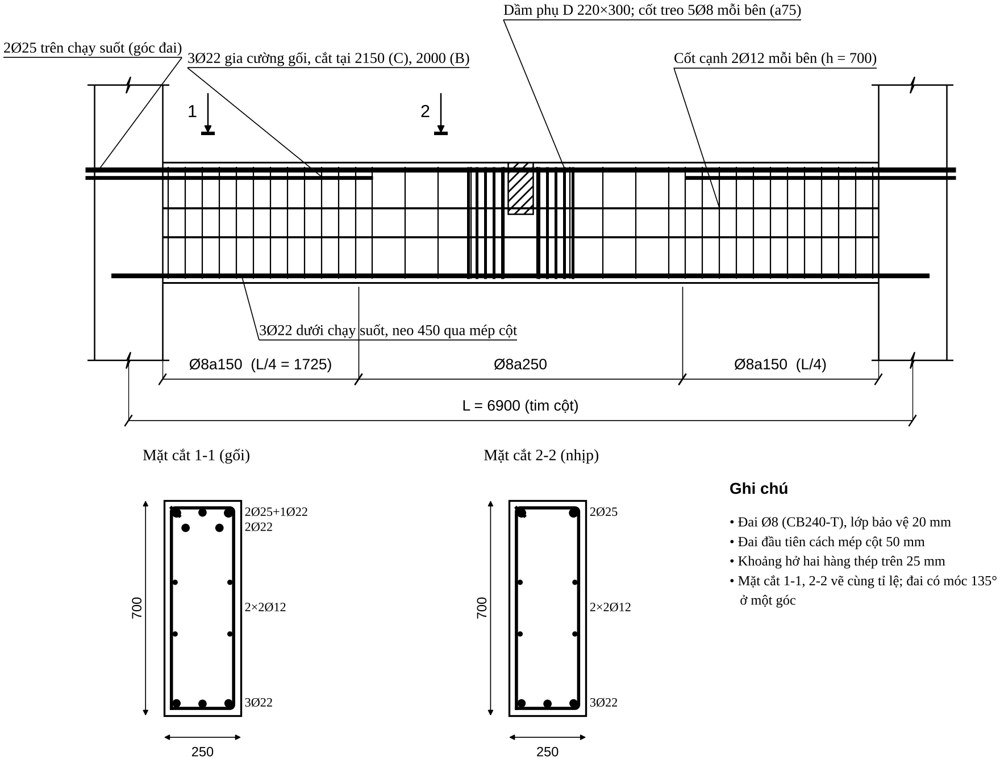{width=16cm}


## 11.2. Dầm BA 250×400 (phần tử 9, tầng 1)

**1. Dữ liệu.** $M^+=99{,}37$ (nhịp), $M^-=-106{,}99$ (gối B), $Q=117{,}99$ kN; $L=2100$; thép gối B dầm CB là 2Ø25+3Ø22 (cần khớp).

**2. Giả thiết.** Nhịp: chữ T, $a=40$, $h_0=360$; $S_f'=\min(1840;\ 2100/6)=350$, $b_f'=250+700=950$. Gối: chữ nhật $250\times400$, $a=40$.

**3. Tính toán.** Như 11.1: $\alpha_m\to\xi\to A_s$; $M_f=R_bb_f'h_f'(h_0-0{,}5h_f')$.

**4. Thay số.** $M_f=17\times950\times100\times310=500{,}7>99{,}37$ → chữ nhật $950\times400$. Nhịp: $\alpha_m=0{,}0475$, $\xi=0{,}0487$, $A_s=0{,}0487\times17\times950\times360/435=650$ mm². Gối B: $\alpha_m=106{,}99\times10^6/(17\times250\times360^2)=0{,}1942$, $\xi=0{,}218$, $A_s=767$ mm².

**5. Kết quả.** $A_{s,tt}$: nhịp **650**, gối **767** mm²; $\mu=0{,}72\%$ và $0{,}85\%$.

**6. Chọn thép.** Nhịp: **2Ø18+1Ø16 = 710 mm²** (dư 9%). Gối: **2Ø25 = 982 mm²** (dư 28% so với 767 — chọn để **liên tục với thép gối B của dầm CB** và tiếp tục ra console; nếu cần tiết kiệm có thể dùng 2Ø22+... nhưng phải khớp thép nút).

**7. Kiểm tra.** Nhịp: $a=36{,}7$, $h_0=363{,}3$, $x=19{,}1$ mm, $M_u=109{,}2\ge99{,}37$ ✓. Gối: $h_0=359{,}5$, $x=100{,}5<\xi_Rh_0=177$, $M_u=132{,}1\ge106{,}99$ ✓, $\mu=1{,}09\%$ ✓.
Đai: $0{,}3R_bbh_0=459\ge117{,}99$ ✓; $Q_{b,min}=51{,}75<117{,}99$ → tính đai: $s_{max}=315{,}8$, $q_{sw}=83{,}0$, $s_{tt}=205{,}8$, $s_{ct}=\min(h_0/2;300)=180$ → **Ø8a150** đầu dầm; kiểm tra $q_{sw}(150)=113{,}9$, $C=720$, $Q_{u,min}=77{,}6+61{,}5=139{,}1\ge117{,}99$ ✓; giữa dầm **Ø8a250**.

**8. Bố trí.** Nhịp dưới 2Ø18+1Ø16 chạy suốt, vào gối $\ge2$ thanh; gối trên 2Ø25; đai Ø8a150/a250.

## 11.3. Console A–E (phần tử 15, tầng 2)

**1. Dữ liệu.** $M=-35{,}43$ kN·m, $Q=24{,}89$ kN; tiết diện 250×400, $h_0=360$.

**2. Giả thiết.** Chữ nhật, cánh sàn console xét như tính; thép trên là phần kéo dài của thép gối B.

**3–4. Tính toán và thay số.** $\alpha_m=35{,}43\times10^6/(17\times250\times360^2)=0{,}0643$; $\xi=0{,}0665$; $A_s=0{,}0665\times17\times250\times360/435=234$ mm² ($\mu=0{,}26\%\ge0{,}1\%$ ✓).

**5. Kết quả.** $A_{s,tt}=234$ mm².

**6. Chọn thép.** Giữ **2Ø25 (982 mm²)** chạy tiếp từ gối B (thép gối liên tục) — thừa nhiều so với 234 nhưng nhằm đơn giản thi công; neo $\ge L_{an}$ ở đầu mút console. Nếu muốn giảm thép thì phải xét hình bao và neo (Bước 14–15).

**7. Kiểm tra.** $Q=24{,}89<Q_{b,min}=51{,}75$ → **đai cấu tạo**; $M_u$ (2Ø25) $=132{,}1\gg35{,}43$ ✓.

**8. Bố trí.** Đai Ø8a250 (cấu tạo, $s\le\min(3h/4;500)=300$ → làm tròn 250); thép trên 2Ø25; thép dưới cấu tạo 2Ø14.

## 11.4. Cột 22, tầng 1 (250×600) — tính đủ 14 bước

**1. Dữ liệu.** TH12 chân cột: $M=417{,}74$ kN·m, $N=1514{,}38$ kN (nén); $M_{dh}=18{,}06$, $N_{dh}=1168{,}39$; $l=5200$ mm; B30, CB500-V.

**2. Giả thiết.** Cốt đối xứng $A_s=A_s'$; $a=a'=40$ → $h_0=560$; $l_0=0{,}7l=3640$; giả thiết $\mu_t=2\%$ để tính $\eta$; mặt phẳng uốn là mặt phẳng khung (cạnh 600).

**3. Tính toán và 4. Thay số** (theo Chương 8):

| Bước | Công thức gọn | Thay số | Kết quả |
|:--|:-------------------|:---------------------------|:-----------|
| 3 Độ mảnh | $\lambda_h=l_0/h$; $\lambda_b=l_0/b\le31$ | $3640/600=6{,}07>4$; $3640/250=14{,}56$ | có uốn dọc; ✓ |
| 4 Lệch tâm | $e_1=M/N$; $e_a=\max(h/30;\ l/600;\ 10)$; $e_0=\max(e_1;e_a)$ | $e_1=275{,}85$; $e_a=\max(20;8{,}67;10)=20$ | $e_0=275{,}85$ mm |
| 5 Uốn dọc | $\eta=\dfrac{1}{1-N/N_{cr}}$, $N_{cr}=\dfrac{\pi^2D}{l_0^2}$, $D=k_bE_bI+0{,}7E_sI_s$ | $\varphi_L=1{,}397$; $\delta_e=0{,}46$; $k_b=0{,}1414$; $D=4{,}717\times10^{13}$; $N_{cr}=35\,140$ kN | $\eta=1{,}045$ (đúng, $N/N_{cr}=4{,}3\%$) |
| 6 Loại | $x_1=N/(R_bb)$ vs $\xi_Rh_0$; $e=\eta e_0+h/2-a$ | $x_1=356{,}3>276{,}3$; $e=548{,}3$ | **lệch tâm bé** |
| 7 $A_s$ | Công thức D (6.20–6.22): $\xi=\dfrac{\alpha_n(1-\xi_R)+2\alpha_s\xi_R}{1-\xi_R+2\alpha_s}$; $A_s=\dfrac{R_bbh_0}{R_{sc}}\dfrac{\alpha_{m1}-\xi(1-\xi/2)}{1-\delta}$ | $\alpha_n=0{,}636$; $\alpha_{m1}=0{,}623$; $\alpha_s=0{,}2344$; $\xi=0{,}5676$ ($x=318$) | $A_s=1275$ mm² (A: 1250; công thức thực nghiệm 1243) |
| 8 $\mu$ | $\mu_{min}$ nội suy; $\mu\le3\%$ | $\mu=1275/(250\times560)=0{,}91\%$; $\mu_{min}=0{,}108\%$ | ✓ |

**5. Kết quả.** $A_{s,tt}=A_{s,tt}'=1275$ mm².

**6. Chọn thép (Bước 9).** Mỗi phía **2Ø25 + 1Ø22 = 1362 mm²** (dư 6,8%); $a$ thực $=40{,}1$ ✓; khoảng hở 61 mm $\ge50$ ✓. Khoảng cách tim hai hàng thép chịu lực $=519>500$ → **cốt cấu tạo 1Ø16 mỗi cạnh dài** (tim cách 259,5 ≤ 500); $\mu_t=3126/(250\times600)=2{,}08\%\le4\%$ ✓.

**7. Kiểm tra (Bước 10–11).**

- Trong mặt phẳng: $x=316{,}7$ mm; $Ne_{gh}=848{,}7\ge Ne=1514{,}38\times0{,}5485=830{,}6$ kN·m → dùng 97,9%; $M_{gh}=454{,}9\ge\eta M=436{,}5$ ✓ (k = 0,96).
- Ngoài mặt phẳng: $\varphi=0{,}836$; $N_u=0{,}836\times(2550+1185)=3123\ge1514{,}38$ ✓ (48%).
- **Biểu đồ tương tác** (mọi cặp, thép thực 1362): điểm $(\eta M,N)=(436{,}5;1514{,}4)$ nằm trong đường bao:

| Điểm | A | G | D | **C** | F | E | B |
|:--|--:|--:|--:|--:|--:|--:|--:|
| $N$ (kN) | 3392 | 3565 | 1873 | **1174** | 587 | 340 | 0 |
| $M$ (kN·m) | 0 | 47,6 | 401,9 | **498,1** | 443,7 | 396,5 | 308,1 |

{width=11.5cm}

- **Đai (Bước 12):** $\varphi_n=1{,}25$, $Q_{b,min}=100{,}6$ kN $\gg$ lực cắt gió $\approx29$ kN → đai cấu tạo; $d_{sw}\ge\max(25/4;6)\to$ **Ø8**; $s\le15d_{min}=240$ → **a200** ngoài đoạn nối; trong đoạn nối và hai đầu cột $s\le10d_{min}=160$ → **a150**; 1 đai chính ôm 6 thanh + **1 đai phụ** nối hai thanh Ø16.
- **Nối thép (Bước 13):** nối 100% tại chân cột tầng trên (3 thanh/cạnh, nối một vị trí), $L_{ov}=1{,}2\,L_{0,an}$: Ø25: 1134 → **1150 mm**; $\mu_t$ tại nối $=4{,}2\%\le8\%$ ✓; đai đoạn nối Ø8a150 (8 đai).

**8. Bố trí.** Mặt cắt: 6Ø thép chịu lực (2Ø25+1Ø22)/cạnh + 2Ø16 cấu tạo; đai Ø8 chính + phụ; lớp bảo vệ 20 mm (hình dưới); mạch ngừng bê tông cột ở mặt dưới dầm; thép chờ nhô khỏi mặt sàn $\ge1150$ mm.

{width=7cm}

## 11.5. Nút góc mái — cột 17 / dầm 50

**1. Dữ liệu.** Tổ hợp TH17, đầu cột 17: A cho $e_0=M/N=575$ mm, $h=600$ mm; thép dầm tại nút $A_{s,cal}=297$ mm², chọn 2Ø16 ($A_{s,ef}=402$ mm²). Dầm 50 làm căng thớ trên ở mọi tổ hợp → **nút đóng**.

::: {custom-style="Canhbao"}
**Số liệu của A không khớp nhau.** A ghi cặp $(M_{max},N_{tu})=(8{,}71;\ 119{,}5)$ nhưng $e_0=57{,}5$ cm; trong khi $8{,}71/119{,}5=0{,}073$ m. Có thể $M=68{,}7$ (thiếu chữ số) hoặc $N=15{,}1$. Không xác định được từ tài liệu. Ở đây **giữ $e_0=575$ mm theo A** để minh hoạ sơ đồ trường hợp $e_0/h>0{,}5$; khi thiết kế thật phải đọc lại $M$, $N$ từ ETABS rồi tính $e_0/h$ (nếu thật là $0{,}12\le0{,}25$ thì dùng sơ đồ a).
:::

**2. Giả thiết.** Nút đóng (mô men đầu dầm làm nút nén); $R_{bond}=\eta_1\eta_2R_{bt}=2{,}5\times1{,}0\times1{,}15=2{,}875$ MPa; thanh kéo, $\alpha=1{,}0$.

**3. Tính toán.** $e_0/h$ chọn sơ đồ (mục 9.7.1); $L_{0,an}=R_sA_s/(R_{bond}u_s)$; $L_{an}=\alpha L_{0,an}A_{s,cal}/A_{s,ef}\ge\max(15d;200;0{,}3L_{0,an})$.

**4. Thay số.** $e_0/h=575/600=0{,}96>0{,}5$ → trường hợp **c**. $L_{0,an}=435\times201{,}1/(2{,}875\times\pi\times16)=605$ mm; $L_{an}=605\times297/402=447$ mm $\ge\max(240;200;182)$.

**5. Kết quả.** $L_{an}=447\to$ **450 mm** (A: 700 do dùng $R_{bt}=0{,}75$ sai).

**6. Chọn thép.** Thép trên dầm 2Ø16 uốn xuống cột $\ge450$ mm, bán kính uốn $r\ge5d=80$ mm; một số thanh cột kéo lên mép trên dầm.

**7. Kiểm tra.** Không cắt quá 2 thanh trên một tiết diện, các tiết diện cắt cách nhau $30d$ (B, cờ *tiêu chuẩn cũ*); đai cột chạy đến sát đáy dầm; đai dầm bắt đầu cách mép trong cột 50 mm; đai phụ $\le100$ ở chỗ uốn.

**8. Bố trí.** Xem Hình 11.4.

{width=13.5cm}

## 11.6. Kết quả các tầng khác (số liệu từ A, bảng 6.24–6.25)

::: {custom-style="Ghichu"}
Mô men và $A_{s,tt}$ của các cấu kiện này lấy từ tài liệu A (đã đối chiếu: diện tích thép chọn đúng với bảng diện tích 8a). Khi áp dụng cho dự án thực, phải **lặp lại đúng quy trình 11.1–11.4** cho từng cấu kiện — bảng dưới chỉ để thấy cách chọn thép ở các cấp nội lực khác nhau.
:::

**Dầm tầng 3 và 5:**

| Dầm | $A_{s,tt}$ gối trái / phải (mm²) | Thép gối chọn ($A_s$) | $A_{s,tt}$ nhịp | Thép nhịp chọn ($A_s$) |
|:--|:-----------:|:----------------------|:--:|:------------------|
| 44–45 | 1212 / 1103 | 5Ø18 (1272) / 3Ø18+2Ø16 (1166) | 569 | 3Ø16 (603) |
| 13 | 327 / 341 | 2Ø18 (509) | 390 | 2Ø16 (402) — *kiểm tra $A_s\ge A_{s,tt}$: 402 mm² > 390 ✓* |
| 48–49 | 690 / 593 | 2Ø18+1Ø16 (710) | 379 | 2Ø16 (402) |
| 11 | 28 / 155 / 153 | 2Ø18 / 2Ø16 | – | – |

*Nhận xét:* 5Ø18 trong $b=250$ không đặt được một hàng (bảng 8b chỉ cho 3–4 thanh) → phải **hai hàng 3+2** và tính lại $h_0$ thực. Dầm 11 có $A_{s,tt}$ rất nhỏ → thép tối thiểu theo $\mu_{min}=0{,}1\%$ và theo cấu tạo (≥2 thanh).

**Cột các tầng khác:**

| Cột | Tầng | $A_{s,tt}$ (mm²) | Thép chọn mỗi phía | $A_s$ (mm²) | Ghi chú |
|:--|:--:|:-------------------|:---------------|:--:|:----------------------------|
| 20, 26 | 3 | 710 / 780 | 2Ø20+1Ø16 | 829 | cả hai cột cùng thép (an toàn) |
| 32, 18, 24, 30 | 5 | 300 / 360 / 360 / 140 | 2Ø16 | 402 | $=A_{s,min}$ ($b\le400$); cột 30 chọn theo thép tối thiểu |

## 11.7. Bảng thống kê thép toàn khung (kết quả cuối)

| Cấu kiện | Vị trí | Thép dọc | Đai | Ghi chú |
|:--|:--|:-----------------|:------------|:------------------------|
| Dầm CB 250×700 | gối C, B (trên) | 2Ø25+3Ø22 (2 hàng) | Ø8a150 ($L/4$) / Ø8a250 | cốt treo 5Ø8 mỗi bên tại D; cắt Ø22 tại 2150 (C) / 2000 (B) — Chương 12 |
| | nhịp (dưới) | 3Ø22 | | 2Ø25 trên chạy suốt (làm cốt giá); cạnh bên 2×2Ø12; neo dưới 450 |
| Dầm BA 250×400 | nhịp (dưới) | 2Ø18+1Ø16 | Ø8a150 / Ø8a250 | |
| | gối B (trên) | 2Ø25 | | liên tục sang CB và console |
| Console | trên | 2Ø25 | Ø8a250 | đai cấu tạo |
| Cột 22 (250×600) | mỗi phía | 2Ø25+1Ø22 + 1Ø16/cạnh dài | Ø8a200 / Ø8a150 + đai phụ | nối 1150 mm; $\mu_t=2{,}08\%$ |
| Nút góc mái 17–50 | | 2Ø16 uốn xuống cột | | $L_{an}=450$, $r\ge80$ |


\newpage

# CHƯƠNG 12. BỐ TRÍ THÉP THEO CHIỀU DÀI CẤU KIỆN VÀ LẬP DỮ LIỆU CHO BẢN VẼ

::: {custom-style="Ghichu"}
**Vì sao có chương này.** Chương 7–8 cho ra *diện tích* thép tại từng tiết diện; Chương 9 cho các *con số cấu tạo*. Muốn vẽ được bản vẽ còn phải trả lời: **thanh nào chạy suốt, thanh nào cắt ở đâu, dài bao nhiêu, đai dày ở đoạn nào, bao nhiêu đai, đánh số thế nào**. Chương này gom các quy tắc đó thành một quy trình từng bước, có ví dụ trên chính dầm CB và cột 22 ở Chương 11, và kết thúc bằng bộ luật + cấu trúc dữ liệu để chương trình/Agent vẽ.

**Nguồn của các quy tắc.** Điều nào có ghi *(A, B, C, D)* là từ 4 tài liệu. Điều ghi **[thực hành]** là quy ước thông dụng của kỹ sư thiết kế, *không nằm trong 4 tài liệu* — dùng khi dự án chưa có quy định riêng và phải đối chiếu với tiêu chuẩn/biện pháp thi công của dự án. Điều ghi **[ước lượng]** là con số tính từ một giả thiết đơn giản hoá, chỉ để minh hoạ phương pháp; dự án thật phải thay bằng số đọc từ ETABS.
:::

## 12.1. Từ "diện tích thép cần có" đến bản vẽ: 9 việc theo thứ tự

| # | Việc phải làm | Đầu vào | Đầu ra (ghi lại) |
|:-:|:--------------------------|:-------------------------|:----------------------------------|
| 1 | Lập bảng $A_{s,tt}$ tại mọi mặt cắt kiểm soát (gối trái, nhịp, gối phải; trên và dưới) | Hình bao $M$, $Q$ từ ETABS (Chương 6) | Bảng $A_{s,tt}$ từng mặt cắt, đã áp $A_{s,min}$ |
| 2 | Chọn **nhóm thép chạy suốt** | Bảng ở việc 1; quy tắc 12.2 B2 | Số thanh, Ø thanh suốt (trên, dưới) |
| 3 | Chọn **thanh gia cường** (phần chênh giữa $A_s$ gối và thép suốt) | Việc 2 | Số thanh, Ø, số hàng; $h_0$ thực |
| 4 | Xác định **điểm cắt** từng nhóm theo hình bao vật liệu | $M_u$ các nhóm; hình bao $M$ | $x_{lt}$, $W$, $x_{cắt}$ (làm tròn 50 mm) |
| 5 | Tính **chiều dài từng thanh** (có uốn, neo) | $x_{cắt}$, $L_{an}$, bán kính uốn | Bảng chiều dài, hình dạng thanh |
| 6 | Chia **vùng đai** và đếm đai | $Q$, $L$, quy tắc cấu tạo | Bảng vùng đai: $s$, chiều dài vùng, số đai |
| 7 | Bổ sung đai/cốt tại **tải tập trung**, lỗ, nút | Dầm phụ, console… | Cốt treo, đai gia cường |
| 8 | **Đánh số hiệu** thanh, lập bảng thống kê, tính khối lượng | Việc 2–7 | Bảng thống kê (mẫu 12.4) |
| 9 | Kiểm tra chéo: khả năng chịu lực sau khi cắt, khoảng hở, mật độ thép | Mọi việc trên | Phiếu kiểm tra (12.8) |

## 12.2. Dầm: quy trình bố trí dọc — 10 bước

### B1. Bảng $A_{s,tt}$ tại các mặt cắt kiểm soát

Với **mỗi nhịp** lập bảng: $A_{s,tt}^{trên}$ và $A_{s,tt}^{dưới}$ tại gối trái, nhịp, gối phải (và tại các điểm có tải tập trung lớn). Mô men lấy từ **hình bao** (Chương 6), tại mép gối nếu dự án quy định lấy mép. Thép dưới ở gối có thể do tổ hợp gió/tải ngang đảo dấu mà *không* đọc ra từ bảng nội lực "nguy hiểm" — phải đọc đủ cả hai dấu của hình bao.

### B2. Chọn nhóm thép chạy suốt

| Quy tắc | Nội dung | Nguồn |
|:--------------------------|:---------------------------------------------------|:---|
| Thép trên chạy suốt | **$\ge 2$ thanh ở góc đai**, chạy suốt chiều dài dầm; đóng vai trò cốt giá | D 4.1.1; A; B/EC8 |
| Diện tích thép trên chạy suốt | $\ge \max\left(A_{s,min};\ \tfrac14A_{s,trên\ gối\ max}\right)$ | B/EC8 (tham khảo), ACI qua A |
| Thép dưới vào gối | **$\ge2$ thanh** và $\ge\tfrac12A_s$ nhịp (dầm) | D 4.6.8 |
| Đường kính | Thanh suốt cùng Ø; trên một mặt cắt dùng **$\le2$ cỡ Ø** và chênh nhau $\le6$ mm | [thực hành] |
| Đối xứng | Số thanh mỗi hàng đối xứng qua trục dầm để đai ôm đều | [thực hành] |
| Thanh suốt trên và đai | Thanh góc trên nằm ở **chỗ uốn của đai** (định vị) | A; D |

Nếu thép trên gối chọn xong có $A_s$ gần bằng thép suốt, không cần thanh gia cường (bỏ B3–B4 cho gối đó).

### B3. Thanh gia cường gối

$$A_{s,gc}\ \ge\ A_{s,gối}-A_{s,suốt}$$

Chọn số thanh và Ø sao cho: (i) đủ $A_{s,tt}$ gối; (ii) vào được **hàng thứ hai** nếu không đủ chỗ trong một hàng (khoảng hở Chương 9.3); (iii) sau khi cắt, phần còn lại (thanh suốt) có $M_u$ xác định được — dùng để tìm điểm cắt ở B4. Thanh gia cường đặt **cùng Ø** với thanh suốt nếu được (thép lớn nằm hàng ngoài, thép nhỏ vào hàng trong).

### B4. Điểm cắt và đoạn kéo dài

1. Với nhóm thép **còn lại** sau khi cắt, tính $M_u^{còn}=R_sA_s^{còn}(h_0-x/2)$ (đúng trình tự Bước 8c).
2. Trên hình bao $M$ (cùng dấu), tìm **tiết diện cắt lý thuyết** $x_{lt}$ là nơi $|M|=M_u^{còn}$. Với hình bao dạng bảng các trạm ETABS: nội suy tuyến tính giữa hai trạm kề nhau.
3. $W=\dfrac{Q}{2q_{sw}}+5d\ \ge\ 20d$ (D 4.98; Bước 14b), $Q$ là lực cắt **tại $x_{lt}$** (hoặc $Q_{max}$ nếu thiên về an toàn), $q_{sw}$ của đai trên đoạn kéo dài.
4. $x_{cắt}=x_{lt}+W$ (về phía có mô men nhỏ hơn). **Làm tròn lên bội 50 mm** (chiều dài thanh tăng, không giảm).
5. **Điều kiện bổ sung:** (a) $x_{cắt}$ không được ngắn hơn quy tắc thực hành khi chưa có hình bao (Bước 14d); (b) điểm cắt nên nằm ở vùng **không chịu kéo lớn** — tránh cắt thanh trong vùng mô men còn lớn khi $W$ chưa đủ; (c) tại điểm cắt phải còn đủ thanh để $\ge2$ thanh trên mỗi mặt (B2); (d) kiểm tra lại khoảng hở và thứ tự thanh sau khi cắt (thanh nhỏ không bị kẹp giữa thanh lớn).
6. **Khi tải ngang (gió, động đất) đáng kể:** hình bao $M$ có cả hai dấu ở gối; điểm cắt phải kiểm tra **cho cả thép trên và thép dưới** với hình bao tương ứng — không áp dụng quy tắc rút gọn Bước 14d.

### B5. Chiều dài từng thanh

| Loại thanh | Công thức chiều dài (theo kích thước ngoài, mm) | Ghi chú |
|:------------------------|:--------------------------------------------|:-------------------------------------|
| Thanh gia cường tại **nút biên**, uốn xuống cột | $\ell = x_{cắt} + (h_c/2 - c) + \ell_{đứng}$ | $\ell_{đứng}\ge L_{an}$ (A, B; mục 9.5.3, 11.5); $r\ge8d$ ($d\ge20$) hoặc $5d$ ($d<20$) |
| Thanh suốt trên, từ nút biên sang nút giữa | $\ell = (h_c/2 - c)+L_{tim\text{-}tim}+\ell_{đứng}$ (đầu biên) ; đầu nút giữa **đi tiếp** sang nhịp kề | Nếu dài hơn thanh thương phẩm (thường 11,7 m) thì nối **giữa nhịp** (mục 9.5.2) |
| Thanh gia cường tại **nút giữa**, vào nhịp kề | $\ell$ tính từ $x_{cắt}$ nhịp này, qua cột, vào nhịp kề $\ge \max(W_{kề};\ 20d)$ tính từ mép cột | $W_{kề}$ theo $Q$ và $q_{sw}$ nhịp kề |
| Thanh dưới | $\ell = L_{tim\text{-}tim} - (h_{c1}+h_{c2})/2 + (\text{neo}_1+\text{neo}_2)$ | Neo mỗi đầu: xem B6 |
| Cốt cạnh bên | $\ell=$ chiều dài dầm giữa hai tim cột (neo $\ge300$ vào cột) | [thực hành] |

Chiều dài khai triển để đặt hàng = tổng các đoạn thẳng (kích thước ngoài) **trừ lượng bù uốn** theo quy ước xưởng gia công của dự án (không có trong 4 tài liệu).

### B6. Neo thép dưới vào cột

- Gối **chịu tải đứng thuần**: thép dưới chỉ cần neo $\ge \max(L_{an,min};\ 5d\text{ qua tim cột})$ (ví dụ 11.1.4).
- Gối **có tải ngang** (gió, động đất) hoặc dầm có thể chịu kéo dưới ở gối: neo **đủ** $L_{0,an}$ (hoặc uốn móc 90° vào cột), không dùng $L_{an,min}$.
- Cột biên: neo $\ge L_{an}$ kể từ mép trong của cột; đoạn thẳng không đủ thì uốn đứng như thanh trên (Hình 9.5).
- Ở nút giữa thép dưới hai nhịp **không bắt buộc nối với nhau**; mỗi nhịp neo riêng vào cột, trừ khi có yêu cầu đảo dấu.

### B7. Dầm nhiều nhịp và dầm khác tiết diện

1. **Thanh suốt trên** chọn chung cho mọi nhịp, theo nhịp có $A_{s,tt}$ nhỏ nhất, nhưng không nhỏ hơn B2.
2. **Gối giữa**: thép gia cường của hai nhịp có thể khác nhau; mỗi bên cắt theo $x_{cắt}$ **của nhịp đó**; thanh gia cường chung đi **xuyên qua** cột khi hai nhịp cùng cần, và chỉ cắt ở hai đầu xa.
3. Hai nhịp chênh chiều cao dầm: thép dầm thấp **neo sâu** vào nút (Hình 9.9); thép dầm cao chạy qua, không bẻ ra ngoài vùng nén của nút.
4. Dầm đổi bề rộng $b$: thép chạy tiếp phải đặt trong bề rộng nhỏ hơn, hoặc cắt và neo; kiểm tra khoảng hở ở tiết diện nhỏ nhất.
5. Dầm console / dầm đỡ: thép gối trên **neo vào dầm kề** $\ge L_{an}$ kể từ mặt cột (mục 9.4.3).

### B8. Vùng đai và số lượng đai

| Vùng | Khoảng cách | Chiều dài vùng | Nguồn |
|:------------------------|:-------------------------|:-------------------------------------|:-----|
| Đai đầu tiên | cách **mép cột 50 mm** | — | A; B |
| Vùng gối | $s\le\min(h/2;\ 300)$ nếu $h\le450$; $\min(h/3;\ 500)$ nếu $h>450$ (và theo tính toán) | $l_1=\max\left(L/4;\ x_1\right)$ | D; A (Bước 11d) |
| Vùng giữa nhịp | $s\le\min(3h/4;\ 500)$ | phần còn lại | D; A |
| Vùng có tải tập trung | thêm cốt treo trong $S=b_{dp}+2h_s$ (Bước 13) | hai bên dầm phụ | D |
| Đai nhiều nhánh | $b\le350$: 2 nhánh; $b>350$ hoặc cắt lớn: 3–4 nhánh | toàn dầm | D; [thực hành] |

Trong đó $x_1$ là khoảng cách từ mép gối đến tiết diện mà tại đó $Q$ giảm xuống bằng khả năng chịu cắt của **đai vùng giữa**: $x_1=(Q_{max}-Q_{u,giữa})/q$ nếu tải phân bố đều $q$ ($q$ là độ dốc biểu đồ $Q$, kN/m). Nếu đai vùng giữa đã chịu được $Q_{max}$ thì $l_1=L/4$.

**Số đai trong một vùng** (đai đầu cách mép cột 50, bước $s$, vùng dài $l$): $n=\left\lfloor\dfrac{l-50}{s}\right\rfloor+1$. Chia đều vùng giữa sao cho bước thực tế $\le s$ và đai cuối vùng không quá gần đai vùng dày kề nhau (làm tròn bước xuống bội 5 mm).

### B9. Cốt treo và đai gia cường

- Vùng đặt cốt treo $S=b_{dp}+2h_s$ ($h_s=h_0-h_{dp}$); mỗi bên dầm phụ đặt $\ge$ số đai tính ở Bước 13 (tối thiểu 4–5); đai đầu cách mép dầm phụ 50 mm; bước 50–80 mm.
- Cốt treo **đặt thêm** vào đai thường; không tính các đai thường có sẵn nằm trong vùng $S$ (an toàn) trừ khi tính theo hướng dẫn riêng.
- Có thể thay bằng cốt xiên uốn từ thép dọc (Bước 12) khi thép dư.

### B10. Cốt cạnh bên, nối thép dọc, đai phụ

- Cốt cạnh bên khi $h>700$ (D, C; xem 9.4.1; $h=700$ đặt thiên về an toàn): cách đều, $h'\le400$, **giằng bằng đai** (đai móc hoặc thanh giằng ngang [thực hành]) và neo $\ge300$ vào cột.
- Thanh thép thương phẩm dài 11,7 m [thực hành]; dầm dài hơn phải nối, ưu tiên: **thép trên nối giữa nhịp, thép dưới nối gần gối** (mục 9.5.2), không nối quá 50% trên một mặt cắt (D 3.4.7).
- Đai kín, móc 135° (kháng chấn) hoặc 90° cắm đủ vào lõi (9.4.2); móc đặt **luân phiên** hai góc đối diện giữa các đai liên tiếp [thực hành].

## 12.3. Cột nhiều tầng: quy trình bố trí dọc — 8 bước

### C1. Gom nhóm tầng và đổi thép

1. Lập bảng $A_{s,tt}$ (Bước 9) theo từng tầng; **gom** các tầng liên tiếp có $A_{s,tt}$ gần nhau thành một nhóm cùng thép (chọn theo tầng nặng nhất của nhóm).
2. Chỉ đổi số thanh/Ø tại **tầng có thay đổi nối** (cùng vị trí nối), không đổi giữa tầng.
3. Đổi tiết diện: $\tan\theta\le1/6$ thì bẻ nghiêng, lớn hơn thì cắt và neo (Hình 9.3–9.4).

### C2. Cao độ và chiều dài nối

- Thép tầng $k$ **nhô lên khỏi mặt sàn tầng $k+1$** một đoạn $L_{ov}$; thép tầng $k+1$ bắt đầu từ mặt sàn tầng $k+1$ [thực hành, phù hợp ví dụ 11.4].
- $L_{ov}=\alpha_{ov}L_{0,an}A_{s,cal}/A_{s,ef}$ (Bước 13a). Với **một nhóm thanh nối cùng cao độ** có Ø khác nhau, lấy $L_{ov}$ của Ø lớn nhất cho cả nhóm (đơn giản thi công).
- Mối nối nằm **ngoài nút**; thép $>4$ thanh/cạnh thì nối so le $\ge1{,}5L_{an}$ (9.5.2).
- Nếu chịu **động đất**, nối **không đặt trong vùng tới hạn** ở đầu cột — xem 13.6.

### C3. Thép chờ chân cột và neo vào móng

$$\ell_{chờ}=\ell_{neo\ móng}+H_1+L_{ov}\ (+\ \text{chân L},\ \ge200)$$

$\ell_{neo\ móng}\ge L_{an}$ với $\alpha=0{,}75$ (nén), tính theo từng Ø; số thanh và diện tích thép chờ **bằng** thép cột tầng 1 (A, hình 5.19; mục 9.7.7).

### C4. Chia vùng đai cột

| Vùng | Khoảng cách | Chiều dài vùng | Nguồn |
|:----------------------|:----------------------------------|:-----------------------------------|:---|
| Đai đầu tiên | cách mặt sàn / đáy dầm **50 mm** | — | [thực hành] |
| Ngoài đoạn nối | $s\le\min(15d_{min};\ 500)$ | giữa cột | D 6.2.1; A |
| **Đoạn nối chồng** | $s\le\min(10d_{min};\ 300)$ | đúng $L_{ov}$ | D; A |
| Hai đầu cột | $s\le10d_{min}$ | $l_d=\max(h_c;\ H_n/6;\ 450)$ | $s$: A; **$l_d$: [thực hành]** — lấy theo cách xác định vùng tới hạn của Chương 13 |
| Trong nút khung | đai **không cắt**; $s$ như hai đầu cột | chiều cao dầm | A; B |
| Cạnh dài $>400$ hoặc $>4$ thanh/cạnh | thêm **đai phụ/thanh giằng** | toàn cột | D; A (Hình 9.2) |

$d_{min}$ là Ø thanh dọc nhỏ nhất (kể cả cốt cấu tạo), $H_n$ là chiều cao thông thủy.

### C5. Đai phụ và móc

Mọi thanh dọc **cách một thanh** phải nằm ở chỗ uốn đai; khoảng cách giữa các chỗ uốn $\le400$ mm; thanh cấu tạo cạnh dài giằng bằng đai phụ có móc 135° ôm thanh. Đặt luân phiên chiều móc giữa các đai liên tiếp [thực hành].

### C6. Nút khung

Thứ tự đặt thép trong nút: thép cột liên tục xuyên nút; thép dầm hai phương đặt **trong khung đai nút**, không chồng lên thép cột; **kiểm tra thép dầm có lọt giữa thép cột không (14.2) và giao cắt thép hai phương dầm (14.3)** trước khi chốt khoảng hở [thực hành]. Đai nút không cắt; tại nút giữa chịu động đất xem 13.5.

### C7. Đếm đai

Trong mỗi vùng: $n=\lfloor (l-50)/s\rfloor+1$; vùng đầu cột và vùng nối **có thể chồng nhau** (như tầng 2 trong ví dụ 12.6) — khi đó dùng bước nhỏ hơn cho toàn đoạn chồng.

### C8. Kiểm tra sau khi bố trí

(i) khoảng cách tim thép dọc $\le500$ trong mặt phẳng uốn và $\le400$ ngoài mặt phẳng; (ii) hàm lượng thép tại chỗ nối $\le8\%$; (iii) tổng thép $\mu_t\ge2\mu_{min}$ khi thép đặt chu vi (9.6); (iv) mọi thanh dọc nằm trong phạm vi giằng của đai.

## 12.4. Ký hiệu thanh và bảng thống kê

**Quy ước số hiệu (thực hành, khớp với cách vẽ trong Hình 12.1):**

- Mỗi **nhóm thanh có cùng Ø, cùng hình dạng và cùng chiều dài** có một số hiệu (đặt trong vòng tròn, trên đường dẫn tới thanh); các thanh giống nhau trên bản vẽ dùng chung số hiệu.
- Ghi **số lượng – Ø – chiều dài** (VD: 2Ø25 L = 8080); đai ghi Ø và bước (Ø8a150).
- Thanh uốn có hình dạng riêng ghi các đoạn thẳng (a, b, c) và bán kính uốn.
- Số hiệu theo thứ tự: thép dọc trên → thép dọc dưới → cốt cấu tạo cạnh bên → đai → cốt treo/gia cường.

**Bảng thống kê** (cột): số hiệu | Ø | hình dạng (mô tả/ghi đoạn) | chiều dài một thanh (mm) | số thanh | tổng chiều dài (m) | khối lượng (kg).

Khối lượng một mét thép: $m_1=0{,}00617\,d^2$ kg/m ($d$ tính bằng mm). Ví dụ: Ø8: 0,395; Ø12: 0,888; Ø16: 1,580; Ø22: 2,986; Ø25: 3,856 kg/m.

Chỉ tiêu kiểm tra nhanh: **khối lượng thép trên một m³ bê tông** của cấu kiện (dầm thường vài chục tới vài trăm kg/m³) để phát hiện nhầm số thanh hoặc nhầm đơn vị chiều dài; con số không thay cho kiểm tra chịu lực.

## 12.5. Ví dụ: bố trí hoàn chỉnh dầm CB 250×700 (khung trục 3)

::: {custom-style="Ghichu"}
**Giả thiết ví dụ.** Số liệu thép và nội lực lấy từ 11.1 (không đổi): gối $2\varnothing25+3\varnothing22$ (hai hàng), nhịp $3\varnothing22$, đai Ø8 ($q_{sw}(a150)=113{,}9$ N/mm). Hình bao $M$ dọc dầm **không có trong A** (A chỉ cho giá trị tại gối và nhịp), nên đoạn này dùng **[ước lượng]**: coi biểu đồ mô men âm là một parabol đi qua $M_C=-462{,}37$, $M_B=-434{,}67$ và có $Q_B=240{,}3$ kN — tương đương tải phân bố đều $q=70{,}8$ kN/m, $Q_C=248{,}3$ kN, $M(x)=-462{,}37+248{,}33\,x-35{,}41\,x^2$ ($x$ tính bằng m từ tim C). Dự án thật thay bằng hình bao ETABS.

**Thay đổi so với 11.1/11.7 (ghi để khớp):** (i) thay *cốt giá 2Ø14 nối chồng* bằng **2Ø25 chạy suốt** (phần thép gối còn lại sau khi cắt 3Ø22; không có thanh Ø14 chen vào góc đai); (ii) neo thép dưới **450 mm** thay cho 400 mm (400 chỉ vượt tim cột 100 mm $<5d=110$ mm).
:::

**B1–B2. Thép chạy suốt.** Thép trên: 2Ø25 ở hai góc đai ($982$ mm² $\ge\tfrac14\times2122=531$ mm² và $\ge A_{s,min}$). Thép dưới: 3Ø22 (đã chọn ở 11.1.2; vào gối đủ $\ge2$ thanh và $>\tfrac12A_s$).

**B3. Gia cường gối.** $A_{s,gc}=2122-982=1140$ mm² → **3Ø22** (một thanh hàng ngoài giữa hai Ø25, hai thanh hàng trong).

**B4. Điểm cắt 3Ø22.** $M_u^{còn}=M_u(2\varnothing25)=260{,}2$ kN·m (11.1.4).

| Đầu | $x_{lt}$ (tim cột) | $W$ | $x_{cắt}$ | Làm tròn |
|:--|:----------------------------|:------------------|:--------|:------|
| C | giải $-462{,}37+248{,}33x-35{,}41x^2=-260{,}2\Rightarrow x_{lt}=0{,}940$ m | $240\,300/(2\times113{,}9)+5\times22=1165\ge440$ (lấy $Q_{max}$, thiên về an toàn) | $940+1165=2105$ | **2150 từ tim C** |
| B | $x'_{lt}=0{,}827$ m từ tim B ($M=-434{,}67+240{,}3x'-35{,}41x'^2$) | 1165 | $827+1165=1992$ | **2000 từ tim B** ($x=4900$) |

Nếu dùng $Q$ thực tại điểm cắt ($\approx181{,}7$ kN) thì $W=181\,700/(2\times113{,}9)+110\approx908$ mm: cắt ngắn hơn khoảng 250 mm. Chọn bản **an toàn** để khớp 11.1.4.

**B5. Chiều dài thanh.** Cột 250×600, $c=20$; $h_c/2-c=280$ mm. Chân uốn xuống cột: $\ell_{đứng}=L_{an}$ với $A_{s,cal}/A_{s,ef}=1950/2122=0{,}919$ (Ø25: $0{,}919\times946=869\to$ **900**; Ø22: $0{,}919\times832=765\to$ **800**).

**B6. Neo thép dưới.** Neo 450 mm kể từ mép cột (vượt tim cột 150 mm $\ge5d=110$ ✓).

**B8. Vùng đai.** $Q_{u,giữa}$ của Ø8a250 tại $C=2h_0$: $Q_b=1{,}5R_{bt}bh_0^2/C=139{,}1$ kN; $Q_{sw}=0{,}75\,q_{sw}C=0{,}75\times68{,}3\times1290=66{,}1$ kN; $Q_u=205{,}2$ kN. $x_1=(240{,}3-205{,}2)/70{,}8=0{,}50$ m $<L/4$ → $l_1=L/4=1725$ mm. Đai Ø8a150: $n_1=\lfloor(1725-50)/150\rfloor+1=12$ mỗi đầu (đai ở 50, 200, …, 1700 kể từ mép cột). Giữa nhịp: 11 đai Ø8a250 (từ 2250 đến 4750 tính từ tim C; khe với vùng dày bên B còn 150).

**B9. Cốt treo tại D (dầm phụ 220×300).** $S=220+2\times375=970$ mm; 5 đai Ø8 mỗi bên, bước 75 (đai ở 50, 125, 200, 275, 350 mm kể từ mép dầm phụ).

**B10. Cốt cạnh bên** $h=700$ (đúng ngưỡng, D/C đòi khi $h>700$; đặt để thiên về an toàn): $2\times2\varnothing12$, giằng bằng đai, neo 300 mm vào mỗi cột.

{width=16.5cm}

**Bảng thống kê thép dầm CB (chỉ phần trong nhịp CB; thanh 1 đi tiếp sang BA):**

| Số hiệu | Ø | Hình dạng / mô tả | Dài 1 thanh (mm) | Số thanh | Tổng dài (m) | Khối lượng (kg) |
|:-:|:-:|:----------------------------|:--:|:-:|:--:|:--:|
| 1 | 25 | thẳng 7180 từ cột C tới tim B + chân đứng 900 (uốn $r\ge200$) | 8080 | 2 | 16,16 | 62,3 |
| 2a | 22 | thẳng 2430 + chân đứng 800 (nhóm C) | 3230 | 3 | 9,69 | 28,9 |
| 2b | 22 | thẳng 2950 (nhóm B; 4900 → 7850, vào BA 650 sau mép cột) | 2950 | 3 | 8,85 | 26,4 |
| 3 | 22 | thẳng, từ $-150$ đến $7050$ (neo 450 mỗi đầu) | 7200 | 3 | 21,60 | 64,5 |
| 4 | 12 | thẳng, cốt cạnh bên, neo 300 mỗi đầu | 6900 | 4 | 27,60 | 24,5 |
| 5–7 | 8 | đai kín 210×660 (trong lòng), móc 135°; ước tính 1860/đai | 1860 | 45 | 83,7 | 33,1 |
| | | | | | **Cộng** | **≈ 239,7** |

Đai: 12 (vùng C) + 11 (giữa) + 12 (vùng B) + 10 (cốt treo) = **45 đai**. Thể tích bê tông phần dầm $0{,}25\times0{,}70\times6{,}9=1{,}21$ m³ → $\approx198$ kg/m³ — ở cận trên của khoảng tham chiếu [kinh nghiệm] ở 14.4; chỉ là dấu hiệu nên cân nhắc tiết diện lớn hơn, chưa phải sai sót.

## 12.6. Ví dụ: bố trí dọc cột 22 (tầng 1 và tầng 2)

::: {custom-style="Ghichu"}
**Giả thiết ví dụ.** Thép tầng 1 lấy từ 11.4: mỗi phía $2\varnothing25+1\varnothing22$, mỗi cạnh dài $1\varnothing16$, đai Ø8, $L_{ov}=1150$ (nối 100% ngay trên mặt sàn tầng 2). **Thép tầng 2 giả định giữ như tầng 1** (A không cho thép tầng 2 của cột này); khi thiết kế thật phải tính riêng. Chiều cao: tầng 1 $H=5200$ (từ mặt móng, gồm 1300 dưới ±0,000), tầng 2 $H=3900$; dầm 250×700 ở cả hai sàn nên $H_n=4500$ và $3200$. Đây là **bố trí cho tải trọng thường** (không động đất); với động đất xem Chương 13.
:::

**C1–C2.** Nối ở tầng 2 trên mặt sàn, $L_{ov}=1150$ lấy chung cho cả nhóm.

**C3. Thép chờ.** Neo vào móng $L_{an,nén}=0{,}75L_{0,an}$: Ø25: $0{,}75\times946=709\to$ **750**; Ø22: $0{,}75\times832=624\to$ **650**; Ø16: $0{,}75\times605=454\to$ **500**. Chân L dài 200.

**C4. Vùng đai.** $d_{min}=16$: ngoài đoạn nối $\min(15\times16;500)=240\to$ **a200**; trong đoạn nối và hai đầu $10d_{min}=160\to$ **a150**. $l_d=\max(600;\ 4500/6=750;\ 450)=750$ (tầng 1); $\max(600;\ 3200/6=533;\ 450)=600$ (tầng 2).

| Vùng (cao độ từ mặt móng, mm) | Bước | Vị trí các đai | Số đai |
|:----------------------------------|:----:|:----------------------------------------|:--:|
| Trong móng ($-500\ldots-200$) | a150 | $-500,\,-350,\,-200$ | 3 |
| Chân cột tầng 1 (0–750) | a150 | 50, 200, 350, 500, 650 | 5 |
| Giữa tầng 1 (750–3750) | a200 | 850, 1050, …, 3650 | 15 |
| Đầu cột tầng 1 (3750–4500) | a150 | 3850, 4000, 4150, 4300, 4450 | 5 |
| Nút tầng 2 (4500–5200) | a150 | 4600, 4750, 4900, 5050 (không cắt) | 4 |
| Đoạn nối 1150 (5200–6350) | a150 | 5250, 5400, …, 6300 | 8 |
| Giữa tầng 2 (6350–7800) | a200 | 6500, 6700, …, 7700 | 7 |
| Đầu cột tầng 2 (7800–8400) | a150 | 7900, 8050, 8200, 8350 | 4 |
| Nút tầng 3 (8400–9100) | a150 | 8500, 8650, 8800, 8950 | 4 |

**Số đai chính một cột tầng 1 (không kể móng và nút): 25; tầng 2: 8 + 7 + 4 = 19.** Mỗi mặt cắt có thêm **1 đai phụ** nối hai thanh Ø16 (11.4).

**Bảng thanh dọc một cột:**

| Số hiệu | Ø | Mô tả | Dài (mm) | Số thanh |
|:-:|:-:|:----------------------------------|:--:|:-:|
| C1 | 25 | chân L 200 + thẳng 750 (móng) + 5200 + 1150 | 7300 | 4 |
| C2 | 22 | chân L 200 + 650 + 5200 + 1150 | 7200 | 2 |
| C3 | 16 | chân L 200 + 500 + 5200 + 1150 | 7050 | 2 |
| C4 | 25 | từ mặt sàn tầng 2: 3900 + 1150 | 5050 | 4 |
| C5 | 22 | như C4 | 5050 | 2 |
| C6 | 16 | như C4 | 5050 | 2 |

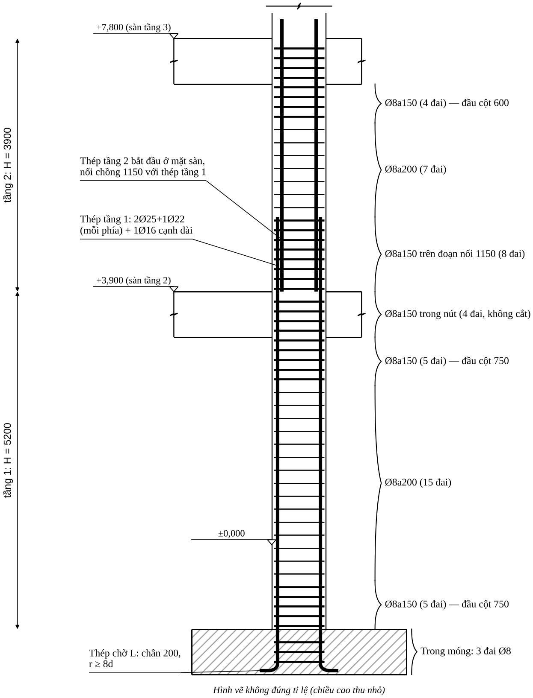{width=12.5cm}

## 12.7. Luật bố trí cho chương trình / Agent

::: {custom-style="Ghichu"}
Các luật dưới đây **nối tiếp** bảng luật chọn thép ở mục 10.4 (luật R1–R13 chọn thép; R14–R30 bố trí thép; R31–R40 kháng chấn ở 13.10; R41–R46 cổng chặn ở 14.6). Cột "Nguồn" như 12.2–12.3.
:::

| # | Điều kiện | Hành động của Agent | Nguồn |
|:--|:----------------------------------|:---------------------------------------------|:---|
| R14 | Mỗi mặt trên của dầm | Chọn $\ge2$ thanh góc chạy suốt, $A_s\ge\max(A_{s,min};\tfrac14A_{s,gối\ max})$ | B2 |
| R15 | $A_{s,gối}-A_{s,suốt}>0$ | Chọn thanh gia cường (hàng ngoài trước), không quá 2 cỡ Ø, chênh $\le6$ mm | B3 |
| R16 | Với mỗi nhóm cắt | Tính $M_u^{còn}$; tìm $x_{lt}$ trên hình bao; $x_{cắt}=x_{lt}+W$; làm tròn lên 50 mm | B4 |
| R17 | Có tải ngang đáng kể | Kiểm điểm cắt cho **cả** thép trên và thép dưới theo hình bao hai dấu; không dùng quy tắc rút gọn | B4 |
| R18 | $x_{cắt}$ nhỏ hơn quy tắc thực hành | Lấy giá trị lớn hơn | B4 |
| R19 | Gối biên | Thanh trên uốn xuống cột, $\ell_{đứng}\ge L_{an}$, $r\ge5d$ ($<20$) / $8d$ ($\ge20$) | B5 |
| R20 | Thép dưới vào gối | Neo $\ge\max(L_{an,min};\ 5d\text{ qua tim})$; nếu có tải ngang thì $L_{0,an}$ | B6 |
| R21 | Dầm nhiều nhịp | Thanh suốt chung; thanh gia cường mỗi bên cắt theo nhịp mình; xuyên qua cột khi cả hai nhịp cần | B7 |
| R22 | Mỗi dầm | Vùng gối $l_1=\max(L/4;x_1)$ bước theo $h$; giữa nhịp $s\le\min(3h/4;500)$; đai đầu cách mép 50 | B8 |
| R23 | Có dầm phụ gác lên | Thêm cốt treo trong $S=b_{dp}+2h_s$, 2 phía | B9 |
| R24 | $h>700$ (và $h=700$ đặt thiên về an toàn) | Cốt cạnh bên 2 hàng, cách đều, giằng đai, neo 300 | B10 |
| R25 | Cột — mỗi tầng | Gom tầng cùng thép; thép tầng $k$ nhô $L_{ov}$ qua sàn tầng $k+1$ | C1–C2 |
| R26 | Cột — đai | Ngoài nối $\min(15d_{min};500)$; đoạn nối và hai đầu cột $\min(10d_{min};300)$; đầu cột dài $l_d=\max(h_c;H_n/6;450)$ | C4 |
| R27 | Cột — nút | Đai không cắt trong nút | C4, C6 |
| R28 | Cột cạnh dài $>400$ hoặc $>4$ thanh/cạnh | Thêm đai phụ/thanh giằng; thanh cách một thanh ở chỗ uốn đai | C5 |
| R29 | Chân cột | Thép chờ cùng số thanh, Ø thép tầng 1; neo móng $0{,}75L_{0,an}$; chân L $\ge200$ | C3 |
| R30 | Hoàn tất mỗi cấu kiện | Lập bảng thống kê, đếm đai, khối lượng; chạy phiếu kiểm tra 12.8 | 12.4 |

**Cấu trúc dữ liệu đầu ra cho Drawing Agent** (một dầm; các toạ độ $x$ theo mm kể từ tim cột trái, trục dầm):

```json
{
  "element": "CB", "type": "beam", "section": {"b": 250, "h": 700, "cover": 20},
  "span": {"L": 6900, "left_support": {"type": "edge", "hc": 600},
           "right_support": {"type": "interior", "hc": 600}},
  "bars": [
    {"mark": 1, "dia": 25, "count": 2, "layer": "top_outer", "x0": -280, "x1": 6900,
     "left_end": {"bend": "down", "leg": 900, "r": 200}, "right_end": "continue"},
    {"mark": "2a", "dia": 22, "count": 3, "layer": "top_2rows", "x0": -280, "x1": 2150,
     "left_end": {"bend": "down", "leg": 800, "r": 176}},
    {"mark": "2b", "dia": 22, "count": 3, "layer": "top_2rows", "x0": 4900, "x1": 7850},
    {"mark": 3, "dia": 22, "count": 3, "layer": "bottom", "x0": -150, "x1": 7050},
    {"mark": 4, "dia": 12, "count": 4, "layer": "side", "x0": 0, "x1": 6900}
  ],
  "stirrups": [
    {"mark": 5, "dia": 8, "s": 150, "x_first": 350, "n": 12},
    {"mark": 6, "dia": 8, "s": 250, "x_first": 2250, "n": 11},
    {"mark": 5, "dia": 8, "s": 150, "x_first": 6550, "n": 12, "dir": -1},
    {"mark": 7, "dia": 8, "s": 75, "x_first": 3610, "n": 5, "extra": true},
    {"mark": 7, "dia": 8, "s": 75, "x_first": 3290, "n": 5, "dir": -1, "extra": true}
  ],
  "sections": [{"name": "1-1", "x": 700}, {"name": "2-2", "x": 2750}],
  "envelope_ref": "Hình 12.1a"
}
```

Mọi giá trị trong dữ liệu trên đã có trong 12.5; Agent vẽ chỉ cần đọc dữ liệu này cộng quy ước ở 12.4. Khi dùng cho dự án thật, mỗi thanh/điểm cắt thêm trường `basis` và đầu ra có mảng `flags` (R45, 14.6): với dầm CB ở ví dụ, `flags` = `["hinh_bao_uoc_luong", "nut_khong_lot_3_thanh"]` nên **chưa đủ để phát hành** cho đến khi xử lý 14.2.

## 12.8. Phiếu kiểm tra bố trí trước khi phát hành bản vẽ

- [ ] Mỗi thanh trên bản vẽ có số hiệu; bảng thống kê khớp số thanh trên mặt đứng và mặt cắt.
- [ ] Sau khi cắt, $M_u$ của nhóm còn lại $\ge|M|$ tại mọi điểm trên hình bao; mỗi thanh cắt đã có $W\ge\max(20d;\ \ldots)$.
- [ ] Thép trên có $\ge2$ thanh suốt; thép dưới vào gối $\ge2$ thanh và $\ge\tfrac12A_s$ nhịp.
- [ ] Neo thép dưới đủ ở gối có tải ngang; thép trên gối biên uốn xuống cột đủ $L_{an}$.
- [ ] Đai đầu cách mép cột 50; vùng đai dày $\ge L/4$ (và $\ge x_1$); đai không cắt trong nút.
- [ ] Cốt treo/đai gia cường tại mọi dầm phụ và tải tập trung.
- [ ] Cột: nối ngoài nút, $L_{ov}$ đủ; $\le4$ thanh/cạnh hoặc nối so le; thanh dọc đều được giằng; thép chờ chân cột đúng số thanh.
- [ ] Khoảng hở mọi tiết diện đạt (9.3) kể cả tiết diện có thanh uốn và giao cắt thép hai phương tại nút.
- [ ] Khối lượng thép/m³ bê tông nằm trong khoảng tham chiếu 14.4, hoặc đã giải thích lý do.
- [ ] Các mục kiểm tra bổ sung ở 14.7 (hình học nút, hai dầm cắt nhau, phạm vi áp dụng).

## 12.9. Lỗi bố trí thường gặp

::: {custom-style="Canhbao"}
**Lỗi thường gặp khi bố trí.** (1) Cắt thanh đúng tại tiết diện cắt lý thuyết, quên đoạn kéo dài $W$; (2) lấy $x_{lt}$ theo hình bao của **một** tổ hợp thay vì hình bao tất cả tổ hợp; (3) bỏ qua mô men dương ở gối do gió nên neo thép dưới không đủ; (4) thanh góc đai bị chiếm bởi thanh gia cường lớn nên không còn chỗ cho cốt giá; (5) nhiều hơn hai cỡ Ø trên một mặt cắt; (6) đai đầu cách mép cột quá xa (>100); (7) đai trong nút bị bỏ vì "bị dầm che"; (8) nối 100% thép cột trong vùng mô men lớn; (9) quên cốt treo tại dầm phụ; (10) thanh dài hơn 11,7 m nhưng không có vị trí nối; (11) ghi chiều dài đai theo kích thước ngoài bê tông chứ không phải đường tâm/kích thước trong lòng; (12) số đai tính theo $l/s$ mà không cộng đai đầu tiên; (13) **thép dầm không lọt qua thép cột ở nút** — nhất là khi dầm và cột cùng bề rộng (kiểm tra ở 14.2); (14) quên rằng dầm đặt thấp ở nút giao bị mất chiều cao làm việc (14.3).
:::


\newpage

# CHƯƠNG 13. CẤU TẠO KHI NHÀ CHỊU ĐỘNG ĐẤT (TCVN 9386:2012)

::: {custom-style="Canhbao"}
**Phạm vi và độ tin cậy — đọc trước khi dùng.** 4 tài liệu nguồn **không chứa** TCVN 9386:2012; B chỉ nêu số liệu Eurocode 8 phiên bản cũ. Chương này lấy các quy định **cấu tạo cốt thép của khung** theo **EN 1998-1:2004 (Eurocode 8)** — là cơ sở mà TCVN 9386:2012 được biên soạn theo — và đã đối chiếu với hai tài liệu công khai độc lập (xem cuối chương). Vì vậy:

- Con số ở đây dùng để **thiết kế sơ bộ, kiểm tra nhanh và lập luật cho chương trình**; hồ sơ thật **phải đối chiếu từng điều khoản với bản TCVN 9386:2012 hiện hành** và số điều khoản ghi ở 13.9.
- Điều nào hai nguồn công khai ghi **khác nhau** hoặc tôi **không kiểm chứng được** đều được đánh dấu ⚠ và liệt kê trong 13.9; không dùng thay cho tiêu chuẩn.
- Chương không thay phần **tính toán** động đất (phổ phản ứng, lực ngang, tổ hợp động đất, độ cứng, $P$–$\Delta$) — những phần đó nằm ở TCVN 9386:2012 và phần mềm.
:::

## 13.1. Khi nào phải áp dụng và cần tra gì

| Việc | Cần làm | Tra ở đâu |
|:---------------------------|:----------------------------------------------|:------------------------------|
| Gia tốc nền thiết kế $a_{gR}$ tại công trình | Tra theo địa điểm (tỉnh/huyện) | QCVN 02:2022/BXD; phụ lục bản đồ của TCVN 9386:2012 |
| Mức độ áp dụng thiết kế kháng chấn (động đất rất yếu/yếu có thể giảm nhẹ) | So $a_{gR}$ và $\gamma_I a_{gR}S$ với ngưỡng của tiêu chuẩn | TCVN 9386:2012, mục về trường hợp động đất yếu ⚠ |
| Hệ số tầm quan trọng $\gamma_I$ | Phân loại công trình (trường học thuộc nhóm cao hơn nhà ở thông thường) | TCVN 9386:2012, bảng tầm quan trọng ⚠ |
| Loại đất nền | Theo số liệu địa chất | TCVN 9386:2012 |
| Cấp dẻo kết cấu, hệ số ứng xử $q$ | 13.2 | TCVN 9386:2012 chương 5 |

## 13.2. Cấp dẻo và hệ số ứng xử

- **DCL** (dẻo thấp): chỉ dùng cho động đất yếu; cấu tạo thường theo TCVN 5574:2018 (Chương 9) — *không* bàn ở đây.
- **DCM** (dẻo trung bình) và **DCH** (dẻo cao): cấu tạo trong chương này.
- Hệ số ứng xử cơ bản cho hệ khung: $q_0=3{,}0\,\alpha_u/\alpha_1$ (DCM), $q_0=4{,}5\,\alpha_u/\alpha_1$ (DCH); $\alpha_u/\alpha_1=1{,}3$ cho khung nhiều tầng nhiều nhịp (⚠ tra điều 5.2.2.2).
- DCH đòi hỏi cấu tạo chặt hơn rõ rệt (13.4–13.6) để đổi lấy $q$ lớn — chọn cấp dẻo là **quyết định của kỹ sư kết cấu** căn cứ $a_{gR}$ và độ phức tạp thi công; không do Agent tự chọn.

## 13.3. Nguyên tắc "thiết kế theo khả năng" (capacity design)

Mục tiêu: khớp dẻo hình thành ở **dầm**, không ở cột; phá hoại cắt không xảy ra trước phá hoại uốn. Ba kiểm tra bắt buộc:

1. **Cột mạnh hơn dầm** tại mọi nút (trừ ngoại lệ ở điều khoản):
$$\sum M_{Rc}\ \ge\ 1{,}3\sum M_{Rb}$$
$\sum M_{Rc}$: tổng khả năng chịu mô men của các cột quy tụ về nút (tính với $N$ của tổ hợp động đất theo chiều lực dọc cho khả năng **nhỏ nhất**); $\sum M_{Rb}$: tổng khả năng chịu mô men của các dầm quy tụ về nút, tính với thép **thực tế** đã chọn (gồm cả thép trong bề rộng cánh bản tham gia).
2. **Lực cắt thiết kế dầm** lấy theo khả năng chịu mô men hai đầu, không lấy từ ETABS:
$$V_{Ed}=V_{g+\psi q}\ \pm\ \gamma_{Rd}\frac{M_{Rb,i}+M_{Rb,j}}{l_{cl}},\qquad \gamma_{Rd}=1{,}0\ (\text{DCM}),\ 1{,}2\ (\text{DCH})$$
Hai đầu lấy mô men của hai chiều lắc ngược nhau (đầu này kéo trên, đầu kia kéo dưới); $l_{cl}$ chiều dài thông thủy; $V_{g+\psi q}$ lực cắt do tải đứng trong tổ hợp động đất.
3. **Lực cắt thiết kế cột**:
$$V_{Ed}=\gamma_{Rd}\frac{M_{Rc,top}+M_{Rc,bot}}{l_{cl}}\ \ \text{(mô men cột nhân}\ \min\!\left(1;\ \tfrac{\sum M_{Rb}}{\sum M_{Rc}}\right)\text{)},\quad \gamma_{Rd}=1{,}1\ (\text{DCM}),\ 1{,}3\ (\text{DCH})$$

## 13.4. Dầm — quy định cấu tạo

| Hạng mục | DCM | DCH | Ghi chú |
|:----------------------------------|:------------------------------------------|:---------------------------------|:---------------------|
| Chiều dài vùng tới hạn $l_{cr}$ (từ mép cột) | $h_w$ | $1{,}5h_w$ | B ghi "$2h$" — **khác**; dùng bảng này |
| Đường kính đai tối thiểu | 6 mm | 6 mm | VN thường dùng Ø8 |
| Khoảng cách đai trong $l_{cr}$ | $\min\{h_w/4;\ 24d_{bw};\ 225;\ 8d_{bL}\}$ | $\min\{h_w/4;\ 24d_{bw};\ 175;\ 6d_{bL}\}$ | $d_{bL}$: Ø thanh dọc **nhỏ nhất**; hai nguồn trùng nhau |
| Đai đầu tiên | $\le50$ mm kể từ mặt cột | như DCM | |
| Ngoài vùng tới hạn | $s\le0{,}75d$ | như DCM | |
| Hàm lượng thép kéo tối thiểu | $0{,}5f_{ctm}/f_{yk}$ | $0{,}5f_{ctm}/f_{yk}$ | ⚠ một nguồn ghi DCM: $0{,}26f_{ctm}/f_{yk}$ (EC2); dùng giá trị lớn |
| Hàm lượng thép kéo tối đa trong vùng tới hạn | $\rho_{max}=\rho'+\dfrac{0{,}0018}{\mu_\varphi\varepsilon_{sy,d}}\dfrac{f_{cd}}{f_{yd}}$ | như DCM | ⚠ tra điều khoản; phụ thuộc $\mu_\varphi$ |
| Thép nén trong vùng tới hạn | $\rho'\ge0{,}5\rho$ | $A_{s,dưới}\ge0{,}5A_{s,trên}$ tại gối | |
| Thép chạy suốt | $\ge2\varnothing14$ trên và dưới | $\ge2\varnothing14$ trên và dưới | |
| Thép trên giữa nhịp | $\ge\tfrac14\times$ thép trên tại gối lớn hơn | như DCM | |
| Thép dưới tại gối | $\ge\tfrac14\times$ thép dưới giữa nhịp | như DCM | |
| Bề rộng | $b_w\le\min(b_c+h_w;\ 2b_c)$ | như DCM; $b_w\ge200$ | |
| Lệch tâm dầm–cột | $\le b_c/4$ | như DCM | B ghi "$b/2$" — **khác**; dùng $b_c/4$ |
| Lực dọc dầm | $\nu_d=N_{Ed}/(A_cf_{cd})\le0{,}1$ | như DCM | dầm có $N$ lớn xử lý như cột |
| Thép xiên cắt (DCH) | — | cần khi điều kiện cắt đảo dấu của điều khoản bị thoả | ⚠ tra điều khoản |

**Vùng tới hạn của dầm** còn gồm hai phía của mọi tiết diện có thể hình thành khớp dẻo (ví dụ nơi thép gia cường bị cắt đột ngột ⚠). Cắt thép trong vùng tới hạn: tránh nếu có thể; nếu cắt thì tiết diện còn lại phải đủ và đai trong $l_{cr}$ vẫn theo bảng.

## 13.5. Cột — quy định cấu tạo

| Hạng mục | DCM | DCH |
|:------------------------------------|:-------------------------------------|:-------------------------------|
| Cạnh nhỏ nhất | $\ge200$ (tham khảo ⚠) | $\ge250$ (tham khảo ⚠) |
| Lực dọc chuẩn hoá $\nu_d=N/(A_cf_{cd})$ | $\le0{,}65$ | $\le0{,}55$ |
| Hàm lượng thép dọc | $1\%\le\rho\le4\%$ | $1\%\le\rho\le4\%$ |
| Số thanh tối thiểu mỗi cạnh | $\ge2$ ⚠ | $\ge3$ ⚠ |
| Khoảng cách giữa các thanh được giằng | $\le200$ mm | $\le150$ mm |
| Vùng tới hạn $l_{cr}$ ở hai đầu cột | $\max\{h_c;\ l_{cl}/6;\ 450\}$ | $\max\{1{,}5h_c;\ l_{cl}/6;\ 600\}$ |
| Toàn chiều cao là vùng tới hạn khi | $l_{cl}/h_c<3$ | $l_{cl}/h_c<3$ |
| Đường kính đai tối thiểu | 6 mm (VN: Ø8) | 6 mm (VN: Ø8) |
| Khoảng cách đai trong $l_{cr}$ | $\min\{b_0/2;\ 175;\ 8d_{bL}\}$ | $\min\{b_0/3;\ 125;\ 6d_{bL}\}$ |
| Hàm lượng đai bó lõi $\omega_{wd}$ tối thiểu | $0{,}08$ (chân cột) | $0{,}12$ chân cột, $0{,}08$ vùng tới hạn khác |
| Kiểm tra bó lõi $\alpha\omega_{wd}$ | $\alpha\omega_{wd}\ge30\mu_\varphi\nu_d\varepsilon_{sy,d}\dfrac{b_c}{b_0}-0{,}035$ ⚠ | như DCM |
| Ngoài vùng tới hạn | đai theo Chương 9; $s\le\min(12d_{bL};\ b_0/2;\ 300)$ hoặc theo TCVN 5574 ⚠ | như DCM nhưng theo $d_{bL}$ nhỏ hơn |

Trong đó $b_0$ là cạnh nhỏ nhất của **lõi bê tông** tính đến **đường tâm đai**; $\omega_{wd}=\rho_wf_{yd,h}/f_{cd}$ với $\rho_w$ là tỉ lệ thể tích đai trên thể tích lõi; $\alpha=\alpha_n\alpha_s$, $\alpha_n=1-\sum b_i^2/(6b_0h_0)$, $\alpha_s=(1-s/2b_0)(1-s/2h_0)$; $\mu_\varphi=2q_0-1$ nếu $T_1\ge T_C$, $=1+2(q_0-1)T_C/T_1$ nếu $T_1<T_C$ (⚠ tra điều 5.2.3.4).

**Thanh dọc phải được giằng:** mọi thanh ở góc và **mọi thanh cách một thanh** trên chu vi nằm ở chỗ uốn của đai hoặc đầu thanh giằng có móc 135°; khoảng cách giữa các thanh được giằng không vượt quá giới hạn của bảng.

## 13.6. Nút khung dầm–cột

| Hạng mục | DCM | DCH |
|:------------------------------------|:------------------------------------------|:-------------------------------|
| Đai ngang trong nút | $\ge$ yêu cầu của vùng tới hạn cột (cùng bước và Ø) | tính theo lực cắt nút, không thưa hơn vùng tới hạn cột |
| Nút có dầm ở cả 4 mặt | bước đai **được gấp đôi** nhưng $\le150$ mm | như DCM |
| Thanh dọc trung gian trong nút | **bắt buộc** (giữa các thanh góc) | bắt buộc |
| Kiểm tra lực cắt nút | thường không yêu cầu riêng ⚠ | $V_{jhd}\le\eta f_{cd}\sqrt{1-\nu_d/\eta}\;b_jh_{jc}$ với $\eta=0{,}6(1-f_{ck}/250)$ ⚠ |
| Lực cắt nút | — | nút giữa: $V_{jhd}=\gamma_{Rd}(A_{s1}+A_{s2})f_{yd}-V_C$; nút biên: $\gamma_{Rd}A_{s1}f_{yd}-V_C$, $\gamma_{Rd}=1{,}2$ ⚠ |
| Đường kính thanh dầm xuyên nút | bị giới hạn theo bề rộng cột $h_c$ và hàm lượng ⚠ | như DCM, chặt hơn |

**Neo thanh dầm trong nút:** đoạn neo kể từ vị trí quy định trong điều khoản (không phải từ mép cột) và có hệ số tăng so với TCVN 5574 ⚠ — mục 9.7 vẫn là cấu tạo hình học (chiều dài, bán kính uốn); khi động đất, **kiểm tra lại $L_{an}$ theo TCVN 9386:2012** và đặt đai phụ ở chỗ uốn.

## 13.7. Neo, nối và cắt thép khi chịu động đất

1. **Nối chồng thép dọc cột:** không đặt trong vùng tới hạn ở đầu cột (chân cột tầng 1 và đầu cột sát dầm). Chuyển mối nối về **vùng giữa cột** ($l_{cr}\le$ vị trí $\le H_n-l_{cr}$), đủ $L_{ov}$ với hệ số tăng nếu điều khoản yêu cầu ⚠; đai trong đoạn nối không thưa hơn bước vùng tới hạn (thiên về an toàn **[thực hành]**).
2. **Thép dọc cột chân tầng 1:** thép chờ ở vùng tới hạn phải liên tục; mối nối đầu tiên nằm trên vùng tới hạn.
3. **Thép dầm:** nối thép trên ở giữa nhịp, thép dưới cách mép cột $\ge l_{cr}$ [thực hành]; không nối trong nút.
4. **Cắt thép dầm:** theo hình bao **hai dấu** (Chương 12, B4); thép trên suốt chiều dài và thép dưới tại gối theo bảng 13.4.
5. **Neo thép ở nút biên:** ưu tiên uốn vào trong cột, đoạn uốn đứng $\ge L_{an}$ theo TCVN 9386:2012; đặt đai phụ $\le100$ mm ở chỗ uốn.
6. **Móc đai:** móc 135° với đoạn thẳng $\ge10d_{sw}$ (hoặc $\ge75$ mm) ⚠; hai móc luân phiên.

## 13.8. Ví dụ kiểm tra kháng chấn (DCM) cho khung trục 3

::: {custom-style="Ghichu"}
**Điều kiện của ví dụ.** Đây là **minh hoạ phương pháp** trên số liệu của Chương 11 giả sử công trình thiết kế DCM. $N=1514{,}4$ kN lấy từ TH12 (**không phải** tổ hợp động đất — dự án thật phải dùng $N$ của tổ hợp động đất); $q_0=3{,}0\times1{,}3=3{,}9$ và $T_1\ge T_C$ (⚠ giả thiết). Không thay cho thiết kế kháng chấn.
:::

**Dầm CB 250×700** (thép 11.1, bố trí 12.5; $h_w=700$, $d_{bL}=22$, $d_{bw}=8$):

| Kiểm tra | Yêu cầu (DCM) | Hiện có | Kết luận |
|:--------------------------|:------------------------------|:------------------------------|:-----------|
| $l_{cr}$ | $=h_w=700$ mm | vùng đai Ø8a150 dài 1725 | ✓ |
| Đai trong $l_{cr}$ | $\min\{175;\,192;\,225;\,176\}=175$ | a150 | ✓ |
| Đai đầu | $\le50$ mm | 50 | ✓ |
| $\rho_{min}=0{,}5f_{ctm}/f_{yk}$ ($f_{ctm}=2{,}6$ ứng với B30≈C25/30 ⚠; $f_{yk}=500$) | $0{,}26\%\Rightarrow\ge417$ mm² | thép trên 2122, thép dưới 1140 | ✓ |
| $\rho'\ge0{,}5\rho$ tại gối | $A_{s,dưới}/A_{s,trên}\ge0{,}5$ | $1140/2122=0{,}54$ | ✓ (sát giới hạn) |
| Thép suốt trên | $\ge2\varnothing14$ và $\ge\tfrac14\times2122=531$ | $2\varnothing25=982$ | ✓ |
| Thép dưới gối $\ge\tfrac14$ thép dưới nhịp | $\ge285$ | $1140$ | ✓ |
| Đai theo khả năng | $V_{Ed}=V_{g+\psi q}\pm1{,}0\times(492{,}5+325{,}0)/6{,}3=V_{g+\psi q}\pm129{,}8$ kN | tính đai theo Bước 11 với $Q=V_{Ed}$ | **làm lại** nếu $V_{Ed}>Q_{max}=240{,}3$; nếu nhỏ hơn thì đai hiện có đủ |

Mô men đã dùng: $M_{Rb}$(gối, kéo trên)$=492{,}5$ (2Ø25+3Ø22, thép thực tế); $M_{Rb}$(gối, kéo dưới)$=325{,}0$ (3Ø22).

**Cột 22 250×600** (thép 11.4: mỗi phía 2Ø25+1Ø22 và cốt cấu tạo cạnh dài 1Ø16; $l_{cl}=4500$, $h_c=600$, $d_{bL}=16$, $b_0=250-2\times20-8=202$):

| Kiểm tra | Yêu cầu | Hiện có | Kết luận |
|:------------------------------|:-------------------------------|:------------------------------|:----------|
| $\nu_d=N/(A_cf_{cd})$ | $\le0{,}65$ (DCM); $\le0{,}55$ (DCH) | $1514{,}4\times10^3/(250\times600\times17)=0{,}594$ | ✓ DCM; ✗ DCH. Sát giới hạn: tiết diện nhỏ |
| $\rho$ | $1\%\ldots4\%$ | $2{,}08\%$ | ✓ |
| Khoảng cách thanh được giằng | $\le200$ mm | cạnh dài: tim $259{,}5$ (chỉ 1Ø16 giữa) | **✗ — thêm 1Ø16: mỗi cạnh dài 2Ø16** (cách 173); $\mu_t=2{,}35\%$ |
| $l_{cr}$ | $\max(600;\,750;\,450)=750$ | đầu cột Ø8a150, dài 750 | ✓ chiều dài |
| Đai trong $l_{cr}$ | $\min\{101;\,175;\,128\}\Rightarrow$ **a100** | a150 | **✗ — đổi a100** |
| $\alpha\omega_{wd}$ | $30\mu_\varphi\nu_d\varepsilon_{sy,d}b_c/b_0-0{,}035$; $\mu_\varphi=2\times3{,}9-1=6{,}8$; $\varepsilon_{sy,d}=435/200\,000$: yêu cầu $=0{,}291$ | Ø8a100 + 2 đai phụ: $\rho_w=0{,}95\%$, $\omega_{wd}=0{,}118$, $\alpha=0{,}674\times0{,}684=0{,}461$ ⇒ $\alpha\omega_{wd}=0{,}054$ | **✗ — chênh $\approx5$ lần** |
| $\sum M_{Rc}\ge1{,}3\sum M_{Rb}$ nút C | $1{,}3\times492{,}5=640{,}3$ | $2\times451=902$ (nội suy bảng 11.4 tại $N=1514$; giả thiết cột trên tương tự) | ✓ (hệ số $1{,}83$) |
| Lực cắt theo khả năng | $V_{Ed}=1{,}1\times2\times(451\times0{,}546)/4{,}5=120{,}4$ kN | $>Q_{b,min}=100{,}6$ → đai phải tính | Ø8a100 hai nhánh đủ ($q_{sw}=170{,}9$ N/mm $\gg$ yêu cầu) ✓ |

**Kết luận của ví dụ (ý nghĩa kỹ thuật):**

1. Dầm CB đạt cấu tạo DCM với bố trí hiện có.
2. Cột 22 phải **sửa cấu tạo**: đai a100 trong 750 mm hai đầu; 2Ø16 mỗi cạnh dài; đai nút a100 (nút biên).
3. Với $\nu_d\approx0{,}59$ và $\mu_\varphi=6{,}8$, điều kiện bó lõi $\alpha\omega_{wd}$ **không thể đạt bằng cách thêm đai**: phải **giảm $\nu_d$** (tăng tiết diện cột, ví dụ 300×700) hoặc **giảm $q$ thiết kế**. Đây là lý do kỹ sư kháng chấn tránh cột nhỏ mang lực dọc lớn.
4. Hai điều trên phụ thuộc $N$ và $\mu_\varphi$ — chỉ chốt sau khi có tổ hợp động đất thật.

{width=15cm}

## 13.9. Điểm phải tra trực tiếp trong TCVN 9386:2012 (không chép lại)

| # | Nội dung | Vì sao cần tra |
|:-:|:----------------------------------------|:----------------------------------------|
| 1 | $a_{gR}$, $\gamma_I$, loại đất; ngưỡng "động đất yếu/rất yếu" | Số liệu của dự án |
| 2 | $q_0$, $\alpha_u/\alpha_1$, $\mu_\varphi$ (điều 5.2.2.2, 5.2.3.4) | Dùng trong 13.5, 13.8 |
| 3 | $\rho_{max}$ dầm (5.4.3.1.2), $\rho_{min}$ dầm | Hai nguồn công khai ghi khác nhau về $\rho_{min}$ |
| 4 | Kích thước nhỏ nhất cột, số thanh mỗi cạnh | Giá trị DCM/DCH ghi trong nguồn không thống nhất |
| 5 | Công thức $\alpha\omega_{wd}$, $\omega_{wd,min}$ (5.4.3.2.2) | Ví dụ 13.8 phụ thuộc trực tiếp |
| 6 | Kiểm tra cắt nút (DCH), đường kính thanh dầm xuyên nút, neo thanh dầm ở nút biên (5.5.3.3, 5.6.2) | Chỉ nêu dạng chung |
| 7 | Nối thép trong và gần vùng tới hạn (5.6.3) | Chuyển mối nối khỏi vùng tới hạn (13.7) |
| 8 | Ngoại lệ của điều kiện $\sum M_{Rc}\ge1{,}3\sum M_{Rb}$ | Tầng mái, nhà thấp, một số cột |
| 9 | Móc đai: chiều dài đoạn thẳng | Giá trị tham khảo |
| 10 | Ranh giới chuyển từ "kháng chấn" sang cấu tạo thường (DCL) | Dự án vùng yếu |

## 13.10. Luật bổ sung cho Agent

| # | Điều kiện | Hành động của Agent |
|:--|:----------------------------------|:---------------------------------------------|
| R31 | Công trình có thiết kế kháng chấn | Người dùng xác nhận **cấp dẻo (DCM/DCH)**; Agent không tự chọn |
| R32 | Dầm trong vùng tới hạn | Đai $s\le\min\{h_w/4;24d_{bw};225;8d_{bL}\}$ (DCM) hoặc $\min\{h_w/4;24d_{bw};175;6d_{bL}\}$ (DCH), dài $h_w$ / $1{,}5h_w$ |
| R33 | Dầm | $\rho'\ge0{,}5\rho$ ở gối; $\ge2\varnothing14$ suốt; thép trên giữa nhịp $\ge\tfrac14$ thép trên gối |
| R34 | Cột | $\nu_d\le0{,}65$ (DCM) / $0{,}55$ (DCH); nếu vượt → báo **tăng tiết diện** |
| R35 | Cột | $\rho\in[1\%;4\%]$; thanh được giằng cách nhau $\le200$ (DCM) / $150$ (DCH) → thêm thanh dọc nếu cần |
| R36 | Cột — đầu cột | $l_{cr}=\max\{h_c;l_{cl}/6;450\}$ (DCM); đai $\min\{b_0/2;175;8d_{bL}\}$ |
| R37 | Cột — bó lõi | Tính $\alpha\omega_{wd}$; nếu không đạt bằng đai khả thi → báo **tăng tiết diện** |
| R38 | Nút | Đai nút $\ge$ vùng tới hạn cột; không cắt; thanh dọc trung gian |
| R39 | Mọi nút | Kiểm $\sum M_{Rc}\ge1{,}3\sum M_{Rb}$; không đạt → báo **tăng cột/giảm thép dầm**, không tự tăng thép cột |
| R40 | Nối thép cột | Chuyển mối nối khỏi vùng tới hạn; $L_{ov}$ kiểm theo 13.9 mục 7 |

**Nguồn của chương:** EN 1998-1:2004 (§5.4.3.1–5.4.3.3, §5.5.3, §5.6) qua hai tài liệu công khai độc lập: M. N. Fardis, *Detailed seismic design of concrete buildings to EC8* (đại học Patras) và bài giảng *EC8 2G* của Riva (ReLUIS); số liệu B (Ngô Thế Phong 2008) đối chiếu ở các ô có ghi "B ghi … — khác".


\newpage

# CHƯƠNG 14. RÀ SOÁT CỦA KỸ SƯ TRƯỚC KHI KÝ: HÌNH HỌC NÚT, PHẠM VI ÁP DỤNG VÀ GIỚI HẠN CỦA TÀI LIỆU

::: {custom-style="Ghichu"}
**Vì sao có chương này.** Chương 7–13 cho ra con số và cách sắp xếp *trên giấy*. Một kỹ sư làm nghề lâu năm kiểm tra thêm ba việc mà bảng tính không bắt được: (1) thép đã chọn **có đặt vừa vào nút thật không**; (2) công trình đang làm **có nằm trong phạm vi** của các quy trình này không; (3) kết quả cuối **có hợp lý** so với kinh nghiệm không. Chương này làm ba việc đó, và nói thẳng tài liệu **chưa** làm được gì.

Quy ước nguồn như Chương 12: **[thực hành]** — quy ước nghề, không có trong 4 tài liệu; **[hình học]** — suy ra từ kích thước và khoảng hở Chương 9.3, không cần tiêu chuẩn; **[ước lượng]**; **[kinh nghiệm]** — bậc độ lớn, chưa kiểm chứng bằng tài liệu nào trong bộ.
:::

## 14.1. Tài liệu này dùng được cho trường hợp nào

| Trường hợp | Đủ để chọn và bố trí thép? | Ghi chú |
|:--------------------------------------|:------------------|:-------------------------------------------|
| Khung BTCT toàn khối, dầm chữ nhật/chữ T, cột chữ nhật; tải đứng + gió; cấu kiện thường (Chương 7–9, 12) | **Đủ**, với điều kiện qua cổng hình học nút 14.2 | Ví dụ Chương 11–12 thuộc loại này |
| Có động đất | **Chưa đủ** | Chương 13 theo EN 1998-1:2004; phải đối chiếu **TCVN 9386:2012** (danh sách 13.9) |
| Dầm chịu xoắn (dầm biên đỡ console/sàn lệch tâm) | **Có quy trình** (15.1) | Theo D, mục 7.5–7.7; còn ba điểm ⚠ cần đối chiếu bản gốc (15.1.2); D không cho công thức tổ hợp $M$–$Q$–$T$ cùng lúc |
| Dầm có lỗ mở xuyên (ống kỹ thuật) | **Chỉ sàng lọc** (15.3) | Không có trong 4 tài liệu; không tự chọn vị trí/thép — phải tính riêng |
| Dầm cao / dầm sâu, dầm chuyển, console ngắn | **Chỉ sàng lọc** (15.2) | Mô hình thanh–giằng, không phải công thức Chương 7 |
| Khung có vách cứng, lõi thang | **Không** | Chương 3 chỉ cho khung phẳng; vách tính theo quy trình riêng |
| Cột nén lệch tâm xiên | **Gần đúng** | Bước 14b; kiểm tra lại bằng phần mềm có biểu đồ tương tác 3D |
| Sàn, móng, giằng móng, cầu thang | **Không** | Chỉ lấy tải từ sàn (4.4) và thép chờ chân cột (9.7.7, 12.3) |
| Nhịp lớn, dầm ứng lực trước | **Không** | Ngoài phạm vi |
| Chống cháy, môi trường xâm thực | **Chỉ lớp bảo vệ** | 9.2; cấp chịu lửa và cấp phơi nhiễm phải do dự án quy định (Chương 1) |

Khi gặp một dòng "Không", "Chưa đủ" hoặc "Chỉ sàng lọc", Agent **dừng và chuyển cho kỹ sư** (R42), không điền số cho đủ bảng.

## 14.2. Kiểm tra hình học nút: thép dầm có lọt qua thép cột không

Đây là lỗi mà bảng tính nào cũng bỏ qua, và công trường phát hiện ra đầu tiên. Ở nút khung, thép dọc cột chạy **thẳng đứng**, thép dầm chạy **nằm ngang** xuyên qua nút; mỗi thanh dầm phải lọt **giữa** hai thanh cột (theo bề rộng $b$), hoặc nằm ngoài chúng. Nếu cột và dầm cùng bề rộng (như khung trục 3: cột 250, dầm 250) thì thanh góc của dầm và thanh góc của cột nằm đúng một vị trí trong mặt bằng, không thể cùng đi qua.

**Quy trình kiểm tra [hình học]**

1. Toạ độ thanh cột theo bề rộng: thanh góc ở $\pm y_0$, $y_0=\tfrac{b_c}{2}-C-d_{đai}-\tfrac{d_{cột}}{2}$ ($C$ lớp bảo vệ); các thanh giữa chia đều.
2. Tính **khe** giữa hai thanh cột liền kề: $w_i=(y_{i+1}-y_i)-\tfrac{d_i+d_{i+1}}{2}$.
3. Một thanh dầm Ø$d_b$ chỉ lọt khe $i$ khi $w_i\ge d_b+2\,\delta$, $\delta\ge10$ mm là dung sai đặt thép và đầm bê tông [thực hành].
4. **Số thanh dầm trong một lớp** $\le$ số khe lọt được. Các lớp xếp chồng đứng nằm trong **cùng** khe (thanh lớp trong đặt ngay dưới thanh lớp ngoài, như 9.3), nên số thanh một lớp mới là giới hạn, không phải tổng số thanh.
5. Làm cho **cả thép trên và thép dưới** của dầm, và cho thép dầm của **phương vuông góc** (dầm dọc) đi qua cùng cột: thanh cột ở hai mặt dài cũng chiếm chỗ.

**Áp dụng cho ví dụ.** Cột 22 (250×600) mỗi mặt đầu có 2Ø25+1Ø22 → thanh ở $y=-84{,}5;\ 0;\ +84{,}5$ → hai khe, mỗi khe $84{,}5-12{,}5-11=61$ mm. Hàng ngoài của dầm CB ở gối C/B có **3 thanh** (Ø25, Ø22, Ø25, mục 11.1.1) → chỉ **2 thanh lọt**; thanh Ø22 giữa trùng đúng thanh cột Ø22. Thép dưới 3Ø22 của dầm cũng vào nút qua cùng các khe nên gặp lỗi tương tự.

{width=15cm}

::: {custom-style="Canhbao"}
**Kết luận về ví dụ.** Số liệu thép của dầm CB và cột 22 lấy từ A (tài liệu 2024) và **đúng về mặt chịu lực**, nhưng **chưa đặt được vào nút** nếu cột chỉ rộng 250 và có thanh giữa mỗi mặt. Không sửa số liệu A trong Chương 11 (để khớp nguồn); khi thiết kế thật phải xử lý bằng một trong các cách dưới đây.
:::

**Cách xử lý, theo thứ tự nên thử [thực hành]:**

| Cách | Nội dung | Hệ quả |
|:--|:-----------------------------------|:-----------------------------------|
| 1 | Tăng $b_c$ lên 300 và dùng **4 thanh mỗi mặt** (ví dụ 4Ø22 = 1521 mm² $\ge$ 1362) | 3 khe 52 mm — lọt 3 thanh Ø25/Ø22/Ø25 (hình 14.1b); phải kiểm tra lại độ mảnh, tải trọng bản thân và kiến trúc |
| 2 | Giữ cột 250 nhưng bỏ thanh giữa: mỗi mặt 2 thanh góc (ví dụ 2Ø28 = 1232, **thiếu** so với 1362) → phải tăng Ø hoặc thêm thép ở mặt dài | Khe giữa hai thanh góc rộng, đủ cho 3 thanh dầm; thép mặt dài lấy thêm phần diện tích còn thiếu |
| 3 | Giảm số thanh dầm trong một lớp xuống $\le$ số khe: đổi sang Ø lớn hơn (ít thanh hơn) | Kiểm tra lại khoảng hở và điều kiện $\xi\le\xi_R$; có thể phải tăng chiều cao dầm |
| 4 | Tăng bề rộng dầm trùm ra ngoài cột (dầm rộng hơn cột) | Thép dầm đi ngoài thanh cột; phải có cấu tạo đai nút và kiểm tra kiến trúc |

Không được "tạm bỏ" thanh cột hoặc uốn lệch thanh cột trong nút mà không tính lại $M_u$ của cột.

## 14.3. Hai dầm cắt nhau tại cột: chiều cao làm việc thực

Dầm khung và dầm dọc (hoặc dầm phụ) cùng chạy qua một cột thường có mặt trên ngang nhau, nên thép trên của hai dầm **cắt chéo ở cùng cao độ**: một dầm phải nằm thấp hơn dầm kia.

- Thép của dầm **chính** (khung, nhịp lớn) đặt ngoài; thép của dầm **phụ** nằm dưới thép dầm chính [thực hành].
- Khi đó $a$ của dầm đặt thấp **tăng thêm xấp xỉ đường kính thanh của dầm kia**: $a'\approx a+d_{kia}$ [thực hành]. Ví dụ dầm dọc 220×300, $a=40$, $h_0=260$; nếu nằm dưới thanh Ø25 của CB thì $a'\approx65$, $h_0'\approx235$ (giảm khoảng 10%), nên $A_s$ cần tăng cỡ 10% [ước lượng] và phải **tính lại** $M_u$ theo $h_0'$ (Bước 8c), không dùng $h_0$ giả thiết ban đầu.
- Dầm thấp hơn rất nhiều dầm kia (như dầm dọc 300 so với CB 700) vẫn bị ảnh hưởng ở mặt trên vì mặt trên của sàn thường ngang nhau.

## 14.4. Rà soát tính hợp lý của kết quả

| Kiểm tra | Cách làm | Nếu lệch |
|:--------------------------|:----------------------------------|:------------------------------|
| So với ETABS | $A_s$ tay so với $A_s$ do ETABS thiết kế cùng cặp nội lực | Lệch nhiều → kiểm tra $h_0$, $\xi_R$, tiêu chuẩn đang chọn trong ETABS (khác 5574:2018?), kể hay không kể cốt nén |
| Hàm lượng | $\mu$ dầm 0,5–2,0%; $\mu_t$ cột 1–3% là vùng làm việc thông thường [kinh nghiệm] | Ngoài vùng: nghĩ lại tiết diện trước khi nghĩ lại thép |
| Tiền lượng thép | Khối lượng thép (12.4) / thể tích bê tông; dầm khung thường vào cỡ 100–200 kg/m³ và cột 120–300 kg/m³ [kinh nghiệm — chưa kiểm chứng] | Ngoài khoảng: tìm lỗi (thiếu/dư đai, nhân đôi thanh, nhầm Ø) hoặc xem lại tiết diện |
| Khả năng thi công | Mỗi nút qua 14.2; mỗi dầm qua 9.3; có thể đầm được | Sửa trước khi phát hành |
| Chênh giữa tầng | Thép tầng $k$ và $k+1$ không đổi đột ngột; có lý do nếu đổi | Gom nhóm lại (C1) |
| Đối chiếu độc lập | Một người khác (hoặc một lần chạy độc lập) tính lại ít nhất các cấu kiện nguy hiểm nhất: gối giữa dầm tầng thấp, cột tầng 1 | Sai khác $>5\%$ phải truy ra nguyên nhân |

Khối lượng 239,7 kg của dầm CB (mục 12.5) tương ứng khoảng 198 kg/m³; con số này **ở cận trên** của khoảng [kinh nghiệm] ở trên vì dầm có tiết diện nhỏ so với tải. Chưa phải sai sót, nhưng là một dấu hiệu nên cân nhắc tiết diện lớn hơn — cũng giúp bài toán nút ở 14.2.

## 14.5. Những việc không thuộc tài liệu này nhưng người ký phải làm

- Xác nhận mô hình ETABS: tổng phản lực bằng tổng tải; chu kỳ dao động; chuyển vị đỉnh và chuyển vị tương đối giữa các tầng (Chương 6.4 chỉ kiểm tra ở mức tối thiểu).
- Điều kiện nền và phản lực chân cột lấy cho móng; thép chờ chân cột đã nối với bản vẽ móng.
- Cấp bê tông, cấp thép, lớp bảo vệ, cấp chịu lửa đúng với hồ sơ thiết kế cơ sở.
- Biện pháp thi công: chiều cao đổ, mạch ngừng thực tế (12.3 đặt mạch ngừng ở mặt dưới dầm), thép dài tối đa mua được.
- Với động đất: đối chiếu từng điều ở 13.9 với **TCVN 9386:2012**; xác nhận cấp dẻo và $a_{gR}$.
- Ký duyệt bởi kỹ sư có chứng chỉ hành nghề phù hợp. Tài liệu này là tài liệu tra cứu và hỗ trợ lập quy trình, **không phải hồ sơ thiết kế**.

## 14.6. Luật bổ sung cho Agent (cổng chặn trước khi xuất bản vẽ)

| # | Điều kiện | Hành động của Agent |
|:--|:----------------------------------|:---------------------------------------------|
| R41 | Trước khi xuất bản vẽ nút | Chạy kiểm tra 14.2 cho thép trên, thép dưới và thép dầm phương vuông góc; số thanh một lớp > số khe lọt được → **không vẽ**, trả về phương án 1–4 để kỹ sư chọn |
| R42 | Công trình/cấu kiện thuộc dòng "Không", "Chưa đủ" hoặc "Chỉ sàng lọc" ở 14.1 (xoắn đã có quy trình, xem R47–R50) | **Dừng**, ghi lý do và danh sách việc cần làm; không điền số |
| R43 | Hai dầm cắt nhau ở cùng cao độ mặt trên | Tính lại $h_0$ của dầm đặt thấp ($a'=a+d_{kia}$); chọn lại thép nếu $M_u<M$ |
| R44 | Tiền lượng hoặc $\mu$ ngoài khoảng 14.4 | **Cảnh báo** (không chặn) kèm con số và khoảng tham chiếu |
| R45 | Mọi con số đưa vào dữ liệu bản vẽ | Gắn trường `basis` ∈ {`TCVN`, `thuc_hanh`, `uoc_luong`, `can_xac_nhan`}; có bất kỳ `uoc_luong` hoặc `can_xac_nhan` thì dữ liệu mang cờ **"chưa đủ để phát hành"** |
| R46 | Hoàn tất | Không in nhãn "ĐẠT" khi còn cờ từ R41–R45 hoặc ⚠ ở Chương 13 |

## 14.7. Phiếu kiểm tra bổ sung (thêm vào 12.8)

- [ ] Mỗi nút: số thanh dầm một lớp $\le$ số khe lọt được giữa thanh cột (14.2), cho thép trên, thép dưới và dầm vuông góc.
- [ ] Dầm đặt thấp ở nút giao: $h_0$ đã giảm và $M_u$ đã kiểm tra lại (14.3).
- [ ] Tiền lượng và $\mu$ nằm trong khoảng tham chiếu, hoặc đã giải thích lý do (14.4).
- [ ] Không có cấu kiện thuộc dòng "Không" hoặc "Chưa đủ" ở 14.1 mà chưa được xử lý riêng.
- [ ] Mọi giá trị `uoc_luong` / `can_xac_nhan` đã được người có chứng chỉ xác nhận hoặc thay bằng số thật.


\newpage

# CHƯƠNG 15. XOẮN VÀ CÁC TRƯỜNG HỢP ĐẶC BIỆT (DẦM CAO, LỖ MỞ)

::: {custom-style="Ghichu"}
**Phạm vi.** Chương 14 liệt kê những trường hợp tài liệu chưa đủ. Chương này lấp phần có thể lấp được bằng nguồn kiểm chứng: **xoắn** (viết lại từ D, TCVN 5574:2018, mục 7.5–7.7 — đã đọc trực tiếp trang 163–169 của bản scan); **dầm cao** và **lỗ mở** chỉ viết đến mức *sàng lọc và nghĩa vụ phải làm*, vì 4 tài liệu không có quy trình tính, và những con số tìm được từ nguồn công khai quá ít để thành quy trình thiết kế.

Quy ước nhãn như Chương 12/14. Điều ghi **[suy ra từ D]** là phép biến đổi đại số của tôi từ công thức D (đã kiểm tra tính liên tục giữa các miền công thức); **⚠** là chỗ cần đối chiếu với tiêu chuẩn gốc.
:::

## 15.1. Xoắn

### 15.1.1. Khi nào khung có xoắn và phải phân loại

Xoắn xuất hiện ở dầm biên đỡ console hoặc sàn công xôn, dầm đỡ dầm phụ lệch tâm, dầm cong/gãy khúc, dầm có tải lệch trục. Trong ETABS đọc cột **T** (Torsion) của bảng nội lực phần tử dầm — **cùng tổ hợp, cùng trạm** với $M$ và $Q$ (không lấy $T_{max}$ của tổ hợp này ghép với $M$ của tổ hợp khác).

D (7.5) phân hai loại:

| Loại | Nhận biết | Xử lý |
|:------------------|:---------------------------------------|:-------------------------------------------|
| **Xoắn cân bằng** (sơ cấp) | $T$ cần thiết để cân bằng tải; không giảm được khi nội lực phân phối lại (D, Hình 7.7a) | Cốt thép phải chịu **toàn bộ** $T$ |
| **Xoắn tương thích** (thứ cấp) | $T$ sinh ra do biến dạng tương thích, có thể giảm khi phân phối lại (Hình 7.7b) | D nói có thể giảm nhưng **không cho hệ số giảm** ⚠ |

**Luật:** Agent không tự giảm $T$. Không xác định được loại → coi là cân bằng và báo kỹ sư (R47).

### 15.1.2. Công thức (D, 7.7)

Gọi $b$, $h$ là cạnh nhỏ và cạnh lớn; $Z_1$ là chiều dài cạnh của tiết diện ở **biên chịu kéo** đang xét, $Z_2$ là chiều dài cạnh còn lại (D, Hình 7.8; xem Hình 15.1); $\delta=\dfrac{Z_1}{2Z_2+Z_1}$ (7.28); $q_{sw1}=\dfrac{R_{sw}A_{sw1}}{s_w}$ (7.26) với $A_{sw1}$ là diện tích **một nhánh** đai chịu xoắn; $A_{s1}$ là diện tích cốt dọc nằm gần biên kéo đang xét.

| Điều kiện | Công thức | Mã D |
|:--------------------------------|:-------------------------------------------|:---|
| Bê tông không bị phá hoại do ứng suất nén chính | $T\le0{,}1R_bb^2h$ | 7.21 |
| $0{,}5\le\dfrac{q_{sw1}Z_1}{R_sA_{s1}}\le1{,}5$ | $T\le T_{gh}=q_{sw1}\,\delta\,Z_1Z_2+0{,}5R_sA_{s1}Z_2$ | 7.33 |
| $\dfrac{q_{sw1}Z_1}{R_sA_{s1}}<0{,}5$ (cốt đai yếu) | $T\le T_{gh}=q_{sw1}Z_1Z_2(\delta+1)$ | 7.34 |
| $\dfrac{q_{sw1}Z_1}{R_sA_{s1}}>1{,}5$ (cốt dọc yếu) | $T\le T_{gh}=0{,}5R_sA_{s1}Z_2(3\delta+1)$ | 7.35 |
| Uốn–xoắn đồng thời | $T\le T_{gh}\sqrt{1-\left(\dfrac{M}{M_{gh}}\right)^2}$ | 7.36 |
| Cắt–xoắn (điều kiện bê tông) | $T\le0{,}1R_bb^2h\left(1-\dfrac{Q}{0{,}3R_bbh_0}\right)$ | 7.37 |
| Cắt–xoắn (cốt thép) | $T\le T_{gh}\left(1-\dfrac{Q}{Q_{gh}}\right)$, $Q_{gh}=\left(0{,}5R_{bt}b+\dfrac{R_{sw}A_{sw}}{s_w}\right)h_0$ | 7.38 |

Các công thức 7.33–7.35 là dạng giản lược (không phải xét tiết diện vênh); D còn cho dạng đầy đủ 7.30–7.32 với tiết diện vênh $C$ (không dùng ở đây). Phải xét **vùng nén ở cả bốn cạnh** của tiết diện và lấy $T_{gh}$ **nhỏ nhất**. $T_{gh}$ trong 7.36 là của tiết diện vênh có cốt dọc chịu kéo chính là cốt chịu kéo do uốn; $M_{gh}$ là khả năng chịu mô men tiết diện thẳng góc; $Q_{gh}$ trong 7.38 lấy an toàn theo công thức đã ghi; $A_{sw}$ ở $Q_{gh}$ là tổng các nhánh đai chịu cắt.

Chuyển tiếp giữa 7.33–7.35 đã được kiểm tra liên tục tại $q_{sw1}Z_1/(R_sA_{s1})=0{,}5$ và $1{,}5$ (hai vế bằng nhau), nên cách chép lại không sai ký hiệu.

::: {custom-style="Canhbao"}
**⚠ Cần đối chiếu với bản gốc:** (i) $Z_1$, $Z_2$ lấy theo kích thước nào — D chỉ ghi "chiều dài cạnh", tài liệu này lấy theo **tâm đai** (thiên về an toàn); (ii) $A_{s1}$ có kể cả thép chịu uốn đã đặt ở biên đó — tài liệu này kể (cùng cách D dùng ở 7.36); (iii) D **không** cho công thức tổ hợp ba tác dụng $M$–$Q$–$T$ cùng lúc: kiểm tra 7.36 và 7.38 riêng rẽ, cả hai phải đạt.
:::

{width=15cm}

### 15.1.3. Quy trình chọn thép chống xoắn

1. **Lấy $T$, $M$, $Q$** cùng tổ hợp, cùng trạm; xác định loại xoắn (15.1.1).
2. **Điều kiện bê tông 7.21.** Không đạt → tăng tiết diện (đừng tăng thép). Thực tế $T$ lớn hơn khoảng một nửa giới hạn này thì đai xoắn đã rất dày; nên xem lại sơ đồ chịu lực/tiết diện [kinh nghiệm].
3. **Đai nhỏ nhất** [suy ra từ D]. Với mỗi cách đặt vùng nén (hình 15.1) tính $\delta=Z_1/(2Z_2+Z_1)$ và
$$q_{sw1}=\frac{T}{Z_1Z_2(1+\delta)}\ \Rightarrow\ s_w\le\frac{R_{sw}A_{sw1}}{q_{sw1}}$$
lấy giá trị **lớn nhất** của $q_{sw1}$ trong hai cách đặt (nén cạnh trên/dưới và nén cạnh bên), làm tròn $s_w$ xuống bội 5 mm. Cách này dùng miền 7.34 (đai yếu), cho lượng đai nhỏ nhất.
4. **Cốt dọc mỗi biên** [suy ra từ D]. Để 7.34 áp dụng được, cần $\dfrac{q_{sw1}Z_1}{R_sA_{s1}}\le0{,}5$, tức $A_{s1}\ge\dfrac{2q_{sw1}Z_1}{R_s}$ cho từng biên kéo (với $Z_1$ tương ứng). Tính đủ **bốn biên**; thép chịu uốn đã đặt được kể vào biên đó. Thiếu → thêm thanh dọc **trên chu vi**, không dồn một chỗ.
5. **Kiểm tra bằng công thức đầy đủ** 7.33–7.35 cho bốn cạnh, lấy $T_{gh}$ nhỏ nhất, phải $\ge T$.
6. **Kiểm tra tác dụng đồng thời:** 7.36 (có $M$), 7.37 và 7.38 (có $Q$). Không đạt → giảm bước đai và kiểm tra lại từ bước 5.
7. **Cấu tạo.** Cốt dọc đặt **theo chu vi** tiết diện và neo chắc vào gối; **đai kín**, hai đầu đai nối đủ chiều dài nối chồng và neo chắc (D, 7.6). Theo quy ước nghề [thực hành]: móc 135°; thanh dọc quanh chu vi cách nhau không quá cỡ 300 mm; đai xoắn đặt trên toàn đoạn có $T$ và không cắt đột ngột; bước đai xoắn không lớn hơn bước đai chống cắt ở cùng vùng.

### 15.1.4. Ví dụ minh hoạ [số giả định]

Dầm biên 250×500, B30 ($R_b=17$; $R_{bt}=1{,}15$), thép dọc CB500-V ($R_s=435$), đai Ø8 CB240-T ($R_{sw}=170$; $A_{sw1}=50{,}3$), $h_0=460$. Thép đã có: đáy 2Ø20 (628 mm²), đỉnh 2Ø14 (308), mỗi cạnh bên 2Ø14 (308). Nội lực **giả định** cùng tổ hợp: $T=10$ kN·m, $M=80$ kN·m, $Q=60$ kN. Khung đai tâm: $Z_b=202$, $Z_h=452$.

| Bước | Tính | Kết quả |
|:--|:----------------------------------------|:------------------------|
| 2 | $0{,}1R_bb^2h=0{,}1\times17\times250^2\times500$ | $53{,}1$ kN·m $\ge10$ ✓ |
| 3 | Nén cạnh trên/dưới: $Z_1=202$, $Z_2=452$, $\delta=0{,}1826$; $q=10^7/(202\times452\times1{,}1826)$ | $92{,}6$ N/mm → $s\le170\times50{,}3/92{,}6=92$ mm |
| 3 | Nén cạnh bên: $Z_1=452$, $Z_2=202$, $\delta=0{,}528$; $q=10^7/(452\times202\times1{,}528)$ | $71{,}7$ N/mm → $s\le119$ mm |
| 3 | Lấy trường hợp bất lợi | $q\ge92{,}6$; chỉ xoắn thì đai Ø8 **a90** |
| 4 | $A_{s1}\ge2qZ_1/R_s$: đáy/đỉnh $2\times92{,}6\times202/435$; cạnh bên $2\times92{,}6\times452/435$ | $86$ mm² (đáy, đỉnh ✓ 628/308); $192$ mm² (cạnh bên ✓ 308) |
| 6 | Kiểm tra a100: $T_{gh}=9{,}23$; 7.36: $6{,}73$; 7.38: $5{,}40$ | **không đạt** |
| 6 | a80: $T_{gh}=11{,}53$; 7.36: $8{,}41$; 7.38: $7{,}32$ | **không đạt** |
| 6 | **a60**: $q=142{,}4$; $T_{gh}=15{,}38$; $M_{gh}=116{,}9$ → 7.36: $15{,}38\sqrt{1-(80/116{,}9)^2}=11{,}22$; $Q_{gh}=197{,}2$ kN → 7.38: $15{,}38(1-60/197{,}2)=10{,}70$; 7.37: $47{,}7$ | $\ge10$ ✓ cả ba |

**Kết luận ví dụ:** đai **Ø8 a60** (không phải a90 như khi chỉ xoắn) vì phải đồng thời chịu uốn–xoắn và cắt–xoắn. Chỉ riêng $T=10$ kN·m mà đai đã phải dày 60 mm → đây là lý do ở bước 2 nên xem lại sơ đồ khi $T$ lớn. Các con số đã được kiểm tra lại bằng tính toán độc lập; số thép dọc, đai chỉ để minh hoạ phương pháp, **không phải thiết kế cho một công trình**.

## 15.2. Dầm cao (dầm sâu)

**Sàng lọc.** Theo EN 1992-1-1 (§5.3.1), dầm được coi là **dầm cao** khi nhịp hữu hiệu nhỏ hơn **3 lần chiều cao toàn phần** ($L_{ef}<3h$); nguồn đối chiếu công khai: *Design of Deep Beams* (Structville). ACI 318 có ngưỡng riêng (nhịp thông thủy $\le4h$ hoặc nhịp cắt $\le2h$ cho tải tập trung) — **⚠ chưa kiểm chứng trong phiên làm việc này**, xác nhận với bản ACI đang dùng; TCVN 5574:2018 phải tra ngưỡng của chính tiêu chuẩn.

**Với khung ví dụ:** $L_{CB}/h=6900/700\approx9{,}9$; BA: $2100/400\approx5{,}3$; console AE: $2100/400\approx5{,}3$ — đều ngoài ngưỡng, dùng được Chương 7. Dầm chuyển tầng, dầm đỡ cột/vách ở tầng kỹ thuật, tường chắn tầng hầm thường rơi vào loại này.

**Việc phải làm khi gặp dầm cao:** không dùng công thức uốn–cắt của Chương 7 (giả thiết tiết diện phẳng không còn đúng); dùng **mô hình thanh–giằng** hoặc phân tích phần tử hữu hạn 2D; cốt thép phân bố hai phương trên hai mặt, neo thanh giằng chịu kéo đủ dài kể cả ở vùng nút. Hướng dẫn chọn thép chi tiết nằm ngoài tài liệu này.

## 15.3. Lỗ mở xuyên dầm

4 tài liệu không có quy trình. Những gì kiểm chứng được trong phiên làm việc chỉ là: lỗ có đường kính lớn hơn khoảng $0{,}25$ lần chiều cao bụng được coi là **lỗ lớn** (tài liệu kỹ thuật công khai của IDEA StatiCa, không phải điều khoản tiêu chuẩn), cần phân tích riêng; lỗ gần gối làm giảm sức chịu cắt nhiều hơn lỗ ở giữa nhịp; dầm thiếu cốt thép quanh lỗ sẽ phá hoại giòn. Không có số liệu cụ thể về khoảng cách tới gối, giữa các lỗ, hay lượng đai quanh lỗ; tài liệu này **không đặt** những con số đó.

**Nghĩa vụ khi có lỗ (nguyên tắc nghề [thực hành], không có con số):**

- Lỗ phải được xác định ở giai đoạn thiết kế (không đục sau khi đổ), có bản vẽ phối hợp cơ điện.
- Ưu tiên vùng lực cắt nhỏ, xa mặt cột và xa tải tập trung; không đặt lỗ trong vùng đai gia cường/cốt treo.
- Không cắt thép dọc chịu lực; thép dọc đi quanh lỗ; đặt **đai gia cường hai bên lỗ** và thép bổ sung quanh lỗ do tính toán, không do "cấu tạo".
- Lỗ có kích thước lớn hoặc nhiều lỗ gần nhau → tính theo mô hình thanh–giằng/Vierendeel và kiểm tra cả vùng nén còn lại.
- Ống xuyên qua dầm khung chịu động đất: tránh vùng tới hạn (13.4).

Agent **không chọn** kích thước, vị trí, hay thép quanh lỗ (R52).

## 15.4. Luật bổ sung cho Agent

| # | Điều kiện | Hành động của Agent |
|:--|:----------------------------------|:---------------------------------------------|
| R47 | Dầm có $|T|>0$ trong bất kỳ tổ hợp nào | Phân loại cân bằng/tương thích; không xác định → coi là cân bằng và **hỏi kỹ sư**; không tự giảm $T$ |
| R48 | Có xoắn cần tính | Kiểm tra 7.21; không đạt → báo **tăng tiết diện** |
| R49 | Có xoắn cần tính | Chọn đai theo 15.1.3 bước 3; chọn thép dọc từng biên theo bước 4; kiểm tra bốn cạnh (bước 5) |
| R50 | Đồng thời có $M$ hoặc $Q$ | Kiểm tra riêng 7.36, 7.37, 7.38; chọn bước đai nhỏ nhất thoả cả ba; gắn cờ `can_xac_nhan` vì D không có công thức tổ hợp ba tác dụng |
| R51 | $L_{ef}/h<3$ (hoặc ngưỡng của dự án) | **Dừng**: dầm cao; chuyển sang mô hình thanh–giằng |
| R52 | Có lỗ mở xuyên dầm | **Dừng**: không chọn vị trí, kích thước, thép quanh lỗ; yêu cầu kỹ sư |

Dữ liệu đầu ra của dầm có xoắn thêm trường `"torsion": {"T": 10.0, "class": "equilibrium", "s_w": 60, "Z1": 202, "Z2": 452, "checks": {"7.21": 53.1, "7.36": 11.22, "7.38": 10.70}}` để Drawing Agent vẽ đai xoắn riêng và để người duyệt thấy mức dư.

**Nguồn của chương:** D (TCVN 5574:2018), mục 7.5–7.7, trang 163–169; EN 1992-1-1 §5.3.1 qua Structville (*Design of Deep Beams*); IDEA StatiCa (*Modern construction vs. openings in beams*).


\newpage

# PHỤ LỤC A. BẢNG TRA

## A.1. Cường độ bê tông (TCVN 5574:2018 — D, phụ lục)

| Cấp bền | B15 | B20 | B25 | B30 | B35 | B40 | B45 | B50 |
|:--|:-:|:-:|:-:|:-:|:-:|:-:|:-:|:-:|
| $R_b$ (MPa) | 8,5 | 11,5 | 14,5 | **17,0** | 19,5 | 22,0 | 25,0 | 27,5 |
| $R_{bt}$ (MPa) | 0,75 | 0,90 | 1,05 | **1,15** | 1,30 | 1,40 | 1,50 | 1,60 |
| $E_b$ (GPa) | 24,0 | 27,5 | 30,0 | **32,5** | 34,5 | 36,0 | 37,0 | 38,0 |
| $R_{b,n}$ (MPa, TTGH2) | 11,0 | 15,0 | 18,5 | 22,0 | 25,5 | 29,0 | – | – |
| $R_{bt,n}$ (MPa, TTGH2) | 1,10 | 1,35 | 1,55 | 1,75 | 1,95 | 2,10 | – | – |

Hệ số từ biến $\varphi_{b,cr}$ (B30): độ ẩm $>75\%$: 1,6; $40\div75\%$: 2,5; $<40\%$: 3,6.

## A.2. Cường độ cốt thép và hệ số $\xi_R$, $\alpha_R$ (TTGH1, $E_s=200\,000$ MPa)

| Nhóm thép | $R_s$ | $R_{sw}$ | $R_{sc}$ | $\xi_R$ (bảng D) | $\alpha_R$ (bảng D) | $\xi_R$ theo công thức | $\alpha_R$ theo công thức |
|:--|:-:|:-:|:-:|:-:|:-:|:-:|:-:|
| CB240-T | 210 | 170 | 210 | 0,615 | 0,426 | 0,615 | 0,426 |
| CB300-T/V | 260 | 210 | 260 | 0,583 | 0,413 | 0,583 | 0,413 |
| CB400-V | 350 | 280 | 350 | 0,533 | 0,391 | 0,533 | 0,391 |
| **CB500-V** | **435** | 300 | 435 | 0,481 | 0,365 | **0,493** | **0,371** |

Công thức: $\xi_R=\dfrac{0{,}8}{1+R_s/(E_s\,0{,}0035)}$; $\alpha_R=\xi_R(1-0{,}5\xi_R)$. Đối với CB500-V bảng của D và công thức lệch nhau 2,4% — tài liệu dùng công thức (như A), bảng cho an toàn hơn (xem Phụ lục B, mục 6). Giá trị $R_{sc}$ khi tải ngắn hạn cho thép CB500-V: tra D (435 hoặc 400 tuỳ điều kiện).

## A.3. Diện tích tiết diện thanh thép (mm²)

| Số thanh | Ø6 | Ø8 | Ø10 | Ø12 | Ø14 | Ø16 | Ø18 | Ø20 | Ø22 | Ø25 | Ø28 | Ø32 | Ø36 | Ø40 |
|:--|--:|--:|--:|--:|--:|--:|--:|--:|--:|--:|--:|--:|--:|--:|
| 1 | 28,3 | 50,3 | 78,5 | 113 | 154 | 201 | 255 | 314 | 380 | 491 | 616 | 804 | 1018 | 1257 |
| 2 | 57 | 101 | 157 | 226 | 308 | 402 | 509 | 628 | 760 | 982 | 1232 | 1608 | 2036 | 2513 |
| 3 | 85 | 151 | 236 | 339 | 462 | 603 | 763 | 942 | 1140 | 1473 | 1847 | 2413 | 3054 | 3770 |
| 4 | 113 | 201 | 314 | 452 | 616 | 804 | 1018 | 1257 | 1521 | 1963 | 2463 | 3217 | 4072 | 5027 |
| 5 | 141 | 251 | 393 | 565 | 770 | 1005 | 1272 | 1571 | 1901 | 2454 | 3079 | 4021 | 5089 | 6283 |
| 6 | 170 | 302 | 471 | 679 | 924 | 1206 | 1527 | 1885 | 2281 | 2945 | 3695 | 4825 | 6107 | 7540 |

## A.4. Diện tích thép bản trên 1 m bề rộng (mm²/m)

| Khoảng cách (mm) | 70 | 100 | 120 | 125 | 150 | 175 | 200 | 250 |
|:--|--:|--:|--:|--:|--:|--:|--:|--:|
| Ø6 | 404 | 283 | 236 | 226 | 188 | 162 | 141 | 113 |
| Ø8 | 718 | 503 | 419 | 402 | 335 | 287 | 251 | 201 |
| Ø10 | 1122 | 785 | 654 | 628 | 524 | 449 | 393 | 314 |
| Ø12 | 1616 | 1131 | 942 | 905 | 754 | 646 | 565 | 452 |

## A.5. Tải trọng gió

Vùng áp lực gió $W_0$ (QCVN 02:2022), hệ số $k(z)$, hệ số khí động $c$ và công thức tải gió: xem **Chương 4.5** (bảng thay số cho khung trục 3). Giá trị cụ thể của từng dự án **tra theo QCVN 02:2022/BXD và TCVN 2737:2023**, không lấy từ bảng ví dụ.

## A.6. Chiều dài neo nhanh (CB500-V, B30, thép gờ, $d\le32$ mm, $L_{0,an}=37{,}8d$)

| $d$ (mm) | 12 | 14 | 16 | 18 | 20 | 22 | 25 | 28 | 32 |
|:--|--:|--:|--:|--:|--:|--:|--:|--:|--:|
| $L_{0,an}$ (mm) | 454 | 529 | 605 | 681 | 757 | 832 | 946 | 1059 | 1210 |
| $L_{an,min}$ (mm) | 200 | 210 | 240 | 270 | 300 | 330 | 375 | 420 | 480 |
| $L_{ov}$ tối thiểu kéo, 100% nối ($1{,}2L_{0,an}$) | 545 | 635 | 726 | 817 | 908 | 998 | 1135 | 1271 | 1452 |

($L_{an,min}=\max(15d;\ 200;\ 0{,}3L_{0,an})$.) Giá trị nối ở dòng cuối là **cận khi $A_{s,cal}=A_{s,ef}$**, xem Chương 9.5.2 cho các điều kiện nối.

# PHỤ LỤC B. SAI KHÁC VÀ LỖI PHÁT HIỆN GIỮA CÁC TÀI LIỆU

::: {custom-style="Ghichu"}
Bảng liệt kê **mọi sai khác** đã gặp khi đối chiếu 4 tài liệu và khi tính lại ví dụ. "Xử lý" là lựa chọn của tài liệu này. Các mục được đánh dấu ⚠ cần người thiết kế xác nhận lại với bản gốc/tiêu chuẩn.
:::

| # | Nội dung | Tài liệu gốc ghi | Giá trị dùng trong tài liệu này | Lý do |
|:-:|:--------------------|:-----------------------|:-----------------------|:---------------------------|
| 1 | Hệ số chuyển đổi chu kỳ gió (ví dụ) | A: 0,864 | **0,852** | TCVN 2737:2023 (số dùng trong ví dụ gió) |
| 2 | $M$ nhịp dầm CB | A: "31,47" (bước thay số) | **315,47** kN·m | lỗi in; kết quả cuối của A đúng với 315,47 |
| 3 | $a$ dầm CB | A: "a = 55 cm" | **55 mm** | lỗi đơn vị |
| 4 | $R_{bond}$ trong ví dụ nút | A: $2{,}5\times1\times0{,}75$ | **$2{,}5\times1{,}0\times1{,}15=2{,}875$ MPa** | A thay $R_{bt}$ bằng 0,75 (cường độ B15); B30 có $R_{bt}=1{,}15$. $L_{an}$: 700 → **450** mm |
| 5 | $R_s$ thép CB240-T | A (ch.6): 225; bảng A, D: 210 | **210** | cùng giá trị D |
| 6 | $\xi_R,\alpha_R$ CB500-V | D bảng: 0,481/0,365; công thức: 0,493/0,371 | **0,493/0,371** (nêu bảng để đối chiếu) | A dùng công thức; bảng làm tròn thiên về an toàn |
| 7 | $\mu_{min}$ dầm | D: 0,1%; A: 0,05% (từ TCXDVN 356:2005) | **0,1%** | tiêu chuẩn hiện hành |
| 8 | Điều kiện độ mảnh $\lambda_b$ cột | D: $\le31$; A: $\le35$ | **$\le31$** | an toàn hơn |
| 9 | Biểu đồ tương tác (A) | không nhân $\eta$; $a=37{,}5$ (khác 40 khi tính); điểm E tại $0{,}2\xi_Rh_0=55<2a'=80$; điểm A nhân $\varphi$ công thức cũ | nhân $\eta$; $a=40$; E tại $x=2a'$; điểm A theo bảng D 6.1 | nhất quán với phần tính |
| 10 | Cột 22 — thép dọc | A: $A_s=1250$ (công thức thực nghiệm) | **1275** (D & nghiệm chính xác); chọn 2Ø25+1Ø22 | A thiên không an toàn $\approx2{,}5\%$ |
| 11 | Cột 22 — $\varphi_L$, $\eta$ | A: 1,42; 1,05 | 1,397; 1,045 | làm tròn khi thay số |
| 12 | Cột 22 — cốt cấu tạo cạnh dài | A: không đặt; $h=600>500$ | **1Ø16 mỗi cạnh dài** | D 6.2.1: tim thép $\le500$ |
| 13 | Cột 22 — đai | A: Ø8a350 (ngoài nối), a200 (nối) | **Ø8a200 / a150** | tính theo $d_{min}=16$ (cốt cấu tạo) thay vì $d=25$ |
| 14 | Đai dầm BA | A: $\min(\cdot)=200$; $Q_{u,min}$ in hệ số 1,15 | $\min=180$; hệ số **0,75** | công thức D 4.65a; kết quả vẫn đạt |
| 15 | Đai dầm CB | A: $0{,}25R_{bt}b=57{,}5$ | **71,9** N/mm | nhầm số; kết quả không đổi |
| 16 | Chiều dài tính toán dầm BA | A: $L=2225$ ($S_f'=370$) | $L=2100$ ($S_f'=350$) | theo nhịp tim trục |
| 17 | Nút góc mái cột 17/dầm 50 | A: $(M,N)=(8{,}71;119{,}5)$, $e_0=57{,}5$ cm | giữ $e_0=575$ mm ⚠ | $8{,}71/119{,}5=7{,}3$ cm — không khớp; phải lấy lại từ ETABS |
| 18 | Diện tích thanh Ø36, Ø40 | một số bảng in sai | 1017,9; 1256,6 mm² | tính $\pi d^2/4$ |
| 19 | Hệ số $\eta_2$ neo | D (một chỗ in) "0,9 khi $d<32$" | $1{,}0$ khi $d\le32$; $0{,}9$ khi $d>32$ | lỗi in (trái với điều kiện chung của D) |
| 20 | Lớp bảo vệ | C (TCXDVN 356:2005): 10–25 tuỳ cấu kiện; B cũ | **20/25/30/40 mm** (D, bảng 3.1) | tiêu chuẩn hiện hành |
| 21 | Bán kính uốn | A: $5d$ ($d<20$), $8d$ ($d\ge20$); B (1991): $10d$ | **A** | tiêu chuẩn hiện hành |
| 22 | Hệ số nối chồng, tỉ lệ nối | giá trị $\alpha_{ov}=1{,}2$ (kéo), $0{,}9$ (nén), tối thiểu và vị trí nối | theo D 3.4.7 và tài liệu nguồn | ⚠ một số giá trị lấy từ nguồn thứ cấp (xem E.2); đối chiếu lại với TCVN 5574:2018 điều 10.3.5 |
| 23 | Cấu tạo kháng chấn (B) | số liệu theo Eurocode 8 | **chỉ tham khảo** | thiết kế kháng chấn phải theo TCVN 9386:2012 |
| 24 | $l_0$ cột | B: nhiều giá trị tuỳ số nhịp, số tầng; A: 0,7$H$ | 0,7$l$ cho ví dụ nhiều tầng toàn khối (như A) ⚠ | tra TCVN 5574:2018 theo sơ đồ cụ thể |
| 25 | Nhịp thông thủy dầm CB để tính $S_f'$ (Bước 4, 11.1.2) | 6620 | **giữ 6620** (kết quả không đổi: trục trung hoà nằm trong cánh) ⚠ | tim–tim $6900-600=6300$ mới là thông thủy; $\tfrac16\times6300=1050<1100$ làm $S_f'$ nhỏ hơn, không ảnh hưởng $A_s$ vì $x<h_f'$ |
| 26 | Cốt giá dầm CB | bản trước của tài liệu này: 2Ø14 nối chồng với thép gối | **2Ø25 chạy suốt** (12.5) | hai thanh góc đai đã bị 2Ø25 chiếm; Ø14 không còn chỗ |
| 27 | Neo thép dưới dầm CB | 11.1.4 cũ: 400 mm | **450 mm** | 400 chỉ vượt tim cột 100 mm $<5d=110$ |
| 28 | Vùng tới hạn dầm khi động đất | B: $2h$ từ mặt cột | **$h_w$ (DCM), $1{,}5h_w$ (DCH)** | EN 1998-1:2004 (13.4) |
| 29 | Lệch tâm dầm–cột khi động đất | B: $\le b/2$ | **$\le b_c/4$** | EN 1998-1:2004 (13.4) |
| 30 | Khoảng cách đai cột trong vùng tới hạn, đường kính đai | B: $\min(8d;b/2;200)$; Ø $\ge8$ | **$\min(b_0/2;175;8d_{bL})$ (DCM)**; Ø $\ge6$ (VN dùng Ø8) | EN 1998-1:2004 (13.5) |
| 31 | Thép dầm CB đi qua nút cột 250 (ví dụ A) | A: 2Ø25+3Ø22 (hàng ngoài 3 thanh) qua cột 250 có 3 thanh mỗi mặt | **chỉ lọt 2 thanh/lớp**; xử lý theo 14.2 (tăng $b_c$ lên 300 với 4 thanh/mặt, hoặc đổi Ø/số thanh) | kiểm tra hình học 14.2 — số liệu A đúng về chịu lực nhưng chưa đặt vừa vào nút |

# PHỤ LỤC C. BIỂU MẪU

## C.1. Phiếu dữ liệu đầu vào một cấu kiện

| Trường | Dầm | Cột |
|:--|:--------------|:--------------|
| Mã phần tử / tầng / trục | | |
| $b\times h$ (mm), chiều dài | | |
| Cấp bền bê tông; nhóm thép dọc / đai | | |
| Lớp bảo vệ $c$ (mm) | | |
| Tổ hợp và vị trí | | |
| $M$ (kN·m), $N$ (kN), $Q$ (kN) | | |
| $M_{dh}$, $N_{dh}$ | – | |
| $l_0$ / điều kiện liên kết | – | |
| Yêu cầu riêng của dự án | | |

## C.2. Bảng thống kê thép dầm

| Dầm | Tiết diện | Vị trí | $M$ (kN·m) | $A_{s,tt}$ | Chọn | $A_{s,ch}$ | $\mu$ (%) | $M_u$ | Đai đầu/giữa | Ghi chú |
|:--|:--|:--|:--|:--|:--|:--|:--|:--|:--|:--|
| | | | | | | | | | | |
| | | | | | | | | | | |

## C.3. Bảng thống kê thép cột

| Cột | Tầng | Tiết diện | $M$/$N$ | $A_{s,tt}$ | Thép mỗi phía | Cấu tạo cạnh dài | $\mu_t$ (%) | $k_{max}$ | Đai (ngoài nối / nối) | $L_{ov}$ |
|:--|:--|:--|:--|:--|:--|:--|:--|:--|:--|:--|
| | | | | | | | | | | |
| | | | | | | | | | | |

# PHỤ LỤC D. BẢNG CÔNG THỨC TRA NHANH

| Nội dung | Công thức | Mục |
|:--|:-------------------------------|:--|
| Dầm — cốt đơn | $\alpha_m=\dfrac{M}{R_bbh_0^2}\le\alpha_R$; $\xi=1-\sqrt{1-2\alpha_m}$; $A_s=\xi\dfrac{R_bbh_0}{R_s}$ | 7.5–7.6 |
| Dầm — cốt kép | $A_s'=\dfrac{M-\alpha_RR_bbh_0^2}{R_{sc}(h_0-a')}$; $A_s=\dfrac{\xi_RR_bbh_0}{R_s}+\dfrac{R_{sc}}{R_s}A_s'$ | 7.6b |
| Cánh chữ T | $b_f'=b+2S_f'$; $M_f=R_bb_f'h_f'(h_0-0{,}5h_f')$ | 7.4 |
| Kiểm tra tiết diện | $x=\dfrac{R_sA_s}{R_bb}\le\xi_Rh_0$; $M_u=R_sA_s(h_0-x/2)$ | 7.8c |
| Cắt | $Q\le0{,}3R_bbh_0$; $Q_{b,min}=0{,}5R_{bt}bh_0$ | 7.9–7.10 |
| Đai | $s_{max}=\dfrac{R_{bt}bh_0^2}{Q}$; $q_{sw}=\dfrac{Q^2}{4{,}5R_{bt}bh_0^2}\ge0{,}25R_{bt}b$; $s_{tt}=\dfrac{R_{sw}A_{sw}}{q_{sw}}$ | 7.11 |
| Tiết diện nghiêng | $Q_u=\dfrac{1{,}5R_{bt}bh_0^2}{C}+0{,}75q_{sw}C$, $C\in[h_0;\,2h_0]$ | 7.11a |
| Cốt treo | $F\left(1-\dfrac{h_s}{h_0}\right)\le\sum R_{sw}A_{sw}$ | 7.13 |
| Đoạn kéo dài | $W=\dfrac{Q}{2q_{sw}}+5d\ge20d$ | 7.14 |
| Neo | $L_{an}=\alpha\dfrac{R_sA_s}{R_{bond}u_s}\dfrac{A_{s,cal}}{A_{s,ef}}\ge\max(15d;200;0{,}3L_{0,an})$; $R_{bond}=\eta_1\eta_2R_{bt}$ | 7.15; 9.5 |
| Cột — lệch tâm | $e_1=M/N$; $e_a=\max(h/30;\ l/600;\ 10)$; $e_0=\max(e_1;e_a)$ | 8.4 |
| Cột — uốn dọc | $\eta=\dfrac{1}{1-N/N_{cr}}$; $N_{cr}=\dfrac{\pi^2D}{l_0^2}$; $D=k_bE_bI+0{,}7E_sI_s$ | 8.5 |
| Cột — loại | $x_1=\dfrac{N}{R_bb}\le\xi_Rh_0$: lệch tâm lớn | 8.6 |
| Cột — $A_s$ | D (6.20)–(6.22) / A (5.30)–(5.31) | 8.7 |
| Cột — hàm lượng | $\mu_{min}$ 0,10–0,25% theo $l_0/h$; $\mu_t\le4\%$ (8% tại nối) | 8.8 |
| Cột — ngoài mặt phẳng | $N_u=\varphi(R_bA+R_{sc}A_{s,tot})$ | 8.10b |
| Biểu đồ tương tác | $N=R_bbx+R_{sc}A_s'-\sigma_sA_s$; $\sigma_s=R_s\left[\dfrac{2(1-x/h_0)}{1-\xi_R}-1\right]$ | 8.11 |
| Đai cột | $d_{sw}\ge\max(d_{max}/4;6)$; $s\le\min(15d_{min};500)$; nối: $\min(10d_{min};300)$ | 8.12 |
| Nối chồng | $L_{ov}=\alpha_{ov}L_{0,an}\dfrac{A_{s,cal}}{A_{s,ef}}$, $\alpha_{ov}=1{,}2$ (kéo), $0{,}9$ (nén) | 8.13; 9.5.2 |
| Nứt | $a_{crc}=\varphi_1\varphi_2\varphi_3\psi_s\dfrac{\sigma_s}{E_s}L_s\le a_{crc,u}$ | 7.16b |

# PHỤ LỤC E. TÀI LIỆU THAM KHẢO VÀ CÁC ĐIỂM CẦN XÁC NHẬN

## E.1. Tài liệu nguồn

1. [A] *Thiết kế khung bê tông cốt thép*, bản 4-9-2024 (trường học 6 tầng, Ninh Bình) — theo TCVN 5574:2018, TCVN 2737:2023, QCVN 02:2022.
2. [D] *Kết cấu bê tông cốt thép – Cấu kiện cơ bản* — theo TCVN 5574:2018.
3. [B] Ngô Thế Phong và cộng sự, *Kết cấu bê tông cốt thép – Phần kết cấu nhà cửa*, 2008 — theo TCVN 5574:1991 và Eurocode 8.
4. [C] Phan Quang Minh (chủ biên), *Kết cấu bê tông cốt thép – Phần cấu kiện cơ bản*, 2006 — theo TCXDVN 356:2005.
5. TCVN 5574:2018 *Kết cấu bê tông và bê tông cốt thép – Tiêu chuẩn thiết kế*.
6. TCVN 2737:2023 *Tải trọng và tác động – Tiêu chuẩn thiết kế*.
7. QCVN 02:2022/BXD *Số liệu điều kiện tự nhiên dùng trong xây dựng*.
8. TCVN 1651-1:2008, 1651-2:2008 *Thép cốt bê tông*.
9. TCVN 9386:2012 *Thiết kế công trình chịu động đất*.

## E.2. Các điểm cần người thiết kế xác nhận với tiêu chuẩn gốc

1. **Nối chồng:** $\alpha_{ov}$ khi nối 100% ở vùng kéo/nén, giá trị tối thiểu, tỉ lệ nối tối đa trên một mặt cắt — một số giá trị tra từ tài liệu thứ cấp; đối chiếu với TCVN 5574:2018 mục 10.3.5.
2. **Hệ số $\varphi_N$** cột nén đúng tâm và bảng $\varphi_n$ theo $l_0/b$ — D bảng 6.1; kiểm tra lại với bản tiêu chuẩn.
3. **Điểm 17 của Phụ lục B** (số liệu nút góc mái của A).
4. **Kháng chấn:** các giá trị ở **Chương 13** (EN 1998-1:2004) phải đối chiếu từng điều khoản với TCVN 9386:2012; danh mục ở 13.9. Mục 9.8 (từ B) chỉ để đối chiếu.
5. **Kiểm tra nứt và võng:** $M_{tc}$ tính theo tổ hợp tiêu chuẩn (TCVN 2737:2023); số trong ví dụ chỉ để minh hoạ phương pháp.
6. **Chiều dài tính toán $l_0$** của cột nhà nhiều tầng toàn khối: kiểm tra theo sơ đồ cụ thể (D 6.2).
7. **Hình học nút (14.2):** dung sai $\delta\ge10$ mm và các cách xử lý ở 14.2 là quy ước nghề [thực hành]; xác nhận theo biện pháp thi công của dự án.
8. **Xoắn (15.1):** ba điểm ⚠ ở 15.1.2 (kích thước $Z_1$, $Z_2$; cách kể $A_{s1}$; tổ hợp ba tác dụng) và ngưỡng bỏ qua xoắn; **dầm cao (15.2):** ngưỡng của ACI 318 và TCVN 5574:2018.


