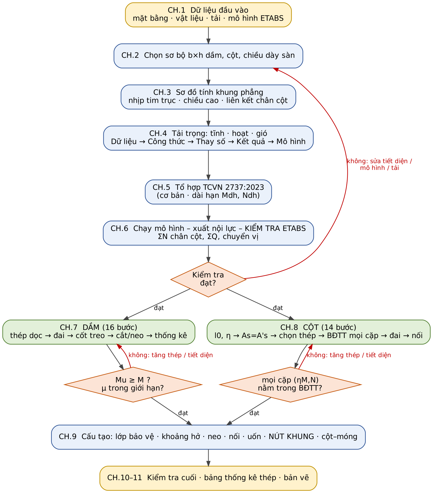

# 01 — VẬT LIỆU, HỆ SỐ VÀ BẢNG TRA (Phụ lục A, D của tài liệu nguồn)

> Dùng cùng `tra_vat_lieu`. Bảng dưới là **số liệu đối chiếu** — khi tính, lấy số từ kết quả tool, không tự nhớ.
> Đơn vị: MPa, mm, mm². Quy ước dấu và đổi đơn vị: module 00 mục 0.4.

# PHỤ LỤC A. BẢNG TRA

## A.1. Cường độ bê tông (TCVN 5574:2018 — D, phụ lục)

| Cấp bền | B15 | B20 | B25 | B30 | B35 | B40 | B45 | B50 |
|:--|:-:|:-:|:-:|:-:|:-:|:-:|:-:|:-:|
| $R_b$ (MPa) | 8,5 | 11,5 | 14,5 | **17,0** | 19,5 | 22,0 | 25,0 | 27,5 |
| $R_{bt}$ (MPa) | 0,75 | 0,90 | 1,05 | **1,15** | 1,30 | 1,40 | 1,50 | 1,60 |
| $E_b$ (GPa) | 24,0 | 27,5 | 30,0 | **32,5** | 34,5 | 36,0 | 37,0 | 38,0 |
| $R_{b,n}$ (MPa, TTGH2) | 11,0 | 15,0 | 18,5 | 22,0 | 25,5 | 29,0 | – | – |
| $R_{bt,n}$ (MPa, TTGH2) | 1,10 | 1,35 | 1,55 | 1,75 | 1,95 | 2,10 | – | – |

Hệ số từ biến $\varphi_{b,cr}$ (B30): độ ẩm $>75\%$: 1,6; $40\div75\%$: 2,5; $<40\%$: 3,6.
**Đối chiếu code:** `tra_vat_lieu` trả đúng $R_b$, $R_{bt}$, $E_b$ của bảng này cho B15–B50 (không có $R_{b,n}$, $R_{bt,n}$, $\varphi_{b,cr}$ — các giá trị này chỉ dùng cho nứt/võng, **không có tool**).

## A.2. Cường độ cốt thép và hệ số $\xi_R$, $\alpha_R$ (TTGH1, $E_s=200\,000$ MPa)

| Nhóm thép | $R_s$ | $R_{sw}$ | $R_{sc}$ | $\xi_R$ (bảng D) | $\alpha_R$ (bảng D) | $\xi_R$ theo công thức | $\alpha_R$ theo công thức |
|:--|:-:|:-:|:-:|:-:|:-:|:-:|:-:|
| CB240-T | 210 | 170 | 210 | 0,615 | 0,426 | 0,615 | 0,426 |
| CB300-T/V | 260 | 210 | 260 | 0,583 | 0,413 | 0,583 | 0,413 |
| CB400-V | 350 | 280 | 350 | 0,533 | 0,391 | 0,533 | 0,391 |
| **CB500-V** | **435** | 300 | 435 | 0,481 | 0,365 | **0,493** | **0,371** |

Công thức: $\xi_R=\dfrac{0{,}8}{1+R_s/(E_s\,0{,}0035)}$; $\alpha_R=\xi_R(1-0{,}5\xi_R)$; $\mu_{max}=\xi_R R_b/R_s$ (B30: CB240-T 4,98%; CB300 3,81%; CB400 2,59%; CB500-V 1,93%).
Đối với CB500-V bảng của D và công thức lệch nhau 2,4% — **tài liệu và tool dùng công thức** (như A); bảng cho **giá trị an toàn hơn** (0,481/0,365).
⚠ **Quy tắc:** trong lần chạy bình thường dùng giá trị của tool (công thức). Nếu người dùng nêu "hồ sơ thẩm tra từng số" thì ghi thêm cờ
`can_xac_nhan` + giá trị bảng để đối chiếu (Phụ lục B, mục 6). Giá trị $R_{sc}$ khi tải **dài hạn** cho CB500-V: tra D (400 hoặc 435 tuỳ điều kiện); **tool đặt 435** ⇒ cột chịu nén lớn do tải thường xuyên: gắn cờ `can_xac_nhan`.

## A.3. Diện tích tiết diện thanh thép (mm²)

| Số thanh | Ø6 | Ø8 | Ø10 | Ø12 | Ø14 | Ø16 | Ø18 | Ø20 | Ø22 | Ø25 | Ø28 | Ø32 | Ø36 | Ø40 |
|:--|--:|--:|--:|--:|--:|--:|--:|--:|--:|--:|--:|--:|--:|--:|
| 1 | 28,3 | 50,3 | 78,5 | 113 | 154 | 201 | 255 | 314 | 380 | 491 | 616 | 804 | 1018 | 1257 |
| 2 | 57 | 101 | 157 | 226 | 308 | 402 | 509 | 628 | 760 | 982 | 1232 | 1608 | 2036 | 2513 |
| 3 | 85 | 151 | 236 | 339 | 462 | 603 | 763 | 942 | 1140 | 1473 | 1847 | 2413 | 3054 | 3770 |
| 4 | 113 | 201 | 314 | 452 | 616 | 804 | 1018 | 1257 | 1521 | 1963 | 2463 | 3217 | 4072 | 5027 |
| 5 | 141 | 251 | 393 | 565 | 770 | 1005 | 1272 | 1571 | 1901 | 2454 | 3079 | 4021 | 5089 | 6283 |
| 6 | 170 | 302 | 471 | 679 | 924 | 1206 | 1527 | 1885 | 2281 | 2945 | 3695 | 4825 | 6107 | 7540 |

**Đối chiếu code:** `BANG_DUONG_KINH` có Ø6…Ø32 (làm tròn 1 chữ số thập phân: Ø12 = 113,1; Ø22 = 380,1). **Không có Ø36, Ø40** (cột cho phép tới Ø40 — D 6.2.1; Ø36/Ø40 sẽ báo `ValueError`). Diện tích 2 thanh Ø25 = 981,7 (bảng làm tròn 982); khác biệt < 0,1% không đổi kết luận.

## A.4. Diện tích thép bản trên 1 m bề rộng (mm²/m)

| Khoảng cách (mm) | 70 | 100 | 120 | 125 | 150 | 175 | 200 | 250 |
|:--|--:|--:|--:|--:|--:|--:|--:|--:|
| Ø6 | 404 | 283 | 236 | 226 | 188 | 162 | 141 | 113 |
| Ø8 | 718 | 503 | 419 | 402 | 335 | 287 | 251 | 201 |
| Ø10 | 1122 | 785 | 654 | 628 | 524 | 449 | 393 | 314 |
| Ø12 | 1616 | 1131 | 942 | 905 | 754 | 646 | 565 | 452 |

(Bản sàn nằm **ngoài phạm vi** các agent: chỉ lấy tải từ sàn và thép chờ cột — xem R42.)

## A.5. Tải trọng gió

Vùng áp lực gió $W_0$ (QCVN 02:2022), hệ số $k(z)$, hệ số khí động $c$ và công thức tải gió: xem Chương 4.5 của tài liệu nguồn
(đã chuyển cho Input Adapter, `SKILL_NHAP_DU_LIEU_ETABS.md`). Giá trị của từng dự án **tra theo QCVN 02:2022/BXD và TCVN 2737:2023**,
không lấy từ bảng ví dụ. Rule Engine Agent **không tính tải**.

## A.6. Chiều dài neo nhanh (CB500-V, B30, thép gờ, $d\le32$ mm, $L_{0,an}=37{,}8d$)

| $d$ (mm) | 12 | 14 | 16 | 18 | 20 | 22 | 25 | 28 | 32 |
|:--|--:|--:|--:|--:|--:|--:|--:|--:|--:|
| $L_{0,an}$ (mm) | 454 | 529 | 605 | 681 | 757 | 832 | 946 | 1059 | 1210 |
| $L_{an,min}$ (mm) | 200 | 210 | 240 | 270 | 300 | 330 | 375 | 420 | 480 |
| $L_{ov}$ tối thiểu kéo, 100% nối ($1{,}2L_{0,an}$) | 545 | 635 | 726 | 817 | 908 | 998 | 1135 | 1271 | 1452 |

($L_{an,min}=\max(15d;\ 200;\ 0{,}3L_{0,an})$.) Giá trị nối ở dòng cuối là **cận khi $A_{s,cal}=A_{s,ef}$**, xem module 04.
Cơ sở: $R_{bond}=\eta_1\eta_2R_{bt}=2{,}5\times1{,}0\times1{,}15=2{,}875$ MPa; $L_{0,an}=R_sd/(4R_{bond})=37{,}8d$.
**Chỉ đúng cho đúng tổ hợp CB500-V + B30.** Với B25 ($R_{bt}=1{,}05$): $L_{0,an}=41{,}4d$; với B20: $48{,}3d$ — luôn lấy từ `tinh_neo_noi`.

## Chuyển đổi đơn vị và kiểm tra nhanh bằng bậc độ lớn

- $\xi_R$ không phụ thuộc mác bê tông trong phạm vi B15–B60 ($\varepsilon_{b2}=0{,}0035$, tải ngắn hạn); phụ thuộc $R_s/E_s$.
- Khối lượng thép: $m_1=0{,}00617\,d^2$ kg/m (Ø8 0,395; Ø12 0,888; Ø16 1,580; Ø22 2,986; Ø25 3,856). Skill Vẽ dùng $0{,}0061654\,d^2$ — chênh 0,07%, bỏ qua.
- Lớp bảo vệ, khoảng hở, neo–nối: module 04.

# PHỤ LỤC D. BẢNG CÔNG THỨC TRA NHANH

> Cột "Mục" dùng số mục của tài liệu nguồn; module chứa chi tiết: dầm → 02, cột → 03, neo/nối → 04.

| Nội dung | Công thức | Mục |
|:--|:--|:--|
| Dầm — cốt đơn | $\alpha_m=\dfrac{M}{R_bbh_0^2}\le\alpha_R$; $\xi=1-\sqrt{1-2\alpha_m}$; $A_s=\xi\dfrac{R_bbh_0}{R_s}$ | 7.5–7.6 |
| Dầm — cốt kép | $A_s'=\dfrac{M-\alpha_RR_bbh_0^2}{R_{sc}(h_0-a')}$; $A_s=\dfrac{\xi_RR_bbh_0}{R_s}+\dfrac{R_{sc}}{R_s}A_s'$ | 7.6b |
| Cánh chữ T | $b_f'=b+2S_f'$; $M_f=R_bb_f'h_f'(h_0-0{,}5h_f')$ | 7.4 |
| Kiểm tra tiết diện | $x=\dfrac{R_sA_s}{R_bb}\le\xi_Rh_0$; $M_u=R_sA_s(h_0-x/2)$ | 7.8c |
| Cắt | $Q\le0{,}3R_bbh_0$; $Q_{b,min}=0{,}5R_{bt}bh_0$ | 7.9–7.10 |
| Đai | $s_{max}=\dfrac{R_{bt}bh_0^2}{Q}$; $q_{sw}=\dfrac{Q^2}{4{,}5R_{bt}bh_0^2}\ge0{,}25R_{bt}b$; $s_{tt}=\dfrac{R_{sw}A_{sw}}{q_{sw}}$ | 7.11 |
| Tiết diện nghiêng | $Q_u=\dfrac{1{,}5R_{bt}bh_0^2}{C}+0{,}75q_{sw}C$, $C\in[h_0;\,2h_0]$ | 7.11a |
| Cốt treo | $F\left(1-\dfrac{h_s}{h_0}\right)\le\sum R_{sw}A_{sw}$ | 7.13 |
| Đoạn kéo dài | $W=\dfrac{Q}{2q_{sw}}+5d\ge20d$ | 7.14 |
| Neo | $L_{an}=\alpha\dfrac{R_sA_s}{R_{bond}u_s}\dfrac{A_{s,cal}}{A_{s,ef}}\ge\max(15d;200;0{,}3L_{0,an})$; $R_{bond}=\eta_1\eta_2R_{bt}$ | 7.15; 9.5 |
| Cột — lệch tâm | $e_1=M/N$; $e_a=\max(h/30;\ l/600;\ 10)$; $e_0=\max(e_1;e_a)$ | 8.4 |
| Cột — uốn dọc | $\eta=\dfrac{1}{1-N/N_{cr}}$; $N_{cr}=\dfrac{\pi^2D}{l_0^2}$; $D=k_bE_bI+0{,}7E_sI_s$ | 8.5 |
| Cột — loại | $x_1=\dfrac{N}{R_bb}\le\xi_Rh_0$: lệch tâm lớn | 8.6 |
| Cột — $A_s$ | D (6.20)–(6.22) / A (5.30)–(5.31) | 8.7 |
| Cột — hàm lượng | $\mu_{min}$ 0,10–0,25% theo $l_0/h$; $\mu_t\le4\%$ (8% tại nối) | 8.8 |
| Cột — ngoài mặt phẳng | $N_u=\varphi(R_bA+R_{sc}A_{s,tot})$ | 8.10b |
| Biểu đồ tương tác | $N=R_bbx+R_{sc}A_s'-\sigma_sA_s$; $\sigma_s=R_s\left[\dfrac{2(1-x/h_0)}{1-\xi_R}-1\right]$ | 8.11 |
| Đai cột | $d_{sw}\ge\max(d_{max}/4;6)$; $s\le\min(15d_{min};500)$; nối: $\min(10d_{min};300)$ | 8.12 |
| Nối chồng | $L_{ov}=\alpha_{ov}L_{0,an}\dfrac{A_{s,cal}}{A_{s,ef}}$, $\alpha_{ov}=1{,}2$ (kéo), $0{,}9$ (nén) | 8.13; 9.5.2 |
| Nứt | $a_{crc}=\varphi_1\varphi_2\varphi_3\psi_s\dfrac{\sigma_s}{E_s}L_s\le a_{crc,u}$ | 7.16b |

**Tool nào cài công thức nào:** $\xi_R$ (`tinh_lech_tam_cot`, `tu_kiem_tra` cột); $q_{sw}$, $Q_{b,1}$, $\varphi_n$, $s_{max}$ cấu tạo (`tinh_cot_dai`);
$L_{0,an}$, $L_{an}$, $L_{lap}$ (`tinh_neo_noi`); $N e\le M_u$ (cột) và μ, loại Ø, $Q\le Q_{b,1}+Q_{sw,1}$ (`tu_kiem_tra`).
**Chưa có tool:** $\alpha_m$/$\xi$/$A_s$ dầm (lấy $A_s$ từ ETABS — "As_yc"), chữ T $b_f'$, $M_u$ dầm, $Q_{u,min}$, $W$, biểu đồ tương tác, nứt–võng, xoắn.

**Mô tả bằng chữ:** Lưu đồ dọc, từ trên xuống: CH.1 Dữ liệu đầu vào → CH.2 Chọn sơ bộ tiết diện → CH.3 Sơ đồ tính khung phẳng →
CH.4 Tải trọng → CH.5 Tổ hợp TCVN 2737:2023 → CH.6 Chạy mô hình, xuất nội lực, kiểm tra ETABS (ΣN chân cột, ΣQ, chuyển vị) → hình thoi
"Kiểm tra đạt?". Nhánh "không" (đỏ) quay ngược lên CH.2 ("sửa tiết diện/mô hình/tải"). Nhánh "đạt" tách hai: CH.7 Dầm (16 bước)
và CH.8 Cột (14 bước); mỗi nhánh có hình thoi kiểm tra riêng (dầm: Mu ≥ M và μ trong giới hạn; cột: mọi cặp (ηM, N) nằm trong biểu đồ
tương tác) với mũi tên đỏ quay lại ("tăng thép/tiết diện"). Hai nhánh hợp lại ở CH.9 Cấu tạo (lớp bảo vệ, khoảng hở, neo, nối, uốn, nút khung,
cột–móng) rồi CH.10–11 Kiểm tra cuối, bảng thống kê, bản vẽ. Ba "cổng" bắt buộc: cổng ETABS (cuối CH.6), cổng khả năng chịu lực (cuối từng cấu kiện),
cổng cấu tạo (CH.9).
