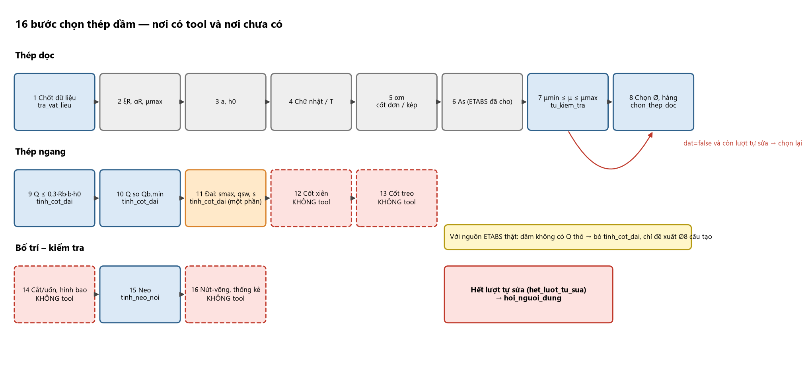
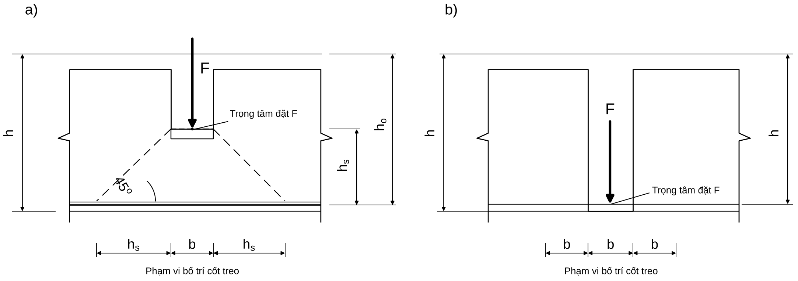
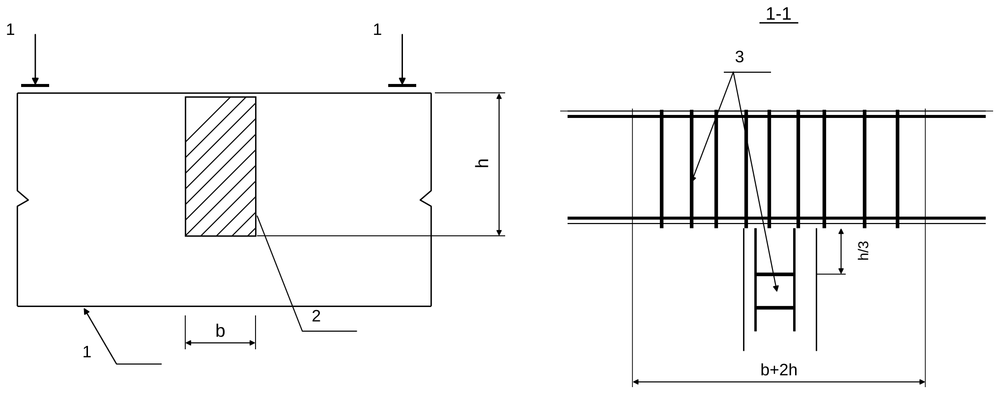

# 02 — CHỌN THÉP DẦM: 16 BƯỚC (Chương 7 của tài liệu nguồn)

> **Vai trò của agent:** với dầm nguồn ETABS, `As_yc` (thép trên = gối, thép dưới = nhịp) **đã có sẵn**; agent KHÔNG tính lại
> $\alpha_m,\xi,A_s$. Các bước 2–7 dưới đây là **kiến thức để hiểu và giải thích** kết quả tool, và để kiểm tra thép đã chọn có
> hợp lý không. Bước 8 (`chon_thep_doc`), 9–11 (`tinh_cot_dai`), 15 (`tinh_neo_noi`) và `tu_kiem_tra` là phần có tool.
> Bước 12, 13, 14, 16 **chưa có tool** (xem 00): agent áp dụng luật định tính, ghi `basis`, không tự bịa số.
> Nguồn: công thức D (TCVN 5574:2018); trình tự đai và ví dụ A. Ví dụ xuyên suốt: **dầm CB 250×700** (khung trục 3, tầng 1), B30, CB500-V, đai CB240-T.

# CHƯƠNG 7. CHỌN THÉP DẦM – 16 BƯỚC

| Nhóm | Bước | Nội dung | Tool |
|:--|:--:|:--|:--|
| **Thép dọc** | 1 | Chốt dữ liệu: nội lực, tiết diện, vật liệu | `tra_vat_lieu` |
| | 2 | Hệ số vật liệu $\xi_R$, $\alpha_R$, $\mu_{max}$ | (`tu_kiem_tra`) |
| | 3 | Giả thiết $a$, $h_0$ | — |
| | 4 | Phân loại tiết diện chữ nhật/chữ T | — |
| | 5 | Tính $\alpha_m$, chọn cốt đơn/kép | — |
| | 6 | Tính $A_s$ ($A_s'$) | (ETABS đã cho) |
| | 7 | Kiểm tra $\mu_{min}\le\mu\le\mu_{max}$ | `tu_kiem_tra` |
| | 8 | Chọn Ø, số thanh, hàng; $h_0$ thực; $M_u\ge M$ | `chon_thep_doc` |
| **Thép ngang** | 9 | $Q\le0{,}3R_bbh_0$ | `tinh_cot_dai` |
| | 10 | $Q$ so với $Q_{b,min}$ | `tinh_cot_dai` |
| | 11 | Cốt đai: $s_{max},q_{sw},s_{tt},s_{ct}$, tiết diện nghiêng | `tinh_cot_dai` (một phần) |
| | 12 | Cốt xiên | **không có** |
| | 13 | Cốt treo/giật đứt | **không có** (hàm `cot_dai.tinh_cot_treo` chưa mở thành tool) |
| **Bố trí – kiểm tra** | 14 | Cắt/uốn cốt dọc, hình bao vật liệu | **không có** (module 06) |
| | 15 | Neo cốt dọc vào gối và nút | `tinh_neo_noi` |
| | 16 | Kiểm tra cuối, nứt–võng, bảng thống kê | `tu_kiem_tra` (một phần) |

**Mô tả bằng chữ:** Lưu đồ gồm ba dải ngang theo nhóm của bảng trên. Dải "Thép dọc" (Bước 1–8): các ô nối nhau từ trái sang phải; Bước 1, 7, 8 tô xanh (có tool), Bước 2–6 tô xám ("kiến thức — As_yc đã có từ ETABS"). Dải "Thép ngang" (Bước 9–13): Bước 9–11 xanh (`tinh_cot_dai`), Bước 12–13 viền đỏ nét đứt ("chưa có tool"). Dải "Bố trí – kiểm tra" (Bước 14–16): Bước 15 xanh (`tinh_neo_noi`), Bước 14 và 16 viền đỏ. Từ ô "tu_kiem_tra" có mũi tên đỏ quay về Bước 8 với nhãn "dat=false và còn lượt tự sửa"; hết lượt ⇒ ô đỏ "hoi_nguoi_dung".

---

## Bước 1. Chốt dữ liệu đầu vào cho từng dầm

**Cần có:** $b, h$; $R_b, R_{bt}, R_s, R_{sc}, R_{sw}, E_s$; $M^{+}_{max}$ (nhịp), $M^{-}_{min}$ (từng gối), $Q_{max}$ (từng đầu); lực tập trung trong nhịp; $L$; hình bao.
Lập bảng từng dầm: tên — tầng — tiết diện — $M$ — $Q$ — tổ hợp. Gối trái/phải có $M$ gần nhau → **thiết kế chung theo giá trị lớn** (ví dụ $-462{,}37$ và $-434{,}67$ ⇒ dùng $462{,}37$). Ngưỡng "gần nhau" **không có số** trong tài liệu: do kỹ sư xác nhận.

**Ví dụ CB (phần tử 40–41, tầng 1):** gối C $-462{,}37$; gối B $-434{,}67$; nhịp $+315{,}47$ kN·m; $Q_{max}=240{,}3$ kN (đầu phải, gối B).
**Nguồn ETABS thật:** dầm chỉ có `As_yc` (FTopArea/FBotArea) và **không có $Q$ thô** ⇒ "Q: KHÔNG CÓ" (module 00, điều 4).
`As_yc = 0` hoặc "N.A." **không có nghĩa "không cần thép"**: luôn $A_{s}=A_{s,min}$ (Phần Q, A2/I1 — module 08).

## Bước 2. Hệ số vật liệu

$\xi_R=\dfrac{0{,}8}{1+\varepsilon_{s,el}/\varepsilon_{b2}}$, $\varepsilon_{s,el}=R_s/E_s$, $\varepsilon_{b2}=0{,}0035$; $\alpha_R=\xi_R(1-0{,}5\xi_R)$; $\mu_{max}=\xi_RR_b/R_s$.
CB500-V: $\xi_R=0{,}493$, $\alpha_R=0{,}371$, $\mu_{max}=1{,}93\%$ (bảng D: $0{,}481/0{,}365$ — an toàn hơn; xem module 01, A.2). Tra nhanh: CB240-T $0{,}615/0{,}426$; CB300 $0{,}583/0{,}413$; CB400-V $0{,}533/0{,}391$.

## Bước 3. Giả thiết $a$, $h_0$

$h_0=h-a$. Một hàng ($h\le500$): $a\approx35$–$45$ ($\approx40$); hai hàng: $a\approx55$–$70$ ($\approx h/10$); bản/dầm nhỏ $a\approx20$–$30$. Sau khi chọn thép phải **tính lại $a$ thực** (Bước 8).
CB: gối hai hàng $a=55$, $h_0=645$; nhịp một hàng $a=40$, $h_0=660$; BA $a=40$, $h_0=360$.

## Bước 4. Phân loại tiết diện: chữ nhật hay chữ T

- **Mô men âm (gối):** cánh ở vùng kéo → **chữ nhật** $b\times h$.
- **Mô men dương (nhịp):** cánh ở vùng nén → **chữ T**, $b_f'=b+2S_f'$ với $S_f'$ = **giá trị nhỏ nhất** của: mọi trường hợp $\le L/6$; có dầm ngang hoặc $h_f'\ge0{,}1h$: $\le\tfrac12$ khoảng hở thông thủy giữa hai dầm dọc; không có dầm ngang và $h_f'<0{,}1h$: $S_f'=6h_f'$; cánh console $h_f'\ge0{,}1h$: $6h_f'$; $0{,}05h\le h_f'<0{,}1h$: $3h_f'$; $h_f'<0{,}05h$: bỏ cánh.
- Vị trí trục trung hoà: $M_f=R_bb_f'h_f'(h_0-0{,}5h_f')$. $M\le M_f$ → tính như **chữ nhật $b_f'\times h$**; $M>M_f$ → qua sườn (6c).

CB nhịp: $S_f'=\min(1840;\ 6620/6)\to1100$; $b_f'=2450$; $M_f=2540{,}7\gg315{,}47$ ⇒ chữ nhật $2450\times700$. BA nhịp: $S_f'=350$, $b_f'=950$, $M_f=500{,}7>99{,}37$ ⇒ chữ nhật $950\times400$ (A dùng $L=2225$, $b_f'=990$ — thiên về không an toàn; lấy theo nhịp tim trục).

## Bước 5. Tính $\alpha_m$ và chọn loại cốt thép

$\alpha_m=\dfrac{M}{R_bbh_0^2}$ (chữ T qua cánh: thay $b$ bằng $b_f'$). $\alpha_m\le\alpha_R$ → **cốt đơn**; $\alpha_R<\alpha_m\le0{,}5$ → **cốt kép** hoặc tăng tiết diện; $\alpha_m>0{,}5$ → **bắt buộc tăng tiết diện** (R1).
CB gối C: $\alpha_m=0{,}2615<0{,}371$ (cốt đơn); nhịp: $\alpha_m=0{,}0174$.

## Bước 6. Tính diện tích cốt thép

### 6a. Cốt đơn (Bài toán 1 – A, D 4.30–4.31)

$\xi=1-\sqrt{1-2\alpha_m}$; $A_s=\xi\dfrac{R_bbh_0}{R_s}$ (hoặc $A_s=\dfrac{M}{\zeta R_sh_0}$, $\zeta=1-0{,}5\xi$).

### 6b. Cốt kép (Bài toán 2 – biết $M$, chưa biết $A_s'$)

Chọn $\xi=\xi_R$: $A_s'=\dfrac{M-\alpha_RR_bbh_0^2}{R_{sc}(h_0-a')}$, $A_s=\dfrac{\xi_RR_bbh_0}{R_s}+\dfrac{R_{sc}}{R_s}A_s'$ (D 4.28–4.29).

### 6c. Biết sẵn $A_s'$ (Bài toán 3 – tận dụng thép nén có sẵn, ví dụ thép gối/ thép giá)

$\alpha_m=\dfrac{M-R_{sc}A_s'(h_0-a')}{R_bbh_0^2}$ (D 4.30). $\alpha_m>\alpha_R$: coi như chưa biết $A_s'$ (6b). $\alpha_m\le\alpha_R$ và $x\ge2a'$: $A_s=\xi\dfrac{R_bbh_0}{R_s}+\dfrac{R_{sc}}{R_s}A_s'$ (4.31). $x<2a'$: $A_s=\dfrac{M}{R_s(h_0-a')}$ (4.33).
**Chữ T qua sườn** ($M>M_f$): $\alpha_m=\dfrac{M-R_b(b_f'-b)h_f'(h_0-0{,}5h_f')}{R_bbh_0^2}$; $A_s=\dfrac{R_b}{R_s}[\xi bh_0+(b_f'-b)h_f']$ (A 5.12–5.13); $\xi>\xi_R$ ⇒ tăng tiết diện hoặc đặt $A_s'$.

**Kết quả CB (tính lại bằng code, độc lập):** gối C $A_{s,tt}=1950$ mm² ($\xi=0{,}309$; A in 1954); gối B riêng $1809$; nhịp (chữ T, $h_0=660$) $1109$ (chữ nhật thiên về an toàn: 1213). Lỗi in của A: $M=31{,}47$ thay cho $315{,}47$ (kết quả cuối vẫn đúng).

## Bước 7. Kiểm tra hàm lượng cốt thép

$\mu=\dfrac{A_s}{bh_0}\times100\%$; $\mu_{min}\le\mu\le\mu_{max}$. **$\mu_{min}$ dầm = 0,1%** (D, điều gốc 10.3.1.1; **không dùng 0,05% của TCXDVN 356:2005 [TC cũ]**). $\mu<\mu_{min}$ ⇒ $A_s=\mu_{min}bh_0$ (R3). Hàm lượng hợp lý A: $0{,}6$–$1{,}2\%$ ($\approx\tfrac13$–$\tfrac12\mu_{max}$ = $0{,}64$–$0{,}96\%$ với CB500-V/B30); ngoài khoảng → xem lại tiết diện.
CB: gối $\mu=1{,}21\%$ (hơi cao, chấp nhận); nhịp $0{,}67\%$.
**Tool:** `tu_kiem_tra(loai="dam")` kiểm $\mu\ge\mu_{min}$ (truyền `do_manh_L0_h` = **0** để dầm nhận 0,10%) và $\mu\le3{,}0\%$ (hằng số cảnh báo thực hành của đồ án). Ngưỡng này **lỏng hơn** $\mu_{max}=\xi_RR_b/R_s$ thật với CB400-V (B30: 2,59%) và CB500-V (1,93%), và chặt hơn với CB240/CB300 (4,98%/3,81%): **agent tra $\mu_{max}$ theo nhóm thép ở module 01 (A.2, giá trị cho B30) và ghi cờ `can_xac_nhan` nếu $\mu$ do tool báo vượt giá trị tra, kể cả khi tool báo đạt** (chỉ so sánh hai số có sẵn, không tự tính).

## Bước 8. Chọn thép, bố trí hàng, kiểm tra $h_0$ thực và khả năng chịu lực

### 8a. Bảng diện tích thép (mm²)

Xem module 01, A.3. (Ø12–Ø32; tool không có Ø36/Ø40.)

### 8b. Nguyên tắc chọn (A 5.4.1, C, TCVN 5574:2018)

1. Đường kính chịu lực dầm Ø12–Ø32 (C: 10–30; dầm khung Ø16–Ø25). 2. **Không quá 3 loại Ø** trong một dầm. 3. Trong cùng miền chịu lực chênh Ø **không quá 6 mm**; thanh lớn ở hàng ngoài. 4. **Không dùng hai Ø chênh 1 mm.** 5. $b\ge150$ ⇒ **≥2 thanh** chịu lực; cốt giá Ø10–Ø12. 6. **Tối đa 2 hàng**; đối xứng; thanh lớn ở góc. 7. Thép gối–nhịp các dầm liên tục phải khớp để uốn/cắt/neo. 8. $A_{s,chọn}\ge A_{s,tt}$, vượt không quá khoảng 5–10%.
**Số thanh tối đa một hàng:** $n\le\dfrac{b-2(c+d_{đai})+t}{d+t}$, $c=20$, $t\ge\max(d;25)$ dưới, $\ge\max(d;30)$ trên.

| $b$ (mm) | Dưới Ø16–Ø20 | Dưới Ø22–Ø25 | Trên Ø16–Ø20 | Trên Ø22–Ø25 |
|:--:|:--:|:--:|:--:|:--:|
| 220 | 3 | 3 | 3 | 3 |
| 250 | 4 | 4 | 3–4 | 3 |
| 300 | 5 | 4 | 4–5 | 4 |
| 350 | 6 | 5 | 5–6 | 5 |
| 400 | 7 | 6 | 6 | 5 |

(Đai Ø8, $c=20$; bảng chỉ để chọn nhanh — công thức cho Ø16, $b=250$ ra 5 thanh dưới; **luôn kiểm bằng công thức**.)
**Thép cạnh bên:** $h>700$ (C) ⇒ cốt cấu tạo dọc cạnh bên, tổng $0{,}1$–$0{,}2\%$ tiết diện sườn, bước $\le400$; $h=700$ (đúng ngưỡng) ⇒ nên đặt **2Ø12 mỗi bên** (R24).
**Đối chiếu tool:** `chon_thep_doc(loai="dam")` mặc định `cover=25`, khoảng hở 25 mm cho cả lớp trên, ưu tiên Ø≥16 và **một** đường kính trong một vị trí, thừa ≤ ~5–15% — cho ra tổ hợp **có thể khác tài liệu** (CB gối: tool chọn 10Ø16 hai lớp = 2011 mm², tài liệu 2Ø25+3Ø22 = 2122 mm²); điều bắt buộc là $A_{s,thực}\ge A_{s,yc}$ và mọi ràng buộc cấu tạo, không phải trùng khớp số thanh.

### 8c. Tính lại $a$ thực và kiểm tra khả năng chịu lực

$a=\dfrac{\sum A_{si}y_i}{\sum A_{si}}$, $h_0^{thực}=h-a$, $x=\dfrac{R_sA_s}{R_bb}$, $M_u=R_sA_s(h_0-x/2)\ge M$, $x\le\xi_Rh_0$.
**Gối CB:** $2\varnothing25+3\varnothing22=2122$ mm² (+8,8%), hai hàng (ngoài 2Ø25+1Ø22 = 1362; trong 2Ø22 = 760). Khe một hàng 3 thanh: $(250-2\times28-72)/2=61$ mm $\ge30$. $a=(1362\times40{,}5+760\times89)/2122=57{,}9$; $h_0=642{,}1$; $x=217<\xi_Rh_0=317$; $M_u=492{,}5\ge462{,}37$ (dư 6,5%).
**Nhịp CB:** $3\varnothing22=1140$; $h_0=661$; $x=11{,}9$; $M_u=325{,}0\ge315{,}47$.
**Cảnh báo:** thép hàng ngoài 3 thanh trong cột 250 **không lọt qua thép cột** (R41, module 09 mục 14.2).

## Bước 9. Kiểm tra ứng suất nén chính trên dải nghiêng

$Q\le0{,}3\varphi_nR_bbh_0$ (D 4.49; A 5.14), $\varphi_n=1$ khi không có lực dọc đáng kể. Không đạt ⇒ **tăng tiết diện/cấp bê tông** (R6), không bù bằng đai.
CB: $0{,}3\times17\times250\times645=822{,}4\ge240{,}3$ ✓. **Tool:** `tinh_cot_dai` trả `dat_dieu_kien_ep_vo_bung` và `Q_gioi_han_ep_vo_bung`.

## Bước 10. Bê tông có tự chịu cắt được không

$Q_{b,min}=0{,}5R_{bt}bh_0$ (D 4.55; A 5.15a). $Q\le Q_{b,min}$ ⇒ **đai cấu tạo**; $Q>Q_{b,min}$ ⇒ tính đai (R5). Giới hạn $Q_b$: $0{,}5R_{bt}bh_0\le\dfrac{\varphi_{b2}R_{bt}bh_0^2}{C}\le2{,}5R_{bt}bh_0$, $\varphi_{b2}=1{,}5$, $0{,}6h_0\le C\le3h_0$.
CB: $Q_{b,min}=92{,}7<240{,}3$ ⇒ tính đai; BA: $51{,}75<117{,}99$ ⇒ tính đai; console $Q=24{,}89<51{,}75$ ⇒ cấu tạo. **Tool:** `tinh_cot_dai` trả `Qb1` và `can_dat_dai_theo_tinh_toan`.

## Bước 11. Tính cốt đai (cốt đai không có cốt xiên)

### 11a. Phương pháp A (đơn giản – dùng cho ví dụ; thiên về an toàn)

| # | Công thức | Ghi chú |
|:--|:--|:--|
| 1 | $s_{max}=\dfrac{R_{bt}bh_0^2}{Q}$ | `buoc_dai_toi_da_theo_kha_nang_chiu_cat` |
| 2 | $q_{sw}=\max\!\left(\dfrac{Q^2}{4{,}5R_{bt}bh_0^2};\ 0{,}25R_{bt}b\right)$ | |
| 3 | $s_{tt}=\dfrac{R_{sw}A_{sw}}{q_{sw}}$, $A_{sw}=n\,a_{sw}$ | **không có tool chọn $s$**: agent đọc kết quả, không tự tính |
| 4 | $s_{ct}$ đầu dầm ($L/4$): $\min(h/2;\,300)$ (A dùng $h_0/2$); giữa dầm $\min(3h/4;\,500)$ | `buoc_dai_max_dam` dùng $h_0$ |
| 5 | $s=\min(s_{max};s_{tt};s_{ct})$, **làm tròn xuống bội 50 mm** | |
| 6 | $C_0=\sqrt{2R_{bt}bh_0^2/q_{sw}}$; $C=\min(\max(C_0;h_0);2h_0)$; $Q_{u,min}=\dfrac{1{,}5R_{bt}bh_0^2}{C}+0{,}75q_{sw}C\ge Q$ | $q_{sw}$ theo bước đã chọn; **không có tool** |

**CB (đầu phải, $Q=240{,}3$, $h_0=645$, Ø8 hai nhánh = 100,5 mm²):** $s_{max}=497{,}7$; $q_{sw}=107{,}3\ge71{,}9$; $s_{tt}=159{,}2$; $s_{ct}=300$ ⇒ **Ø8a150** ở $L/4=1725$ mm hai đầu; giữa dầm $s_{ct}=483\to$ **Ø8a250**. Kiểm: $q_{sw}(150)=113{,}9$; $C=2h_0=1290$; $Q_{u,min}=139{,}1+110{,}2=249{,}3\ge240{,}3$ ✓ (A in $0{,}25R_{bt}b=57{,}5$: nhầm số).
**BA (gối B, $Q=117{,}99$, $h_0=360$):** $s_{max}=315{,}8$; $q_{sw}=83{,}0$; $s_{tt}=205{,}8$; $s_{ct}=180$ ⇒ **Ø8a150** đầu, **Ø8a250** giữa; $Q_{u,min}=139{,}1\ge117{,}99$ ✓ (A in $\min=200$ và hệ số 1,15 thay 0,75: sai in).
⚠ **Khác biệt với code:** `tu_kiem_tra` (dầm) dùng tiêu chí chặt hơn $Q\le Q_{b,1}+Q_{sw,1}$ ($Q_{b,1}=0{,}5R_{bt}bh_0$, $Q_{sw,1}=q_{sw}h_0$). Với **Ø8a150 của CB ($Q=240{,}3$)** tool cho $165{,}4$ kN ⇒ **báo vi phạm** dù 11a cho $249{,}3$ kN đạt; cần đai khoảng **Ø8a70** để tool chấp nhận. Agent: làm theo tool (an toàn hơn), ghi cờ `can_xac_nhan` "tiêu chí đồ án chặt hơn 11a".

### 11b. Phương pháp D chính xác hơn (có kể tải phân bố trên đoạn nghiêng)

$q_1=g+0{,}5p$. $Q_u(C)=\dfrac{1{,}5R_{bt}bh_0^2}{C}+(0{,}75q_{sw}+q_1)C$ khi $0{,}6h_0\le C\le2h_0$ (4.65a); $Q_u(C)=\dfrac{1{,}5R_{bt}bh_0^2}{C}+q_1C+1{,}5q_{sw}h_0$ khi $2h_0<C\le3h_0$ (4.65b). Cực tiểu: $C_2=\sqrt{1{,}5R_{bt}bh_0^2/(0{,}75q_{sw}+q_1)}$ (4.67), $C_3=\sqrt{1{,}5R_{bt}bh_0^2/q_1}$ (4.68); kiểm thêm $C=0$ ($Q_u(0)=2{,}5R_{bt}bh_0$), $2h_0$, $3h_0$ (4.66). Dùng khi A cho đai quá dày; **không có tool**.

### 11c. Phương pháp gần đúng của D (tiết diện thẳng góc cách gối $a$)

$a\in[h_0;2{,}5h_0]$ ($a=1{,}5h_0$); $Q_1=Q_{max}-q_1a$; $Q_{b,1}=\dfrac{1{,}25R_{bt}bh_0^2}{a}$, giới hạn $[0{,}5;\,2{,}5]R_{bt}bh_0$ (4.82); $Q_{sw,1}=Q_1-Q_{b,1}$; $<0$ ⇒ đai cấu tạo; $\ge0$ ⇒ $q_{sw}=Q_{sw,1}/h_0$ (4.83), $q_{sw}\ge0{,}25R_{bt}b$ (tải tập trung: $q_{sw}=(Q_1-Q_{b,1})/(\lambda h_0)$, $\lambda=0{,}75;1;1{,}5$ — D 4.84).

### 11d. Cốt đai cấu tạo và các yêu cầu chung (A 5.2.2; D 4.7.2; C)

| Yêu cầu | Giá trị |
|:--|:--|
| $h\le150$ | không cần đai |
| $h>150$, **có tính đai** | $s_{ct}\le\min(h/2;300)$ đoạn $L/4$ gần gối |
| $h>150$, **không phải tính** | $s_{ct}\le\min(3h/4;500)$ |
| Đường kính đai | $\ge6$; C: Ø6–Ø10; $h\ge800$ ⇒ Ø$\ge8$ |
| Số nhánh | $b\le400$: 2 nhánh; $b>400$ hoặc nhiều hơn 5 thanh nén một hàng: $\ge3$–4 nhánh |
| Có cốt nén kể vào tính | đai kín, $s\le15d$ và $\le500$ |
| Đai đầu tiên | cách mép cột/gối $\approx50$ mm |

⚠ **Xung đột trong chính tài liệu nguồn** (mặc định = giá trị chặt hơn, ghi cờ): (i) $s_{ct}$ gần gối: 11d $\min(h/2;300)$ ⟷ 9.4.2 và B8: $\min(h/2;300)$ nếu $h\le450$, **$\min(h/3;500)$ nếu $h>450$**; (ii) số nhánh: 11d ($b\le400$: 2) ⟷ 9.4.2 ($b\le350$: 2; $b>350$: 3–4) ⟷ rule base cũ ($b\ge400$: $\ge3$; $b\le150$: 1). Ví dụ CB/BA không bị ảnh hưởng ($s_{tt}$ chi phối).
**Lỗi thường gặp:** lấy $Q$ giữa dầm thay $Q_{max}$ mép gối; dùng $R_s$ (210) thay $R_{sw}$ (170); quên số nhánh; $s$ không làm tròn xuống; không kiểm $q_{sw}\ge0{,}25R_{bt}b$; đai giữa dày bằng đai đầu; bỏ đai bổ sung chỗ dầm phụ.

## Bước 12. Cốt xiên (khi bê tông + đai chưa đủ)

Ít dùng. $Q\le Q_b+Q_{sw}+Q_{sw,inc}$, $Q_{sw,inc}=\sum\varphi_{sw}R_{sw}A_{s,inc}\sin\theta$, $\varphi_{sw}=0{,}75$ (D 4.85). Góc: $h<400$: 30°; $400\le h\le800$: 45°; $h>800$: 60°. Trình tự: (1) $Q_{u,min}$ bằng bê tông + đai; (2) $Q_{sw,inc,yc}=Q-Q_b-Q_{sw}$; (3) $A_{s,inc}=Q_{sw,inc,yc}/(0{,}75R_{sw}\sin\theta)$; (4) khoảng cách gối–lớp xiên đầu, giữa các lớp, lớp cuối–lực tập trung đều $\le s_{max}$ (D 4.17); (5) kiểm mọi tiết diện nghiêng $0{,}6h_0\le C\le3h_0$.
Trong ví dụ CB và BA không cần cốt xiên. **Không có tool:** nếu $Q_u<Q$ sau khi giảm bước đai/tăng Ø/nhánh → **không tự chọn cốt xiên**, báo kỹ sư (`can_xac_nhan`).

## Bước 13. Cốt treo (giật đứt) tại chỗ dầm phụ gác lên dầm chính

Điều kiện (A 5.22a; bản 2018 chỉ còn yêu cầu cấu tạo ở mục 10.4.12): $F\left(1-\dfrac{h_s}{h_0}\right)\le\sum R_{sw}A_{sw}$; $F=\gamma_{f1}G+\gamma_{f2}P$ (phản lực dầm phụ); $h_s$ = khoảng cách từ trọng tâm lực $F$ (đáy dầm phụ) đến trọng tâm cốt dọc dầm chính; đoạn bố trí $a=2h_s+b_{phụ}$ (dầm phụ thấp hơn dầm chính). Hai dầm **cùng chiều cao**: $a=3b$, $F\le\sum R_{sw}A_{sw}$ (A 5.22b). **Cấu tạo:** bước đai treo $40$–$80$; mỗi bên dầm phụ **≥4 đai**; trên dầm phụ thêm cốt ngang trong đoạn $h/3$. Phân bổ (Phần Q, C3): ≥2/3 $A_{sw}$ trong $(b+2h)$ dầm chính, phần còn lại trong $h/3$ dầm phụ.
**CB tại D:** $F=15{,}9\times1{,}15+7{,}5\times1{,}3=28{,}035$ kN; $h_s=645-270=375$; $F(1-h_s/h_0)=11{,}74$ kN ⇒ $\sum A_{sw}\ge69$ mm² (0,69 đai); vùng $a=970$; **chọn 5 đai Ø8 mỗi bên** (cấu tạo ≥4; bước 50–80). **Quên cốt treo là lỗi hay gặp nhất.** Tool: `cot_dai.tinh_cot_treo` có trong code nhưng **chưa mở thành tool** ⇒ agent ghi yêu cầu (≥4–5 đai Ø8 mỗi bên, vùng $b+2h_s$) với `basis=thuc_hanh` và để Drawing vẽ.

**Mô tả bằng chữ:** Hai hình cắt đứng cạnh nhau. (a) Dầm chính nằm ngang, phía trên có một khối nhô lên (dầm phụ gác vào) rộng $b$; mũi tên $F$ thẳng đứng đi xuống ở giữa khối, điểm đặt ghi "Trọng tâm đặt F" ở mặt dưới khối. Từ hai góc dưới khối vẽ hai đường nét đứt xiên 45° xuống đáy dầm chính; dưới dầm ghi ba đoạn liền nhau $h_s$, $b$, $h_s$ và nhãn "Phạm vi bố trí cốt treo". Bên trái ghi chiều cao $h$; bên phải $h_0$ và $h_s$ (từ điểm đặt lực đến trọng tâm cốt dọc). (b) Hai dầm cùng chiều cao: mũi tên $F$ đặt sát đáy, trọng tâm đặt $F$ nằm ở mép dưới; dưới dầm ghi ba đoạn $b$, $b$, $b$ — vùng đặt cốt treo dài $3b$.

**Mô tả bằng chữ:** Bên trái: mặt đứng dầm chính, hai mũi tên tải đặt trên đỉnh, một hình chữ nhật gạch chéo rộng $b$ (vùng gác dầm phụ, ghi số 2) và mặt cắt ghi số 1 ở chân dầm. Bên phải: mặt cắt 1-1 — hai thanh dọc nằm ngang (trên, dưới), một dãy đai thẳng đứng dày đặc trải đều trong đoạn dài $b+2h$ (số 3: cốt treo), bên dưới dầm phụ có cốt ngang dạng thang trong đoạn cao $h/3$.

## Bước 14. Cắt hoặc uốn cốt dọc – hình bao vật liệu

### 14a. Nguyên tắc (D 4.6.8; A 5.4.1)

Chỉ cắt khi $M_u$ của phần thép còn lại đủ với $M$ tại tiết diện đó **và** kéo dài thêm $W$ qua **tiết diện cắt lý thuyết**. Chuẩn xác nhất: vẽ **hình bao vật liệu** ($M_u$ của các cụm thanh) đặt lên hình bao $M$.

### 14b. Đoạn kéo dài $W$

$W=\dfrac{Q}{2q_{sw}}+5d\ge20d$ (D 4.98); có cốt xiên: $W=\dfrac{Q-Q_{s,inc}}{2q_{sw}}+5d\ge20d$ (4.99). $Q$ tại tiết diện cắt lý thuyết (thiên về an toàn: $Q_{max}$ gối). **Không có tool.**

### 14c. Điều kiện kéo vào gối (D 4.6.8)

Thép dọc nhịp kéo vào gối: **≥2 thanh** và tổng diện tích $\ge\tfrac12A_s$ nhịp (dầm); $\ge\tfrac13$ trên 1 m bề rộng (bản). Neo gối biên $\ge15d$ và $\ge200$ mm.

### 14d. Quy tắc thực hành khi chưa có hình bao (A, Hình 5.7–5.9)

Từ AS3600, BS8110, ACI 318 (**không phải TCVN**), chỉ cho nhà thấp tầng tải ngang bé: ít nhất $\tfrac13A_s$(gối) trên kéo qua điểm uốn $\ge\max(d;12\varnothing;L_n/16)$ và tới $0{,}25L_n$ từ mép gối; $\tfrac14A_s$(nhịp) dưới chạy suốt vào gối. **Khung chịu gió/động đất: KHÔNG dùng**, phải có hình bao vật liệu (R17).
**Ví dụ cắt 3Ø22 gối CB:** còn 2Ø25: $x=100{,}5$; $M_u=260{,}2$; $q_{sw}(150)=113{,}9$; $W=240\,300/(2\times113{,}9)+110=1165\ge440$ ⇒ cắt Ø22 cách tiết diện cắt lý thuyết $\ge1165\to1200$ mm. Chi tiết toàn dầm: module 06 mục 12.5.

## Bước 15. Neo cốt dọc vào gối và nút khung

$L_{0,an}=\dfrac{R_sA_s}{R_{bond}u_s}$, $R_{bond}=\eta_1\eta_2R_{bt}$, $L_{an}=\alpha L_{0,an}\dfrac{A_{s,cal}}{A_{s,ef}}\ge\max(15d;\ 200;\ 0{,}3L_{0,an})$ (D 4.88–4.90; TCVN 5574:2018 mục 10.3.5.4).
$\eta_1$: **2,5** thép gờ cán nóng (1,5 trơn; 2,0 cán nguội có gờ); $\eta_2$: **1,0** khi $d\le32$ (0,9 khi $d>32$ — D in nhầm "$d<32$"); $\alpha$: **1,0 kéo**, **0,75 nén**. B30/$R_s=435$: $R_{bond}=2{,}875$; $L_{0,an}=37{,}8d$ (module 01, A.6).
**Đối chiếu:** (i) A thay $R_{bt}$ bằng 0,75 nên in $L_{an}=686\to700$; đúng: $L_{0,an}=605$, $L_{an}=605\times297/402=447\to$ **450 mm** (Ø16). (ii) TCXDVN 356:2005 [TC cũ] cho $28{,}9d<37{,}8d$ — **dùng bản 2018**. (iii) ⚠ `tinh_neo_noi` chỉ áp sàn $\max(15d;200)$, **thiếu $0{,}3L_{0,an}$** (chỉ quan trọng khi $R_{bt}$ thấp: B15/B20 có $0{,}3L_{0,an}>15d$) ⇒ agent so tay: $L_{an}\ge0{,}3L_{0,an}$.
Cấu tạo nút (neo trong cột, móc, bán kính uốn): module 04–05.

## Bước 16. Kiểm tra cuối và lập bảng thống kê thép

### 16a. Dầm có lực dọc đáng kể, xoắn

Nén $N>0{,}1R_bbh_0$ ⇒ thiết kế như **nén lệch tâm** (module 03; R12 cho kéo). **Xoắn:** điều kiện không phá hoại bê tông $T\le0{,}1R_bb^2h$; D không nêu ngưỡng bỏ qua xoắn ⇒ không tự đặt; có $T\ne0$ ⇒ module 09 mục 15.1 (R47–R50).

### 16b. Trạng thái giới hạn thứ hai: nứt và võng

Chỉ cần khi nhịp lớn, tiết diện mỏng hơn $L/14$, hoặc yêu cầu chống thấm. $a_{crc}=\varphi_1\varphi_2\varphi_3\psi_s\dfrac{\sigma_s}{E_s}L_s\le a_{crc,u}$; $\varphi_1=1{,}0$ (ngắn hạn)/$1{,}4$ (dài hạn); $\varphi_2=0{,}5$ (gờ)/0,8 (trơn); $\varphi_3=1{,}0$ (uốn)/1,2 (kéo); $\psi_s=1-0{,}8\sigma_{s,crc}/\sigma_s\le1$; $\sigma_s\approx M_{tc}/(0{,}8h_0A_s)$; $L_s=0{,}5\dfrac{A_{bt}}{A_s}d$ ($10d\le L_s\le40d$, $100\le L_s\le400$). Giới hạn $a_{crc,u}=0{,}3$ (dài hạn), $0{,}4$ (ngắn hạn); chống thấm $0{,}2/0{,}3$. Võng giới hạn: $L\le1$ m: $L/120$; 3 m: $L/150$; 6 m: $L/200$; 12 m: $L/250$; 24 m: $L/300$ (nội suy); cấu tạo $L/150$. $M_{tc}$ theo tổ hợp **tiêu chuẩn** (TCVN 2737:2023). **Không có tool nứt–võng** ⇒ không đưa số, chỉ ghi "chưa kiểm nứt–võng" khi thuộc diện cần. Ví dụ minh hoạ A: $M_{tc}\approx340$ [số giả định] ⇒ $a_{crc}\approx0{,}27\le0{,}3$ [ước lượng].

### 16c. Bảng thống kê thép dầm (mẫu)

| Dầm | Tiết diện | Vị trí | $M$ (kN·m) | $A_{s,tt}$ (mm²) | Chọn | $A_{s,chọn}$ | $\mu$ (%) | Đai đầu / giữa |
|:--|:--|:--|:-:|:-:|:--|:-:|:-:|:--|
| 40–41 | 250×700 | gối C, B (trên) | $-462{,}37$ | 1950 | 2Ø25+3Ø22 (2 hàng) | 2122 | 1,21 | Ø8a150 / Ø8a250 |
| 40–41 | 250×700 | nhịp (dưới) | $+315{,}47$ | 1109 | 3Ø22 | 1140 | 0,67 | |
| 9 | 250×400 | nhịp BA (dưới) | $+99{,}37$ | 650 | 2Ø18+1Ø16 | 710 | 0,79 | Ø8a150 / Ø8a250 |
| 9 | 250×400 | gối B (trên) | $-106{,}99$ | 767 | 2Ø25 | 982 | 1,09 | |
| 15 | 250×400 | console (trên) | $-35{,}43$ | 234 | 2Ø25 (theo thép gối B) | 982 | 1,09 | Ø8a250 |

(Phép tính độc lập: gối C 1949,5; nhịp T 1108,5; BA nhịp 650,4; BA gối 766,8; console 234,0 mm² — khớp bảng.) Mẫu bảng thống kê đầy đủ cho bản vẽ: module 06 mục 12.4.
