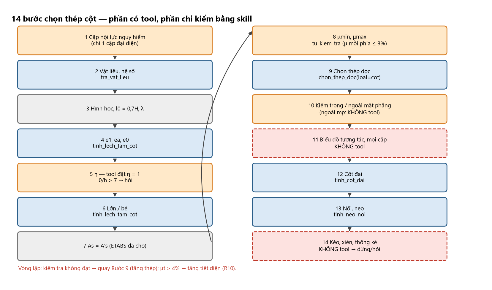
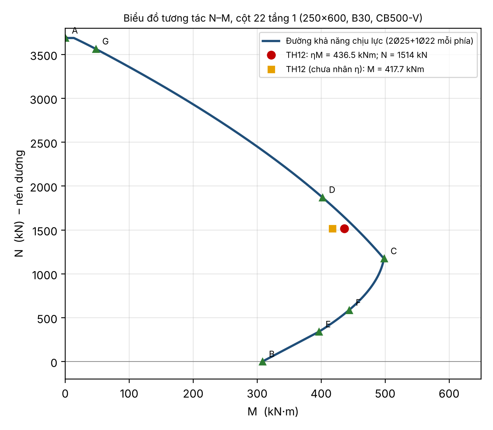

# 03 — CHỌN THÉP CỘT: 14 BƯỚC (Chương 8 của tài liệu nguồn)

> **Vai trò của agent với cột:** `As_yc` (PMMArea, **mỗi phía**) và cặp nội lực đại diện $(M,N)$ đã có. Chuỗi gọi tool: `tra_vat_lieu` →
> `chon_thep_doc(loai="cot", As_target=As_yc, b, h)` → `tinh_cot_dai`/`tinh_neo_noi` → `tu_kiem_tra(loai="cot", N, M, h, …)`.
> **Hai giới hạn thật của tool cần nhớ:** (1) $\eta=1$ cố định (không kể uốn dọc) — chỉ đúng khi $l_0/h\le4$; (2) chỉ kiểm **một** cặp $(M,N)$,
> không dựng biểu đồ tương tác, không kiểm phương ngoài mặt phẳng. Phần tài liệu cho thêm (η, BĐTT, nối thép, cột kéo…) dùng để **hiểu và
> gắn cờ**, không để agent tự tính. Ví dụ xuyên suốt: **cột 22, tầng 1, 250×600**, TH12: $M=417{,}74$ kN·m, $N=1514{,}38$ kN, $M_{dh}=18{,}06$, $N_{dh}=1168{,}39$, $l=5200$.

# CHƯƠNG 8. CHỌN THÉP CỘT – 14 BƯỚC

## 8.0. Chọn phương pháp tính — làm trước khi tính

| Phương pháp | Nguồn | Dùng khi | Ưu / nhược |
|:--|:--|:--|:--|
| **(1) Công thức, cốt đối xứng $A_s=A_s'$** | A 5.30–5.31; D (6.20)–(6.22) | **Mặc định** cho cột khung (gió đổi chiều ⇒ $M$ đổi dấu) | Nhanh; chỉ xét **một cặp** mỗi lần |
| **(2) Biểu đồ tương tác $N$–$M$** | A (5.32–5.33); D 6.4.5, hình 6.11 | **Kiểm tra** thép đã chọn với **mọi** cặp nội lực | Không cho trực tiếp $A_s$ |
| **(3) Cốt không đối xứng** | D (6.23)–(6.29) | $M$ luôn một chiều (hiếm) hoặc cột tầng mái/biên $M$ rất lớn một phía | Tiết kiệm nhưng dễ đặt nhầm phía |
| **(4) Mô hình biến dạng phi tuyến** | D 6.5 | Tiết diện phức tạp, xiên | Chỉ bằng phần mềm |
| **(5) Nén đúng tâm** | D 6.3, (6.3)–(6.4) | $e_0\le h/30$, $l_0/h\le20$; chủ yếu kiểm **phương ngoài mặt phẳng** (Bước 10b) | Rất đơn giản |

**Quy trình khuyến nghị:** (1) cặp nguy hiểm nhất → $A_s$ → chọn thép (Bước 1–9); (2) dựng BĐTT, đưa **mọi cặp** vào (Bước 10–11); (3) kiểm ngoài mặt phẳng bằng (5); (3)/(4) chỉ khi có lý do.
Điều kiện BĐTT không thứ nguyên của D (hình 6.11): $A_s=A_s'$ và $a'\le0{,}15h_0$ (cột 22: $a'/h_0=0{,}071$ ✓). **Không dùng đồ thị đọc bằng mắt trong chương trình.**
Với agent: luồng tự động là (1) → chọn thép → kiểm → nếu một cặp ngoài đường tương tác thì **tăng thép/tiết diện** rồi kiểm lại (R10).

**Sơ đồ 14 bước:** 1 cặp nội lực • 2 vật liệu • 3 hình học, $l_0$, độ mảnh • 4 $e_1,e_a,e_0$ • 5 $\eta$ • 6 lớn/bé • 7 $A_s=A_s'$ • 8 $\mu$ • 9 chọn thép •
10 khả năng chịu lực • 11 BĐTT mọi cặp • 12 đai • 13 nối, neo, đổi thép • 14 đặc biệt + bảng thống kê.

**Mô tả bằng chữ:** Lưu đồ dọc 14 ô nối nhau theo thứ tự bước. Ô Bước 1–2 và 9 (chọn thép), 12 (đai), 13 (neo/nối) và kiểm tra cuối tô xanh vì có tool (`tra_vat_lieu`, `chon_thep_doc`, `tinh_cot_dai`, `tinh_neo_noi`, `tu_kiem_tra`). Ô Bước 5 ($\eta$), 11 (biểu đồ tương tác), 10b (ngoài mặt phẳng) tô cam: "tool đặt $\eta=1$/chỉ kiểm một cặp — gắn cờ". Ô Bước 14 (cột kéo, xiên) tô đỏ nét đứt: "dừng và hỏi (R12, 14b)". Mũi tên quay lại từ "Kiểm tra" về Bước 9 ghi "tăng thép; nếu $\mu_t>4\%$ ⇒ tăng tiết diện".

---

## Bước 1. Chốt các cặp nội lực nguy hiểm của cột

Mỗi đầu cột (chân, đỉnh) và từng tổ hợp: $M,N,Q$ — trị tuyệt đối, nén dương; tách **nội lực dài hạn** $M_{dh},N_{dh}$ (tĩnh tải). Ba cặp: ($M_{max}$, $N$ tương ứng; $e_1$ lớn nhất → thường lệch tâm lớn), ($N_{max}$, $M$ tương ứng → lệch tâm bé), ($e_1$ lớn nhất và $N$ nhỏ → thép kéo cực đại). Tính cho **cả hai đầu**; chọn thép theo cặp **không lợi nhất**, đặt cho cả tầng. **Cặp phải cùng một tổ hợp.** Cột 22: TH12 chân cột, $l=3{,}9+1{,}3=5{,}2$ m (tính từ mặt ngàm).
**Nguồn ETABS thật:** chỉ **một** dòng PMM đại diện ("dai_dien": `PMMDemandN/M/Area/Combo`) ⇒ các cặp còn lại **không có**; ghi cờ "chỉ kiểm một cặp".

## Bước 2. Vật liệu và hệ số

$\xi_R=0{,}8/(1+\varepsilon_{s,el}/0{,}0035)$, $\alpha_R=\xi_R(1-0{,}5\xi_R)$. Với CB240-T, CB300-V, CB400-V, CB500-V: $R_{sc}=R_s$ (D 6.4.4) — CB500-V: 435. B30: $R_b=17$, $E_b=32\,500$. Cột 22: $\xi_R=0{,}493$, $\alpha_R=0{,}371$.

## Bước 3. Hình học, chiều dài tính toán, độ mảnh

$a=a'\approx c+d_{đai}+d/2\approx40$; $h_0=h-a$; $z_s=h_0-a'$. $l_0$: khung toàn khối nhiều tầng nhiều nhịp **$0{,}7H$** (tầng 1 từ **mặt ngàm**); khung một nhịp, nhà công nghiệp, liên kết khác: **tra TCVN 5574:2018 mục 8.1.2**; một đầu ngàm một đầu khớp $0{,}7L$; hai đầu ngàm $0{,}5L$; công xôn $2{,}0L$ (tra mục 8.1.2). Độ mảnh: $\lambda=l_0/i$, $i=0{,}289h$; $\lambda_h=l_0/h$, $\lambda_b=l_0/b$.

| Điều kiện | Giá trị |
|:--|:--|
| $\lambda\le120$ (cột nhà) | D 6.1.2, A 1.4 |
| $\lambda_b=l_0/b\le35$ (A, TCVN 5574:2012) | **D (2018): $\le31$** — dùng **31** (an toàn hơn) |
| $\lambda_h\le4$ | bỏ qua uốn dọc, $\eta=1$ (R7) |
| $\lambda_h>4$ | phải kể $\eta$ (Bước 5) |

Cột 22: $l_0=0{,}7\times5200=3640$; $h_0=560$; $\lambda_h=6{,}07>4$ ⇒ kể uốn dọc; $\lambda_b=14{,}56\le31$ ✓; $\lambda=21\le120$ ✓.
⚠ Rule base cũ dùng $L_0=0{,}8L$ ở mã giả (Phần Q, mục 67) — **mâu thuẫn** với $0{,}7H$ của A/B cho khung toàn khối nhiều tầng. Dùng $0{,}7H$ khi có ≥2 nhịp, còn lại **tra tiêu chuẩn** (cờ `can_xac_nhan`).
**Đầu vào số học cho `tu_kiem_tra`:** `do_manh_L0_h = l0/h` (đây là đầu vào hình học, không phải kết quả thiết kế).

## Bước 4. Độ lệch tâm $e_1$, $e_a$, $e_0$

$e_1=M/N$; $e_a\ge\max(h/30;\ l/600;\ 10)$ — **$l$ là chiều dài cột/khoảng giữa liên kết chặn, không phải $l_0$**; $h$ là cạnh **trong mặt phẳng uốn**; $e_0=\max(e_1;e_a)$ (khung siêu tĩnh) hay $e_1+e_a$ (tĩnh định).
Cột 22: $e_1=275{,}85$; $e_a=\max(20;8{,}67;10)=20$; $e_0=275{,}85$ mm. Tool dùng $e_a=\max(L/600;h/30;10)$ khi truyền `L`, và $\max(h/30;10)$ khi không có `L`.

## Bước 5. Kể ảnh hưởng uốn dọc — hệ số $\eta$

Chỉ khi $l_0/h>4$. $\eta=\dfrac1{1-N/N_{cr}}$; $N_{cr}=\dfrac{\pi^2D}{l_0^2}$; $D=k_bE_bI+0{,}7E_sI_s$; $k_b=\dfrac{0{,}15}{\varphi_L(0{,}3+\delta_e)}$; $\varphi_L=1+\dfrac{M_{L1}}{M_L}\le2$ (cho phép lấy 2 để đơn giản); $\delta_e=e_0/h\in[0{,}15;1{,}5]$; $M_{L1}=M_{dh}+N_{dh}(h/2-a)$; $M_L=M+N(h/2-a)$; $I_s=\mu_tbh_0(0{,}5h-a)^2$ ($\mu_t$ giả thiết 1–2%, kiểm lại sau Bước 8).
A cho phép $\eta=1{,}03\div1{,}08$ khi $4<l_0/h\le7$. Sau đó **nhân vào độ lệch tâm**: $\eta e_0$ dùng ở Bước 6–7; **bỏ bước nhân $\eta$ ⇒ thép thiếu**. $N\ge N_{cr}$ ⇒ mất ổn định ⇒ tăng tiết diện (R8); thường $N/N_{cr}<0{,}5$.
Cột 22: $\mu_t=2\%$ ⇒ $I_s=1{,}893\times10^8$; $\varphi_L=1{,}397$; $k_b=0{,}1414$; $D=4{,}717\times10^{13}$; $N_{cr}=35\,140$ kN; $\eta=\mathbf{1{,}045}$ ($N/N_{cr}=4{,}3\%$).
⚠ **Tool:** `tinh_lech_tam_cot`/`tu_kiem_tra` đặt $\eta=1$. Với cột 22, $e$ tool $=535{,}8$ thay vì $548{,}5$ (thấp 2,3%): tỉ số sử dụng $k=0{,}956$ thay vì $0{,}979$. **Quy tắc agent:** nếu $l_0/h\le4$ ⇒ bình thường; nếu $4<l_0/h\le7$ ⇒ ghi cờ "chưa kể $\eta\approx1{,}03$–$1{,}08$"; nếu $l_0/h>7$ ⇒ **`hoi_nguoi_dung`** (không có tool tính $\eta$) và không in "ĐẠT".

## Bước 6. Phân loại lệch tâm lớn / bé

$e=\eta e_0+h/2-a$; $e'=\eta e_0-h/2+a'$; $\alpha_n=\dfrac{N}{R_bbh_0}$; $x_1=\dfrac N{R_bb}$. $x_1\le\xi_Rh_0$ (hay $\alpha_n\le\xi_R$) ⇒ **lệch tâm lớn** (phá hoại dẻo); ngược lại **lệch tâm bé** (giòn). Cột 22: $e=548{,}3$; $x_1=356{,}3>276{,}3$ ⇒ **lệch tâm bé** ($\alpha_n=0{,}636>0{,}493$) (R9). Tool: `tinh_lech_tam_cot` trả `nhanh_lech_tam` ("lon"/"be").

## Bước 7. Tính $A_s = A_s'$ (cốt đối xứng)

### 7a. Lệch tâm lớn ($x_1 \le \xi_R h_0$)

$2a'\le x_1\le\xi_Rh_0$ (A 5.30; D 6.20): $A_s=A_s'=\dfrac{Ne-R_bbx_1(h_0-0{,}5x_1)}{R_{sc}(h_0-a')}$. $x_1<2a'$ (A 5.31): $A_s=A_s'=\dfrac{Ne'}{R_s(h_0-a')}$.

### 7b. Lệch tâm bé ($x_1 > \xi_R h_0$) — ba cách

<!-- PROMPT:BO_BAT_DAU -->
**Cách 1 (thực nghiệm A, ước nhanh):** $x=h_0\dfrac{(1-\xi_R)\alpha n+2\xi_R(n-0{,}48)}{(1-\xi_R)\alpha+2(n-0{,}48)}$, $n=\dfrac N{R_bbh_0}$, $\alpha=e/h_0$; $\xi_Rh_0<x\le h_0$; $A_s=\dfrac{Ne-R_bbx(h_0-0{,}5x)}{R_{sc}(h_0-a')}$.
<!-- PROMPT:BO_KET_THUC -->
**Cách 2 (D 6.22, dùng làm kết quả chính):** $\xi_1=\min(\tfrac{\alpha_n+\xi_R}{2};1)$, $\alpha_{m1}=\dfrac{Ne}{R_bbh_0^2}$, $\alpha_s=\dfrac{\alpha_{m1}-\xi_1(1-\xi_1/2)}{1-\delta}$, $\xi=\dfrac{\alpha_n(1-\xi_R)+2\alpha_s\xi_R}{1-\xi_R+2\alpha_s}$, $A_s=\dfrac{R_bbh_0}{R_{sc}}\cdot\dfrac{\alpha_{m1}-\xi(1-\xi/2)}{1-\delta}$.
<!-- PROMPT:BO_BAT_DAU -->
**Cách 3 (chính xác):** $\sigma_s=R_s\left[\dfrac{2(1-\xi)}{1-\xi_R}-1\right]$, $-R_{sc}\le\sigma_s\le R_s$; $x=\dfrac{N+R_sA_s\frac{1+\xi_R}{1-\xi_R}-R_{sc}A_s'}{R_bb+\frac{2R_sA_s}{h_0(1-\xi_R)}}$, giải đồng thời với $Ne=R_bbx(h_0-0{,}5x)+R_{sc}A_s'(h_0-a')$.
<!-- PROMPT:BO_KET_THUC -->
**Cột 22:** Cách 1 $x=325$, $A_s=1243$; Cách 2 ($\alpha_{m1}=0{,}623$, $\alpha_s=0{,}2344$, $\xi=0{,}5676$, $x=318$) $A_s=1275$; Cách 3 $x=318$, $\sigma_s=+311$ MPa (kéo nhẹ, chưa chảy), $A_s=1275$. Cách 1 thấp hơn nghiệm đúng khoảng 2,5% ⇒ **lấy $A_{s,tt}=1275$ mm²**. (A in 1250 với $e=550$.)
**Agent không tự tính $A_s$:** `As_yc` đến từ ETABS (PMMArea ≈ As mỗi phía; công thức TCVN 2.5 cho ≈ 630/624 mm² với phần tử '14' và '1' vs As_yc 752,8/743,2 — thấp hơn 15–20%, **không** phải một nửa).

## Bước 8. Xử lý kết quả: hàm lượng thép tối thiểu, tối đa

$\mu=\dfrac{A_s}{bh_0}\times100\%$ (mỗi phía); $\mu_t=\dfrac{A_{s,tot}}{bh}\times100\%$. **$\mu_{min}$ (D 6.2.1):** $\lambda\le17$ ($l_0/h\le5$): **0,10%**; $17<\lambda<87$: nội suy ($\mu_{min}=0{,}10+0{,}15\dfrac{l_0/h-5}{20}$ %); $\lambda\ge87$ ($l_0/h\ge25$): **0,25%**. Thép đặt **đều chu vi**: $\mu_{t,min}$ **gấp đôi**.
**$\mu_{max}$:** $\mu_t\le4\%$ nói chung, **8% tại chỗ nối chồng** (D 6.2.1). A giới hạn $\mu\le3\%$ mỗi phía ($\mu_t\le6\%$) và nên $\mu_t=1\div2\%$; $\mu_t>1{,}5\%$ nên tăng tiết diện/cấp bền (với cột nén, tăng cấp bền hiệu quả hơn tăng thép).
**Thép tối thiểu thực hành (A):** kết quả âm hoặc $<\mu_{min}bh_0$ ⇒ $A_s=A_s'=\mu_{min}bh_0$ nhưng không dưới **402 mm² (2Ø16) nếu $b\le400$; 603 mm² (3Ø16) nếu $b>400$** mỗi phía. **Âm ⇒ cấu tạo tối thiểu** (D9, module 08). (Cốt không đối xứng: $A_s'$ theo D 6.25–6.27.)
Cột 22: $\mu=1275/(250\times560)=0{,}91\%$; $\mu_{min}=0{,}108\%$; $\mu_t\approx1{,}8\%$ ✓ ($\le4\%$).
⚠ **Code vs tài liệu:** `tu_kiem_tra` (cột) giới hạn **μ mỗi phía ≤ 3%** (`MU_MAX_COT_MOI_PHIA_PHAN_TRAM`); D 6.2.1 là **μ_t (tổng) ≤ 4%**, 8% tại nối. Hai tiêu chí khác cơ sở chuẩn hoá; tool đã ghi chú "chưa đổi". Agent: dùng tool, và **kiểm thêm μ_t ≤ 4% bằng số trong kết quả** (`As_thuc_tong` / bh); vượt ⇒ tăng tiết diện (R10), không tăng thép.

**Mô tả bằng chữ:** Mặt cắt cột chữ nhật 250 (rộng) × 600 (cao), lớp bảo vệ 20. Thanh chịu lực: mỗi cạnh ngắn (phía trên và dưới của hình) có 3 thanh nằm trong hàng — hai thanh góc Ø25 (chấm lớn) và một thanh giữa Ø22 (chấm nhỏ hơn), khe giữa hai thanh liền kề ghi "61 ≥ 50". Tại giữa chiều cao, mỗi cạnh dài (trái, phải) có 1 thanh cấu tạo Ø16; khoảng cách tim từ hàng thép trên xuống thanh Ø16 và từ thanh Ø16 xuống hàng thép dưới đều ghi "259,5 ≤ 500". Một đai chính Ø8 hình chữ nhật ôm cả 8 thanh có móc ở góc trên trái; một đai phụ Ø8 nằm ngang nối hai thanh Ø16 ở giữa, hai đầu có móc nghiêng.

## Bước 9. Chọn thép dọc: đường kính, số thanh, cốt cấu tạo

| Hạng mục | Quy định | Nguồn |
|:--|:--|:--|
| Đường kính | **12 ≤ d ≤ 40 mm** (thực hành Ø16–Ø32) | D, A |
| Số thanh | mỗi phía ≥2; chữ nhật ≥4 (mỗi góc 1) | thực hành |
| Loại Ø | ≤3 loại; chênh ≤6 mm; tránh chênh 1–2 mm | A |
| Khoảng cách tim thép dọc | **⊥ mặt phẳng uốn ≤400**; **trong mặt phẳng uốn ≤500** (300/400 khi B70–B100) | D, A |
| Cốt cấu tạo khi $h>500$ | thêm thanh giữa cạnh dài để tim ≤500; $d\ge12$ | C, D |
| Khoảng hở | $\ge\max(d_{max};50)$ cho thanh **đứng** khi đổ bê tông | D 3.4.5 |
| Lớp bảo vệ | 20 (trong nhà ≤75%); 25 (>75%); 30 (ngoài trời); 40 (đất); $\ge d$, $\ge10$ | D Bảng 3.1 |

Bảng diện tích một phía: 2Ø16 402; 3Ø16 603; 2Ø18 509; 3Ø18 763; 2Ø20 628; 3Ø20 942; 2Ø22 760; 3Ø22 1140; 2Ø25 982; 3Ø25 1473; 4Ø25 1963; 2Ø28 1232; 2Ø20+1Ø16 829; 2Ø22+1Ø20 1074; 2Ø25+1Ø22 1362; 2Ø25+1Ø20 1296; 2Ø25+1Ø18 1236; 2Ø28+1Ø25 1722.
**Bề rộng cột tối thiểu cho $n$ thanh cùng Ø một cạnh** ($c=20$, đai Ø8, hở $\ge\max(d;50)$): $b_{min}=2\times28+nd+(n-1)\max(d;50)$:

| $d$ | $n=2$ | $n=3$ | $n=4$ | $n=5$ |
|:--|:--:|:--:|:--:|:--:|
| 16 | 138 | 204 | 270 | 336 |
| 20 | 146 | 216 | 286 | 356 |
| 25 | 156 | 231 | 306 | 381 |
| 28 | 162 | 240 | 318 | 396 |
| 32 | 170 | 252 | 334 | 416 |

**Quy tắc chọn [kinh nghiệm]:** $A_{s,chọn}\ge A_{s,tt}$ thừa ≤ +10–15%; ưu tiên số lẻ đối xứng (2Ø lớn ở góc + 1Ø nhỏ giữa); thanh lớn ở góc; tầng trên giảm Ø giữ số thanh; **tính lại $a$ thực** (lệch >5 mm ⇒ quay Bước 5–7); kiểm khoảng hở theo bảng.
**Cột 22:** $A_{s,tt}=1275\to$ **2Ø25+1Ø22 = 1362** (dư 6,8%); $a=(2\times490{,}9\times40{,}5+380{,}1\times39)/1362=40{,}1$ ✓; hở Ø25–Ø22 $=61\ge50$ ✓; khoảng cách tim hai hàng chịu lực $=519>500$ ⇒ **bắt buộc 1Ø16 mỗi cạnh dài** ($A_{s,tot}=3126$; $\mu_t=2{,}08\%$); cốt cấu tạo không tính vào khả năng chịu lực.
⚠ **Tool:** `chon_thep_doc(loai="cot")` dùng **một** đường kính cho mọi thanh, `cover=40` (=a), khoảng hở 25, khoảng cách tối đa 400 cho cả hai phương. Với cột 22 tool chọn **8Ø25** (1473 mm²/phía, thừa 15,5%) thay vì 2Ø25+1Ø22 + 2Ø16. **Chấp nhận được** nếu `tu_kiem_tra` đạt; nhưng thanh giữa cạnh ngắn cùng Ø25 trong $b=250$ là **3 thanh — hở $=(250-2\times28-3\times25)/2=59$ ✓ ≥50**. Với $b$ nhỏ hơn hoặc nhiều thanh: tool dùng hở 25 ⇒ **agent phải đối chiếu bảng $b_{min}$ ở trên** (R4, R11, I6).

## Bước 10. Kiểm tra khả năng chịu lực của tiết diện đã chọn

### 10a. Trong mặt phẳng uốn (D 6.13)

Lệch tâm bé: $x=\dfrac{N+R_sA_s\frac{1+\xi_R}{1-\xi_R}-R_{sc}A_s'}{R_bb+\frac{2R_sA_s}{h_0(1-\xi_R)}}$; lệch tâm lớn: $x=N/(R_bb)$. $Ne\le R_bbx(h_0-0{,}5x)+R_{sc}A_s'(h_0-a')\iff\eta M\le M_{gh}$, với $\eta$ **tính lại theo thép thực**.
Cột 22: $I_s=1{,}842\times10^8$ ⇒ $\eta=1{,}046$; $e=548{,}5$; $x=316{,}7>276{,}3$ ✓; $\sigma_s=+311$; $Ne_{gh}=848{,}7\ge830{,}6$ (**97,9%**); $M_{gh}=454{,}9\ge\eta M=436{,}5$ ($k=0{,}96$).

### 10b. Ngoài mặt phẳng uốn (nén đúng tâm theo cạnh nhỏ $b$)

$N\le N_u=\varphi(R_bA+R_{sc}A_{s,tot})$; $\varphi$ theo D Bảng 6.1 (nội suy theo $l_0/b$; B20–B55: 0,92 tại $l_0/h=6$; 0,90 (10); 0,83 (15); 0,70 (20); giá trị cho **tải dài hạn**). Điều kiện $l_0/b\le20$ và $e_0\le b/30$; có mô men ngoài mặt phẳng (cột góc/biên chịu dầm dọc) ⇒ nén lệch tâm xiên (14b).
Cột 22: $l_0/b=14{,}56$ ⇒ $\varphi=0{,}836$; $N_u=0{,}836\times(2550+1185)=3123\ge1514{,}38$ ✓ (48%). **Tool không kiểm** ⇒ ghi "chưa kiểm ngoài mặt phẳng".

## Bước 11. Biểu đồ tương tác và kiểm tra mọi cặp nội lực

Đường bao $(M,N)$ mà tiết diện chịu được. **Nhân $\eta$ vào $M$ trước khi vẽ điểm nội lực** (A không nhân $\eta$ ⇒ thiên về không an toàn, ở ví dụ lệch 4,5%). Phương trình (A 5.32–5.33), $\sigma_s>0$ là kéo: $N=R_bbx+R_{sc}A_s'-\sigma_sA_s$; $M=R_bbx\left(\tfrac h2-\tfrac x2\right)+R_{sc}A_s'\left(\tfrac h2-a'\right)+\sigma_sA_s\left(\tfrac h2-a\right)$ (đối với trọng tâm tiết diện); $\sigma_s=R_s$ khi $x\le\xi_Rh_0$, ngược lại $R_s\left[\dfrac{2(1-x/h_0)}{1-\xi_R}-1\right]\in[-R_{sc};R_s]$.
**Bảy điểm:** A nén đúng tâm ($N_{max}=\varphi_N[R_b(A-A_{s,tot})+R_{sc}A_{s,tot}]$, $M=0$); D $x=1{,}3\xi_Rh_0$; **C $x=\xi_Rh_0$ (cân bằng, $M$ lớn nhất)**; F $x=0{,}5\xi_Rh_0$; E $x=2a'$ (A chọn $0{,}2\xi_Rh_0<2a'$: thép nén chưa chảy — dùng $x=2a'$); G $x=h_0$; B uốn thuần ($N=0$, $M=R_sA_s(h_0-a')$).

| Điểm | $x$ (mm) | $\sigma_s$ (MPa) | $N$ (kN) | $M$ (kN·m) | A (bản gốc) |
|:--|--:|--:|--:|--:|:--|
| A | – | – | 3689 (kể $\varphi_N=0{,}92$: **3392**) | 0 | 3209 |
| G | 560 | −435 | 3565 | 47,6 | – |
| D | 359 | +181 | 1873 | 401,9 | 1878 / 403,8 |
| **C** | 276 | +435 | **1174** | **498,1** | 1179 / 501,2 |
| F | 138 | +435 | 587 | 443,7 | – |
| E | 80 | +435 | 340 | 396,5 | 236 / 375,2 |
| B | – | – | 0 | 308,1 | 311,1 |

**Mô tả bằng chữ:** Đồ thị trục hoành $M$ (kN·m, 0–650), trục tung $N$ (kN, nén dương, −200 đến 3800). Đường cong xanh đậm bắt đầu ở $M\approx0$, $N\approx3689$ (điểm A), đi xuống sang phải qua G, D, đạt $M$ lớn nhất ≈ 498 tại $N\approx1174$ (điểm C, mũi cong ra xa nhất), rồi cong ngược vào trái qua F, E đến $M=308$ tại $N=0$ (điểm B). Các điểm A–G đánh tam giác xanh lá. Điểm đỏ tròn $(\eta M,N)=(436{,}5;\ 1514)$ nằm **bên trong** đường cong (cạnh nhánh D–C); ô vuông cam $(417{,}7;\ 1514)$ là điểm chưa nhân $\eta$, nằm sâu hơn bên trong — chênh lệch 4,5% giữa hai điểm cho thấy vì sao phải nhân $\eta$.

**Quy trình kiểm mọi cặp (cho agent/chương trình):** (1) lập mọi cặp $(M_i,N_i)$ hai đầu cột × mọi tổ hợp, nhân $\eta$; (2) nội suy $M_{gh}(N_i)$ trên đường D–C–B; (3) $k_i=\eta M_i/M_{gh}(N_i)$, đạt khi $\max k_i\le1$; $N_i>N_{max}$ ⇒ không đạt; (4) $N_i<0$ (kéo) ⇒ 14a; (5) $\max k_i>1$ ⇒ tăng thép/tiết diện; $<0{,}7$ ⇒ có thể giảm thép/chuyển tầng trên. **Agent hiện chỉ có một cặp** ⇒ ghi cờ.

## Bước 12. Cốt đai

Lực cắt cột thường nhỏ ⇒ đai **theo cấu tạo** sau khi kiểm điều kiện không cần tính.

### 12a. Điều kiện kiểm tra cắt (A 5.3.2)

$Q\le Q_{b,min}=0{,}5\varphi_nR_{bt}bh_0\Rightarrow$ đai cấu tạo; $Q\le0{,}3R_bbh_0$. $\varphi_n$ (A 5.38), $\sigma_m=N/A$ ($\le3\%$ thép có thể bỏ qua): $0\le\sigma_m\le0{,}25R_b$: $1+\sigma_m/R_b$; $0{,}25R_b<\sigma_m\le0{,}75R_b$: **1,25**; $0{,}75R_b<\sigma_m\le R_b$: $5(1-\sigma_m/R_b)$; kéo: $1-\sigma_t/(2R_{bt})$. $Q>Q_{b,min}$ ⇒ tính như dầm (module 02, Bước 11).
Cột 22: $\sigma_m=10{,}1$ MPa ⇒ $\varphi_n=1{,}25$; $Q_{b,min}=100{,}6$ kN $\gg$ lực cắt gió $\approx29$ kN ⇒ **đai cấu tạo**; $0{,}3R_bbh_0=714\gg Q$ ✓. **Tool:** `tinh_cot_dai` (truyền `N`, **`h`**, `loai="cot"`, `d_doc_min`).

### 12b. Cấu tạo cốt đai (D 6.2.1; A 5.4.2; C)

| Hạng mục | Quy định |
|:--|:--|
| Đường kính đai | $d_{sw}\ge\max(0{,}25d_{max};\ 6)$ (D 6 mm; A 5 mm — dùng **6**) |
| Bước ngoài đoạn nối | $s\le\min(15d_{min};\ 500)$ ($d_{min}$ = thanh dọc chịu nén **nhỏ nhất**, kể cả cốt cấu tạo) |
| Bước trong đoạn nối chồng | $s\le\min(10d_{min};\ 300)$ |
| Thép nén lớn | A: $\mu_t>3\%$; **D (2018): thép dọc chịu nén $>1{,}5\%$** ⇒ $\min(10d_{min};300)$ — **lấy D** (chặt hơn) |
| Đai bao | **toàn bộ** thanh dọc; thanh (ít nhất **cách một thanh**) ở **chỗ uốn** đai; các chỗ uốn cách nhau $\le400$ |
| Cạnh $\le400$ và $\le4$ thanh/cạnh | cho phép **một đai** ôm tất cả |
| Cạnh $>400$ hoặc $>4$ thanh/cạnh | thêm **đai phụ**; Ø phụ $\ge\max(d_{max}/4;5)$ |
| Nút khung và vùng nối | không bỏ đai trong nút; đai dày hơn trong chiều cao dầm |

**Cột 22:** $d_{sw}=$ **Ø8** (CB240-T); $\mu'=0{,}91\%<1{,}5\%$; ngoài nối $s\le\min(15\times16;500)=240\to$ **a200** (A: 350 vì không đặt Ø16; ở đây $d_{min}=16$); trong nối và hai đầu cột $s\le160\to$ **a150**; 1 đai chính ôm 6 thanh + **1 đai phụ** nối hai thanh Ø16 (chỗ uốn cách 259,5 ≤ 400). Xem Hình 9.2 (module 04).

## Bước 13. Nối cốt thép, neo, thay đổi thép theo chiều cao

### 13a. Chiều dài nối chồng

$L_{ov}=\alpha_{ov}L_{0,an}\dfrac{A_{s,cal}}{A_{s,ef}}\ge\max(0{,}4\alpha_{ov}L_{0,an};\ 20d;\ 250)$; $\alpha_{ov}$: kéo ≤50% **1,2**, 100% **2,0**; nén ≤50% **0,9**, 100% **1,2** (nội suy). ⚠ Các tỉ lệ 100% và tối thiểu trên lấy từ nguồn thứ cấp (TCVN 5574:2018 mục 10.3.6) — đối chiếu bản gốc. $d>40$ không nối chồng; $d\ge32$ nên hàn/cơ khí; **cột kéo phải hàn hoặc nối cơ khí** (D 7.2).

<!-- PROMPT:BO_BAT_DAU -->
| $d$ | $L_{0,an}$ | Nén ≤50% (0,9) | Nén 100% (1,2) | Kéo ≤50% (1,2) | Kéo 100% (2,0) |
|:--|--:|--:|--:|--:|--:|
| 16 | 605 | 544 | 726 | 726 | 1210 |
| 18 | 680 | 612 | 816 | 816 | 1361 |
| 20 | 756 | 680 | 907 | 907 | 1512 |
| 22 | 832 | 748 | 998 | 998 | 1664 |
| 25 | 945 | 850 | 1134 | 1134 | 1890 |
| 28 | 1058 | 953 | 1270 | 1270 | 2116 |

<!-- PROMPT:BO_KET_THUC -->
[TC cũ] TCXDVN 356:2005: kéo $34{,}0d$, nén $24{,}6d$ — ngắn hơn bản 2018 ⇒ **dùng 2018**. Tool: `tinh_neo_noi` trả `L_lap` (với `keo=true/false`).

### 13b. Vị trí nối và tỷ lệ nối (A, B, C)

Nối ở **gần mặt sàn** (mô men nhỏ nhất), **không nối trong vùng nút khung** và vùng mô men lớn. ≤4 thanh/cạnh: nối **một vị trí**; >4 thanh: **so le**, mỗi lần ≤50%, trục hai mối nối ≥$1{,}5L_{an}$; thép trơn ≤25% [TC cũ]; $\mu_t\le8\%$ tại nối. Tiết diện cột không đổi: thép tầng trên **bẻ khuỷu** (độ dốc 1:10, thu vào 50) để nối với thép chờ tầng dưới (Hình 9.3). Cột trên nhỏ hơn: $\tan\theta=(h_2-h_1)/h_d\le1/6$ ⇒ bẻ nghiêng thép tầng dưới; $>1/6$ ⇒ cắt thép dưới ở mặt dầm, neo $L_{an}$, thép trên chờ riêng (Hình 9.8b–c). Đai trong đoạn nối $\min(10d_{min};300)$.
Cột 22: 3 thanh/cạnh ⇒ nối 100% tại chân cột tầng trên: Ø25 $L_{ov}=1134\to$ **1150**; Ø22 998 → thống nhất **1150**; $\mu_t$ tại nối $=2\times2{,}08=4{,}2\%\le8\%$ ✓; đai nối Ø8a150 (8 đai).

### 13c. Thay đổi thép theo chiều cao

Nội lực giảm lên tầng trên ⇒ giảm **thép** nhưng **giữ tiết diện**; gom 2–3 tầng cùng thép; giảm **đường kính** trước, giữ số thanh; $\mu_t\approx1\%$ cho cột nén nhỏ tầng trên; giảm tiết diện cột ⇒ giảm **cấp bền bê tông** trước. Neo thép chờ vào móng và đầu cột tầng mái: module 05, 06.

## Bước 14. Trường hợp đặc biệt và bảng thống kê thép cột

### 14a. Cột chịu kéo (lực dọc $N < 0$) — D chương 7

**R12: chuyển hẳn sang kéo lệch tâm — KHÔNG áp dụng công thức nén lệch tâm** (lỗi hay gặp nhất nếu chỉ đọc $|N|$). Kéo đúng tâm ($e_0=0$): $N\le R_sA_{s,tot}$ (D 7.1). Kéo lệch tâm bé ($e_0\le0{,}5h-a$): $Ne\le R_sA_s'(h_0-a')$; $Ne'\le R_sA_s(h_0-a')$ với $e=0{,}5h-e_0-a$, $e'=0{,}5h+e_0-a'$ (D 7.4–7.7). Kéo lệch tâm lớn ($e_0>0{,}5h-a$): $Ne\le R_bbx(h_0-0{,}5x)+R_{sc}A_s'(h_0-a')$; $N=R_sA_s-R_bbx-R_{sc}A_s'$; $2a'\le x\le\xi_Rh_0$ (D 7.3, 7.8). Cấu tạo: $\mu,\mu'\ge0{,}1\%$, $\mu_t\ge2\mu_{min}$; thép chịu kéo **hàn hoặc nối cơ khí, không nối chồng**; neo chắc hai đầu; đai $\le500$. **Tool `tu_kiem_tra` trả lỗi khi $N\le0$ ⇒ dừng, báo kỹ sư.**

### 14b. Nén lệch tâm xiên và cột góc

Khung phẳng chỉ có $M_x$; cột góc/biên của khung không gian có $M_x,M_y$: **không có công thức tay trong D** (mặt tương tác 3D D 6.5.6). Thực hành: lấy $N,M_x,M_y$ cùng tổ hợp; kiểm bằng phần mềm (ETABS/SAP Section Designer, PCACOL…); hoặc $M$ một phương rất nhỏ thì tính phương lớn và kiểm phương kia theo 10b. **Dừng và hỏi** khi có $M_y$ đáng kể (Phần Q, D12).

### 14c. Cột nén đúng tâm (D 6.3)

Chỉ khi $e_0\le h/30$, $l_0/h\le20$: $A_{s,tot}=\dfrac{N/\varphi-R_bA}{R_{sc}}$ (6.4); $N_u=\varphi(R_bA+R_{sc}A_{s,tot})$ (6.3).

### 14d. Các điều kiện còn lại cần kiểm tra

$N>N_{max}$ (điểm A) ⇒ tăng tiết diện/cấp bền, **không tăng thép**; $\lambda_h>25$ hoặc $\lambda>120$ ⇒ quá mảnh (D11); khe nứt cột nén lệch tâm ($\varphi_3=1{,}0$) chỉ khi cần; cột chịu cắt lớn (cột ngắn, tường chèn) ⇒ tính đai như dầm; tầng 1 cao hơn ⇒ $l_0$ riêng.

<!-- PROMPT:BO_BAT_DAU -->
### 14e. Bảng thống kê thép cột (mẫu)

| Cột | Tầng | Tiết diện | Cặp $M$ (kN·m)/$N$ (kN) | $A_{s,tt}$ | Thép mỗi phía | Cấu tạo cạnh dài | $\mu_t$ (%) | Đai (ngoài nối / nối) | $k_{max}$ |
|:--|:--:|:--:|:--|:--:|:--|:--|:--:|:--|:--:|
| 22 | 1 | 250×600 | 417,74 / 1514,38 | 1275 | 2Ø25+1Ø22 (1362) | 1Ø16 mỗi cạnh dài | 2,08 | Ø8a200 / Ø8a150 | 0,96 |

**Checklist 12 điểm:** (1) $\lambda_b\le31$, $\lambda\le120$; (2) $\eta$ theo $\mu_t$ thực, $N<N_{cr}$; (3) loại lệch tâm đúng, $A_s\ge A_{s,min}$; (4) $\mu_{min}\le\mu\le3\%$, $\mu_t\le4\%$ ($8\%$ nối); (5) $d\in[12;40]$, chênh ≤6, ≤3 loại; (6) hở $\ge\max(d;50)$, $a$ thực ±5; (7) tim ≤400 (⊥) / ≤500 (//), cốt cấu tạo khi $h>500$; (8) mọi $(\eta M,N)$ trong BĐTT; (9) ngoài mặt phẳng $N\le N_u$; (10) đai: $d_{sw}$, $s$, đai phụ, $Q\le0{,}3R_bbh_0$; (11) nối: vị trí, %, $L_{ov}$, đai nối; (12) nút và neo móng: module 05.
**Lỗi thường gặp:** quên nhân $\eta$; $l_0=H$ thay $0{,}7H$ (hoặc quên đoạn ngàm tầng 1); chỉ kiểm một cặp; $e_a$ theo $l_0$; $a$ thực lệch >5 mm không tính lại; bỏ cốt cấu tạo khi $h>500$; đai $15d$ theo thanh lớn nhất; $\mu_t>3$–$4\%$ ở nối; cột góc một phương.
<!-- PROMPT:BO_KET_THUC -->
