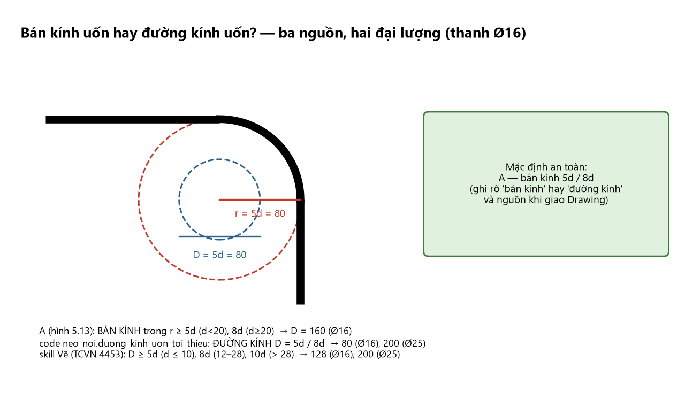

# 04 — YÊU CẦU CẤU TẠO CỐT THÉP CHUNG (Chương 9, trừ nút khung và kháng chấn)

> **Nguồn và thứ bậc:** D (TCVN 5574:2018 mục 3.4, 4.1, 6.2) và A (mục 5.4, hình 5.4–5.20). B, C là [TC cũ]. Tính đúng $A_s$ mà cấu tạo sai vẫn là thiết kế sai.
> Cấu tạo nút khung (9.7) ở module **05**; nhà chịu động đất (9.8) ở module **07**. Tool liên quan: `tinh_neo_noi`, `chon_thep_doc`, `tu_kiem_tra` (xem các khung "Đối chiếu tool").

# CHƯƠNG 9. YÊU CẦU CẤU TẠO CỐT THÉP

<!-- PROMPT:BO_BAT_DAU -->
## 9.1. Bảng tổng hợp nhanh các con số cấu tạo

| Nhóm | Hạng mục | Giá trị | Nguồn |
|:--|:--|:--|:--|
| Lớp bảo vệ | Trong nhà, độ ẩm ≤ 75% | **20 mm** | D Bảng 3.1; A |
| | Trong nhà, độ ẩm > 75% | 25 mm | D Bảng 3.1 |
| | Ngoài trời | **30 mm** | D, A |
| | Trong đất, móng có lớp lót | 40 mm | D |
| | Giới hạn thêm | $\ge d$ và $\ge10$ mm; kiểm tra chống cháy | D 3.4.4 |
| Khoảng hở | Thép đáy dầm (1–2 lớp, nằm ngang) | $\ge\max(d;\ 25)$ mm | D 3.4.5 |
| | Thép lớp trên dầm | $\ge\max(d;\ 30)$ mm | D |
| | Từ 3 lớp trở lên, hoặc thanh đặt đứng khi đổ bê tông (**cột**) | $\ge\max(d;\ 50)$ mm | D |
| Dầm | Đường kính cốt chịu lực | 12–32 mm | D 4.1.1; A |
| | $b<150$: số thanh | ≥ 1; $b\ge150$: ≥ **2 thanh** | D |
| | Cốt cấu tạo (giá) | Ø10–14 | D |
| | Cốt giá phụ cạnh bên | khi $h>700$ mm; tổng $\ge0{,}1\%\,b'h'$, $b'=\min(0{,}5b;\ 200)$, $h'\le400$ | D |
| | Đai | Ø6–10; $h\ge800$: Ø8 trở lên | D |
| | Cốt xiên | 30° ($h<400$), 45° ($400\le h\le800$), 60° ($h>800$) | D |
| | Tỉ lệ $h/b$ | 2–4; $h=(1/8\div1/20)L$ | D, C |
| Bản | Đường kính | 6–12 mm; khoảng cách $\le200$ ($h_b<150$), $\le1{,}5h_b$ ($h_b\ge150$); $\ge70$ mm | D 4.1.2 |
| | Cốt phân bố | Ø6–8, $\ge10\%$ cốt chịu lực; khoảng cách 250–300, $\le350$ mm | D |
| Cột | Đường kính cốt dọc | 12–40 mm | D 6.2.1 |
| | Khoảng cách tim thép dọc | ⊥ mặt phẳng uốn $\le400$; trong mặt phẳng uốn $\le500$ | D, A |
| | Đai | $d_{sw}\ge\max(d/4;\ 6)$; $s\le\min(15d;\ 500)$; nối hoặc $\mu'>1{,}5\%$: $\min(10d;\ 300)$ | D, A |
| | $\mu_{min}$, $\mu_{max}$ | 0,10–0,25% (nội suy theo $l_0/h$); 4% (8% tại chỗ nối) | D |
| Neo | $L_{an}=\alpha L_{0,an}A_{s,cal}/A_{s,ef}$ | $\ge\max(15d;\ 200;\ 0{,}3L_{0,an})$; $\alpha=1{,}0$ kéo, $0{,}75$ nén | D 3.4.6; A |
| Nối chồng | $L_{ov}=\alpha_{ov}L_{0,an}A_{s,cal}/A_{s,ef}$ | $\alpha_{ov}=1{,}2$ kéo; $0{,}9$ nén; thanh $d\le40$ mm | D 3.4.7 |
| Uốn cong | Bán kính uốn thanh dọc | $r\ge5d$ ($d<20$); $r\ge8d$ ($d\ge20$) | A (B cũ: $r\ge10d$) |

<!-- PROMPT:BO_KET_THUC -->
## 9.2. Lớp bảo vệ bê tông

**Định nghĩa (D 3.4.4):** chiều dày bê tông từ mặt ngoài cùng đến mép **gần nhất** của cốt thép (kể cả cốt đai).
Bảng 3.1 (D): trong nhà, độ ẩm ≤75%: **20**; độ ẩm cao >75%: 25; ngoài trời: **30**; trong đất/móng có lớp lót: **40** (mm).
**Quy tắc thực hành:** (1) cốt dọc $C\ge\max(d;10;\text{bảng})$ — $d=32\Rightarrow C\ge32$; (2) lớp bảo vệ của đai cũng không dưới bảng; **bảo vệ cốt dọc $=C_{đai}+d_{đai}$** (ví dụ $20+8=28$); (3) dầm, cột trong nhà: $C=20$ mm tới mặt đai, $a=20+8+d/2$ (một hàng $\approx40$–45; hai hàng $\approx65$–70); (4) sàn mái, ban công, dầm ngoài trời, sê nô: 30 (hoặc 25 nếu có lớp chống thấm); (5) móng, dầm giằng, cột chôn đất: 40; không lớp lót thì tăng (tra mục 10.3.2 và chống cháy).
[TC cũ] TCXDVN 356:2005 (C): bản $h\le100$: 10 (15); $h>100$: 15 (20); dầm $h<250$: 15 (20), $\ge250$: 20 (25); cột 20 (25); dầm móng 30; móng toàn khối có lót 35, không lót 70. **Bản 2018 chặt hơn** ⇒ dùng 2018.
**Đối chiếu tool:** `chon_thep_doc` nhận `cover` — là **khoảng cách từ mép bê tông tới mép đai** (mặc định dầm 25, cột 40). Giá trị mặc định 40 của cột thực chất là $a$ (tâm thép) nên tool đang tính cột **chặt hơn** mức 20+8: với cột $b=250$, tool vẫn cho tối đa 3 thanh Ø25 mỗi cạnh ngắn (khớp bảng $b_{min}=231$ của module 03). Agent truyền `cover` đúng theo môi trường của dự án (Bảng 3.1 + đường kính đai) khi có dữ liệu.

## 9.3. Khoảng hở thông thủy và bố trí thép trên tiết diện

$t\ge d_{max}$ và: dưới 1–2 lớp: **25**; trên 1–2 lớp: **30**; dưới từ 3 lớp (trừ hai lớp cuối): **50**; thanh **đứng** khi đổ bê tông (**cột**): **50** (mm). Khoảng cách các lớp thép dầm (A hình 5.4): $t_0\ge\max(d;25)$ theo phương đứng; thanh lớp trên hàng sau đặt **ngay trên** thanh hàng dưới (không so le, trừ khi tính lại $a$).
Nhiều hàng: thanh Ø lớn **xa trục trung hoà hơn**; Ø trong một miền chịu lực chênh $\le6$; một dầm $\le3$ loại Ø; tránh chênh 1–2 mm. Số thanh tối đa một hàng: $b\ge2C_{đai}+2d_{đai}+nd+(n-1)t_{min}$. **Cặp thanh/bó:** C cho ghép hai thanh sát nhau với $t\ge1{,}5d$ giữa các cặp (cũ) — hệ thống này **không dùng bó thanh**.

**Mô tả bằng chữ:** Ba chi tiết. (1) Mặt cắt dầm chữ nhật rộng $b$, cao $h$, đai kín ôm các thanh. Phía trên có một hàng 5 thanh, khe giữa hai thanh liền kề ghi $t_o\ge(30;d_{max})$; phía dưới có **hai hàng** 5 thanh chồng thẳng đứng, khe ngang ghi $t_o\ge(25;d_{max})$, khe đứng giữa hai hàng ghi $t_o$; hai cạnh bên mỗi cạnh có hai thanh cấu tạo cách nhau và cách hàng trên/dưới các đoạn $S\le400$, khoảng giữa thanh cạnh bên thấp nhất và hàng dưới ghi $t_o\ge50$; đường dẫn ghi "Cốt dọc cấu tạo khi $h\ge700$, $A_{S,ct}\ge0{,}1\%(0{,}5bS)$". (2) Chi tiết phải trên: tiết diện chữ U với hai hàng thép dưới ghép cặp, khe ngang giữa các cặp ghi $t_o\ge1{,}5d_{max}$, và $t_o\ge50$ giữa hàng dưới và thanh cạnh bên. (3) Chi tiết phải dưới: góc đai và thanh dọc, lớp bảo vệ ghi $C\ge(20;d_{max})$, chú thích "$d_{max}$: đường kính thanh cốt dọc lớn nhất".

## 9.4. Cấu tạo dầm khung

### 9.4.1. Cốt dọc

- **Cốt chịu lực** Ø12–Ø32; tại một tiết diện **≥2 thanh** khi $b\ge150$; thanh góc ở góc đai để định vị.
- **Cốt giá phía nén:** Ø10–14 chạy suốt dầm (hoặc ≥2Ø12 mặt trên và dưới suốt chiều dài khi chịu động đất — B/EC8).
- **Cốt giá phụ cạnh bên** khi $h>700$ (D; C): $\ge0{,}1\%\,b'h'$ với $b'=\min(0{,}5b;200)$, $h'$ là khoảng giữa các lớp ($\le400$ khi $h>1000$); chống co ngót, chênh nhiệt, giữ khung thép. CB 250×700 ($h=700$ **bằng** ngưỡng) nên đặt 2Ø12 (R24; A không đặt).
- **Thép dọc gối** qua nút và neo vào cột; thép nhịp chạy suốt hoặc cắt theo hình bao vật liệu (module 02 Bước 14, module 06).
- **≥1/4 thép chịu lực đầu mút phía trên chạy suốt dầm** (B/EC8, tham khảo; ACI: ≥1/3 thép gối kéo quá điểm uốn $\max(d;12d_s;L_n/16)$ và ≥1/4 thép nhịp vào gối).

### 9.4.2. Cốt đai và cốt xiên

Ø đai **6–10**; $h\ge800$ ⇒ Ø≥8 (D); số nhánh: 2 nhánh khi $b\le350$, 3–4 nhánh khi $b>350$ hoặc cắt lớn (xung đột với 11d $b\le400$ — module 02). Bước: đoạn gần gối $L/4$: $\min(h/2\ \text{hoặc}\ h_0/2;\ 300)$ khi $h\le450$; $h>450$: $\min(h/3;\ 500)$; giữa nhịp $\min(3h/4;\ 500)$. **Đai kín**, móc 135° (kháng chấn) hoặc 90° cắm đủ vào lõi. Cốt xiên 30°/45°/60° theo $h$, thường **uốn từ cốt dọc nhịp lên gối**; điểm cuối uốn nằm trong vùng nén hoặc neo $\ge20d$ ở vùng nén ($\ge10d$ nếu hàn hai phía). Cốt treo/giật đứt trong $S=b_{dp}+2h_s$ hai bên dầm phụ (module 02 Bước 13, **module 05 bảng điều kiện thêm thép**).

### 9.4.3. Dầm console và dầm biên

Console ($L\le1{,}5$ m): thép gối trên **neo vào dầm khung $\ge L_{an}$** tính từ mặt cột/dầm; mặt dưới chỉ thép cấu tạo; **đai dày sát ngàm**. Dầm biên chịu tải lệch tâm của sàn/console: **xoắn** — khi $T$ nhỏ đai kín thông thường đủ; có $T\ne0$ ⇒ module 09, 15.1 (R47–R50).

## 9.5. Neo, nối, uốn cốt thép

### 9.5.1. Chiều dài neo $L_{an}$

Công thức và bảng $L_{0,an}$: module 02 Bước 15, module 01 A.6. Điều kiện bổ sung (D 3.4.6): $L_{an}\ge\max(15d;200;0{,}3L_{0,an})$ **trong mọi trường hợp**; thép **trơn** chịu kéo **phải có móc** (U/L, hình 3.9 D); thép **gờ** không cần móc nếu đủ $L_{an}$ (có móc thì $L_{an}$ giảm **không quá 30%** — tra mục 10.3.5); $\eta_1=1{,}5$ (trơn), 2,0 (cán nguội có gờ), **2,5** (cán nóng có gờ); $\eta_2=1{,}0$ khi $d\le32$, 0,9 khi $d>32$ (**D in "0,9 khi $d<32$" là lỗi in**). Móc chuẩn (rule base cũ): bán kính trong $2{,}25d$ (móc 180°, đoạn thẳng $3d$) hoặc $1{,}25d$ (móc 90°, đoạn thẳng $5d$).

### 9.5.2. Nối cốt thép

| Cách nối | Quy định | Nguồn |
|:--|:--|:--|
| **Nối chồng** | $d\le40$; $L_{ov}=\alpha_{ov}L_{0,an}A_{s,cal}/A_{s,ef}$; $\alpha_{ov}=1{,}2$ kéo, $0{,}9$ nén (so le ≤50%) | D 3.4.7 |
| **Hàn đối đầu** | ép hai đầu, chủ yếu ở nhà máy | D |
| **Hàn chập** | chập $l_h=5d$ (hai phía) hoặc $10d$ (một phía) | D |
| **Hàn máng** | vào lòng thép chữ U, khe $\ge1$ mm | D |
| **Ống ren (coupler)** | ren đầu thanh, vặn vào ống; kiểm bằng cờ lê lực | D |

**Tỷ lệ nối một tiết diện:** thép gờ chịu kéo ≤50%; thép trơn ≤25% [TC cũ]; nối 100% ⇒ $\alpha_{ov}$ tăng (module 03 Bước 13a); cột >4 thanh/cạnh: **không nối cùng chiều cao**; cột 4 thanh nối một tiết diện; trục hai mối nối kề (so le) $\ge1{,}5L_{an}$; khoảng giữa hai mối nối cạnh nhau $\ge\max(2d;30)$ (code `khoang_cach_toi_thieu_2_moi_noi`).
**Vị trí nối [thực hành]:** thép **dưới** dầm: gần gối (mô men dương nhỏ nhất); thép **trên** dầm: giữa nhịp; thép cột: trên mặt sàn, ngoài vùng nút; **không nối** trong nút, vùng mô men lớn.

### 9.5.3. Uốn cong và móc

| Hạng mục | Quy định | Nguồn |
|:--|:--|:--|
| Bán kính trong gối uốn cốt chịu lực | $r\ge5d$ khi $d<20$; $r\ge8d$ khi $d\ge20$ | A (hình 5.13) |
| Bán kính uốn (cũ) | $r\ge10d$ | B (TCVN 5574:1991) |
| Đoạn thẳng sau chỗ uốn | $\ge5d$ (đầu nhánh) | thực hành |
| Chỗ uốn cong trong đoạn neo | **đai phụ $\le100$ mm** gia cường | B |
| Thép dầm uốn xuống cột (nút góc) | đoạn đứng sau uốn $\ge L_{an}$ | A, B |

⚠ **Ba nguồn hệ thống nêu ba mức khác nhau cho cùng một việc (bán kính/đường kính uốn):**
(a) **A, hình vẽ**: **bán kính** trong $r\ge5d$ ($d<20$), $r\ge8d$ ($d\ge20$) ⇒ đường kính trong $10d$/$16d$ (Hình 11.4 ghi "r ≥ 5d = 80" cho Ø16);
(b) **code `neo_noi.duong_kinh_uon_toi_thieu`**: **đường kính** $5d$/$8d$ (có gờ) — kết quả Ø16 ⇒ 80, Ø25 ⇒ 200 **(thấp gấp đôi (a))**;
(c) **skill Vẽ (TCVN 4453)**: đường kính trong $D\ge5d$ ($d\le10$), $8d$ ($12$–$28$), $10d$ ($>28$).
**Mặc định an toàn: dùng (a) (bán kính $5d$/$8d$)** cho thép dầm uốn xuống cột ở nút; với các chỗ uốn khác (đai, chờ L) ghi giá trị tool và cờ `can_xac_nhan`. Khi chuyển cho Drawing Agent, ghi rõ "**bán kính** trong" hay "**đường kính** trong" và nguồn.

**Mô tả bằng chữ:** Một thanh Ø16 uốn góc vuông; trên hình vẽ hai vòng tròn đồng tâm tại chỗ uốn. Nhãn thứ nhất: bán kính $r=5d=80$ mm (tài liệu A, hình 5.13) ⇒ đường kính trong 160 mm. Nhãn thứ hai: đường kính $D=5d=80$ mm (code `duong_kinh_uon_toi_thieu`) — vòng tròn nhỏ hơn bằng một nửa. Bảng nhỏ bên phải liệt kê ba nguồn cho Ø16 và Ø25 (A: $r=80/200$; code: $D=80/200$; skill Vẽ: $D\ge128/200$ cho Ø16 và Ø25) kèm mũi tên đỏ "mặc định an toàn = A".

## 9.6. Cấu tạo cột

Xem đầy đủ module 03 (Bước 9, 12, 13). Điểm hay bị bỏ sót: (1) cạnh trong mặt phẳng uốn $h>500$ ⇒ thanh cấu tạo giữa cạnh dài (tim ≤500); (2) thanh dọc **cách một thanh** ở chỗ uốn đai, các chỗ uốn cách nhau ≤400; cạnh >400 hoặc >4 thanh/cạnh ⇒ đai phụ (hình 5.10 A — Hình 9.2); khi $\mu>3\%$ **mọi** thanh dọc phải được giằng (hình 3.5 B); (3) đai **không cắt** trong nút; đoạn nối $s\le10d_{min}$ và ≤300; (4) tiết diện đổi: $\tan\theta=(h_2-h_1)/h_d\le1/6$ ⇒ bẻ nghiêng, lớn hơn ⇒ cắt và neo (A hình 5.17); (5) $\mu_t\ge2\mu_{min}$ khi thép chu vi; $\le4\%$ ($8\%$ nối); (6) chân cột: thép chờ **cùng số thanh và Ø** thép tầng 1 (A hình 5.19), ≥2 đai ở đầu thép chờ (B).

**Mô tả bằng chữ:** Sáu mặt cắt cột chữ nhật xếp lưới 2 cột × 3 hàng, mỗi hình có đai chính ôm các thanh dọc (chấm đen). (a) Cạnh dài $h$, mỗi mặt bên 4 thanh với khoảng $S_1\le400$, thêm hai thanh giữa mặt trên/dưới; một đai phụ **thẳng đứng** nối hai thanh giữa, chia chiều rộng thành hai khoảng $S_2\le500$. (b) $b\le400$, $h\le500$: chỉ **một đai chính**, không đai phụ. (c) $b\le400$, $500\le h\le1000$: đai chính + một đai phụ thẳng đứng ở giữa. (d) $b>400$, $500\le h\le1000$: đai phụ **hình thoi** nối bốn thanh giữa các cạnh (hình thoi nhỏ vẽ riêng bên phải, ghi "Đai phụ"). (e) $b>400$, $1000\le h\le1500$: hai đai phụ **chữ V** ('<' bên trái, '>' bên phải) móc vào thanh cạnh và thanh mặt trên/dưới. (f) $b>400$, $1000\le h\le1500$: hai đai phụ thẳng đứng và hai đai phụ nằm ngang, các đầu có móc (hình đai phụ thẳng hai móc vẽ riêng bên phải). Các khoảng $S_2\le500$ ghi dưới mỗi hình; kích thước $h$, $b$ ghi ở cạnh.

**Mô tả bằng chữ:** Mặt đứng một đoạn cột đi qua sàn (dầm ở hai bên). Cốt dọc tầng trên (các nét đậm thẳng đứng) khi xuống gần sàn **bẻ khuỷu** thu vào phía trong 50 mm (ghi "50") trên đoạn dài bằng 10 lần đoạn thu vào (ghi "i = 1:10"), rồi chạy thẳng song song với cốt chờ nét đứt của tầng dưới (xuống dưới sàn). Có hai đai thu hẹp đặt đúng chỗ bẻ khuỷu (nhãn "Đặt cốt đai tại chỗ bẻ khuỷu"). Đoạn nối dài $L_{an}$ ngay trên sàn (cách mặt sàn 50) có đai **rất dày**, ngoặc ghi "Khoảng cách cốt đai ≤300, ≤10Ø$_{min}$"; phía trên đoạn nối đai thưa hơn, ngoặc "≤500, ≤15Ø$_{min}$". Mặt cắt 1-1 bên dưới: 6 thanh (4 góc đặc, hai thanh giữa cạnh dài đánh dấu bằng ký hiệu bầu dục chỉ hướng bẻ khuỷu).

**Mô tả bằng chữ:** Mặt đứng cột đổi tiết diện tại sàn: cột trên **hẹp**, cột dưới **rộng**. Cốt dọc cột dưới bẻ vào trong, kết thúc trong sàn (nét đứt trên mặt sàn) — chú thích "Nên neo vào sàn nếu mô men lớn"; cốt dọc cột trên **kéo xuống** qua sàn một đoạn $L_{an}$ (kích thước dọc bên phải) tới dưới đáy sàn. Đai đoạn $L_{an}$ trên sàn dày ("≤300, ≤10Ø$_{min}$"), phía trên thưa ("≤500, ≤15Ø$_{min}$"). Hai mặt cắt: 1-1 (cột trên, đai nhỏ, 4 thanh góc) và 2-2 (cột dưới lớn hơn: đai lớn nét đậm, đai nhỏ nét đứt của cột trên chiếu xuống, nhãn "Đai định vị — ít nhất 3 cái").

## 9.9. Lỗi cấu tạo thường gặp

(1) Cột có $h>500$ nhưng không đặt thanh giữa cạnh dài. (2) Đai cột không ôm đủ thanh, thanh giữa không ở chỗ uốn. (3) Khoảng hở nhỏ hơn 25/30/50 mm. (4) Nối 100% thép ở một mặt cắt với số thanh $>4$/cạnh. (5) Nối thép trong nút hoặc vùng mô men lớn. (6) Lớp bảo vệ tính tới mặt thép dọc thay vì mặt đai ⇒ $a$ sai. (7) Neo thép dầm vào cột biên thiếu $L_{an}$ do dùng $R_{bt}$ sai (Phụ lục B, mục 4). (8) Quên đai trong đoạn nút. (9) Quên cốt treo tại chỗ dầm phụ gác lên dầm chính. (10) Thép gối trên cắt quá sớm, thiếu đoạn kéo dài sau điểm cắt lý thuyết. (11) Thanh $d\ge32$ vẫn nối chồng. (12) Không có cốt giá phụ cho dầm $h>700$ (CB $h=700$ nên đặt).
