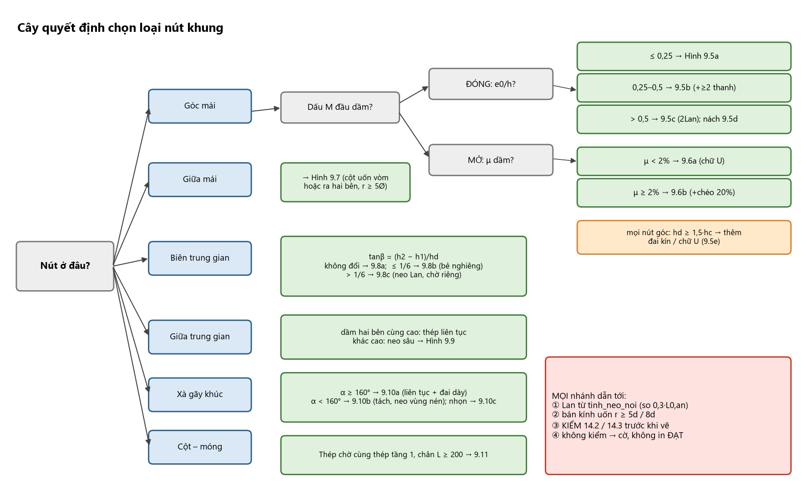
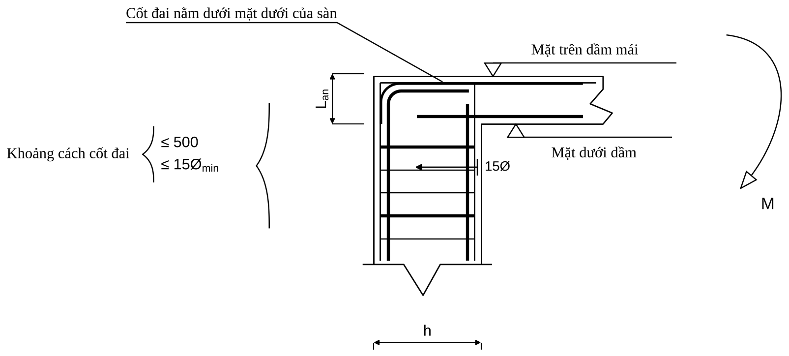
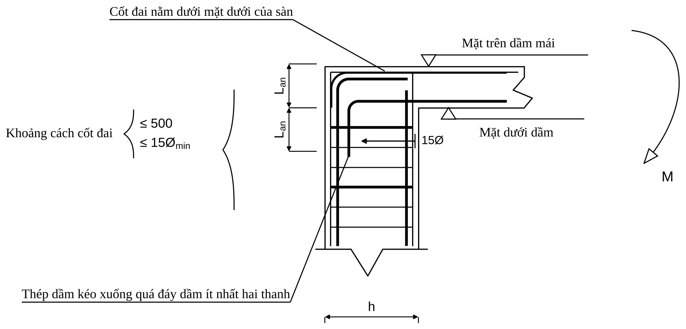
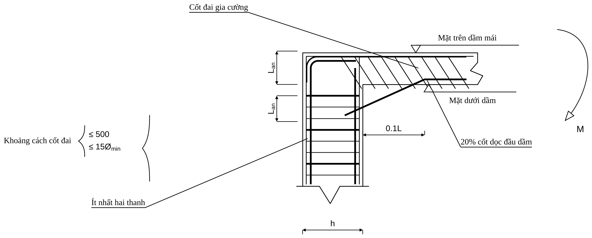
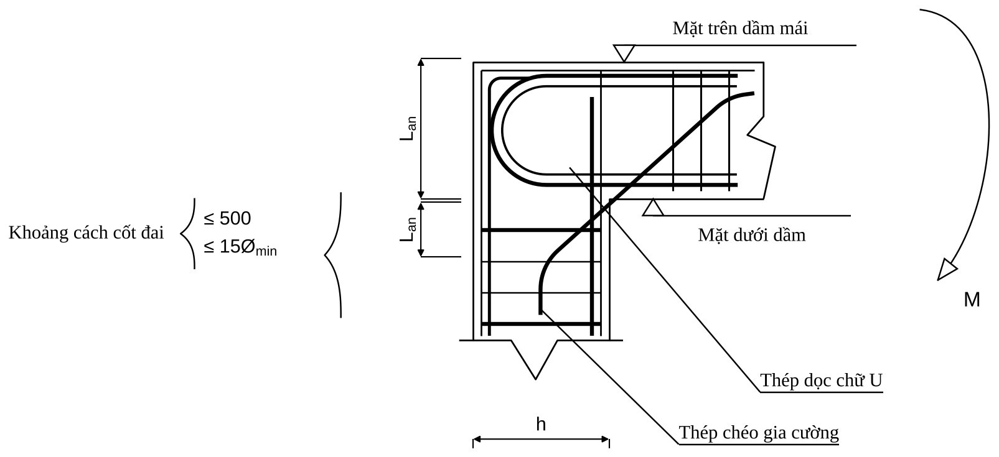
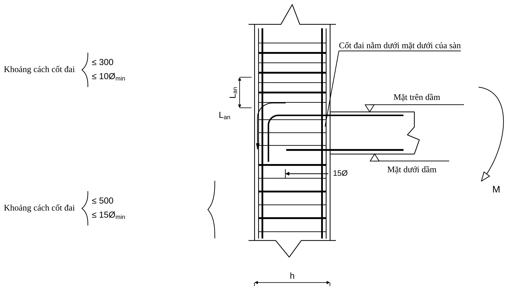
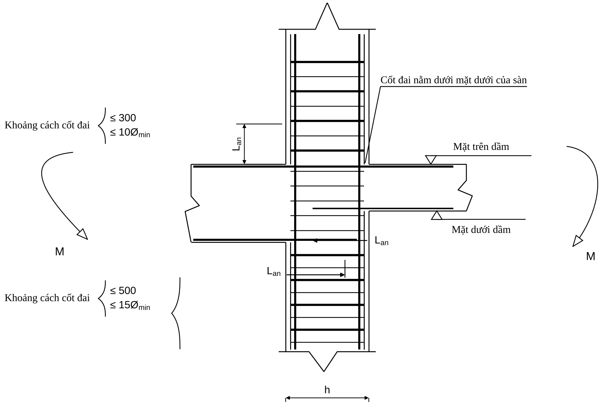
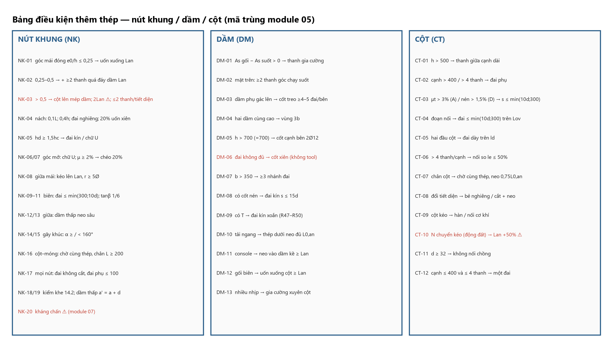
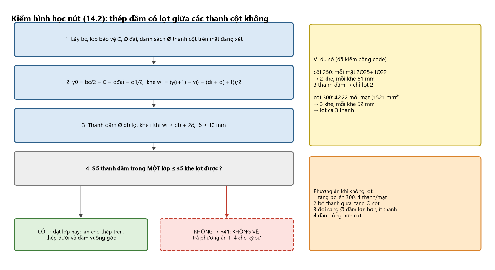

# 05 — CẤU TẠO NÚT KHUNG VÀ BẢNG ĐIỀU KIỆN THÊM THÉP (Chương 9.7 của tài liệu nguồn)

> **Trọng tâm của bộ skill.** Phá hoại khung chủ yếu do phá hoại nút; bản vẽ đúng $A_s$ mà nút không đặt vừa thép là bản vẽ hỏng.
> **Trạng thái tool:** `src/rule_engine/nut_khung.py` có bảng 13 loại nút (`BANG_CAU_TAO_NUT`, `tra_yeu_cau_nut`) nhưng **không tool nào của agent gọi nó** ⇒ **agent KHÔNG có công cụ sinh cấu tạo nút**.
> Do đó với mỗi nút agent phải: (1) xác định loại nút bằng quy trình dưới đây (hỏi người dùng khi thiếu dữ liệu); (2) liệt kê **thép phải thêm** từ Bảng điều kiện thêm thép; (3) ghi vào báo cáo cấu tạo dạng chữ + `basis`; (4) gắn cờ `can_xac_nhan`
> nếu chưa kiểm hình học 14.2/14.3; (5) **không in "ĐẠT"** khi nút còn cờ (R41, R46). Số liệu số học ($L_{an}$, $L_{ov}$, $r$) lấy từ `tinh_neo_noi`, không tự tính.

## 9.7. Cấu tạo nút khung

**Nguyên tắc chung (A 5.4.3; B):** nút phải (i) neo đủ $L_{an}$ cho **mọi** thanh quy tụ về nút, thanh kéo phải neo vào vùng bê tông **chịu nén**; (ii) tránh tập trung quá nhiều thép; (iii) đủ khoảng hở thi công, đầm bê tông; (iv) **mạch ngừng bê tông cột đặt ở mặt dưới dầm**; (v) bê tông vùng nút bị ép cục bộ ⇒ phải có đai (**đai cột không cắt trong nút**).

### Quy trình xác định loại nút và cấu tạo (5 bước)

1. **Vị trí hình học** (từ `truc`, `tang` của Input Adapter): trục **biên** hay **giữa**; tầng **mái** hay **trung gian**; có đổi tiết diện cột (tính $\tan\beta=(h_2-h_1)/h_d$)? có dầm gãy khúc (góc lõm $\alpha$)? cột–móng?
2. **Nút góc mái — đóng hay mở:** dấu mô men đầu dầm. Dầm làm **căng thớ trên** ở mọi tổ hợp (mô men âm tại nút) ⇒ **nút đóng** (vùng nén tăng ứng suất cục bộ). Mô men đầu dầm hướng ra ngoài góc (kéo trong góc) ⇒ **nút mở**. Dấu mô men dầm **không có** trong dữ liệu ETABS thật (chỉ có `FTopArea/FBotArea`): `FTopArea` chi phối ở gối ⇒ coi là đóng, **ghi cờ** và `hoi_nguoi_dung` nếu tổ hợp gió đảo dấu.
3. **Nút đóng:** tính $e_0/h$ tại **đầu cột** ($e_0=M/N$ của cột tại nút, $h$ chiều cao tiết diện cột trong mặt phẳng khung) — **dùng cặp nội lực đầu cột tại đúng tổ hợp chi phối**; ngưỡng 0,25 và 0,5. Dữ liệu đại diện chỉ là một cặp ⇒ khi sát ngưỡng chọn **trường hợp chặt hơn** (an toàn hơn).
4. **Nút mở:** hàm lượng $\mu$ thép dọc dầm ($<2\%$ hay $\ge2\%$). **Nút đóng hoặc mở với $h_d\ge1{,}5h_c$:** thêm đai kín/chữ U (N5).
5. **Chốt kiểm:** $L_{an}$ (tool, so với $0{,}3L_{0,an}$), bán kính uốn, **kiểm hình học 14.2 (thép dầm lọt qua thép cột) và 14.3 (dầm giao nhau)** — module 09. Không kiểm ⇒ cờ.

**Mô tả bằng chữ:** Cây quyết định nằm ngang. Gốc: "Nút ở đâu?" chia bốn nhánh: Góc mái / Giữa mái / Biên trung gian / Giữa trung gian, cộng hai nhánh phụ "Xà gãy khúc" và "Cột–móng". **Góc mái** → "Dấu mô men đầu dầm?" → Đóng ⇒ ba ô theo $e_0/h$: ≤0,25 (9.5a), 0,25–0,5 (9.5b), >0,5 (9.5c; thêm nách 9.5d nếu cần); Mở ⇒ hai ô theo $\mu$: <2% (9.6a), ≥2% (9.6b). Ô cuối mọi nhánh góc: "$h_d\ge1{,}5h_c$ ⇒ thêm đai kín/chữ U (9.5e)". **Giữa mái** → 9.7. **Biên trung gian** → "$\tan\beta$?" Không đổi/≤1/6 (9.8a, 9.8b) / >1/6 (9.8c). **Giữa trung gian** → dầm hai bên cùng cao: thép liên tục; khác cao: neo sâu (9.9). **Gãy khúc** → $\alpha\ge160°$ (9.10a) / $<160°$ (9.10b) / góc nhọn (9.10c). **Cột–móng** → 9.11. Mọi lá nối vào hộp cuối "Kiểm 14.2/14.3 trước khi vẽ".

### 9.7.1. Nút góc tầng mái (nút đóng — mô men đầu dầm làm nút nén)

Cấu tạo phụ thuộc $e_0/h$ tại đầu cột:

| $e_0/h$ | Cấu tạo | Hình |
|:--|:--|:--|
| $\le0{,}25$ | Thép kéo dầm kéo ra sát mặt ngoài cột và **uốn xuống một đoạn $L_{an}$**; đai cột đặt đến dưới mặt dưới sàn; đai dầm bắt đầu cách mép trong cột 50 mm | A 5.13a; B 3.9a |
| $0{,}25<e_0/h\le0{,}5$ | Như trên **và** ít nhất **2 thanh** thép dầm kéo xuống quá đáy dầm một đoạn $L_{an}$ | A 5.13b; B 3.9b |
| $>0{,}5$ | Một số thanh thép cột phải **kéo lên mép trên dầm** đồng thời một số thanh thép dầm neo sâu vào cột; thép kéo dầm kéo xuống quá đáy dầm $L_{an}$; **không cắt quá 2 thanh trên cùng một tiết diện**, các tiết diện cắt cách nhau $30d$ (B); hoặc mở rộng nút bằng **nách khung** | A 5.13c, d; B 3.9c |

⚠ **Xung đột nội bộ của nguồn:** hàng 3 ghi "kéo xuống quá đáy dầm $L_{an}$", nhưng **chú thích Hình 9.5c** ghi "$2L_{an}$, ít nhất hai thanh" và hình vẽ có **hai** đoạn $L_{an}$ chồng nhau dưới đáy dầm; ví dụ 11.5 viết "uốn xuống cột $\ge L_{an}=450$". **Mặc định an toàn: $2L_{an}$ cho $e_0/h>0{,}5$**, ghi cờ `can_xac_nhan`.

**Mô tả bằng chữ:** Nút góc tầng mái nhìn từ bên, cột đứng bên trái (rộng $h$ ghi dưới chân), dầm mái đi sang phải; mô men $M$ vẽ bằng mũi tên cong ở mép phải. Thép trên dầm chạy ngang tới mép **ngoài** cột rồi uốn tròn xuống dọc mặt ngoài cột một đoạn $L_{an}$ (kích thước dọc). Thép cột bên trong kéo lên đến sát mặt trên dầm rồi bẻ ngang vào dầm. Thép dưới dầm đi vào cột và kết thúc **bên trong cột**; chiều sâu neo ghi bằng mũi tên ngang "15Ø" ngay dưới đáy dầm, từ mặt trong cột đi vào phía cột. Đai cột (ngang, dày/thưa xen kẽ) kéo lên **đến dưới mặt dưới sàn** (nhãn "Cốt đai nằm dưới mặt dưới của sàn"); khoảng cách đai ghi ngoặc "≤500, ≤15Ø$_{min}$". Hai cao độ: "Mặt trên dầm mái" và "Mặt dưới dầm".

**Mô tả bằng chữ:** Giống 9.5a nhưng thêm: từ thép dầm, **ít nhất hai thanh** (nét đậm, nhãn "Thép dầm kéo xuống quá đáy dầm ít nhất hai thanh") đi xuống dọc mặt trong của cột, qua đáy dầm thêm một đoạn $L_{an}$; kích thước $L_{an}$ thứ nhất ở vùng chiều cao dầm, thứ hai dưới đáy dầm. Khoảng đai ghi ≤500, ≤15Ø$_{min}$.

**Mô tả bằng chữ:** Như 9.5a, thép trên dầm uốn xuống mặt ngoài cột; **hai kích thước $L_{an}$ xếp chồng** bên dưới đáy dầm (tổng $2L_{an}$). Thép cột phía ngoài kéo lên sát mép trên dầm. Nhãn "Ít nhất hai thanh" chỉ vào nhóm thanh dầm kéo xuống.

**Mô tả bằng chữ:** Nút góc có **nách** (dầm dày dần về phía cột). Vùng nách vẽ gạch chéo, bên trong có các **đai gia cường nghiêng** song song (nhãn "Cốt đai gia cường"); chiều dài nách ghi "0.1L" dưới đáy dầm. Thép dưới dầm ở đầu dầm: **20% cốt dọc đầu dầm** uốn xiên xuống đi vào cột (nét đậm chéo, nhãn "20% cốt dọc đầu dầm"), phần còn lại thẳng. Thép trên dầm uốn xuống cột $L_{an}$ (hai kích thước $L_{an}$ chồng nhau); nhãn "Ít nhất hai thanh" chỉ thép kéo xuống.

**Mô tả bằng chữ:** Dầm cao hơn cột ($h_d\ge1{,}5h_c$, kích thước ghi ở phải). Trong vùng nút mở rộng có một dãy **đai kín** thẳng đứng dày đặc suốt chiều cao dầm và hai nhánh ngang bổ sung; ở góc trên trái, một thanh **uốn chữ U** (nhãn "Thép uốn chữ U") ôm góc nối thép dầm trên với thép cột. Thép dưới dầm kết thúc trong nút. Cột phía dưới có đai thưa hơn. Mô men $M$ vẽ ở bên phải.

**Nách khung (B):** chiều dài nách $\ge1/10$ nhịp; chiều cao nách $\le0{,}4h_{xà}$; độ dốc từ **1:3** trở lên có hiệu quả; dọc mép nách đặt cốt cấu tạo.
**Điều kiện bổ sung (A, TCVN 5574:2018 mục 10.4.11):** chiều cao dầm $>1{,}5$ chiều cao cột ⇒ **đai kín hoặc đai chữ U** trong vùng nút mở rộng.
**Bán kính uốn:** $r\ge5d$ ($d<20$), $r\ge8d$ ($d\ge20$) — tăng $r$ để truyền lực vào bê tông trong nút (A); xem **⚠ ba mức khác nhau** ở module 04 mục 9.5.3; chỗ uốn có đai phụ $\le100$ mm (B).

**Ví dụ — nút góc mái cột 17 / dầm 50 (A):** $e_0/h=0{,}96>0{,}5$ ⇒ trường hợp **c**; $A_{s,cal}=297$, thép chọn 2Ø16 ($A_{s,ef}=402$): $L_{0,an}=435\times201{,}1/(2{,}875\times\pi\times16)=605$; $L_{an}=605\times297/402=447\ge\max(240;200;182)\to$ **450** (A chọn 700 do $R_{bt}=0{,}75$ sai); thép dầm uốn xuống cột $\ge450$, $r\ge5d=80$; đai cột sát đáy dầm; đai dầm bắt đầu cách mép cột 50. ⚠ **Số liệu của A tự mâu thuẫn:** $(M,N)=(8{,}71;119{,}5)$ cho $e_0=7{,}3$ cm chứ không phải 57,5 cm ($e_0/h$ thật có thể là 0,12 ⇒ trường hợp a). **Phải đọc lại $M,N$ từ ETABS trước khi chọn loại nút.**

**Mô tả bằng chữ:** Nút góc mái đóng, cột bên trái, dầm sang phải. Nhãn trên cùng: "Thép trên dầm 2Ø16 uốn xuống cột ≥ $L_{an}$ = 450" và "r ≥ 5d = 80" chỉ vào chỗ uốn. Hai kích thước $L_{an}$ chồng nhau ở dưới đáy dầm. Nhãn "Ít nhất hai thanh" cho nhóm thanh kéo xuống; "Thanh cột kéo lên sát mép trên dầm" chỉ thanh cột phía ngoài; "Đai cột đặt đến sát đáy dầm" chỉ đai trên cùng của cột; kích thước "15Ø" ở đầu thép dưới dầm; mô men $M$ ở phải; "Mặt trên dầm mái"/"Mặt dưới dầm".

### 9.7.2. Nút góc tầng mái chịu kéo (nút mở — mô men đầu dầm làm nút kéo)

Ứng suất kéo tập trung ở góc nút và lan vào giữa nút ⇒ nứt chéo (A hình 5.14). Cấu tạo (A hình 5.15): hàm lượng thép dọc dầm $\mu<2\%$: dạng hình 5.15a (Hình 9.6a); $\mu\ge2\%$: hình 5.15b (Hình 9.6b). Thép chịu kéo của dầm và cột uốn **chữ U**, bán kính uốn tuỳ kích thước nút; đặt thêm **thanh thép chéo gia cường** diện tích $\approx20\%$ thép chịu lực đầu dầm; thép chịu kéo neo vào vùng bê tông chịu nén ($L_{an}$).

**Mô tả bằng chữ:** Nút góc, cột trái, dầm phải. Hai thanh dọc (một đậm, một mảnh hơn nằm trong) **uốn thành cung bán nguyệt chữ U** nối thép trên dầm với thép dưới dầm ngay tại góc nút (nhãn "Thép dọc chữ U"); các đai dầm thẳng đứng dày ở phần gần góc. Thép cột bên trong kéo lên tới mặt trên. Kích thước hai $L_{an}$ chồng nhau ở mép trái; ngoặc "Khoảng cách cốt đai ≤500, ≤15Ø$_{min}$".

**Mô tả bằng chữ:** Giống 9.6a và thêm **một thanh chéo** (nhãn "Thép chéo gia cường") đi từ vùng cột bên dưới nút, cắt chéo qua vùng nút lên phía trên dầm bên phải, bẻ cong ở hai đầu; thanh này bổ sung chống nứt chéo ở góc nút.

### 9.7.3. Nút giữa tầng mái

Thép dọc của cột phải **kéo lên trên mặt dầm một đoạn $L_{an}$** (A hình 5.16); thép dầm tại nút giữa chạy qua hoặc neo $\ge L_{an}$ vào cột; đai cột dày hơn tại nút nếu có.

**Mô tả bằng chữ:** Hai phương án vẽ trên-dưới. **Phương án trên:** cột đứng, hai thanh cột kéo lên đến mặt trên dầm/sàn mái rồi **uốn vòm** (cung tròn bán kính $r\ge5\varnothing$, ghi nhãn "r ≥ 5Ø") nối với nhau, một thanh ngang đặt ở đỉnh; mũi tên cong ghi $L_{an}$ chạy từ đỉnh cung xuống dọc theo thanh. **Phương án dưới:** hai thanh cột kéo lên rồi **uốn ra hai bên** (mỗi bên một góc vuông bo tròn $r\ge5\varnothing$) nằm ngang trong sàn/dầm một đoạn $L_{an}$ (mũi tên ngang) và một đoạn $L_{an}$ thẳng đứng. Đai cột ở thân với ngoặc "Khoảng cách cốt đai ≤500, ≤15Ø$_{min}$"; "Mặt trên sàn mái" ở phía trên.

### 9.7.4. Nút biên tầng trung gian

| Điều kiện | Cấu tạo | Hình |
|:--|:--|:--|
| Tiết diện cột trên = cột dưới | thép cột liên tục qua nút; thép dầm uốn xuống/lên neo $\ge L_{an}$; đai $\le\min(300;10d_{min})$ trong đoạn $L_{an}$ tại nút | A 5.17a |
| Cột trên nhỏ hơn cột dưới, $\tan\beta=(h_2-h_1)/h_d\le1/6$ | thép cột dưới **bẻ nghiêng** lên chờ nối với thép cột trên | A 5.17b |
| $\tan\beta>1/6$ | thép cột dưới **kéo lên mặt dầm, neo một đoạn $L_{an}$** rồi cắt; thép cột trên có thép chờ riêng | A 5.17c |
| Chiều cao dầm hai bên khác nhau | neo sâu thép dầm vào nút | A 5.18 |

**Mô tả bằng chữ:** Cột đứng rộng $h$, dầm đi sang phải từ cao độ giữa hình. Thép trên dầm tới mặt ngoài cột rồi **uốn xuống** một đoạn $L_{an}$ (mũi tên cong, kích thước $L_{an}$ ở bên trái cột); thép dưới dầm kết thúc trong cột với kích thước "15Ø". Thép cột chạy thẳng liên tục qua nút. Trên nút, đai dày: ngoặc "≤300, ≤10Ø$_{min}$" ở đoạn $L_{an}$; đoạn xa nút thưa: ngoặc "≤500, ≤15Ø$_{min}$"; "Cốt đai nằm dưới mặt dưới của sàn".

**Mô tả bằng chữ:** Cột có hai bề rộng $h_1$ (trên, hẹp) và $h_2$ (dưới, rộng); mép ngoài chuyển tiếp xiên ở mức dầm với góc $\beta$ ghi "tgβ ≤ 1/6". Thép cột dưới bên phải **bẻ nghiêng** thẳng theo mép xiên rồi tiếp tục lên thành thép cột trên. Thép dầm uốn xuống mặt ngoài cột $L_{an}$; dầm bên phải. Có sơ đồ phụ thu nhỏ bên phải thể hiện góc $\beta$ và hai bề rộng $h_1$, $h_2$.

**Mô tả bằng chữ:** Giống 9.8b nhưng mép xiên rất dốc ("tgβ > 1/6"); thép cột dưới **không bẻ lên tiếp** mà kết thúc trong vùng dầm sau khi neo $L_{an}$ (kích thước $L_{an}$ ở bên trái); thép cột trên đặt riêng, kết thúc tại mức dầm. Đai như 9.8a.

### 9.7.5. Nút giữa tầng trung gian

Thép dọc dầm có thể **chạy liên tục qua nút**; nếu tiết diện cột đổi nhiều ($\tan\beta>1/6$) bố trí như nút biên; nếu hai dầm hai bên có chiều cao khác nhau thì neo sâu thép dầm vào nút (A 5.18). Khung chịu động đất: **đai nút dày như vùng tới hạn của cột** (B; module 07).

**Mô tả bằng chữ:** Cột đứng giữa hình, **hai dầm** hai bên cùng mặt trên nhưng dầm trái cao hơn dầm phải (đáy dầm trái thấp hơn). Thép trên cả hai dầm đi thẳng qua cột. Thép dưới dầm bên phải (dầm thấp) đi vào cột và kết thúc với kích thước "$L_{an}$"; thép dưới dầm trái đi vào cột và có kích thước $L_{an}$ khác phía dưới; dưới cột có $L_{an}$ chiều dọc. Hai mũi tên cong M ở hai bên (mô men ngược chiều). Đai cột dày ở đoạn nút (≤300, ≤10Ø$_{min}$), thưa dưới (≤500, ≤15Ø$_{min}$).

### 9.7.6. Nút xà ngang gãy khúc

Dưới mô men dương, hợp lực kéo và nén ở chỗ gãy hướng **ra ngoài** ⇒ có thể làm bật thép. Góc lõm $\alpha\ge160°$: thép kéo dầm chạy **liên tục** qua nút, chỉ cần đai gia cường (A 5.20a; B 3.12b). $\alpha<160°$: **tách một số hoặc toàn bộ thép kéo**, neo vào vùng nén, và đặt **cốt đai/thanh ngang ôm toàn bộ thép kéo** (A 5.20b, c; B 3.12c). Thép dọc gia cường $\ge20\%$ thép chịu lực đầu dầm (A). Đoạn đặt đai gia cường $S=h\tan(3\alpha/8)$ (B 3.2).
Diện tích đai giằng (B 3.1, **[TC cũ]**): $\sum R_{sw}A_{sw}\cos\beta\ge(2F_{a1}+0{,}7F_{a2})R_s\cos\dfrac\alpha2$ ($F_{a1}$: thanh **không** neo trong vùng nén; $F_{a2}$: thanh đã neo vùng nén; $\beta$: góc giữa phân giác góc lõm và trục đai). ⚠ **Tra D/TCVN 5574:2018 (mục xà gãy khúc) cho công thức hiện hành.**

**Mô tả bằng chữ:** Xà hai mái dốc nhẹ gặp nhau ở đỉnh (góc lõm $\alpha\ge160°$ ghi ở dưới đỉnh), hai đầu xà có kí hiệu gãy và mô men $M$ vòng cung. Hai thanh dọc tính toán (trên, dưới) **chạy liên tục** qua đỉnh, bo tròn nhẹ. Quanh đỉnh, đoạn dài $S=h\cdot\mathrm{tg}(3\alpha/8)$ (ghi trên đỉnh) có đai **dày hơn** (các vạch xiên sát nhau) giới hạn bởi hai đường nét đứt hợp góc $\alpha_1=3\alpha/4$; kích thước $h$, $h/2$, $h/2$ ghi bên phải; $h_1$, $h_2$ ở hai đầu. Nhãn "Cốt dọc tính toán đặt liên tục qua nút".

**Mô tả bằng chữ:** Xà dốc hơn, đỉnh gãy rõ ($\alpha<160°$). Thanh dọc **trên** liên tục qua đỉnh; hai thanh dọc **dưới** gặp nhau ở đỉnh nhưng **không liên tục**: mỗi thanh đi vào đỉnh rồi kéo qua điểm giao một đoạn $L_{an}$ (neo vào vùng nén). Một thanh đứng ngắn nằm đúng đỉnh và hai thanh chéo ngắn đối xứng ôm lấy các đầu thanh kéo. Đoạn đai dày $S=h\cdot\mathrm{tg}(3\alpha/8)$ ở đỉnh; nhãn "Cốt dọc tính toán phải được neo vào vùng nén".

**Mô tả bằng chữ:** Xà hình chữ V ngược góc nhọn. Cốt dọc tính toán hai thanh đặt sát biên **trong** (phía dưới) chạy liền qua đỉnh. Phía trên có **thép gia cường**: một thanh ngang nằm dưới đỉnh, hai đầu bẻ xuống, mỗi bên kéo dài $L_{an}$ (ghi hai chữ $L_{an}$), kết hợp một **vòng thép tròn** khép kín đặt sát đỉnh nối với thanh ngang bằng hai nhánh chéo. Kích thước $h_1/2$, $h_2/2$ dọc mép ngoài hai bên đỉnh; $h_1$, $h_2$ ở chân.

### 9.7.7. Liên kết cột – móng (A 5.19; B 3.14–3.15)

| Hạng mục | Quy định |
|:--|:--|
| Thép chờ | từ móng, **diện tích và số thanh bằng thép cột tầng 1** |
| Cao trình ngàm | mặt trên móng (B), $\pm0{,}00$ nếu móng nằm dưới nền |
| Nối thép chờ | so le dọc chiều cao; $\le50\%$ thép gờ (B: $\le25\%$ thép trơn) trong một tiết diện hoặc đoạn $<L_{an}$ |
| Thép cột $>4$ thanh | **không** cắt cùng chiều dài; cột 4 thanh cho phép nối tại một tiết diện |
| Đai trong móng | ít nhất **2–3 đai** trong chiều cao móng ở đoạn thép chờ (B: $\le10d$ hoặc 100 mm gần mặt móng); thêm đai gia cường khi ép mặt lớn |
| Neo thép cột vào móng | $\ge L_{an}$ (nén, $\alpha=0{,}75$), hết chiều cao móng nếu móng mỏng; móc uốn ra để định vị; **chân L $\ge200$** |
| Mối nối khớp (cũ) | giảm tiết diện cột $1/3$–$1/2$; khe 2–4 cm lấp chì/sợi nhựa; lưới ép mặt $F_a=P/8000$ cm² — **[TC cũ], chỉ để nhận biết** |

**Mô tả bằng chữ:** Cột đứng trên một móng chữ nhật (có ký hiệu gãy hai bên). Hai thanh thép chờ chạy dọc cột xuống móng và **bẻ chữ L ra hai phía** ở đáy móng, đoạn nằm ngang dài $\ge200$ (kích thước ghi dưới); một thanh L rời vẽ riêng bên trái. Mặt trên móng có cao độ "Mặt trên móng". Đai cột kéo xuống tới mặt móng; ở đoạn $L_{an}$ phía trên mặt móng đai dày (ngoặc "≤300, ≤10Ø$_{min}$"), có kích thước 100 từ mặt móng tới đai đầu. Ở đáy móng là lưới thép thể hiện bằng một đường kép ngang và dãy chấm tròn.

## BẢNG ĐIỀU KIỆN THÊM THÉP (điều kiện kích hoạt → thép phải thêm)

> Cách dùng: với mỗi cấu kiện/nút, quét từ trên xuống; mỗi dòng có điều kiện đúng ⇒ đưa **cột "Phải THÊM"** vào báo cáo cấu tạo và dữ liệu cho Drawing Agent. `basis`: TCVN / thuc_hanh / uoc_luong / can_xac_nhan (module 00). Nhãn "TC cũ" ⇒ `can_xac_nhan`.

**Mô tả bằng chữ:** Ba thẻ lớn cạnh nhau (Nút khung / Dầm / Cột). Mỗi thẻ liệt kê các dòng "điều kiện → thép thêm" bằng chữ ngắn, đánh mã NK-01…, DM-01…, CT-01… trùng với ba bảng bên dưới; dòng nào là ⚠ có biểu tượng cảnh báo vàng, dòng nào còn thiếu tool có viền đỏ.

### Bảng A — Nút khung (mã NK)

| Mã | Điều kiện (IF) | Phải THÊM / cấu tạo (THEN) | Số liệu | Nguồn | basis |
|:--|:--|:--|:--|:--|:--|
| NK-01 | Nút góc mái đóng, $e_0/h\le0{,}25$ | Thép kéo dầm kéo ra sát mặt ngoài cột, uốn xuống $L_{an}$; đai cột lên tới dưới mặt dưới sàn; đai dầm đầu tiên cách mép trong cột 50 | $L_{an}$ từ `tinh_neo_noi`; $r\ge5d/8d$ | A 5.13a | TCVN (A) |
| NK-02 | Góc mái đóng, $0{,}25<e_0/h\le0{,}5$ | NK-01 **+ ≥2 thanh** thép dầm kéo xuống **quá đáy dầm $L_{an}$** | ≥2 thanh | A 5.13b | TCVN (A) |
| NK-03 | Góc mái đóng, $e_0/h>0{,}5$ | Thanh cột kéo lên mép trên dầm; thép dầm neo sâu vào cột, kéo xuống quá đáy dầm **$2L_{an}$** (⚠ bảng 9.7.1 ghi $L_{an}$), ≥2 thanh; **không cắt quá 2 thanh/tiết diện**, tiết diện cắt cách nhau $30d$ [TC cũ B]; hoặc nách khung | $2L_{an}$; $30d$ | A 5.13c,d; B 3.9c | can_xac_nhan |
| NK-04 | Nách khung được chọn | Chiều dài nách $\ge0{,}1L$ (≥1/10 nhịp), chiều cao nách $\le0{,}4h_{xà}$, độ dốc ≥1:3; **đai gia cường nghiêng** trong nách; **20% cốt dọc đầu dầm uốn xiên** xuống cột; cốt cấu tạo dọc mép nách | 0,1L; 0,4h; 20% | A 5.13d; B | TCVN (A) / TC cũ (B) |
| NK-05 | $h_d\ge1{,}5h_c$ ở nút góc | **Đai kín hoặc chữ U** trong vùng nút mở rộng + thép uốn chữ U | $h_d/h_c\ge1{,}5$ | A 5.13e; TCVN 5574:2018 10.4.11 | TCVN |
| NK-06 | Góc mái **mở**, $\mu<2\%$ | Thép dọc dầm+cột **uốn chữ U**; neo vào vùng nén $L_{an}$ | $\mu<2\%$ | A 5.15a | TCVN (A) |
| NK-07 | Góc mái mở, $\mu\ge2\%$ | NK-06 **+ thanh chéo gia cường $\approx20\%$** thép chịu lực đầu dầm | 20% | A 5.15b | TCVN (A) |
| NK-08 | Nút giữa mái | Thép cột kéo lên trên mặt dầm $L_{an}$ (uốn vòm hoặc ra hai bên); $r\ge5\varnothing$; đai nút ≤500, ≤$15d_{min}$ | $L_{an}$; $r\ge5\varnothing$ | A 5.16 | TCVN (A) |
| NK-09 | Biên trung gian, cột không đổi | Thép cột liên tục; thép dầm uốn xuống/lên neo $\ge L_{an}$; **đai $\le\min(300;10d_{min})$ trong đoạn $L_{an}$ tại nút** | 300; $10d_{min}$ | A 5.17a | TCVN (A) |
| NK-10 | Biên, cột đổi tiết diện, $\tan\beta\le1/6$ | Thép cột dưới **bẻ nghiêng** lên chờ nối cột trên (không cắt) | $\tan\beta\le1/6$ | A 5.17b | TCVN (A) |
| NK-11 | Biên, $\tan\beta>1/6$ | Thép cột dưới **kéo lên mặt dầm, neo $L_{an}$**, rồi cắt; thép cột trên có **thép chờ riêng**; đai định vị ≥3 trong mặt cắt đổi tiết diện (Hình 9.4) | $L_{an}$ | A 5.17c | TCVN (A) |
| NK-12 | Giữa trung gian, 2 dầm khác chiều cao | Thép dầm **thấp** neo sâu vào nút (≥$L_{an}$ từ mép nút phía đối diện); thép dầm cao chạy qua | $L_{an}$ | A 5.18 | TCVN (A) |
| NK-13 | Giữa trung gian, đổi tiết diện nhiều ($\tan\beta>1/6$) | Như NK-11 | | A | TCVN (A) |
| NK-14 | Xà gãy khúc $\alpha\ge160°$ | Thép kéo **liên tục** qua nút + **đai gia cường** trong đoạn $S=h\tan(3\alpha/8)$ | $S$ | A 5.20a | TCVN (A) |
| NK-15 | Xà gãy khúc $\alpha<160°$ | **Tách** thanh kéo, **neo vào vùng nén** $L_{an}$; **đai/thanh ngang ôm toàn bộ thép kéo**; thép dọc gia cường $\ge20\%$ thép chịu lực đầu dầm; góc nhọn: thép gia cường dạng vòng + thanh ngang $L_{an}$ mỗi bên | $20\%$ | A 5.20b,c | TCVN (A) + ⚠ công thức B |
| NK-16 | Cột–móng | Thép chờ **cùng số thanh/Ø** thép cột tầng 1; chân L $\ge200$, $r\ge5\varnothing$; neo $\ge L_{an}$ ($\alpha=0{,}75$); đai trong móng **2–3 cái** (≤$10d$ hoặc 100 mm); đai cột ≤300 và ≤$10d_{min}$ trong $L_{an}$ | 200; 3 đai | A 5.19; B 3.14–3.15 | TCVN (A) |
| NK-17 | **Mọi nút** | **Đai cột không cắt trong nút**; mạch ngừng bê tông ở mặt dưới dầm; mọi thanh quy tụ neo $\ge L_{an}$; chỗ uốn có **đai phụ ≤100 mm** | 100 mm | A 5.4.3; B | TCVN (A) |
| NK-18 | **Mọi nút giao dầm–cột** (trước khi vẽ) | **Kiểm hình học 14.2:** số thanh dầm một lớp ≤ số khe lọt giữa thép cột; không đạt ⇒ phương án 1–4 (tăng $b_c$, đổi Ø/số thanh, dầm rộng hơn cột) | khe ≥ $d_b+2\delta$, $\delta\ge10$ | Chương 14 | thuc_hanh (R41) |
| NK-19 | Hai dầm cắt nhau cùng cao độ mặt trên | Dầm thấp: $a'=a+d_{kia}$, tính lại $h_0$, $M_u$; chọn lại thép nếu $M_u<M$ | $a'=a+d_{kia}$ | Chương 14 | thuc_hanh (R43) |
| NK-20 | Công trình kháng chấn (cờ BẬT) | Đai nút ≥ vùng tới hạn cột; nút 4 dầm: bước đai có thể gấp đôi nhưng ≤150; **thanh dọc trung gian** giữa các thanh góc; **không nối trong vùng tới hạn**; $\sum M_{Rc}\ge1{,}3\sum M_{Rb}$ | module 07 | EN 1998-1 | can_xac_nhan (⚠) |

### Bảng B — Dầm (mã DM)

| Mã | Điều kiện (IF) | Phải THÊM (THEN) | Số liệu | Nguồn | basis |
|:--|:--|:--|:--|:--|:--|
| DM-01 | $A_{s,gối}-A_{s,suốt}>0$ | **Thanh gia cường gối** (hàng ngoài trước), ≤2 cỡ Ø, chênh ≤6 mm; tối đa 2 hàng | R15 | Ch.12 B3 | thuc_hanh |
| DM-02 | Mặt trên dầm bất kỳ | **≥2 thanh góc chạy suốt** làm cốt giá, $A_s\ge\max(A_{s,min};\tfrac14A_{s,gối\,max})$ | R14 | D 4.1.1; B/EC8 | TCVN + TC cũ |
| DM-03 | Dầm phụ gác lên dầm chính | **Cốt treo**: $F(1-h_s/h_0)\le\sum R_{sw}A_{sw}$; **≥4 (ví dụ 5) đai/bên**, bước 40–80, trong $S=b_{dp}+2h_s$; trên dầm phụ cốt ngang trong $h/3$; ≥2/3 $A_{sw}$ trong dầm chính | R23; ⚠ Hình 7.2 ghi $b+2h$: **lấy vùng rộng hơn** | A 5.22; D | TCVN (A) |
| DM-04 | Hai dầm giao nhau cùng cao | $F\le\sum R_{sw}A_{sw}$ trong $3b$ | $a=3b$ | A 5.22b | TCVN (A) |
| DM-05 | $h>700$ (và $h=700$ đặt thiên về an toàn) | **Cốt cạnh bên** 2 hàng, cách đều, $\ge0{,}1\%\,b'h'$, $h'\le400$, **giằng đai**, neo 300 vào cột | 2Ø12/bên cho CB | D, C; R24 | TCVN |
| DM-06 | Đai tính không đủ ($Q_u<Q$ sau khi tăng đai) | **Cốt xiên** $\theta=30°/45°/60°$ ($h<400$; 400–800; >800), $\varphi_{sw}=0{,}75$ | | D 4.85 | TCVN — **không tool ⇒ báo kỹ sư** |
| DM-07 | $b>350$ (9.4.2) hoặc $>400$ (11d) hoặc >5 thanh nén một hàng | ≥3–4 nhánh đai (lấy ngưỡng 350 an toàn hơn) | | D; A | can_xac_nhan |
| DM-08 | Có cốt nén kể vào tính | Đai kín, $s\le15d$ và $\le500$ | | D 10.3 | TCVN |
| DM-09 | Dầm có $T\ne0$ | **Đai kín xoắn** (nối chồng ≥$30d_{sw}$), cốt dọc theo chu vi (≤400, thực tế ≤200), neo $L_{an}$; kiểm 7.21, 7.33–7.38 | module 09 | D 7.5–7.7 | TCVN + ⚠ (R47–R50) |
| DM-10 | Gối có tải ngang/đảo dấu | **Thép dưới vào gối neo đủ $L_{0,an}$** (hoặc móc 90°), không dùng $L_{an,min}$; kiểm điểm cắt cho **cả** thép trên và dưới | R17, R20 | Ch.12 B4,B6 | thuc_hanh |
| DM-11 | Console | Thép gối trên neo vào dầm khung $\ge L_{an}$ từ mặt cột; đai dày sát ngàm | | A | TCVN |
| DM-12 | Thép trên gối nối/uốn xuống cột biên | $\ell_{đứng}\ge L_{an}$, $r\ge5d$ ($<20$)/$8d$ ($\ge20$) | R19 | Ch.12 B5 | TCVN (A) |
| DM-13 | Dầm nhiều nhịp | Thanh gia cường mỗi bên cắt theo nhịp mình, **xuyên qua cột** khi cả hai nhịp cần | R21 | Ch.12 B7 | thuc_hanh |

### Bảng C — Cột (mã CT)

| Mã | Điều kiện (IF) | Phải THÊM (THEN) | Số liệu | Nguồn | basis |
|:--|:--|:--|:--|:--|:--|
| CT-01 | Cạnh trong mặt phẳng uốn $h>500$ (tim hai hàng >500) | **Thanh cấu tạo giữa cạnh dài** (tim ≤500), $d\ge12$; giằng bằng đai phụ | R11 | D; C | TCVN |
| CT-02 | Cạnh >400 hoặc >4 thanh/cạnh | **Đai phụ/thanh giằng**; thanh cách một thanh ở chỗ uốn đai; chỗ uốn cách ≤400 | R28; Hình 9.2 | D; A | TCVN |
| CT-03 | $\mu_t>3\%$ (A) hoặc thép nén >1,5% (D) | Đai $s\le\min(10d_{min};300)$; **mọi** thanh dọc được giằng | | D 6.2.1; B 3.5 | TCVN (lấy D) |
| CT-04 | Đoạn nối chồng thép dọc | Đai $s\le\min(10d_{min};300)$ trên đúng $L_{ov}$; $\mu_t$ tại nối $\le8\%$ | R26 | A; D | TCVN |
| CT-05 | Hai đầu cột (vùng nút) | Đai dày $s\le10d_{min}$ trên $l_d=\max(h_c;H_n/6;450)$ **[thực hành]** | R26 | A; Ch.12 C4 | thuc_hanh |
| CT-06 | Cột có $>4$ thanh/cạnh | Nối **so le**, mỗi lần ≤50%, cách $\ge1{,}5L_{an}$ | | A; D | TCVN |
| CT-07 | Chân cột | Thép chờ cùng số thanh/Ø thép tầng 1; chân L; neo móng $0{,}75L_{0,an}$ | R29 | A 5.19; Ch.12 C3 | TCVN (A) |
| CT-08 | Cột đổi tiết diện, $\tan\beta\le1/6$ / $>1/6$ | Bẻ nghiêng / cắt + neo + chờ riêng | NK-10/11 | A 5.17 | TCVN (A) |
| CT-09 | Cột chịu **kéo** ($N<0$) | **Hàn hoặc nối cơ khí**, không nối chồng; neo chắc hai đầu; kiểm kéo lệch tâm | R12 | D 7.2 | TCVN |
| CT-10 | N chuyển kéo trong tổ hợp động đất | $L_{an}$ **tăng 50%** | module 07 | EN 1998 5.6.2 | can_xac_nhan (⚠) |
| CT-11 | Thép $d\ge32$ | Không nối chồng; nên hàn/cơ khí | | D; C | TCVN |
| CT-12 | Cạnh $\le400$ và $\le4$ thanh/cạnh | **Một đai** ôm tất cả (không thêm đai phụ) | | D, A | TCVN |

### Ánh xạ bảng khoá của `nut_khung.py` (13 loại) ↔ mã NK

`goc_mai_dong_e0_h_le_025`→NK-01; `goc_mai_dong_025_lt_e0_h_le_05`→NK-02; `goc_mai_dong_e0_h_gt_05`→NK-03 (**code thiếu "$2L_{an}$", "không cắt >2 thanh", "30d"**); `goc_mai_mo`→NK-06/07; `giua_khung_mai`→NK-08; `bien_tang_trung_gian_tiet_dien_khong_doi`→NK-09; `bien_doi_tiet_dien_tgbeta_le_1_6`→NK-10; `bien_doi_tiet_dien_tgbeta_gt_1_6`→NK-11; `giua_tang_trung_gian`→NK-12/13; `cot_mong`→NK-16; `gay_khuc_alpha_ge_160`→NK-14; `gay_khuc_alpha_lt_160`→NK-15; `dam_phu_dam_chinh`→DM-03 (**code ghi $b+2h$ cho dầm chính**, phù hợp ⚠ ở DM-03).
**Thiếu trong code:** nách khung (NK-04), nút mở rộng $h_d\ge1{,}5h_c$ (NK-05), kiểm hình học (NK-18/19), kháng chấn (NK-20).

**Mô tả bằng chữ:** Lưu đồ dọc 5 ô. (1) "Lấy $b_c$, lớp bảo vệ, $d_{đai}$, danh sách Ø thanh cột trên mặt đang xét". (2) "Tính toạ độ thanh cột $y_i$ theo bề rộng (thanh góc ở $\pm y_0$, $y_0=b_c/2-C-d_{đai}-d_1/2$) và các khe $w_i=(y_{i+1}-y_i)-(d_i+d_{i+1})/2$". (3) "Một thanh dầm Ø$d_b$ lọt khe $i$ khi $w_i\ge d_b+2\delta$, $\delta\ge10$ mm". (4) "Số thanh dầm trong **một lớp** ≤ số khe lọt được?" nhánh Có → "Đạt cho lớp này; lặp cho thép trên, thép dưới và dầm vuông góc"; nhánh Không (đỏ) → "R41: **không vẽ**; đưa phương án 1–4". (5) Hộp bên cạnh minh hoạ số liệu: cột 250, 2Ø25+1Ø22 ⇒ 2 khe 61 mm, 3 thanh dầm ⇒ chỉ lọt 2; cột 300, 4Ø22 ⇒ 3 khe 52 mm, lọt 3.

## Những việc agent KHÔNG được làm ở nút khung

1. Không tự quyết định cấu tạo nút "cho vừa" mà không ghi nguồn/`basis`; không bỏ đai trong nút vì "bị dầm che".
2. Không dùng số của ví dụ A (700, $e_0=57{,}5$ cm…) cho công trình khác; không dùng $L_{an}=700$ (sai $R_{bt}$).
3. Không cắt/uốn thép cột ở nút khi chưa tính lại $M_u$ của cột (14.2).
4. Không áp dụng cấu tạo [TC cũ] của B (ví dụ $r\ge10d$, $30d$, công thức đai giằng xà gãy khúc, mối nối khớp) khi đã có quy định của A/D.
5. Không in "ĐẠT" cho nút còn cờ NK-03, NK-15, NK-18–NK-20.
