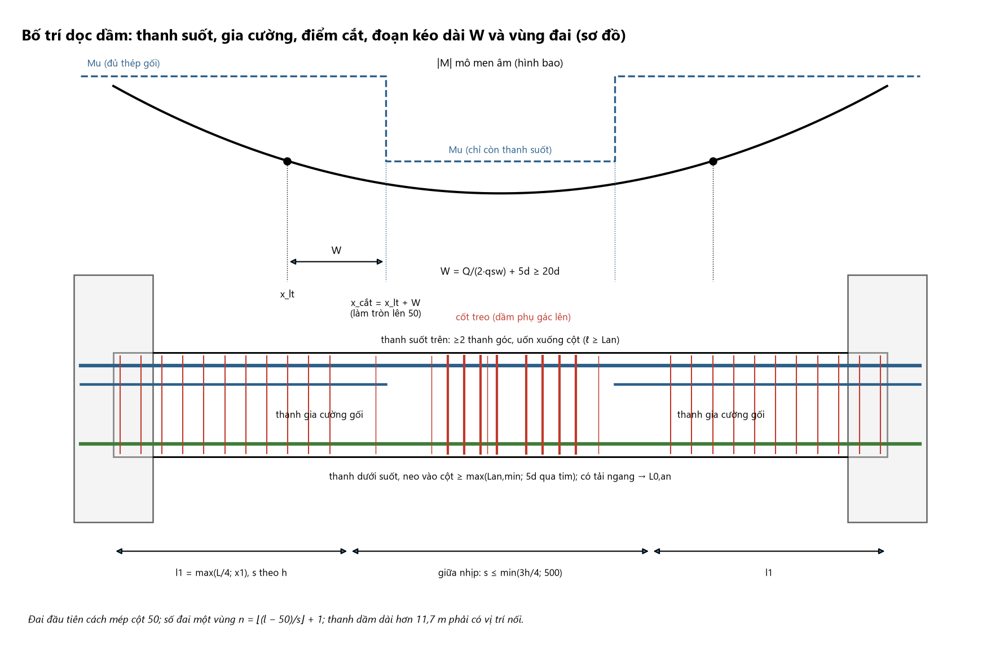
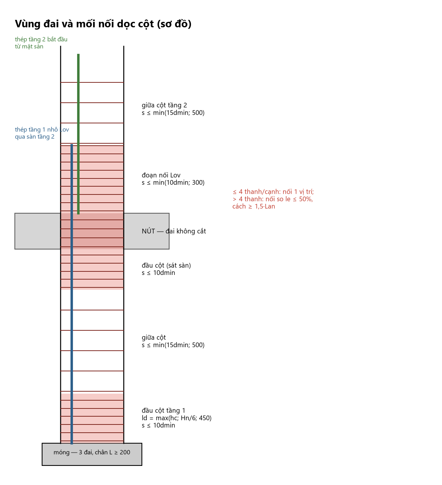

# 06 — BỐ TRÍ THÉP THEO CHIỀU DÀI CẤU KIỆN VÀ DỮ LIỆU CHO BẢN VẼ (Chương 12)

> **Trạng thái tool:** hệ thống hiện chỉ chọn thép **tại 3 vị trí** (gối trái, giữa nhịp, gối phải); **không có** khái niệm điểm cắt lý thuyết, chiều dài từng thanh, vùng đai theo chiều dài, đếm đai, bảng thống kê khối lượng.
> Chương này là **checklist và công thức** để agent biết *còn thiếu gì* và để chuẩn bị dữ liệu cho Drawing Agent. Agent **không tự tính** các con số ở đây trong lần chạy thật (không có hình bao $M$ từ ETABS dầm — chỉ có `As_yc`):
> mọi con số bố trí dọc đều mang `basis=uoc_luong` hoặc `thuc_hanh` và cờ **"chưa đủ để phát hành"** (R45) cho đến khi có hình bao thật.
> Quy ước nguồn: *(A, B, C, D)* từ 4 tài liệu; **[thực hành]** quy ước nghề; **[ước lượng]** số minh hoạ — dự án thật thay bằng số đọc từ ETABS.

# CHƯƠNG 12. BỐ TRÍ THÉP THEO CHIỀU DÀI CẤU KIỆN VÀ LẬP DỮ LIỆU CHO BẢN VẼ

## 12.1. Từ "diện tích thép cần có" đến bản vẽ: 9 việc theo thứ tự

| # | Việc phải làm | Đầu vào | Đầu ra |
|:-:|:--|:--|:--|
| 1 | Lập bảng $A_{s,tt}$ tại mọi mặt cắt kiểm soát (gối trái, nhịp, gối phải; trên và dưới) | Hình bao $M$, $Q$ (Chương 6) | Bảng $A_{s,tt}$, đã áp $A_{s,min}$ |
| 2 | Chọn **nhóm thép chạy suốt** | Bảng ở việc 1; B2 | Số thanh, Ø thanh suốt (trên, dưới) |
| 3 | Chọn **thanh gia cường** (phần chênh giữa $A_s$ gối và thép suốt) | Việc 2 | Số thanh, Ø, số hàng; $h_0$ thực |
| 4 | Xác định **điểm cắt** từng nhóm theo hình bao vật liệu | $M_u$ các nhóm; hình bao $M$ | $x_{lt}$, $W$, $x_{cắt}$ (làm tròn 50 mm) |
| 5 | Tính **chiều dài từng thanh** (có uốn, neo) | $x_{cắt}$, $L_{an}$, bán kính uốn | Bảng chiều dài, hình dạng thanh |
| 6 | Chia **vùng đai** và đếm đai | $Q$, $L$, quy tắc cấu tạo | Bảng vùng đai: $s$, chiều dài vùng, số đai |
| 7 | Bổ sung đai/cốt tại **tải tập trung**, lỗ, nút | Dầm phụ, console… | Cốt treo, đai gia cường |
| 8 | **Đánh số hiệu** thanh, bảng thống kê, khối lượng | Việc 2–7 | Bảng thống kê (12.4) |
| 9 | Kiểm tra chéo: khả năng chịu lực sau khi cắt, khoảng hở, mật độ thép | Mọi việc trên | Phiếu kiểm tra (12.8) |



**Mô tả bằng chữ:** Mặt đứng dầm hai nhịp giữa hai cột, vẽ tượng trưng (không đúng tỉ lệ). Dải trên: hình bao $|M|$ âm hình parabol lõm và đường bậc thang nét đứt của $M_u$ (cao ở hai gối, thấp ở giữa). Giao điểm hình bao và bậc thấp là **điểm cắt lý thuyết $x_{lt}$** (chấm đen); từ đó kéo thêm đoạn **$W=Q/(2q_{sw})+5d\ge20d$** về phía mô men nhỏ để ra **điểm cắt thực $x_{cắt}$** (làm tròn lên 50 mm). Dải giữa: hai thanh góc trên chạy suốt (đường đậm dài hết dầm, uốn xuống cột ở đầu biên, ghi $\ell_{đứng}\ge L_{an}$), thanh gia cường gối ngắn hơn (kết thúc tại $x_{cắt}$), thanh dưới chạy suốt và neo vào cột; dải dưới: vùng đai dày dài $l_1=\max(L/4;x_1)$ mỗi đầu, vùng giữa nhịp thưa $s\le\min(3h/4;500)$, đai đầu tiên cách mép cột 50, vùng cốt treo hai bên dầm phụ.

## 12.2. Dầm: quy trình bố trí dọc — 10 bước

### B1. Bảng $A_{s,tt}$ tại các mặt cắt kiểm soát

Với **mỗi nhịp** lập bảng $A_{s,tt}^{trên}$, $A_{s,tt}^{dưới}$ tại gối trái, nhịp, gối phải (và tại điểm có tải tập trung lớn). Mô men từ **hình bao**, tại mép gối nếu dự án quy định. Thép dưới ở gối có thể do tải ngang đảo dấu mà **không** có trong bảng nội lực "nguy hiểm": phải đọc đủ **hai dấu** của hình bao.

### B2. Chọn nhóm thép chạy suốt

| Quy tắc | Nội dung | Nguồn |
|:--|:--|:--|
| Thép trên chạy suốt | **≥2 thanh ở góc đai**, chạy suốt dầm, làm cốt giá | D 4.1.1; A; B/EC8 |
| Diện tích | $\ge\max\left(A_{s,min};\ \tfrac14A_{s,trên\ gối\ max}\right)$ | B/EC8 (tham khảo), ACI qua A |
| Thép dưới vào gối | **≥2 thanh** và $\ge\tfrac12A_s$ nhịp | D 4.6.8 |
| Đường kính | Cùng Ø; một mặt cắt **≤2 cỡ Ø**, chênh ≤6 mm | [thực hành] |
| Đối xứng | Số thanh mỗi hàng đối xứng qua trục dầm | [thực hành] |
| Thanh góc trên | ở **chỗ uốn của đai** (định vị) | A; D |

Thép chọn xong gần bằng thép suốt ⇒ không cần thanh gia cường (bỏ B3–B4 cho gối đó).

### B3. Thanh gia cường gối

$A_{s,gc}\ge A_{s,gối}-A_{s,suốt}$. Chọn số thanh/Ø sao cho: đủ $A_{s,tt}$ gối; vào được **hàng thứ hai** nếu một hàng không đủ chỗ (khoảng hở module 04, 9.3); sau khi cắt, phần còn lại (thanh suốt) có $M_u$ xác định (dùng ở B4). Thanh gia cường **cùng Ø** với thanh suốt nếu được (thép lớn ở hàng ngoài).

### B4. Điểm cắt và đoạn kéo dài

1. $M_u^{còn}=R_sA_s^{còn}(h_0-x/2)$ cho nhóm thép **còn lại** sau khi cắt.
2. Trên hình bao $M$ (cùng dấu) tìm **tiết diện cắt lý thuyết $x_{lt}$** nơi $|M|=M_u^{còn}$ (hình bao dạng bảng trạm ETABS ⇒ nội suy tuyến tính).
3. $W=\dfrac{Q}{2q_{sw}}+5d\ \ge\ 20d$ (D 4.98); $Q$ tại $x_{lt}$ (hoặc $Q_{max}$ nếu thiên về an toàn), $q_{sw}$ của đai trên đoạn kéo dài.
4. $x_{cắt}=x_{lt}+W$ (về phía mô men nhỏ). **Làm tròn lên bội 50 mm.**
5. Điều kiện bổ sung: (a) không ngắn hơn quy tắc thực hành khi chưa có hình bao (module 02 Bước 14d); (b) tránh cắt trong vùng còn chịu kéo lớn khi $W$ chưa đủ; (c) tại điểm cắt còn **≥2 thanh** mỗi mặt (B2); (d) kiểm lại khoảng hở và thứ tự thanh sau khi cắt.
6. **Có tải ngang đáng kể (gió, động đất):** hình bao có cả hai dấu ở gối ⇒ kiểm điểm cắt cho **cả thép trên và dưới**; **không** dùng quy tắc rút gọn (R17).
(Rule base cũ, mục 53.3, thêm số liệu "kinh nghiệm": mỗi lần cắt ≤50% $A_s$; cắt lần 1 cách mép gối $>L/4$, lần 2 $>L/3$; thép dương cắt cách gối biên $<0{,}1L$, gối giữa $<0{,}15L$; khoảng giữa cắt lớp trên và dưới $\ge h$ — **[kinh nghiệm]**, dùng làm cận kiểm tra thô, không thay hình bao.)

### B5. Chiều dài từng thanh

| Loại thanh | Công thức chiều dài (kích thước ngoài, mm) | Ghi chú |
|:--|:--|:--|
| Thanh gia cường tại **nút biên**, uốn xuống cột | $\ell=x_{cắt}+(h_c/2-c)+\ell_{đứng}$ | $\ell_{đứng}\ge L_{an}$; $r\ge8d$ ($d\ge20$) hoặc $5d$ ($d<20$) |
| Thanh suốt trên, từ nút biên sang nút giữa | $\ell=(h_c/2-c)+L_{tim\text{-}tim}+\ell_{đứng}$ (đầu biên); đầu nút giữa **đi tiếp** nhịp kề | dài hơn thanh thương phẩm (11,7 m) ⇒ nối **giữa nhịp** |
| Thanh gia cường tại **nút giữa** | từ $x_{cắt}$ nhịp này qua cột vào nhịp kề $\ge\max(W_{kề};20d)$ tính từ mép cột | |
| Thanh dưới | $\ell=L_{tim\text{-}tim}-(h_{c1}+h_{c2})/2+(\text{neo}_1+\text{neo}_2)$ | neo: B6 |
| Cốt cạnh bên | $\ell$ = dài dầm giữa hai tim cột (neo ≥300 vào cột) | [thực hành] |

Chiều dài khai triển đặt hàng = tổng đoạn thẳng **trừ lượng bù uốn** theo xưởng gia công của dự án (không có trong 4 tài liệu).

### B6. Neo thép dưới vào cột

Gối **chịu tải đứng thuần**: neo $\ge\max(L_{an,min};\ 5d\text{ qua tim cột})$ (ví dụ 11.1.4). Gối **có tải ngang** hoặc dầm có thể chịu kéo dưới ở gối: neo **đủ $L_{0,an}$** (hoặc móc 90° vào cột), **không** dùng $L_{an,min}$ (R20). Cột biên: neo $\ge L_{an}$ kể từ mép trong cột; đoạn thẳng không đủ ⇒ uốn đứng như thanh trên (Hình 9.5). Nút giữa: thép dưới hai nhịp **không bắt buộc nối nhau**, mỗi nhịp neo riêng.

### B7. Dầm nhiều nhịp và dầm khác tiết diện

1. **Thanh suốt trên** chung cho mọi nhịp, theo nhịp có $A_{s,tt}$ nhỏ nhất nhưng không dưới B2. 2. **Gối giữa:** gia cường hai nhịp có thể khác nhau; mỗi bên cắt theo $x_{cắt}$ **của nhịp đó**; thanh chung **xuyên qua** cột khi cả hai nhịp cần, chỉ cắt ở hai đầu xa. 3. Hai nhịp chênh chiều cao: thép dầm thấp **neo sâu** vào nút (Hình 9.9); thép dầm cao chạy qua. 4. Dầm đổi bề rộng $b$: kiểm khoảng hở ở tiết diện nhỏ nhất. 5. Console/dầm đỡ: thép gối trên **neo vào dầm kề $\ge L_{an}$** từ mặt cột.

### B8. Vùng đai và số lượng đai

| Vùng | Khoảng cách | Chiều dài vùng | Nguồn |
|:--|:--|:--|:--|
| Đai đầu tiên | cách **mép cột 50 mm** | — | A; B |
| Vùng gối | $s\le\min(h/2;300)$ nếu $h\le450$; $\min(h/3;500)$ nếu $h>450$ (và theo tính toán) | $l_1=\max\left(L/4;\ x_1\right)$ | D; A |
| Vùng giữa nhịp | $s\le\min(3h/4;500)$ | phần còn lại | D; A |
| Có tải tập trung | thêm cốt treo trong $S=b_{dp}+2h_s$ | hai bên dầm phụ | D |
| Đai nhiều nhánh | $b\le350$: 2 nhánh; $b>350$ hoặc cắt lớn: 3–4 | toàn dầm | D; [thực hành] |

$x_1$ = khoảng từ mép gối tới tiết diện mà $Q$ giảm bằng khả năng chịu cắt của **đai vùng giữa**: $x_1=(Q_{max}-Q_{u,giữa})/q$ (tải đều $q$); đai vùng giữa đã chịu $Q_{max}$ ⇒ $l_1=L/4$. **Số đai một vùng** (đai đầu cách mép 50, bước $s$, dài $l$): $n=\left\lfloor\dfrac{l-50}{s}\right\rfloor+1$; chia đều sao cho bước thực $\le s$ (làm tròn bước xuống bội 5 mm).

### B9. Cốt treo và đai gia cường

Vùng $S=b_{dp}+2h_s$ ($h_s=h_0-h_{dp}$); mỗi bên dầm phụ $\ge$ số đai tính ở Bước 13 (tối thiểu 4–5); đai đầu cách mép dầm phụ 50; bước 50–80. Cốt treo **đặt thêm** vào đai thường; không tính đai thường sẵn có trong $S$ (an toàn) trừ khi có hướng dẫn riêng. Có thể thay bằng cốt xiên uốn từ thép dọc (Bước 12).

### B10. Cốt cạnh bên, nối thép dọc, đai phụ

Cốt cạnh bên khi $h>700$ (D, C; $h=700$ đặt thiên về an toàn): cách đều, $h'\le400$, **giằng bằng đai** (đai móc/thanh giằng ngang [thực hành]), neo ≥300 vào cột. Thanh thương phẩm 11,7 m [thực hành]: dầm dài hơn phải nối — **thép trên nối giữa nhịp, thép dưới nối gần gối**, không nối quá 50% một mặt cắt (D 3.4.7). Đai kín, móc 135° (kháng chấn) hoặc 90° cắm đủ vào lõi; móc **luân phiên** hai góc đối diện giữa các đai liên tiếp [thực hành].

## 12.3. Cột nhiều tầng: quy trình bố trí dọc — 8 bước

### C1. Gom nhóm tầng và đổi thép

Lập bảng $A_{s,tt}$ theo tầng; **gom** tầng liên tiếp có $A_{s,tt}$ gần nhau thành một nhóm cùng thép (theo tầng nặng nhất); chỉ đổi số thanh/Ø **tại tầng có thay đổi nối**; đổi tiết diện: $\tan\theta\le1/6$ bẻ nghiêng, lớn hơn cắt và neo (Hình 9.3–9.4).

### C2. Cao độ và chiều dài nối

Thép tầng $k$ **nhô lên khỏi mặt sàn tầng $k+1$** một đoạn $L_{ov}$ (thép tầng $k+1$ bắt đầu từ mặt sàn) [thực hành]; $L_{ov}=\alpha_{ov}L_{0,an}A_{s,cal}/A_{s,ef}$; nhóm nối cùng cao độ có Ø khác nhau lấy $L_{ov}$ của Ø lớn nhất cho cả nhóm; mối nối **ngoài nút**; >4 thanh/cạnh ⇒ nối so le $\ge1{,}5L_{an}$; chịu **động đất** ⇒ nối **không** trong vùng tới hạn (module 07).

### C3. Thép chờ chân cột và neo vào móng

$\ell_{chờ}=\ell_{neo\ móng}+H_1+L_{ov}\ (+\ \text{chân L},\ \ge200)$; $\ell_{neo\ móng}\ge L_{an}$ với $\alpha=0{,}75$ (nén); số thanh và diện tích thép chờ **bằng** thép cột tầng 1 (A hình 5.19; module 05, NK-16).

### C4. Chia vùng đai cột

| Vùng | Khoảng cách | Chiều dài vùng | Nguồn |
|:--|:--|:--|:--|
| Đai đầu tiên | cách mặt sàn/đáy dầm **50 mm** | — | [thực hành] |
| Ngoài đoạn nối | $s\le\min(15d_{min};500)$ | giữa cột | D 6.2.1; A |
| **Đoạn nối chồng** | $s\le\min(10d_{min};300)$ | đúng $L_{ov}$ | D; A |
| Hai đầu cột | $s\le10d_{min}$ | $l_d=\max(h_c;H_n/6;450)$ | $s$: A; **$l_d$: [thực hành]** (theo cách xác định vùng tới hạn Chương 13) |
| Trong nút khung | đai **không cắt**; $s$ như hai đầu cột | chiều cao dầm | A; B |
| Cạnh dài >400 hoặc >4 thanh/cạnh | thêm **đai phụ/thanh giằng** | toàn cột | D; A (Hình 9.2) |

$d_{min}$ = Ø thanh dọc nhỏ nhất (kể cả cốt cấu tạo), $H_n$ = chiều cao thông thủy.

### C5. Đai phụ và móc

Thanh dọc **cách một thanh** ở chỗ uốn đai; khoảng giữa các chỗ uốn ≤400; thanh cấu tạo cạnh dài giằng bằng đai phụ **móc 135°**; móc đặt luân phiên [thực hành].

### C6. Nút khung

Thứ tự đặt thép: thép cột xuyên nút; thép dầm hai phương trong **khung đai nút**, không chồng thép cột; **kiểm thép dầm có lọt giữa thép cột (14.2) và giao cắt hai phương (14.3)** trước khi chốt khoảng hở [thực hành]. Đai nút không cắt; nút giữa chịu động đất xem 13.5/13.6.

### C7. Đếm đai

Mỗi vùng $n=\lfloor(l-50)/s\rfloor+1$; vùng đầu cột và vùng nối **có thể chồng nhau** (như tầng 2 ví dụ 12.6) — khi đó dùng bước nhỏ hơn cho toàn đoạn chồng.

### C8. Kiểm tra sau khi bố trí

(i) tim thép dọc ≤500 (trong mp uốn) và ≤400 (ngoài mp); (ii) $\mu$ tại chỗ nối ≤8%; (iii) $\mu_t\ge2\mu_{min}$ khi thép chu vi; (iv) mọi thanh dọc nằm trong phạm vi giằng của đai.



**Mô tả bằng chữ:** Một đoạn cột hai tầng vẽ đứng, tượng trưng. Từ dưới lên: móng (thép chờ chữ L, 3 đai trong móng), vùng đầu cột tầng 1 với $l_d=\max(h_c;H_n/6;450)$ (đai a $\le10d_{min}$, tô đậm), vùng giữa cột (đai $\le15d_{min}$ và $\le500$, nét thưa), vùng đầu cột sát sàn, **nút** (đai không cắt, tô sẫm), đoạn **nối chồng $L_{ov}$** nằm ngay trên mặt sàn (đai $\le\min(10d_{min};300)$, chồng lên vùng đầu cột), rồi lặp lại cho tầng 2. Bên phải là các ngoặc ghi từng vùng; thép tầng dưới (đậm) nhô lên $L_{ov}$ qua sàn, thép tầng trên (nhạt) bắt đầu từ mặt sàn; ký hiệu $\le4$ thanh/cạnh nối một vị trí, $>4$ thanh nối so le.

## 12.4. Ký hiệu thanh và bảng thống kê

**Quy ước số hiệu (thực hành, khớp Hình 12.1):** mỗi **nhóm thanh cùng Ø, hình dạng, chiều dài** có một số hiệu (vòng tròn trên đường dẫn); thanh giống nhau dùng chung số hiệu; ghi **số lượng–Ø–chiều dài** (VD `2Ø25 L = 8080`); đai ghi Ø và bước (`Ø8a150`); thanh uốn ghi các đoạn thẳng và bán kính; thứ tự số hiệu: thép dọc trên → dưới → cốt cấu tạo cạnh bên → đai → cốt treo/gia cường.
**Bảng thống kê:** số hiệu | Ø | hình dạng | dài 1 thanh (mm) | số thanh | tổng dài (m) | khối lượng (kg). $m_1=0{,}00617d^2$ kg/m (Ø8 0,395; Ø12 0,888; Ø16 1,580; Ø22 2,986; Ø25 3,856). Chỉ tiêu kiểm nhanh: **khối lượng thép/m³ bê tông** (dầm vài chục đến vài trăm kg/m³; 14.4) để phát hiện nhầm số thanh/đơn vị.
⚠ **Đối chiếu skill Vẽ:** skill Vẽ yêu cầu bảng **8 cột logic** (tên cấu kiện, STT, hình dạng, Ø, chiều dài, số lượng chia "1 CK/T. BỘ", tổng dài, trọng lượng) và dùng $0{,}0061654d^2$ (lệch 0,07%); mẫu ở đây 7 cột — khi giao dữ liệu cho Drawing Agent dùng **cấu trúc của hợp đồng dữ liệu/skill Vẽ**.

## 12.5. Ví dụ: bố trí hoàn chỉnh dầm CB 250×700 (khung trục 3)

Số liệu thép và nội lực lấy từ module 02 (không đổi): gối $2\varnothing25+3\varnothing22$ (hai hàng), nhịp $3\varnothing22$, đai Ø8 ($q_{sw}(a150)=113{,}9$). **Hình bao $M$ không có trong A** ⇒ dùng **[ước lượng]**: parabol qua $M_C=-462{,}37$, $M_B=-434{,}67$, $Q_B=240{,}3$ ⇔ $q=70{,}8$ kN/m, $Q_C=248{,}3$, $M(x)=-462{,}37+248{,}33x-35{,}41x^2$ ($x$ m từ tim C). **Thay đổi so với 11.1/11.7:** (i) cốt giá 2Ø14 thay bằng **2Ø25 chạy suốt**; (ii) neo thép dưới **450** thay cho 400 (400 chỉ vượt tim cột 100 < $5d=110$).
**B1–B2:** thép trên 2Ø25 hai góc đai (982 ≥ $\tfrac14\times2122=531$); thép dưới 3Ø22. **B3:** $A_{s,gc}=2122-982=1140\Rightarrow$ **3Ø22**.
**B4 — điểm cắt 3Ø22** ($M_u^{còn}=260{,}2$): đầu C: $x_{lt}=0{,}940$ m, $W=240\,300/(2\times113{,}9)+110=1165\ge440$, $x_{cắt}=2105\to$ **2150 từ tim C**; đầu B: $x'_{lt}=0{,}827$, $x_{cắt}=1992\to$ **2000 từ tim B** ($x=4900$). Dùng $Q$ thực ($\approx181{,}7$) thì $W\approx908$ (ngắn hơn ~250); chọn bản **an toàn**.
**B5:** cột 250×600, $c=20$, $h_c/2-c=280$; chân uốn xuống: $\ell_{đứng}=L_{an}\times1950/2122$: Ø25 $0{,}919\times946=869\to$ **900**; Ø22 $765\to$ **800**. **B6:** neo thép dưới **450** từ mép cột (vượt tim 150 ≥ $5d=110$). **B8:** $Q_{u,giữa}$ của Ø8a250 tại $C=2h_0$: $139{,}1+66{,}1=205{,}2$; $x_1=(240{,}3-205{,}2)/70{,}8=0{,}50$ m $<L/4\Rightarrow l_1=1725$; Ø8a150: $n_1=\lfloor(1725-50)/150\rfloor+1=12$ mỗi đầu; giữa 11 đai Ø8a250. **B9:** $S=220+2\times375=970$; 5 đai Ø8 mỗi bên a75. **B10:** $h=700$ (đúng ngưỡng) ⇒ $2\times2\varnothing12$, giằng đai, neo 300.


**Mô tả bằng chữ:** (a) Phía trên: đường cong liền hình parabol lõm (|M| mô men âm ước lượng) từ hai đầu gối xuống thấp nhất giữa nhịp; đường nét đứt bậc thang $M_u$: cao 492,5 (2Ø25+3Ø22) ở hai gối, hạ xuống 260,2 (chỉ 2Ø25) ở giữa. Hai chấm đen là điểm cắt lý thuyết tại 940 và 827 (ghi dưới trục); hai đoạn $W=1165$ nằm ngang đi từ chấm tới chỗ bậc nét đứt hạ xuống. (b) Phía dưới: mặt đứng dầm CB giữa hai cột (L = 6900 tim cột). Thanh số ① (2Ø25) chạy suốt phía trên, uốn xuống cột C (chân 900) và đi tiếp sang dầm BA; số ② (3Ø22) gia cường: nhóm C kết thúc ở **2150 từ tim C** (chân uốn 800), nhóm B bắt đầu ở **2000 từ tim B** vào BA 650 sau mép cột; số ③ (3Ø22) dưới chạy suốt, neo 450 qua mép cột; số ④ (2×2Ø12) cốt cạnh bên; đai ⑤ Ø8a150 (12 đai mỗi đầu), ⑥ Ø8a250 (11 đai giữa), ⑦ Ø8a75 cốt treo 5 đai mỗi bên dầm phụ D (hình chữ nhật gạch chéo ở giữa nhịp). Phía dưới có chú giải số hiệu 1–7 và chuỗi kích thước vùng đai.

**Bảng thống kê thép dầm CB (trong nhịp CB; thanh 1 đi tiếp sang BA):**

| Số hiệu | Ø | Hình dạng / mô tả | Dài 1 thanh (mm) | Số thanh | Tổng dài (m) | Khối lượng (kg) |
|:-:|:-:|:--|:--:|:-:|:--:|:--:|
| 1 | 25 | thẳng 7180 từ cột C tới tim B + chân đứng 900 ($r\ge200$) | 8080 | 2 | 16,16 | 62,3 |
| 2a | 22 | thẳng 2430 + chân đứng 800 (nhóm C) | 3230 | 3 | 9,69 | 28,9 |
| 2b | 22 | thẳng 2950 (nhóm B; 4900 → 7850, vào BA 650 sau mép cột) | 2950 | 3 | 8,85 | 26,4 |
| 3 | 22 | thẳng, từ $-150$ đến $7050$ (neo 450 mỗi đầu) | 7200 | 3 | 21,60 | 64,5 |
| 4 | 12 | cốt cạnh bên, neo 300 mỗi đầu | 6900 | 4 | 27,60 | 24,5 |
| 5–7 | 8 | đai kín 210×660 (trong lòng), móc 135°; ước tính 1860/đai | 1860 | 45 | 83,7 | 33,1 |
| | | | | | **Cộng** | **≈ 239,7** |

Đai: 12 + 11 + 12 + 10 (cốt treo) = **45**. Thể tích bê tông $0{,}25\times0{,}70\times6{,}9=1{,}21$ m³ ⇒ ≈198 kg/m³ — cận trên của khoảng tham chiếu [kinh nghiệm] ở 14.4; dấu hiệu nên cân nhắc tiết diện lớn hơn, chưa phải sai sót.

## 12.6. Ví dụ: bố trí dọc cột 22 (tầng 1 và tầng 2)

Thép tầng 1 từ module 03 (mỗi phía 2Ø25+1Ø22; mỗi cạnh dài 1Ø16; đai Ø8; $L_{ov}=1150$ nối 100% trên mặt sàn tầng 2). **Thép tầng 2 giả định giữ như tầng 1** (A không cho). Chiều cao: tầng 1 $H=5200$ (từ mặt móng, gồm 1300 dưới ±0,000), tầng 2 $H=3900$; dầm 250×700 ⇒ $H_n=4500$ và $3200$. Bố trí cho **tải thường** (không động đất).
**C3:** neo móng $0{,}75L_{0,an}$: Ø25 $709\to$ **750**; Ø22 $624\to$ **650**; Ø16 $454\to$ **500**; chân L 200. **C4:** $d_{min}=16$ ⇒ ngoài nối **a200**, trong nối/hai đầu **a150**; $l_d=\max(600;4500/6=750;450)=750$ (tầng 1), $\max(600;3200/6=533;450)=600$ (tầng 2).

| Vùng (cao độ từ mặt móng, mm) | Bước | Vị trí các đai | Số đai |
|:--|:--:|:--|:--:|
| Trong móng ($-500\ldots-200$) | a150 | $-500,\,-350,\,-200$ | 3 |
| Chân cột tầng 1 (0–750) | a150 | 50, 200, 350, 500, 650 | 5 |
| Giữa tầng 1 (750–3750) | a200 | 850, 1050, …, 3650 | 15 |
| Đầu cột tầng 1 (3750–4500) | a150 | 3850, 4000, 4150, 4300, 4450 | 5 |
| Nút tầng 2 (4500–5200) | a150 | 4600, 4750, 4900, 5050 (không cắt) | 4 |
| Đoạn nối 1150 (5200–6350) | a150 | 5250, 5400, …, 6300 | 8 |
| Giữa tầng 2 (6350–7800) | a200 | 6500, 6700, …, 7700 | 7 |
| Đầu cột tầng 2 (7800–8400) | a150 | 7900, 8050, 8200, 8350 | 4 |
| Nút tầng 3 (8400–9100) | a150 | 8500, 8650, 8800, 8950 | 4 |

**Số đai chính một cột tầng 1 (không kể móng và nút): 25; tầng 2: 8 + 7 + 4 = 19.** Mỗi mặt cắt thêm **1 đai phụ** nối hai thanh Ø16.
**Bảng thanh dọc một cột:** C1 Ø25 ×4: chân L 200 + 750 + 5200 + 1150 = 7300; C2 Ø22 ×2: 7200; C3 Ø16 ×2: 7050; C4 Ø25 ×4: từ mặt sàn tầng 2: 3900 + 1150 = 5050; C5 Ø22 ×2: 5050; C6 Ø16 ×2: 5050.


**Mô tả bằng chữ:** Mặt đứng một cột hẹp từ móng (đáy hình, gạch chéo) lên qua hai tầng; hai thanh thép dọc đậm hai bên cột; thép chờ **chân L** ở đáy móng ghi "chân 200, r ≥ 8d"; mốc cao độ ±0,000, +3,900 (sàn tầng 2), +7,800 (sàn tầng 3). Thép tầng 2 bắt đầu ở mặt sàn tầng 2 và chồng 1150 với thép tầng 1 (ghi chú trái). Bên phải là chuỗi ngoặc theo từng vùng đai: "Trong móng: 3 đai Ø8"; "Ø8a150 (5 đai) — đầu cột 750"; "Ø8a200 (15 đai)"; "Ø8a150 (5 đai) — đầu cột 750"; "Ø8a150 trong nút (4 đai, không cắt)"; "Ø8a150 trên đoạn nối 1150 (8 đai)"; "Ø8a200 (7 đai)"; "Ø8a150 (4 đai) — đầu cột 600". Hai bên cột là dầm sàn tầng 2 và 3 (hình chữ nhật có ký hiệu gãy). Có ghi chú "Hình vẽ không đúng tỉ lệ".

## 12.7. Luật bố trí cho chương trình / Agent

Nối tiếp bảng luật chọn thép (R1–R13, module 08): **R14–R30 bố trí thép**; R31–R40 kháng chấn (module 07); R41–R46 cổng chặn và R47–R52 xoắn/dầm cao/lỗ mở (module 09).

| # | Điều kiện | Hành động của Agent | Nguồn |
|:--|:--|:--|:--|
| R14 | Mỗi mặt trên của dầm | Chọn $\ge2$ thanh góc chạy suốt, $A_s\ge\max(A_{s,min};\tfrac14A_{s,gối\ max})$ | B2 |
| R15 | $A_{s,gối}-A_{s,suốt}>0$ | Chọn thanh gia cường (hàng ngoài trước), không quá 2 cỡ Ø, chênh $\le6$ mm | B3 |
| R16 | Với mỗi nhóm cắt | Tính $M_u^{còn}$; tìm $x_{lt}$ trên hình bao; $x_{cắt}=x_{lt}+W$; làm tròn lên 50 mm | B4 |
| R17 | Có tải ngang đáng kể | Kiểm điểm cắt cho **cả** thép trên và thép dưới theo hình bao hai dấu; không dùng quy tắc rút gọn | B4 |
| R18 | $x_{cắt}$ nhỏ hơn quy tắc thực hành | Lấy giá trị lớn hơn | B4 |
| R19 | Gối biên | Thanh trên uốn xuống cột, $\ell_{đứng}\ge L_{an}$, $r\ge5d$ ($<20$) / $8d$ ($\ge20$) | B5 |
| R20 | Thép dưới vào gối | Neo $\ge\max(L_{an,min};\ 5d\text{ qua tim})$; nếu có tải ngang thì $L_{0,an}$ | B6 |
| R21 | Dầm nhiều nhịp | Thanh suốt chung; thanh gia cường mỗi bên cắt theo nhịp mình; xuyên qua cột khi cả hai nhịp cần | B7 |
| R22 | Mỗi dầm | Vùng gối $l_1=\max(L/4;x_1)$ bước theo $h$; giữa nhịp $s\le\min(3h/4;500)$; đai đầu cách mép 50 | B8 |
| R23 | Có dầm phụ gác lên | Thêm cốt treo trong $S=b_{dp}+2h_s$, 2 phía | B9 |
| R24 | $h>700$ (và $h=700$ đặt thiên về an toàn) | Cốt cạnh bên 2 hàng, cách đều, giằng đai, neo 300 | B10 |
| R25 | Cột — mỗi tầng | Gom tầng cùng thép; thép tầng $k$ nhô $L_{ov}$ qua sàn tầng $k+1$ | C1–C2 |
| R26 | Cột — đai | Ngoài nối $\min(15d_{min};500)$; đoạn nối và hai đầu cột $\min(10d_{min};300)$; đầu cột dài $l_d=\max(h_c;H_n/6;450)$ | C4 |
| R27 | Cột — nút | Đai không cắt trong nút | C4, C6 |
| R28 | Cột cạnh dài $>400$ hoặc $>4$ thanh/cạnh | Thêm đai phụ/thanh giằng; thanh cách một thanh ở chỗ uốn đai | C5 |
| R29 | Chân cột | Thép chờ cùng số thanh, Ø thép tầng 1; neo móng $0{,}75L_{0,an}$; chân L $\ge200$ | C3 |
| R30 | Hoàn tất mỗi cấu kiện | Lập bảng thống kê, đếm đai, khối lượng; chạy phiếu kiểm tra 12.8 | 12.4 |

**Cấu trúc dữ liệu đầu ra cho Drawing Agent** (một dầm; $x$ mm từ tim cột trái). ⚠ Hợp đồng dữ liệu hiện tại (`PhuongAnThepPhanTu`) **chưa có** các trường này; agent đưa vào **phần tóm tắt bằng văn bản** kèm `basis`:

```json
{
  "element": "CB", "type": "beam", "section": {"b": 250, "h": 700, "cover": 20},
  "span": {"L": 6900, "left_support": {"type": "edge", "hc": 600},
           "right_support": {"type": "interior", "hc": 600}},
  "bars": [
    {"mark": 1, "dia": 25, "count": 2, "layer": "top_outer", "x0": -280, "x1": 6900,
     "left_end": {"bend": "down", "leg": 900, "r": 200}, "right_end": "continue"},
    {"mark": "2a", "dia": 22, "count": 3, "layer": "top_2rows", "x0": -280, "x1": 2150,
     "left_end": {"bend": "down", "leg": 800, "r": 176}},
    {"mark": "2b", "dia": 22, "count": 3, "layer": "top_2rows", "x0": 4900, "x1": 7850},
    {"mark": 3, "dia": 22, "count": 3, "layer": "bottom", "x0": -150, "x1": 7050},
    {"mark": 4, "dia": 12, "count": 4, "layer": "side", "x0": 0, "x1": 6900}
  ],
  "stirrups": [
    {"mark": 5, "dia": 8, "s": 150, "x_first": 350, "n": 12},
    {"mark": 6, "dia": 8, "s": 250, "x_first": 2250, "n": 11},
    {"mark": 5, "dia": 8, "s": 150, "x_first": 6550, "n": 12, "dir": -1},
    {"mark": 7, "dia": 8, "s": 75, "x_first": 3610, "n": 5, "extra": true},
    {"mark": 7, "dia": 8, "s": 75, "x_first": 3290, "n": 5, "dir": -1, "extra": true}
  ],
  "sections": [{"name": "1-1", "x": 700}, {"name": "2-2", "x": 2750}],
  "envelope_ref": "Hình 12.1a"
}
```

Mỗi thanh/điểm cắt thêm trường `basis`; đầu ra có mảng `flags` (R45, 14.6): với dầm CB ví dụ, `flags` = `["hinh_bao_uoc_luong", "nut_khong_lot_3_thanh"]` ⇒ **chưa đủ để phát hành** cho đến khi xử lý 14.2.

## 12.8. Phiếu kiểm tra bố trí trước khi phát hành bản vẽ

- [ ] Mỗi thanh có số hiệu; bảng thống kê khớp số thanh trên mặt đứng và mặt cắt.
- [ ] Sau khi cắt, $M_u$ nhóm còn lại $\ge|M|$ tại mọi điểm trên hình bao; mỗi thanh cắt có $W\ge\max(20d;\ \ldots)$.
- [ ] Thép trên ≥2 thanh suốt; thép dưới vào gối ≥2 thanh và ≥$\tfrac12A_s$ nhịp.
- [ ] Neo thép dưới đủ ở gối có tải ngang; thép trên gối biên uốn xuống cột đủ $L_{an}$.
- [ ] Đai đầu cách mép cột 50; vùng đai dày $\ge L/4$ (và $\ge x_1$); đai không cắt trong nút.
- [ ] Cốt treo/đai gia cường tại mọi dầm phụ và tải tập trung.
- [ ] Cột: nối ngoài nút, $L_{ov}$ đủ; ≤4 thanh/cạnh hoặc nối so le; thanh dọc đều được giằng; thép chờ chân cột đúng số thanh.
- [ ] Khoảng hở mọi tiết diện đạt (9.3) kể cả tiết diện có thanh uốn và giao cắt thép hai phương tại nút.
- [ ] Khối lượng thép/m³ bê tông trong khoảng tham chiếu 14.4, hoặc đã giải thích.
- [ ] Các mục 14.7 (hình học nút, hai dầm cắt nhau, phạm vi áp dụng).

## 12.9. Lỗi bố trí thường gặp

(1) Cắt thanh đúng tại điểm cắt lý thuyết, quên $W$; (2) lấy $x_{lt}$ theo hình bao **một** tổ hợp; (3) bỏ qua mô men dương ở gối do gió nên neo thép dưới không đủ; (4) thanh góc đai bị thanh gia cường lớn chiếm nên không còn chỗ cho cốt giá; (5) nhiều hơn hai cỡ Ø trên một mặt cắt; (6) đai đầu cách mép cột >100; (7) đai trong nút bị bỏ vì "bị dầm che"; (8) nối 100% thép cột trong vùng mô men lớn; (9) quên cốt treo tại dầm phụ; (10) thanh dài hơn 11,7 m nhưng không có vị trí nối; (11) ghi chiều dài đai theo kích thước ngoài bê tông thay vì đường tâm/kích thước trong lòng; (12) số đai tính theo $l/s$ mà không cộng đai đầu tiên; (13) **thép dầm không lọt qua thép cột ở nút** (14.2); (14) quên rằng dầm đặt thấp ở nút giao mất chiều cao làm việc (14.3).
