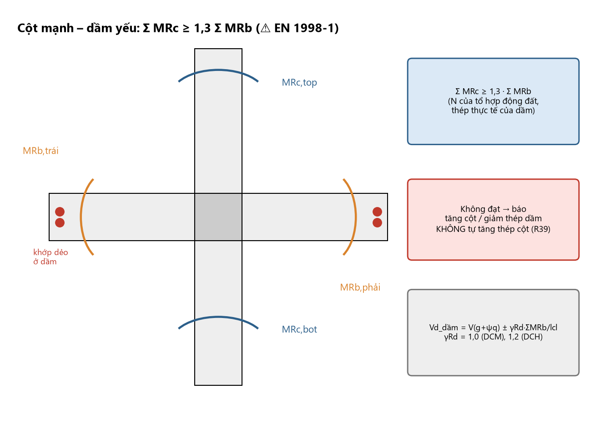
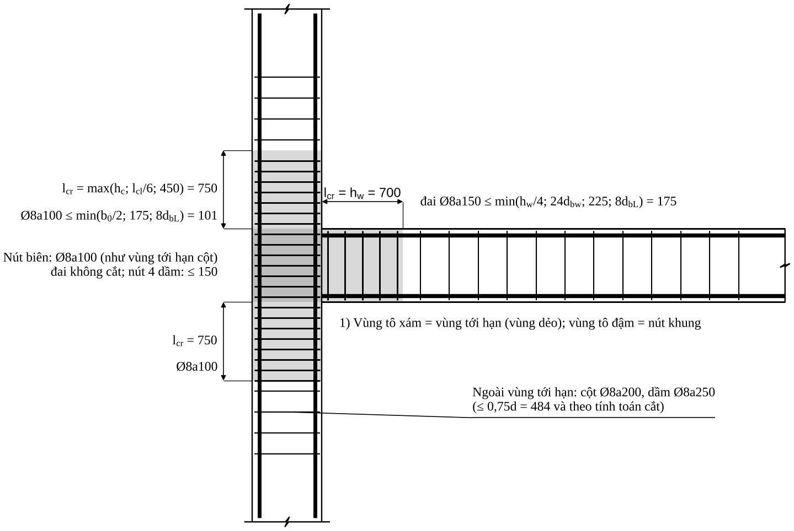

<!-- PROMPT:BAT_DAU -->
# 07 — CẤU TẠO KHI NHÀ CHỊU ĐỘNG ĐẤT (Chương 13) — ⚠ CHỈ SƠ BỘ, KHÔNG ĐỦ ĐỂ PHÁT HÀNH

> **Độ tin cậy thấp có chủ đích.** 4 tài liệu nguồn **không chứa** TCVN 9386:2012; B chỉ có Eurocode 8 bản cũ. Chương này lấy cấu tạo cốt thép khung theo **EN 1998-1:2004** (cơ sở của TCVN 9386:2012), đối chiếu hai tài liệu công khai độc lập. **Mọi con số ở đây mang ⚠**:
> dùng để thiết kế sơ bộ, kiểm nhanh và lập luật; hồ sơ thật phải đối chiếu từng điều khoản TCVN 9386:2012 (danh mục 13.9). **Hệ thống chưa có cờ "kháng chấn", chưa có tool kháng chấn** ⇒ cấp dẻo và $a_{gR}$ do **người dùng** khai (R31) — agent không tự suy từ ETABS, không tự chọn DCM/DCH, và **không in "ĐẠT"** khi áp dụng chương này (R46).
> Không thay phần *tính* động đất (phổ phản ứng, lực ngang, tổ hợp động đất, độ cứng, $P$–$\Delta$).

# CHƯƠNG 13. CẤU TẠO KHI NHÀ CHỊU ĐỘNG ĐẤT (TCVN 9386:2012)

## 13.1. Khi nào phải áp dụng và cần tra gì

| Việc | Cần làm | Tra ở đâu |
|:--|:--|:--|
| Gia tốc nền thiết kế $a_{gR}$ | Tra theo địa điểm | QCVN 02:2022/BXD; phụ lục bản đồ của TCVN 9386:2012 |
| Mức độ áp dụng (động đất rất yếu/yếu có thể giảm nhẹ) | So $a_{gR}$ và $\gamma_Ia_{gR}S$ với ngưỡng | TCVN 9386:2012, mục động đất yếu ⚠ |
| Hệ số tầm quan trọng $\gamma_I$ | Phân loại công trình (trường học thuộc nhóm cao hơn nhà ở) | TCVN 9386:2012, bảng tầm quan trọng ⚠ |
| Loại đất nền | Theo số liệu địa chất | TCVN 9386:2012 |
| Cấp dẻo, hệ số ứng xử $q$ | 13.2 | TCVN 9386:2012 chương 5 |

## 13.2. Cấp dẻo và hệ số ứng xử

- **DCL** (dẻo thấp): chỉ cho động đất yếu; cấu tạo theo TCVN 5574:2018 (module 04) — không bàn ở đây.
- **DCM** (dẻo trung bình) và **DCH** (dẻo cao): cấu tạo ở 13.4–13.6.
- Hệ số ứng xử cơ bản hệ khung: $q_0=3{,}0\,\alpha_u/\alpha_1$ (DCM), $q_0=4{,}5\,\alpha_u/\alpha_1$ (DCH); $\alpha_u/\alpha_1=1{,}3$ cho khung nhiều tầng nhiều nhịp (⚠ tra điều 5.2.2.2).
- DCH cấu tạo chặt hơn rõ rệt để đổi lấy $q$ lớn — chọn cấp dẻo là **quyết định của kỹ sư kết cấu** (R31).

## 13.3. Nguyên tắc "thiết kế theo khả năng" (capacity design)

Khớp dẻo ở **dầm**, không ở cột; phá hoại cắt không xảy ra trước uốn. Ba kiểm tra bắt buộc:
1. **Cột mạnh hơn dầm** tại mọi nút (trừ ngoại lệ): $\sum M_{Rc}\ge1{,}3\sum M_{Rb}$ — $\sum M_{Rc}$ tính với $N$ của tổ hợp động đất cho khả năng **nhỏ nhất**; $\sum M_{Rb}$ với thép **thực tế** (gồm thép trong bề rộng cánh tham gia).
2. **Lực cắt thiết kế dầm** lấy theo khả năng chịu mô men hai đầu, **không lấy từ ETABS**: $V_{Ed}=V_{g+\psi q}\pm\gamma_{Rd}\dfrac{M_{Rb,i}+M_{Rb,j}}{l_{cl}}$, $\gamma_{Rd}=1{,}0$ (DCM), $1{,}2$ (DCH).
3. **Lực cắt thiết kế cột:** $V_{Ed}=\gamma_{Rd}\dfrac{M_{Rc,top}+M_{Rc,bot}}{l_{cl}}$ (mô men cột nhân $\min(1;\tfrac{\sum M_{Rb}}{\sum M_{Rc}})$), $\gamma_{Rd}=1{,}1$ (DCM), $1{,}3$ (DCH).

**Mô tả bằng chữ:** Một nút khung bốn nhánh (cột trên, cột dưới, dầm trái, dầm phải) vẽ bằng nét thanh. Ở hai đầu cột có hai cung cong màu xanh ghi $M_{Rc,top}$, $M_{Rc,bot}$; ở hai đầu dầm có hai cung cong màu cam ghi $M_{Rb,trái}$, $M_{Rb,phải}$ (hai chiều ngược nhau vì lắc ngược chiều). Bên cạnh là khung công thức: $\sum M_{Rc}\ge1{,}3\sum M_{Rb}$; nếu không đạt ⇒ hộp đỏ "báo tăng cột/giảm thép dầm — không tự tăng thép cột (R39)". Có khớp dẻo vẽ bằng chấm đỏ ở hai đầu dầm sát mặt cột.

## 13.4. Dầm — quy định cấu tạo

| Hạng mục | DCM | DCH | Ghi chú |
|:--|:--|:--|:--|
| Chiều dài vùng tới hạn $l_{cr}$ (từ mép cột) | $h_w$ | $1{,}5h_w$ | B ghi "$2h$" — **khác**; dùng bảng này. Rule base cũ (Bảng H3): $1{,}5h_w$ cho DCM — **mâu thuẫn**: khi chưa xác nhận cấp dẻo lấy **$1{,}5h_w$ (an toàn hơn)** |
| Đường kính đai tối thiểu | 6 mm | 6 mm | VN thường Ø8 |
| Khoảng cách đai trong $l_{cr}$ | $\min\{h_w/4;\ 24d_{bw};\ 225;\ 8d_{bL}\}$ | $\min\{h_w/4;\ 24d_{bw};\ 175;\ 6d_{bL}\}$ | $d_{bL}$: Ø thanh dọc **nhỏ nhất**; hai nguồn trùng nhau |
| Đai đầu tiên | $\le50$ mm kể từ mặt cột | như DCM | |
| Ngoài vùng tới hạn | $s\le0{,}75d$ | như DCM | |
| Hàm lượng thép kéo tối thiểu | $0{,}5f_{ctm}/f_{yk}$ | $0{,}5f_{ctm}/f_{yk}$ | ⚠ một nguồn ghi DCM: $0{,}26f_{ctm}/f_{yk}$ (EC2); dùng giá trị lớn |
| Hàm lượng thép kéo tối đa trong vùng tới hạn | $\rho_{max}=\rho'+\dfrac{0{,}0018}{\mu_\varphi\varepsilon_{sy,d}}\dfrac{f_{cd}}{f_{yd}}$ | như DCM | ⚠ tra điều khoản; phụ thuộc $\mu_\varphi$ |
| Thép nén trong vùng tới hạn | $\rho'\ge0{,}5\rho$ | $A_{s,dưới}\ge0{,}5A_{s,trên}$ tại gối | |
| Thép chạy suốt | $\ge2\varnothing14$ trên và dưới | $\ge2\varnothing14$ | |
| Thép trên giữa nhịp | $\ge\tfrac14\times$ thép trên tại gối lớn hơn | như DCM | |
| Thép dưới tại gối | $\ge\tfrac14\times$ thép dưới giữa nhịp | như DCM | |
| Bề rộng | $b_w\le\min(b_c+h_w;\ 2b_c)$ | như DCM; $b_w\ge200$ | |
| Lệch tâm dầm–cột | $\le b_c/4$ | như DCM | B ghi "$b/2$" — **khác**; dùng $b_c/4$ |
| Lực dọc dầm | $\nu_d=N_{Ed}/(A_cf_{cd})\le0{,}1$ | như DCM | dầm có $N$ lớn xử lý như cột |
| Thép xiên cắt (DCH) | — | khi điều kiện cắt đảo dấu của điều khoản bị thoả | ⚠ tra điều khoản |

**Vùng tới hạn của dầm** còn gồm hai phía mọi tiết diện có thể hình thành khớp dẻo (ví dụ nơi thép gia cường bị cắt đột ngột ⚠). Cắt thép trong vùng tới hạn: tránh nếu có thể; nếu cắt, tiết diện còn lại phải đủ và đai trong $l_{cr}$ vẫn theo bảng.

## 13.5. Cột — quy định cấu tạo

| Hạng mục | DCM | DCH |
|:--|:--|:--|
| Cạnh nhỏ nhất | $\ge200$ (tham khảo ⚠) | $\ge250$ (tham khảo ⚠) |
| Lực dọc chuẩn hoá $\nu_d=N/(A_cf_{cd})$ | $\le0{,}65$ | $\le0{,}55$ |
| Hàm lượng thép dọc | $1\%\le\rho\le4\%$ | $1\%\le\rho\le4\%$ |
| Số thanh tối thiểu mỗi cạnh | $\ge2$ ⚠ | $\ge3$ ⚠ |
| Khoảng cách giữa các thanh được giằng | $\le200$ mm | $\le150$ mm |
| Vùng tới hạn $l_{cr}$ ở hai đầu cột | $\max\{h_c;\ l_{cl}/6;\ 450\}$ | $\max\{1{,}5h_c;\ l_{cl}/6;\ 600\}$ |
| Toàn chiều cao là vùng tới hạn khi | $l_{cl}/h_c<3$ | $l_{cl}/h_c<3$ |
| Đường kính đai tối thiểu | 6 mm (VN: Ø8) | 6 mm (VN: Ø8) |
| Khoảng cách đai trong $l_{cr}$ | $\min\{b_0/2;\ 175;\ 8d_{bL}\}$ | $\min\{b_0/3;\ 125;\ 6d_{bL}\}$ |
| Hàm lượng đai bó lõi $\omega_{wd}$ tối thiểu | $0{,}08$ (chân cột) | $0{,}12$ chân cột, $0{,}08$ vùng tới hạn khác |
| Kiểm tra bó lõi $\alpha\omega_{wd}$ | $\alpha\omega_{wd}\ge30\mu_\varphi\nu_d\varepsilon_{sy,d}\dfrac{b_c}{b_0}-0{,}035$ ⚠ | như DCM |
| Ngoài vùng tới hạn | đai theo module 04; $s\le\min(12d_{bL};\ b_0/2;\ 300)$ hoặc theo TCVN 5574 ⚠ | như DCM nhưng theo $d_{bL}$ nhỏ hơn |

$b_0$ = cạnh nhỏ nhất của **lõi bê tông** tính tới **đường tâm đai**; $\omega_{wd}=\rho_wf_{yd,h}/f_{cd}$; $\alpha=\alpha_n\alpha_s$, $\alpha_n=1-\sum b_i^2/(6b_0h_0)$, $\alpha_s=(1-s/2b_0)(1-s/2h_0)$; $\mu_\varphi=2q_0-1$ nếu $T_1\ge T_C$, $=1+2(q_0-1)T_C/T_1$ nếu $T_1<T_C$ (⚠ điều 5.2.3.4).
**Thanh dọc phải được giằng:** mọi thanh ở góc và **mọi thanh cách một thanh** trên chu vi nằm ở chỗ uốn đai hoặc đầu thanh giằng có móc 135°; khoảng giữa các thanh được giằng không vượt giới hạn của bảng.
Rule base cũ (Bảng H2) trùng DCM: $l_{cr}=\max(h_c;l_{cl}/6;450)$, $s=\min(b_0/2;175;8d_{bL})$; nối thép cột: $s=\min(h/4;100)$, $A_{st}=s(d_{bL}/50)(f_{yld}/f_{ywd})$; móc 135° đoạn thẳng $\ge10d_{sw}$.

## 13.6. Nút khung dầm–cột

| Hạng mục | DCM | DCH |
|:--|:--|:--|
| Đai ngang trong nút | $\ge$ yêu cầu vùng tới hạn cột (cùng bước và Ø) | tính theo lực cắt nút, không thưa hơn vùng tới hạn cột |
| Nút có dầm ở cả 4 mặt | bước đai **được gấp đôi** nhưng $\le150$ mm | như DCM |
| Thanh dọc trung gian trong nút | **bắt buộc** (giữa các thanh góc) | bắt buộc |
| Kiểm tra lực cắt nút | thường không yêu cầu riêng ⚠ | $V_{jhd}\le\eta f_{cd}\sqrt{1-\nu_d/\eta}\;b_jh_{jc}$, $\eta=0{,}6(1-f_{ck}/250)$ ⚠ |
| Lực cắt nút | — | nút giữa: $V_{jhd}=\gamma_{Rd}(A_{s1}+A_{s2})f_{yd}-V_C$; nút biên: $\gamma_{Rd}A_{s1}f_{yd}-V_C$, $\gamma_{Rd}=1{,}2$ ⚠ |
| Đường kính thanh dầm xuyên nút | giới hạn theo bề rộng cột $h_c$ và hàm lượng ⚠ | như DCM, chặt hơn |

**Neo thanh dầm trong nút:** đoạn neo kể từ vị trí quy định trong điều khoản (không phải từ mép cột), có hệ số tăng so với TCVN 5574 ⚠ — module 05 vẫn là cấu tạo hình học; khi động đất **kiểm lại $L_{an}$ theo TCVN 9386:2012** và đặt đai phụ ở chỗ uốn.

## 13.7. Neo, nối và cắt thép khi chịu động đất

1. **Nối chồng thép cột:** không trong vùng tới hạn ở đầu cột; chuyển về **vùng giữa cột** ($l_{cr}\le$ vị trí $\le H_n-l_{cr}$), $L_{ov}$ với hệ số tăng nếu điều khoản yêu cầu ⚠; đai đoạn nối không thưa hơn bước vùng tới hạn **[thực hành]**.
2. **Thép dọc chân cột tầng 1:** thép chờ ở vùng tới hạn liên tục; mối nối đầu tiên nằm trên vùng tới hạn.
3. **Thép dầm:** nối thép trên giữa nhịp, thép dưới cách mép cột $\ge l_{cr}$ [thực hành]; không nối trong nút.
4. **Cắt thép dầm:** theo hình bao **hai dấu** (module 06, B4); thép trên suốt dài và thép dưới tại gối theo 13.4.
5. **Neo thép nút biên:** ưu tiên uốn vào trong cột, đoạn đứng $\ge L_{an}$ theo TCVN 9386:2012; đai phụ $\le100$ ở chỗ uốn.
6. **Móc đai:** 135°, đoạn thẳng $\ge10d_{sw}$ (hoặc $\ge75$ mm) ⚠; hai móc luân phiên.
7. **$N$ chuyển thành kéo trong tổ hợp động đất:** $L_{an}$ tăng thêm 50% (EN 1998-1 5.6.2) ⚠.

<!-- PROMPT:KET_THUC -->
## 13.8. Ví dụ kiểm tra kháng chấn (DCM) cho khung trục 3

**Điều kiện:** minh hoạ phương pháp trên số liệu Chương 11 giả sử DCM. $N=1514{,}4$ kN lấy từ TH12 (**không phải** tổ hợp động đất); $q_0=3{,}0\times1{,}3=3{,}9$, $T_1\ge T_C$ (⚠ giả thiết). Không thay cho thiết kế kháng chấn.

**Dầm CB 250×700** ($h_w=700$, $d_{bL}=22$, $d_{bw}=8$):

| Kiểm tra | Yêu cầu (DCM) | Hiện có | Kết luận |
|:--|:--|:--|:--|
| $l_{cr}$ | $=h_w=700$ | vùng đai Ø8a150 dài 1725 | ✓ |
| Đai trong $l_{cr}$ | $\min\{175;192;225;176\}=175$ | a150 | ✓ |
| Đai đầu | $\le50$ | 50 | ✓ |
| $\rho_{min}=0{,}5f_{ctm}/f_{yk}$ ($f_{ctm}=2{,}6$ ⚠; $f_{yk}=500$) | $0{,}26\%\Rightarrow\ge417$ mm² | trên 2122, dưới 1140 | ✓ |
| $\rho'\ge0{,}5\rho$ tại gối | $A_{s,dưới}/A_{s,trên}\ge0{,}5$ | $1140/2122=0{,}54$ | ✓ (sát giới hạn) |
| Thép suốt trên | $\ge2\varnothing14$ và $\ge\tfrac14\times2122=531$ | $2\varnothing25=982$ | ✓ |
| Thép dưới gối $\ge\tfrac14$ thép dưới nhịp | $\ge285$ | 1140 | ✓ |
| Đai theo khả năng | $V_{Ed}=V_{g+\psi q}\pm1{,}0\times(492{,}5+325{,}0)/6{,}3=V_{g+\psi q}\pm129{,}8$ kN | tính đai theo module 02 với $Q=V_{Ed}$ | **làm lại** nếu $V_{Ed}>240{,}3$ |

$M_{Rb}$ (gối, kéo trên) $=492{,}5$ (2Ø25+3Ø22); (gối, kéo dưới) $=325{,}0$ (3Ø22).

**Cột 22 250×600** (mỗi phía 2Ø25+1Ø22 và 1Ø16 mỗi cạnh dài; $l_{cl}=4500$, $h_c=600$, $d_{bL}=16$, $b_0=250-2\times20-8=202$):

| Kiểm tra | Yêu cầu | Hiện có | Kết luận |
|:--|:--|:--|:--|
| $\nu_d=N/(A_cf_{cd})$ | $\le0{,}65$ (DCM); $\le0{,}55$ (DCH) | $1514{,}4\times10^3/(250\times600\times17)=0{,}594$ | ✓ DCM; ✗ DCH. Sát giới hạn |
| $\rho$ | 1%…4% | 2,08% | ✓ |
| Khoảng cách thanh được giằng | $\le200$ | cạnh dài: tim 259,5 (chỉ 1Ø16 giữa) | **✗ — thêm 1Ø16: mỗi cạnh dài 2Ø16** (cách 173); $\mu_t=2{,}35\%$ |
| $l_{cr}$ | $\max(600;750;450)=750$ | đầu cột Ø8a150, dài 750 | ✓ chiều dài |
| Đai trong $l_{cr}$ | $\min\{101;175;128\}\Rightarrow$ **a100** | a150 | **✗ — đổi a100** |
| $\alpha\omega_{wd}$ | $30\mu_\varphi\nu_d\varepsilon_{sy,d}b_c/b_0-0{,}035$; $\mu_\varphi=6{,}8$: yêu cầu $=0{,}291$ | Ø8a100 + 2 đai phụ: $\rho_w=0{,}95\%$, $\omega_{wd}=0{,}118$, $\alpha=0{,}674\times0{,}684=0{,}461$ ⇒ $\alpha\omega_{wd}=0{,}054$ | **✗ — chênh ≈5 lần** |
| $\sum M_{Rc}\ge1{,}3\sum M_{Rb}$ nút C | $1{,}3\times492{,}5=640{,}3$ | $2\times451=902$ | ✓ (hệ số 1,83) |
| Lực cắt theo khả năng | $V_{Ed}=1{,}1\times2\times(451\times0{,}546)/4{,}5=120{,}4$ kN | $>Q_{b,min}=100{,}6$ ⇒ đai phải tính | Ø8a100 hai nhánh đủ ✓ |

**Kết luận ví dụ:** (1) Dầm CB đạt cấu tạo DCM với bố trí hiện có. (2) Cột 22 phải **sửa cấu tạo**: đai a100 trong 750 hai đầu; 2Ø16 mỗi cạnh dài; đai nút a100. (3) Với $\nu_d\approx0{,}59$ và $\mu_\varphi=6{,}8$, điều kiện bó lõi $\alpha\omega_{wd}$ **không đạt bằng cách thêm đai**: phải **giảm $\nu_d$** (tăng tiết diện, ví dụ 300×700) hoặc **giảm $q$** — vì vậy kỹ sư kháng chấn tránh cột nhỏ mang lực dọc lớn. (4) Phụ thuộc $N$ và $\mu_\varphi$ — chỉ chốt sau khi có tổ hợp động đất thật.

**Mô tả bằng chữ:** Nút biên: cột đứng bên trái, dầm đi sang phải. Vùng tới hạn tô **xám nhạt**: trên và dưới nút mỗi chỗ cao $l_{cr}=750$ (ghi "$l_{cr}=\max(h_c;l_{cl}/6;450)=750$", đai "Ø8a100 ≤ min(b₀/2;175;8d$_{bL}$) = 101"); trên dầm, đoạn dài $l_{cr}=h_w=700$ tính từ mép cột (đai "Ø8a150 ≤ min(h$_w$/4; 24d$_{bw}$; 225; 8d$_{bL}$) = 175"). Vùng **nút** (giao cột–dầm) tô **xám đậm**, ghi "Nút biên: Ø8a100 (như vùng tới hạn cột), đai không cắt; nút 4 dầm: ≤150". Ngoài vùng tới hạn đai thưa hơn: "cột Ø8a200, dầm Ø8a250 (≤0,75d = 484 và theo tính toán cắt)". Hai thanh dọc cột chạy suốt; hai thanh dọc dầm (trên, dưới) nét đậm. Chú thích 1) ghi ý nghĩa các vùng tô.

## 13.9. Điểm phải tra trực tiếp trong TCVN 9386:2012 (không chép lại)

| # | Nội dung | Vì sao cần tra |
|:-:|:--|:--|
| 1 | $a_{gR}$, $\gamma_I$, loại đất; ngưỡng "động đất yếu/rất yếu" | Số liệu dự án |
| 2 | $q_0$, $\alpha_u/\alpha_1$, $\mu_\varphi$ (điều 5.2.2.2, 5.2.3.4) | Dùng trong 13.5, 13.8 |
| 3 | $\rho_{max}$ dầm (5.4.3.1.2), $\rho_{min}$ dầm | Hai nguồn công khai ghi khác nhau về $\rho_{min}$ |
| 4 | Kích thước nhỏ nhất cột, số thanh mỗi cạnh | Giá trị DCM/DCH ghi trong nguồn không thống nhất |
| 5 | Công thức $\alpha\omega_{wd}$, $\omega_{wd,min}$ (5.4.3.2.2) | Ví dụ 13.8 phụ thuộc trực tiếp |
| 6 | Kiểm tra cắt nút (DCH), đường kính thanh dầm xuyên nút, neo thanh dầm ở nút biên (5.5.3.3, 5.6.2) | Chỉ nêu dạng chung |
| 7 | Nối thép trong và gần vùng tới hạn (5.6.3) | Chuyển mối nối khỏi vùng tới hạn (13.7) |
| 8 | Ngoại lệ của điều kiện $\sum M_{Rc}\ge1{,}3\sum M_{Rb}$ | Tầng mái, nhà thấp, một số cột |
| 9 | Móc đai: chiều dài đoạn thẳng | Giá trị tham khảo |
| 10 | Ranh giới chuyển từ "kháng chấn" sang cấu tạo thường (DCL) | Dự án vùng yếu |

<!-- PROMPT:BAT_DAU -->
## 13.10. Luật bổ sung cho Agent

| # | Điều kiện | Hành động của Agent |
|:--|:--|:--|
| R31 | Công trình có thiết kế kháng chấn | Người dùng xác nhận **cấp dẻo (DCM/DCH)**; Agent không tự chọn |
| R32 | Dầm trong vùng tới hạn | Đai $s\le\min\{h_w/4;24d_{bw};225;8d_{bL}\}$ (DCM) hoặc $\min\{h_w/4;24d_{bw};175;6d_{bL}\}$ (DCH), dài $h_w$ / $1{,}5h_w$ |
| R33 | Dầm | $\rho'\ge0{,}5\rho$ ở gối; $\ge2\varnothing14$ suốt; thép trên giữa nhịp $\ge\tfrac14$ thép trên gối |
| R34 | Cột | $\nu_d\le0{,}65$ (DCM) / $0{,}55$ (DCH); nếu vượt → báo **tăng tiết diện** |
| R35 | Cột | $\rho\in[1\%;4\%]$; thanh được giằng cách nhau $\le200$ (DCM) / $150$ (DCH) → thêm thanh dọc nếu cần |
| R36 | Cột — đầu cột | $l_{cr}=\max\{h_c;l_{cl}/6;450\}$ (DCM); đai $\min\{b_0/2;175;8d_{bL}\}$ |
| R37 | Cột — bó lõi | Tính $\alpha\omega_{wd}$; nếu không đạt bằng đai khả thi → báo **tăng tiết diện** |
| R38 | Nút | Đai nút $\ge$ vùng tới hạn cột; không cắt; thanh dọc trung gian |
| R39 | Mọi nút | Kiểm $\sum M_{Rc}\ge1{,}3\sum M_{Rb}$; không đạt → báo **tăng cột/giảm thép dầm**, không tự tăng thép cột |
| R40 | Nối thép cột | Chuyển mối nối khỏi vùng tới hạn; $L_{ov}$ kiểm theo 13.9 mục 7 |

**Nguồn của chương:** EN 1998-1:2004 (§5.4.3.1–5.4.3.3, §5.5.3, §5.6) qua hai tài liệu công khai độc lập: M. N. Fardis, *Detailed seismic design of concrete buildings to EC8* (đại học Patras) và bài giảng *EC8 2G* của Riva (ReLUIS); số liệu B (Ngô Thế Phong 2008) đối chiếu ở các ô có ghi "B ghi … — khác".

<!-- PROMPT:KET_THUC -->
## 9.8. Yêu cầu bổ sung khi nhà chịu động đất (tham khảo từ B)

**Phạm vi.** Các số liệu của B (Eurocode 8 bản cũ) **chỉ để đối chiếu và đã được thay bằng Chương 13**. Một số giá trị của B **khác** Chương 13: vùng tới hạn dầm ($2h$ so với $h_w$/$1{,}5h_w$), lệch tâm dầm–cột ($b/2$ so với $b_c/4$), đường kính đai tối thiểu (≥8 so với ≥6), bước đai cột. **Khi có khác biệt, dùng Chương 13.** Thiết kế kháng chấn ở Việt Nam bắt buộc theo **TCVN 9386:2012**.
**Dầm (B):** $b\ge200$, $b\le\min(b_c+h_c/2;2b_c)$; $b/h\ge0{,}25$, $l/h\ge4$; lệch tâm $\le b/2$; $\dfrac{1{,}4}{R_s}\le\mu\le\dfrac7{R_s}$; 2Ø12 suốt trên và dưới; $\mu'\ge\mu/2$ ở vùng dẻo; ≥1/4 thép chịu lực mặt trên đầu mút chạy suốt; vùng tới hạn $2h$; đai $d_{sw}\ge6$, $u\le\min(h/4;8d;24d_{sw};200)$ (DCH: $\le6d$; 150).
**Cột (B):** cạnh nhỏ $\ge250$, $l/b\le25$ (DCH: $\ge300$, $l/b\le16$, công xôn $\le10$); $1\%\le\mu\le6\%$; tim thép dọc $\le200$; vùng tới hạn $l_c=\max(h;l/6;450)$; đai vùng tới hạn $u=\min(8d;b/2;200)$ (DCH $\min(6d;b/4;150)$); ngoài vùng $\min(12d;b;300)$ hoặc $\min(8d;b/2;200)$; Ø đai $\ge8$; nút giữa 4 dầm giảm một nửa nhưng $\le10d$ hoặc 200 (ACI qua B).
