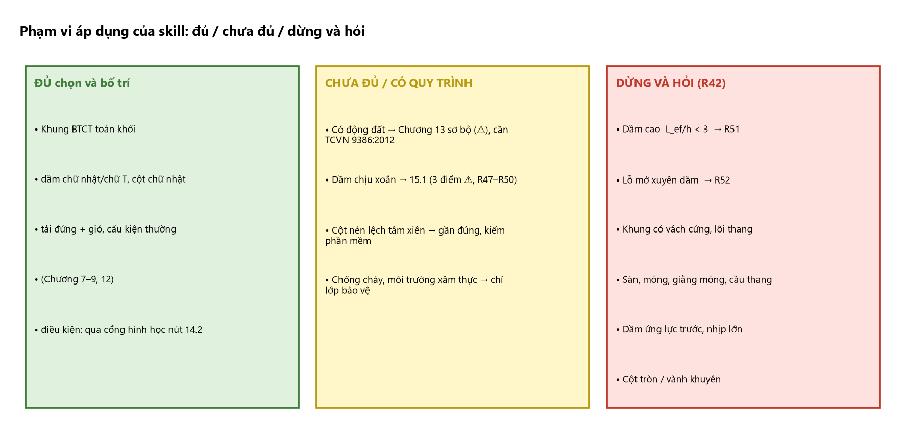
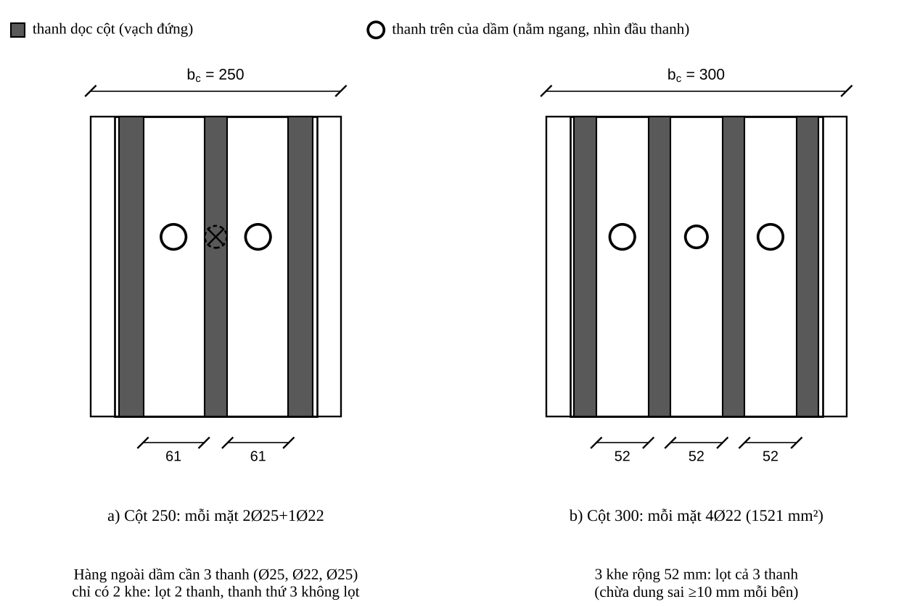
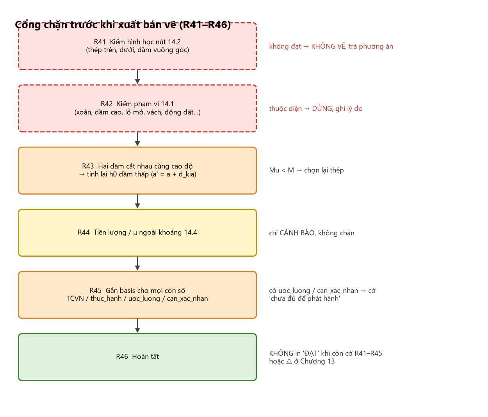

<!-- PROMPT:BAT_DAU -->
# 09 — RÀ SOÁT CỦA KỸ SƯ, PHẠM VI ÁP DỤNG, XOẮN/DẦM CAO/LỖ MỞ, VÍ DỤ ĐỐI CHIẾU VÀ SAI KHÁC GIỮA CÁC TÀI LIỆU

> Module cuối: (1) **Chương 14** cổng chặn trước khi xuất bản vẽ (R41–R46); (2) **Chương 15** xoắn và sàng lọc dầm cao, lỗ mở (R47–R52); (3) **ví dụ hoàn chỉnh** khung trục 3 (Chương 11) và ví dụ **Khung Trục 5** của rule base cũ — dùng để **đối chiếu**, không để sao chép số;
> (4) **Phụ lục B** (31 sai khác giữa các tài liệu) cùng **bổ sung của biên soạn skill** (xung đột nội bộ và lệch giữa tài liệu–code–skill Vẽ), Phụ lục C, E.

# CHƯƠNG 14. RÀ SOÁT CỦA KỸ SƯ TRƯỚC KHI KÝ: HÌNH HỌC NÚT, PHẠM VI ÁP DỤNG VÀ GIỚI HẠN CỦA TÀI LIỆU

Chương 7–13 cho con số và cách sắp xếp *trên giấy*. Kỹ sư làm nghề lâu năm kiểm thêm: (1) thép đã chọn **có đặt vừa vào nút thật không**; (2) công trình **có nằm trong phạm vi** các quy trình này không; (3) kết quả **có hợp lý** không. Nhãn: **[thực hành]**, **[hình học]**, **[ước lượng]**, **[kinh nghiệm]** như module 00.

## 14.1. Tài liệu này dùng được cho trường hợp nào

| Trường hợp | Đủ để chọn và bố trí thép? | Ghi chú |
|:--|:--|:--|
| Khung BTCT toàn khối, dầm chữ nhật/chữ T, cột chữ nhật; tải đứng + gió; cấu kiện thường (Chương 7–9, 12) | **Đủ**, với điều kiện qua cổng hình học nút 14.2 | Ví dụ Chương 11–12 thuộc loại này |
| Có động đất | **Chưa đủ** | Chương 13 theo EN 1998-1:2004; đối chiếu **TCVN 9386:2012** (13.9) |
| Dầm chịu xoắn (dầm biên đỡ console/sàn lệch tâm) | **Có quy trình** (15.1) | D 7.5–7.7; còn ba điểm ⚠ (15.1.2); D không cho công thức tổ hợp $M$–$Q$–$T$ |
| Dầm có lỗ mở xuyên (ống kỹ thuật) | **Chỉ sàng lọc** (15.3) | Không có trong 4 tài liệu; không tự chọn vị trí/thép |
| Dầm cao/dầm sâu, dầm chuyển, console ngắn | **Chỉ sàng lọc** (15.2) | Mô hình thanh–giằng, không phải công thức Chương 7 |
| Khung có vách cứng, lõi thang | **Không** | Chương 3 chỉ cho khung phẳng |
| Cột nén lệch tâm xiên | **Gần đúng** | 03 Bước 14b; kiểm bằng phần mềm có BĐTT 3D |
| Sàn, móng, giằng móng, cầu thang | **Không** | Chỉ lấy tải từ sàn (4.4) và thép chờ chân cột |
| Nhịp lớn, dầm ứng lực trước | **Không** | Ngoài phạm vi |
| Chống cháy, môi trường xâm thực | **Chỉ lớp bảo vệ** | 04, mục 9.2; cấp chịu lửa và cấp phơi nhiễm do dự án quy định |

Gặp dòng "Không", "Chưa đủ" hoặc "Chỉ sàng lọc" ⇒ Agent **dừng và chuyển cho kỹ sư** (R42), không điền số cho đủ bảng.

**Mô tả bằng chữ:** Bảng ba cột màu: **Xanh — đủ chọn và bố trí** (khung toàn khối thường, tải đứng + gió, qua cổng 14.2); **Vàng — có quy trình/chưa đủ** (xoắn: 15.1 với ba điểm ⚠; có động đất: Chương 13 sơ bộ, cần TCVN 9386); **Đỏ — dừng và hỏi** (dầm cao $L_{ef}/h<3$: R51; lỗ mở xuyên dầm: R52; vách/lõi, sàn, móng, dự ứng lực, cột xiên/tròn). Mỗi ô đỏ có mũi tên tới hộp "hoi_nguoi_dung, không điền số".

## 14.2. Kiểm tra hình học nút: thép dầm có lọt qua thép cột không

Thép dọc cột chạy **thẳng đứng**, thép dầm chạy **nằm ngang** xuyên nút; mỗi thanh dầm phải lọt **giữa** hai thanh cột (theo bề rộng $b$) hoặc nằm ngoài. Cột và dầm cùng bề rộng (cột 250, dầm 250) ⇒ thanh góc dầm và thanh góc cột nằm đúng một vị trí mặt bằng, không cùng đi qua.
**Quy trình [hình học]:** (1) toạ độ thanh cột: góc ở $\pm y_0$, $y_0=\tfrac{b_c}{2}-C-d_{đai}-\tfrac{d_{cột}}{2}$; thanh giữa chia đều; (2) **khe** $w_i=(y_{i+1}-y_i)-\tfrac{d_i+d_{i+1}}{2}$; (3) thanh dầm Ø$d_b$ lọt khe $i$ khi $w_i\ge d_b+2\delta$, $\delta\ge10$ mm [thực hành]; (4) **số thanh dầm trong một lớp ≤ số khe lọt** (các lớp xếp chồng đứng nằm cùng khe); (5) làm cho **cả thép trên và dưới** và thép dầm **vuông góc** đi qua cùng cột.
**Áp dụng cho ví dụ:** cột 22 (250×600) mỗi mặt đầu 2Ø25+1Ø22 ⇒ thanh ở $y=-84{,}5;0;+84{,}5$ ⇒ hai khe mỗi khe $84{,}5-12{,}5-11=61$ mm. Hàng ngoài dầm CB 3 thanh (Ø25, Ø22, Ø25) ⇒ **chỉ 2 lọt**; thanh Ø22 giữa trùng đúng thanh cột Ø22. Thép dưới 3Ø22 cũng vậy.

**Mô tả bằng chữ:** Hai ô vuông cạnh nhau nhìn dọc trục dầm. Chú giải: ô vuông xám = thanh dọc cột (vạch đứng); vòng tròn = thanh trên của dầm (nằm ngang, nhìn đầu thanh). (a) Cột $b_c=250$: ba vạch xám (Ø25, Ø22, Ø25), hai khe giữa ghi "61" và "61"; ba vòng tròn dầm: hai vòng nằm gọn trong hai khe, **vòng thứ ba (Ø22, nét đứt, gạch chéo ×)** nằm đè lên vạch cột giữa; chú thích "chỉ có 2 khe: lọt 2 thanh, thanh thứ 3 không lọt". (b) Cột $b_c=300$: bốn vạch xám Ø22, ba khe ghi "52"; ba vòng tròn dầm (Ø25, Ø22, Ø25) nằm trọn trong ba khe; chú thích "3 khe rộng 52 mm: lọt cả 3 thanh (chừa dung sai ≥10 mm mỗi bên)".

**Kết luận về ví dụ:** thép CB và cột 22 lấy từ A **đúng về chịu lực** nhưng **chưa đặt được vào nút** nếu cột chỉ rộng 250 với thanh giữa mỗi mặt. Không sửa số liệu A (để khớp nguồn); thiết kế thật xử lý bằng một trong các cách (theo thứ tự thử [thực hành]):

| Cách | Nội dung | Hệ quả |
|:--|:--|:--|
| 1 | Tăng $b_c$ lên 300 và **4 thanh mỗi mặt** (4Ø22 = 1521 ≥ 1362) | 3 khe 52 mm — lọt 3 thanh (hình 14.1b); kiểm lại độ mảnh, tải bản thân, kiến trúc |
| 2 | Giữ cột 250, bỏ thanh giữa: mỗi mặt 2 thanh góc (2Ø28 = 1232, **thiếu** 1362) ⇒ tăng Ø hoặc thêm thép mặt dài | Khe giữa hai thanh góc rộng đủ 3 thanh dầm; thép mặt dài lấy phần thiếu |
| 3 | Giảm số thanh dầm một lớp ≤ số khe: đổi sang Ø lớn hơn | Kiểm khoảng hở và $\xi\le\xi_R$; có thể tăng chiều cao dầm |
| 4 | Dầm rộng hơn cột | Thép dầm đi ngoài thanh cột; cấu tạo đai nút và kiểm kiến trúc |

**Không được "tạm bỏ" hoặc uốn lệch thanh cột trong nút mà không tính lại $M_u$ của cột.**

**Mô tả bằng chữ:** Lưu đồ dọc sáu hộp nối bằng mũi tên, mỗi hộp gắn một luật: R41 kiểm hình học nút (14.2) → R42 kiểm phạm vi (14.1) → R43 hai dầm cắt nhau (tính lại $h_0$) → R44 tiền lượng/μ ngoài khoảng (cảnh báo vàng, không chặn) → R45 gắn `basis` cho mọi con số (có `uoc_luong`/`can_xac_nhan` ⇒ cờ "chưa đủ để phát hành") → R46 "Không in ĐẠT khi còn cờ". Các hộp R41, R42 có nhánh đỏ ra "DỪNG/không vẽ, trả phương án cho kỹ sư".

## 14.3. Hai dầm cắt nhau tại cột: chiều cao làm việc thực

Dầm khung và dầm dọc (hoặc dầm phụ) cùng qua một cột thường có mặt trên ngang nhau ⇒ thép trên hai dầm **cắt chéo ở cùng cao độ**: một dầm phải thấp hơn. Thép dầm **chính** đặt ngoài; thép dầm **phụ** nằm dưới [thực hành]. Khi đó $a$ của dầm thấp **tăng thêm xấp xỉ Ø thanh dầm kia**: $a'\approx a+d_{kia}$. Ví dụ dầm dọc 220×300, $a=40$, $h_0=260$ nằm dưới Ø25 của CB ⇒ $a'\approx65$, $h_0'\approx235$ (giảm ~10%) nên $A_s$ cần tăng cỡ 10% [ước lượng], phải **tính lại $M_u$** (02 Bước 8c) — không dùng $h_0$ giả thiết ban đầu.

<!-- PROMPT:BO_BAT_DAU -->
## 14.4. Rà soát tính hợp lý của kết quả

| Kiểm tra | Cách làm | Nếu lệch |
|:--|:--|:--|
| So với ETABS | $A_s$ tay so với ETABS cùng cặp nội lực | Lệch nhiều ⇒ kiểm $h_0$, $\xi_R$, tiêu chuẩn đang chọn trong ETABS, kể hay không kể cốt nén |
| Hàm lượng | $\mu$ dầm 0,5–2,0%; $\mu_t$ cột 1–3% [kinh nghiệm] | Ngoài vùng ⇒ nghĩ lại tiết diện trước |
| Tiền lượng thép | Khối lượng thép (12.4) / thể tích bê tông; dầm khung ~100–200 kg/m³, cột ~120–300 kg/m³ [kinh nghiệm — chưa kiểm chứng] | Ngoài khoảng ⇒ tìm lỗi (thiếu/dư đai, nhân đôi thanh, nhầm Ø) hoặc xem lại tiết diện |
| Khả năng thi công | Mỗi nút qua 14.2; mỗi dầm qua 9.3; đầm được | Sửa trước khi phát hành |
| Chênh giữa tầng | Thép tầng $k$ và $k+1$ không đổi đột ngột | Gom nhóm lại (C1) |
| Đối chiếu độc lập | Người khác (hoặc lần chạy độc lập) tính lại ít nhất cấu kiện nguy hiểm nhất | Sai khác $>5\%$ phải truy nguyên nhân |

Khối lượng 239,7 kg dầm CB (12.5) ≈ 198 kg/m³, **cận trên** của khoảng [kinh nghiệm] — dấu hiệu nên cân nhắc tiết diện lớn hơn, cũng giúp bài toán nút 14.2.

## 14.5. Những việc không thuộc tài liệu này nhưng người ký phải làm

Xác nhận mô hình ETABS (tổng phản lực = tổng tải; chu kỳ; chuyển vị đỉnh và tương đối giữa tầng); điều kiện nền và phản lực chân cột cho móng, thép chờ chân cột nối với bản vẽ móng; cấp bê tông/thép, lớp bảo vệ, cấp chịu lửa đúng hồ sơ thiết kế cơ sở; biện pháp thi công (chiều cao đổ, mạch ngừng, thép dài tối đa); động đất: đối chiếu từng điều ở 13.9 với TCVN 9386:2012, xác nhận cấp dẻo và $a_{gR}$; ký duyệt bởi kỹ sư có chứng chỉ hành nghề. **Tài liệu này là tài liệu tra cứu và hỗ trợ lập quy trình, không phải hồ sơ thiết kế.**

<!-- PROMPT:BO_KET_THUC -->
## 14.6. Luật bổ sung cho Agent (cổng chặn trước khi xuất bản vẽ)

| # | Điều kiện | Hành động của Agent |
|:--|:--|:--|
| R41 | Trước khi xuất bản vẽ nút | Chạy kiểm tra 14.2 cho thép trên, thép dưới và thép dầm phương vuông góc; số thanh một lớp > số khe lọt được → **không vẽ**, trả về phương án 1–4 để kỹ sư chọn |
| R42 | Công trình/cấu kiện thuộc dòng "Không", "Chưa đủ" hoặc "Chỉ sàng lọc" ở 14.1 (xoắn đã có quy trình, xem R47–R50) | **Dừng**, ghi lý do và danh sách việc cần làm; không điền số |
| R43 | Hai dầm cắt nhau ở cùng cao độ mặt trên | Tính lại $h_0$ của dầm đặt thấp ($a'=a+d_{kia}$); chọn lại thép nếu $M_u<M$ |
| R44 | Tiền lượng hoặc $\mu$ ngoài khoảng 14.4 | **Cảnh báo** (không chặn) kèm con số và khoảng tham chiếu |
| R45 | Mọi con số đưa vào dữ liệu bản vẽ | Gắn trường `basis` ∈ {`TCVN`, `thuc_hanh`, `uoc_luong`, `can_xac_nhan`}; có bất kỳ `uoc_luong` hoặc `can_xac_nhan` thì dữ liệu mang cờ **"chưa đủ để phát hành"** |
| R46 | Hoàn tất | Không in nhãn "ĐẠT" khi còn cờ từ R41–R45 hoặc ⚠ ở Chương 13 |

<!-- PROMPT:BO_BAT_DAU -->
## 14.7. Phiếu kiểm tra bổ sung (thêm vào 12.8)

- [ ] Mỗi nút: số thanh dầm một lớp ≤ số khe lọt giữa thép cột (14.2), cho thép trên, dưới và dầm vuông góc.
- [ ] Dầm đặt thấp ở nút giao: $h_0$ đã giảm và $M_u$ đã kiểm tra lại (14.3).
- [ ] Tiền lượng và $\mu$ trong khoảng tham chiếu, hoặc đã giải thích (14.4).
- [ ] Không có cấu kiện thuộc dòng "Không"/"Chưa đủ" ở 14.1 mà chưa xử lý riêng.
- [ ] Mọi giá trị `uoc_luong`/`can_xac_nhan` đã được người có chứng chỉ xác nhận hoặc thay bằng số thật.

<!-- PROMPT:BO_KET_THUC -->
# CHƯƠNG 15. XOẮN VÀ CÁC TRƯỜNG HỢP ĐẶC BIỆT (DẦM CAO, LỖ MỞ)

Lấp phần có thể lấp bằng nguồn kiểm chứng: **xoắn** (D, TCVN 5574:2018, mục 7.5–7.7, đã đọc trực tiếp trang 163–169 bản scan); **dầm cao** và **lỗ mở** chỉ ở mức **sàng lọc và nghĩa vụ phải làm**. **[suy ra từ D]** = phép biến đổi đại số của biên soạn từ công thức D (đã kiểm tính liên tục giữa các miền); ⚠ = cần đối chiếu tiêu chuẩn gốc.

## 15.1. Xoắn

### 15.1.1. Khi nào khung có xoắn và phải phân loại

Xoắn xuất hiện ở dầm biên đỡ console/sàn công xôn, dầm đỡ dầm phụ lệch tâm, dầm cong/gãy khúc, dầm tải lệch trục. ETABS: cột **T**, **cùng tổ hợp, cùng trạm** với $M$ và $Q$ (không lấy $T_{max}$ tổ hợp này ghép $M$ tổ hợp khác). **Nguồn ETABS design summary không có $T$ ⇒ không đủ dữ liệu: hỏi kỹ sư.**

| Loại | Nhận biết | Xử lý |
|:--|:--|:--|
| **Xoắn cân bằng** (sơ cấp) | $T$ cần thiết để cân bằng tải; không giảm khi phân phối lại (D, Hình 7.7a) | Cốt thép chịu **toàn bộ** $T$ |
| **Xoắn tương thích** (thứ cấp) | $T$ sinh do biến dạng tương thích, có thể giảm khi phân phối lại (Hình 7.7b) | D nói có thể giảm nhưng **không cho hệ số giảm** ⚠ |

**Luật:** Agent không tự giảm $T$. Không xác định được loại ⇒ coi là cân bằng và báo kỹ sư (R47).

### 15.1.2. Công thức (D, 7.7)

$b$, $h$ cạnh nhỏ/lớn; $Z_1$ chiều dài cạnh tiết diện ở **biên chịu kéo** đang xét, $Z_2$ cạnh còn lại (D, Hình 7.8; xem Hình 15.1); $\delta=\dfrac{Z_1}{2Z_2+Z_1}$ (7.28); $q_{sw1}=\dfrac{R_{sw}A_{sw1}}{s_w}$ (7.26), $A_{sw1}$ diện tích **một nhánh** đai chịu xoắn; $A_{s1}$ cốt dọc gần biên kéo đang xét.

| Điều kiện | Công thức | Mã D |
|:--|:--|:--|
| Bê tông không bị phá hoại do ứng suất nén chính | $T\le0{,}1R_bb^2h$ | 7.21 |
| $0{,}5\le\dfrac{q_{sw1}Z_1}{R_sA_{s1}}\le1{,}5$ | $T\le T_{gh}=q_{sw1}\,\delta\,Z_1Z_2+0{,}5R_sA_{s1}Z_2$ | 7.33 |
| $\dfrac{q_{sw1}Z_1}{R_sA_{s1}}<0{,}5$ (cốt đai yếu) | $T\le T_{gh}=q_{sw1}Z_1Z_2(\delta+1)$ | 7.34 |
| $\dfrac{q_{sw1}Z_1}{R_sA_{s1}}>1{,}5$ (cốt dọc yếu) | $T\le T_{gh}=0{,}5R_sA_{s1}Z_2(3\delta+1)$ | 7.35 |
| Uốn–xoắn đồng thời | $T\le T_{gh}\sqrt{1-\left(\dfrac{M}{M_{gh}}\right)^2}$ | 7.36 |
| Cắt–xoắn (điều kiện bê tông) | $T\le0{,}1R_bb^2h\left(1-\dfrac{Q}{0{,}3R_bbh_0}\right)$ | 7.37 |
| Cắt–xoắn (cốt thép) | $T\le T_{gh}\left(1-\dfrac{Q}{Q_{gh}}\right)$, $Q_{gh}=\left(0{,}5R_{bt}b+\dfrac{R_{sw}A_{sw}}{s_w}\right)h_0$ | 7.38 |

7.33–7.35 là dạng giản lược (không xét tiết diện vênh); D còn dạng đầy đủ 7.30–7.32 (không dùng ở đây). Phải xét **vùng nén ở cả bốn cạnh** và lấy $T_{gh}$ **nhỏ nhất**. Chuyển tiếp 7.33–7.35 đã kiểm liên tục tại $q_{sw1}Z_1/(R_sA_{s1})=0{,}5$ và $1{,}5$.
⚠ **Cần đối chiếu bản gốc:** (i) $Z_1$, $Z_2$ theo kích thước nào — tài liệu lấy theo **tâm đai** (thiên về an toàn); (ii) $A_{s1}$ có kể thép chịu uốn đã đặt ở biên đó — tài liệu kể; (iii) D **không** cho công thức tổ hợp ba tác dụng: kiểm 7.36 và 7.38 riêng rẽ, cả hai phải đạt.

**Mô tả bằng chữ:** Hai mặt cắt dầm 250×500, đai ôm các thanh (đáy 2 thanh to hơn, đỉnh và hai bên mỗi chỗ 2 thanh nhỏ). (a) Cạnh trên được tô **xám đậm** (vùng nén, nhãn "nén"), cạnh đáy vẽ **nét đứt** (biên kéo, "biên kéo ($A_{s1}$)"); kích thước ngang $Z_1=202$ phía trên, kích thước đứng $Z_2=452$ bên trái; chú thích "biên kéo = cạnh đáy: $Z_1=b$, $Z_2=h$". (b) Cạnh **trái** tô xám (nén, chữ xoay dọc), cạnh **phải** nét đứt (biên kéo); kích thước ngang $Z_2=202$, kích thước đứng $Z_1=452$ ở phải; chú thích "biên kéo = cạnh bên đối diện: $Z_1=h$, $Z_2=b$".

### 15.1.3. Quy trình chọn thép chống xoắn

1. Lấy $T$, $M$, $Q$ cùng tổ hợp, cùng trạm; xác định loại xoắn.
2. **Điều kiện bê tông 7.21.** Không đạt ⇒ tăng tiết diện (R48). Thực tế $T$ lớn hơn một nửa giới hạn thì đai xoắn đã rất dày; nên xem lại sơ đồ/tiết diện [kinh nghiệm].
3. **Đai nhỏ nhất [suy ra từ D]:** với mỗi cách đặt vùng nén tính $\delta=Z_1/(2Z_2+Z_1)$ và $q_{sw1}=\dfrac{T}{Z_1Z_2(1+\delta)}\Rightarrow s_w\le\dfrac{R_{sw}A_{sw1}}{q_{sw1}}$; lấy $q_{sw1}$ **lớn nhất** trong hai cách đặt, làm tròn $s_w$ xuống bội 5 mm (miền 7.34).
4. **Cốt dọc mỗi biên [suy ra từ D]:** để 7.34 áp dụng cần $\dfrac{q_{sw1}Z_1}{R_sA_{s1}}\le0{,}5$, tức $A_{s1}\ge\dfrac{2q_{sw1}Z_1}{R_s}$ cho từng biên kéo; tính đủ **bốn biên**; thép chịu uốn đã đặt kể vào biên đó; thiếu ⇒ thêm thanh **trên chu vi**, không dồn một chỗ.
5. **Kiểm bằng công thức đầy đủ** 7.33–7.35 cho bốn cạnh, lấy $T_{gh}$ nhỏ nhất, $\ge T$.
6. **Kiểm tác dụng đồng thời:** 7.36 (có $M$), 7.37 và 7.38 (có $Q$). Không đạt ⇒ giảm bước đai và kiểm lại từ bước 5.
7. **Cấu tạo.** Cốt dọc theo **chu vi** và neo chắc vào gối; **đai kín**, hai đầu nối đủ chiều dài nối chồng (D 7.6). [thực hành]: móc 135°; thanh dọc chu vi cách nhau không quá ~300 mm; đai xoắn trên toàn đoạn có $T$, không cắt đột ngột; bước đai xoắn không lớn hơn bước đai chống cắt cùng vùng. (Rule base cũ 53.5: nối đai ≥$30d_{sw}$; thanh dọc mặt bên ≤400, thực tế ≤200; chữ T/I: đai kín ôm bụng và cánh.)

<!-- PROMPT:BO_BAT_DAU -->
### 15.1.4. Ví dụ minh hoạ [số giả định]

Dầm biên 250×500, B30, CB500-V dọc, đai Ø8 CB240-T ($R_{sw}=170$; $A_{sw1}=50{,}3$), $h_0=460$. Thép đã có: đáy 2Ø20 (628), đỉnh 2Ø14 (308), mỗi bên 2Ø14 (308). Nội lực **giả định** cùng tổ hợp: $T=10$ kN·m, $M=80$, $Q=60$ kN. Khung đai tâm: $Z_b=202$, $Z_h=452$.

| Bước | Tính | Kết quả |
|:--|:--|:--|
| 2 | $0{,}1R_bb^2h=0{,}1\times17\times250^2\times500$ | $53{,}1$ kN·m $\ge10$ ✓ |
| 3 | Nén cạnh trên/dưới: $Z_1=202$, $Z_2=452$, $\delta=0{,}1826$; $q=10^7/(202\times452\times1{,}1826)$ | $92{,}6$ N/mm ⇒ $s\le92$ mm |
| 3 | Nén cạnh bên: $Z_1=452$, $Z_2=202$, $\delta=0{,}528$; $q=10^7/(452\times202\times1{,}528)$ | $71{,}7$ ⇒ $s\le119$ |
| 3 | Bất lợi | chỉ xoắn thì đai Ø8 **a90** |
| 4 | $A_{s1}\ge2qZ_1/R_s$: đáy/đỉnh; cạnh bên | $86$ (✓ 628/308); $192$ mm² (✓ 308) |
| 6 | a100: $T_{gh}=9{,}23$; 7.36: $6{,}73$; 7.38: $5{,}40$ | **không đạt** |
| 6 | a80: $11{,}53$; $8{,}41$; $7{,}32$ | **không đạt** |
| 6 | **a60:** $q=142{,}4$; $T_{gh}=15{,}38$; $M_{gh}=116{,}9$ ⇒ 7.36: $11{,}22$; $Q_{gh}=197{,}2$ ⇒ 7.38: $10{,}70$; 7.37: $47{,}7$ | $\ge10$ ✓ cả ba |

**Kết luận:** đai **Ø8 a60** (không phải a90) vì đồng thời uốn–xoắn và cắt–xoắn; chỉ riêng $T=10$ kN·m đã phải đai dày 60 mm ⇒ nên xem lại sơ đồ khi $T$ lớn. Kết quả đã kiểm lại bằng tính toán độc lập; chỉ minh hoạ phương pháp, **không phải thiết kế một công trình**.

<!-- PROMPT:BO_KET_THUC -->
## 15.2. Dầm cao (dầm sâu)

**Sàng lọc.** EN 1992-1-1 (§5.3.1): dầm cao khi nhịp hữu hiệu $<3$ lần chiều cao ($L_{ef}<3h$); nguồn đối chiếu: *Design of Deep Beams* (Structville). ACI 318: nhịp thông thủy $\le4h$ hoặc nhịp cắt $\le2h$ cho tải tập trung — **⚠ chưa kiểm chứng**; TCVN 5574:2018 tra ngưỡng của chính tiêu chuẩn. **Khung ví dụ:** $L_{CB}/h\approx9{,}9$; BA: $2100/400\approx5{,}3$; console AE $\approx5{,}3$ — ngoài ngưỡng. Dầm chuyển tầng, dầm đỡ cột/vách tầng kỹ thuật, tường chắn tầng hầm thường thuộc loại này.
**Việc phải làm:** không dùng công thức uốn–cắt Chương 7; dùng **mô hình thanh–giằng** hoặc FEM 2D; cốt phân bố hai phương hai mặt, neo thanh giằng kéo đủ dài kể cả ở nút. **Agent dừng (R51).**

## 15.3. Lỗ mở xuyên dầm

4 tài liệu không có quy trình. Chỉ kiểm chứng được: lỗ đường kính $>0{,}25$ lần chiều cao bụng là **lỗ lớn** (IDEA StatiCa, không phải điều khoản tiêu chuẩn), cần phân tích riêng; lỗ gần gối làm giảm sức chịu cắt nhiều hơn lỗ giữa nhịp; thiếu cốt quanh lỗ ⇒ phá hoại giòn. Không có số liệu cụ thể về khoảng cách tới gối, giữa các lỗ, lượng đai quanh lỗ — **tài liệu không đặt** những số đó.
**Nghĩa vụ [thực hành], không có con số:** lỗ xác định ở giai đoạn thiết kế (không đục sau khi đổ), có bản vẽ phối hợp cơ điện; ưu tiên vùng lực cắt nhỏ, xa mặt cột và tải tập trung, không trong vùng đai gia cường/cốt treo; **không cắt thép dọc chịu lực**, thép đi quanh lỗ; đai gia cường hai bên lỗ và thép bổ sung quanh lỗ do **tính toán**; lỗ lớn/nhiều lỗ gần nhau ⇒ thanh–giằng/Vierendeel; ống xuyên dầm khung chịu động đất: tránh vùng tới hạn (13.4). **Agent không chọn kích thước, vị trí, thép quanh lỗ (R52).**

## 15.4. Luật bổ sung cho Agent

| # | Điều kiện | Hành động của Agent |
|:--|:--|:--|
| R47 | Dầm có $\|T\|>0$ trong bất kỳ tổ hợp nào | Phân loại cân bằng/tương thích; không xác định → coi là cân bằng và **hỏi kỹ sư**; không tự giảm $T$ |
| R48 | Có xoắn cần tính | Kiểm tra 7.21; không đạt → báo **tăng tiết diện** |
| R49 | Có xoắn cần tính | Chọn đai theo 15.1.3 bước 3; chọn thép dọc từng biên theo bước 4; kiểm tra bốn cạnh (bước 5) |
| R50 | Đồng thời có $M$ hoặc $Q$ | Kiểm tra riêng 7.36, 7.37, 7.38; chọn bước đai nhỏ nhất thoả cả ba; gắn cờ `can_xac_nhan` vì D không có công thức tổ hợp ba tác dụng |
| R51 | $L_{ef}/h<3$ (hoặc ngưỡng của dự án) | **Dừng**: dầm cao; chuyển sang mô hình thanh–giằng |
| R52 | Có lỗ mở xuyên dầm | **Dừng**: không chọn vị trí, kích thước, thép quanh lỗ; yêu cầu kỹ sư |

Dữ liệu đầu ra dầm có xoắn thêm trường `"torsion": {"T": 10.0, "class": "equilibrium", "s_w": 60, "Z1": 202, "Z2": 452, "checks": {"7.21": 53.1, "7.36": 11.22, "7.38": 10.70}}`.
**Nguồn của chương:** D (TCVN 5574:2018) mục 7.5–7.7, trang 163–169; EN 1992-1-1 §5.3.1 qua Structville; IDEA StatiCa (*Modern construction vs. openings in beams*).

<!-- PROMPT:KET_THUC -->
# CHƯƠNG 11. VÍ DỤ HOÀN CHỈNH — KHUNG TRỤC 3, TRƯỜNG HỌC 6 TẦNG

Một bộ số liệu duy nhất (module Input Adapter, Chương 1.5). Nội lực ETABS lấy từ A (không tính lại được bằng tay); **mọi phép tính tiết diện đã được tính lại** — sai khác ghi ở Phụ lục B. **Dùng để đối chiếu logic, không dùng số cho dự án khác.**

## 11.0. Bộ số liệu thống nhất

Trường học 6 tầng, Ninh Bình; khung trục 3; bước 3,9 m; mái dốc 13°. CB (C–B) $L=6900$ (D giữa nhịp là dầm phụ 220×300); BA 2100; console A–E 2100 (tầng 2); tầng 1 cao 5,2 m (gồm 1,3 m dưới ±0,000), tầng 2–6 cao 3,9 m. B30 ($R_b=17$, $R_{bt}=1{,}15$, $E_b=32\,500$); CB500-V ($R_s=R_{sc}=435$); đai CB240-T ($R_{sw}=170$); $\xi_R=0{,}493$, $\alpha_R=0{,}371$, $\mu_{max}=1{,}93\%$. Dầm CB 250×700; BA, console 250×400; dầm phụ 220×300; cột 250×600 (B, C); sàn 100; lớp bảo vệ 20; đai Ø8.
Nội lực nguy hiểm (Bảng 6.1): CB $-462{,}37$/$-434{,}67$/$+315{,}47$, $Q_{max}=240{,}3$; BA $+99{,}37$/$-106{,}99$, $Q=117{,}99$; console $-35{,}43$, $Q=24{,}89$; cột 22 TH12: $M=417{,}74$, $N=1514{,}38$, $M_{dh}=18{,}06$, $N_{dh}=1168{,}39$.

## 11.1. Dầm CB 250×700 (phần tử 40–41, tầng 1)

### 11.1.1. Thép dọc gối C và B (mô men âm)

Chữ nhật 250×700, $a=55$, $h_0=645$: $\alpha_m=0{,}2615<0{,}371$ (cốt đơn); $\xi=0{,}309$; $A_s=1950$; $\mu=1{,}21\%$. Chọn **2Ø25+3Ø22 = 2122** (+8,8%), 2 hàng; khe 61 ≥30 ✓; $a=57{,}9$, $h_0=642{,}1$; $x=217<317$; $M_u=492{,}5\ge462{,}37$ ✓.

### 11.1.2. Thép dọc nhịp CB (mô men dương)

Chữ T: $S_f'=1100$, $b_f'=2450$, $M_f=2540{,}7\gg315{,}47$ ⇒ chữ nhật $2450\times700$; $\alpha_m=0{,}0174$; $A_s=1109$ ($M$ in nhầm 31,47 trong A). Chọn **3Ø22 = 1140**; $M_u=325{,}0\ge315{,}47$ ✓.

### 11.1.3. Cốt đai

Ø8 hai nhánh: $s_{max}=497{,}7$; $q_{sw}=107{,}3$; $s_{tt}=159{,}2$; $s_{ct}=300$ ⇒ **Ø8a150** ở $L/4=1725$; giữa Ø8a250; $Q_{u,min}=249{,}3\ge240{,}3$ ✓.

### 11.1.4. Cắt thép, cốt treo, neo

Cắt 3Ø22 trên: $M_u$ (còn 2Ø25) $=260{,}2$; $W=1165\to$ cắt cách tiết diện cắt lý thuyết $\ge1200$. Cốt treo tại D: $F=28{,}035$; $\sum A_{sw}\ge69$ ⇒ 5 đai Ø8 mỗi bên, $a=970$. Neo thép dưới: Ø22 có $L_{an,min}=330$, đủ cường độ $L_{0,an}=832$ ⇒ chọn **450 từ mép cột** (vượt tim cột 150 ≥ $5d=110$).

**Mô tả bằng chữ:** Phía trên là mặt đứng dầm CB giữa hai cột (L = 6900 tim cột; hai cột vẽ bằng hai đường đứng kèm ký hiệu gãy). Các nhãn có đường dẫn: "2Ø25 trên chạy suốt (góc đai)" chỉ thanh trên cùng chạy hết dầm; "3Ø22 gia cường gối, cắt tại 2150 (C), 2000 (B)" chỉ thanh gia cường ở hàng dưới thanh trên, chỉ dài ở hai đầu; "3Ø22 dưới chạy suốt, neo 450 qua mép cột" chỉ thanh đáy; "Cốt cạnh 2Ø12 mỗi bên (h = 700)" chỉ hai đường ngang giữa chiều cao dầm; "Dầm phụ D 220×300; cốt treo 5Ø8 mỗi bên (a75)" chỉ hình chữ nhật gạch chéo ở giữa nhịp với các đai dày hai bên. Hai mũi tên cắt ghi số 1 (gần gối trái) và 2 (giữa nhịp). Chuỗi kích thước phía dưới: "Ø8a150 (L/4 = 1725)", "Ø8a250", "Ø8a150 (L/4)" và tổng "L = 6900 (tim cột)". Phía dưới hai mặt cắt cùng tỉ lệ 250×700: **1-1 (gối)** có hàng trên 3 thanh (2Ø25 hai góc + 1Ø22 giữa) và hàng thứ hai 2Ø22 bên dưới, đáy 3Ø22, mỗi cạnh bên 2Ø12; **2-2 (nhịp)** có trên 2Ø25 hai góc, đáy 3Ø22, 2×2Ø12. Khung ghi chú bên phải: đai Ø8 (CB240-T), lớp bảo vệ 20; đai đầu tiên cách mép cột 50; khoảng hở hai hàng thép trên 25; mặt cắt vẽ cùng tỉ lệ; đai có móc 135° ở một góc.

## 11.2. Dầm BA 250×400 (phần tử 9, tầng 1)

Nhịp: chữ nhật $950\times400$ ($M_f=500{,}7>99{,}37$), $A_s=650$ ⇒ **2Ø18+1Ø16 = 710**, $M_u=109{,}2$ ✓. Gối B: $A_s=767$ ⇒ **2Ø25 = 982** (liên tục với thép gối B của CB và console), $M_u=132{,}1$ ✓. Đai: $s_{ct}=180$ ⇒ **Ø8a150** đầu, **Ø8a250** giữa; $Q_{u,min}=139{,}1\ge117{,}99$ ✓.

## 11.3. Console A–E (phần tử 15, tầng 2)

$M=-35{,}43$, $Q=24{,}89$; $A_s=234$ ($\mu=0{,}26\%$); giữ **2Ø25 (982)** chạy tiếp từ gối B (đơn giản thi công); $Q<Q_{b,min}=51{,}75$ ⇒ đai cấu tạo Ø8a250; thép dưới cấu tạo 2Ø14.

## 11.4. Cột 22, tầng 1 (250×600) — tính đủ 14 bước

Xem module 03 (toàn bộ số liệu: $\eta=1{,}045$; lệch tâm bé; $A_{s,tt}=1275$; **2Ø25+1Ø22 = 1362** + 1Ø16 cạnh dài; $\mu_t=2{,}08\%$; $Ne_{gh}=848{,}7\ge830{,}6$; ngoài mặt phẳng $N_u=3123$; đai Ø8a200/a150 + đai phụ; nối 1150). Hình 11.2 (biểu đồ tương tác) và Hình 11.3 (mặt cắt cột 22) nằm ở module 03, Bước 11 và Bước 9.

## 11.5. Nút góc mái — cột 17 / dầm 50

$e_0=575$, $h=600$ ⇒ $e_0/h=0{,}96>0{,}5$ ⇒ trường hợp c; $L_{an}=447\to450$; thép dầm 2Ø16 uốn xuống cột $\ge450$ (⚠ **$2L_{an}$** theo Hình 9.5c), $r\ge80$. ⚠ Số liệu A không khớp ($e_0$ thật có thể 7,3 cm). Hình 11.4 ở module 05.

## 11.6. Kết quả các tầng khác (số liệu từ A, bảng 6.24–6.25)

Bảng chỉ để thấy cách chọn thép ở các cấp nội lực: dầm tầng 3, 5: 44–45 gối 1212/1103 ⇒ 5Ø18 / 3Ø18+2Ø16, nhịp 569 ⇒ 3Ø16; dầm 13: 327/341 ⇒ 2Ø18, nhịp 390 ⇒ 2Ø16 (402 > 390 ✓); 48–49: 690/593 ⇒ 2Ø18+1Ø16, nhịp 379 ⇒ 2Ø16. **5Ø18 trong $b=250$ không đặt được một hàng** ⇒ hai hàng 3+2, tính lại $h_0$ thực. Cột tầng 3 (20, 26): 710/780 ⇒ 2Ø20+1Ø16 (829); cột tầng 5: 300/360/360/140 ⇒ 2Ø16 (402 = $A_{s,min}$ với $b\le400$).

## 11.7. Bảng thống kê thép toàn khung (kết quả cuối)

| Cấu kiện | Vị trí | Thép dọc | Đai | Ghi chú |
|:--|:--|:--|:--|:--|
| Dầm CB 250×700 | gối C, B (trên) | 2Ø25+3Ø22 (2 hàng) | Ø8a150 ($L/4$) / Ø8a250 | cốt treo 5Ø8 mỗi bên tại D; cắt Ø22 tại 2150 (C)/2000 (B) |
| | nhịp (dưới) | 3Ø22 | | 2Ø25 trên chạy suốt; cạnh bên 2×2Ø12; neo dưới 450 |
| Dầm BA 250×400 | nhịp (dưới) | 2Ø18+1Ø16 | Ø8a150 / Ø8a250 | |
| | gối B (trên) | 2Ø25 | | liên tục sang CB và console |
| Console | trên | 2Ø25 | Ø8a250 | đai cấu tạo |
| Cột 22 (250×600) | mỗi phía | 2Ø25+1Ø22 + 1Ø16/cạnh dài | Ø8a200 / Ø8a150 + đai phụ | nối 1150; $\mu_t=2{,}08\%$ |
| Nút góc mái 17–50 | | 2Ø16 uốn xuống cột | | $L_{an}=450$ ($2L_{an}$ ⚠), $r\ge80$ |

<!-- PROMPT:BAT_DAU -->
# PHẦN R — VÍ DỤ ÁP DỤNG THỰC TẾ: KHUNG TRỤC 5 (rule base cũ; bằng chứng đối chiếu dữ liệu thật)

Kết quả áp dụng Rule Engine lên **MỘT** bộ dữ liệu ETABS thật: **Khung Trục 5** — đồ án Kết cấu BTCT 2, ĐH Kiến trúc Hà Nội (SVTH Phan Nguyễn Thiện An, GVHD ThS. Lê Thế Anh).

<!-- PROMPT:BO_BAT_DAU -->
### 68. Thông tin công trình và dữ liệu đầu vào

| Hạng mục | Giá trị |
|:--|:--|
| Công trình | Khung Trục 5 — cơ sở giáo dục, 4 tầng |
| Sơ đồ | Khung phẳng 2D, trục A (x=0)–B (x=5,6 m)–C (x=7,1 m) |
| Chiều cao tầng | Tầng 1: 4,2 m; tầng 2–4 + mái: 3,2 m/tầng (mái 13,8 m) |
| Cột trục A, B | 220×300; cột trục C 220×220 |
| Dầm nhịp AB (5,6 m) | 220×500; nhịp BC (1,5 m) 220×300 |
| Vật liệu | B25 ($R_b=14{,}5$; $R_{bt}=1{,}05$); CB500-V ($R_s=R_{sc}=435$); đai CB240-T ($R_{sw}=170$) |
| Mã thiết kế ETABS | SP 63.13330.2012 (Nga — phổ biến khi chưa có TCVN) |
| Số cấu kiện | 12 cột + 8 dầm × 3 vị trí = 24 vị trí thép dầm |

### 69. Kết quả chọn thép — DẦM (24 vị trí)

Quy trình: $A_{s,yc}\to A_{s,tk}=\max(A_{s,yc},A_{s,min})\to$ chọn Ø18 (quy ước chuẩn dự án) $\to$ kiểm $\mu_{min}\le\mu\le\mu_{max}\to$ đai theo $Q$. Dầm AB (220×500): **2Ø18** (508) thường, **3Ø18** (762) ở vị trí lớn hơn; đai Ø6 2 nhánh, bước 130–190. Dầm BC (220×300): **2Ø18** (508) mọi vị trí; đai Ø6 a130. 24/24 vị trí rơi nhánh chuẩn (A1) hoặc $A_{s,min}$ chi phối (A2) — không cốt kép (A3), không vượt số thanh (A7); bước đai do cấu tạo chi phối (B1/B7).

### 70. Kết quả chọn thép — CỘT (12 cấu kiện)

As từ ETABS (PMMArea) diễn giải là diện tích thép **MỘT PHÍA** ($A_s=A_s'$). Cột trục A/B (220×300): **2×2Ø18** (1016) phần lớn, **2×3Ø18** (1524) ở chân cột tầng 1; cột trục C (220×220): **2×2Ø18**. Đai Ø6 2 nhánh a180 ($\mu_t>1{,}5\%$ ⇒ điều kiện chặt E2). $\mu_t=1{,}78$–$2{,}66\%$ ($\le4\%$; D10 không kích hoạt); 12/12 cột lệch tâm LỚN (D4).

<!-- PROMPT:BO_KET_THUC -->
### 71. Kiểm chứng Rule Engine với dữ liệu mẫu có sẵn trong hồ sơ gốc

| Phần tử | Vị trí | As,chọn thuyết minh gốc | Thép gốc | As,chọn Rule Engine | Thép RE | Kết quả |
|:--|:--|:--|:--|:--|:--|:--|
| 14 | Cột (1 phía) | 763,4 | 3Ø18 | 762 | 3Ø18 | KHỚP |
| 32 | Dầm - Gối trái | 763,4 | 3Ø18 | 762 | 3Ø18 | KHỚP |
| 32 | Dầm - Gối phải | 763,4 | 3Ø18 | 762 | 3Ø18 | KHỚP |
| 32 | Dầm - Giữa nhịp | 508,9 | 2Ø18 | 508 | 2Ø18 | KHỚP |

Chênh 0,9–1,4 mm² chỉ do làm tròn diện tích Ø18. **Rule Engine đạt 4/4 khớp.** **Xác nhận độc lập lần hai:** phần tử 14 ($A_{s,gốc}=763{,}4$ "1 phía", 3Ø18) trùng số liệu `data/KhungTruc5_BaoCaoETABS_TaiTao.xlsx` sheet `DoiChieu_As_TinhToan_Goc` ⇒ quyết định **không chia đôi As_yc** khi gọi `chon_thep_doc(loai="cot")` là đúng (As_yc dùng trực tiếp làm As_target mỗi phía).

### 72. Giả định quan trọng cần xác minh lại trước khi dùng cho thi công

(1) Đường kính chuẩn dự án Ø18 (suy từ 4/4 dòng mẫu; công trình khác cần logic chọn Ø tối ưu). (2) **As cột là diện tích MỘT PHÍA** — rủi ro cao nhất nếu sai (sai khối lượng thép cột 2 lần) — **đã xác nhận đúng**. (3) $a=40$ mm khởi đầu. (4) Đai cột hoàn toàn theo cấu tạo vì ETABS gốc không có $Q$ cột; có $Q$ ⇒ tính lại theo Bảng B, lấy nhỏ hơn.
**Trường hợp đã THỰC SỰ xảy ra trong Khung Trục 5:** A1 (24/24, trừ nhịp BC ngắn chạm $A_{s,min}$); A2 (nhịp BC 220×300, $A_{s,yc}$ 18,33/41,39 ≪ $A_{s,min}=57{,}2$); D3–D6: cả 12/12 cột lệch tâm lớn (D4); **A3/A3a, D10/D11, B2, G7/G8, Bảng H không kích hoạt** — vẫn phải lập trình đầy đủ cho công trình khác.

<!-- PROMPT:KET_THUC -->
# PHỤ LỤC B. SAI KHÁC VÀ LỖI PHÁT HIỆN GIỮA CÁC TÀI LIỆU

Bảng liệt kê **mọi sai khác** đã gặp khi đối chiếu 4 tài liệu và khi tính lại ví dụ. "Xử lý" là lựa chọn của tài liệu nguồn. Mục ⚠ cần người thiết kế xác nhận với bản gốc/tiêu chuẩn.

| # | Nội dung | Tài liệu gốc ghi | Giá trị dùng trong tài liệu này | Lý do |
|:-:|:--|:--|:--|:--|
| 1 | Hệ số chuyển đổi chu kỳ gió (ví dụ) | A: 0,864 | **0,852** | TCVN 2737:2023 (số dùng trong ví dụ gió) |
| 2 | $M$ nhịp dầm CB | A: "31,47" (bước thay số) | **315,47** kN·m | lỗi in; kết quả cuối của A đúng với 315,47 |
| 3 | $a$ dầm CB | A: "a = 55 cm" | **55 mm** | lỗi đơn vị |
| 4 | $R_{bond}$ trong ví dụ nút | A: $2{,}5\times1\times0{,}75$ | **$2{,}5\times1{,}0\times1{,}15=2{,}875$ MPa** | A thay $R_{bt}$ bằng 0,75 (cường độ B15); B30 có $R_{bt}=1{,}15$. $L_{an}$: 700 → **450** mm |
| 5 | $R_s$ thép CB240-T | A (ch.6): 225; bảng A, D: 210 | **210** | cùng giá trị D |
| 6 | $\xi_R,\alpha_R$ CB500-V | D bảng: 0,481/0,365; công thức: 0,493/0,371 | **0,493/0,371** (nêu bảng để đối chiếu) | A dùng công thức; bảng làm tròn thiên về an toàn |
| 7 | $\mu_{min}$ dầm | D: 0,1%; A: 0,05% (từ TCXDVN 356:2005) | **0,1%** | tiêu chuẩn hiện hành |
| 8 | Điều kiện độ mảnh $\lambda_b$ cột | D: $\le31$; A: $\le35$ | **$\le31$** | an toàn hơn |
| 9 | Biểu đồ tương tác (A) | không nhân $\eta$; $a=37{,}5$ (khác 40 khi tính); điểm E tại $0{,}2\xi_Rh_0=55<2a'=80$; điểm A nhân $\varphi$ công thức cũ | nhân $\eta$; $a=40$; E tại $x=2a'$; điểm A theo bảng D 6.1 | nhất quán với phần tính |
| 10 | Cột 22 — thép dọc | A: $A_s=1250$ (công thức thực nghiệm) | **1275** (D & nghiệm chính xác); chọn 2Ø25+1Ø22 | A thiên không an toàn $\approx2{,}5\%$ |
| 11 | Cột 22 — $\varphi_L$, $\eta$ | A: 1,42; 1,05 | 1,397; 1,045 | làm tròn khi thay số |
| 12 | Cột 22 — cốt cấu tạo cạnh dài | A: không đặt; $h=600>500$ | **1Ø16 mỗi cạnh dài** | D 6.2.1: tim thép $\le500$ |
| 13 | Cột 22 — đai | A: Ø8a350 (ngoài nối), a200 (nối) | **Ø8a200 / a150** | tính theo $d_{min}=16$ (cốt cấu tạo) thay vì $d=25$ |
| 14 | Đai dầm BA | A: $\min(\cdot)=200$; $Q_{u,min}$ in hệ số 1,15 | $\min=180$; hệ số **0,75** | công thức D 4.65a; kết quả vẫn đạt |
| 15 | Đai dầm CB | A: $0{,}25R_{bt}b=57{,}5$ | **71,9** N/mm | nhầm số; kết quả không đổi |
| 16 | Chiều dài tính toán dầm BA | A: $L=2225$ ($S_f'=370$) | $L=2100$ ($S_f'=350$) | theo nhịp tim trục |
| 17 | Nút góc mái cột 17/dầm 50 | A: $(M,N)=(8{,}71;119{,}5)$, $e_0=57{,}5$ cm | giữ $e_0=575$ mm ⚠ | $8{,}71/119{,}5=7{,}3$ cm — không khớp; phải lấy lại từ ETABS |
| 18 | Diện tích thanh Ø36, Ø40 | một số bảng in sai | 1017,9; 1256,6 mm² | tính $\pi d^2/4$ |
| 19 | Hệ số $\eta_2$ neo | D (một chỗ in) "0,9 khi $d<32$" | $1{,}0$ khi $d\le32$; $0{,}9$ khi $d>32$ | lỗi in (trái với điều kiện chung của D) |
| 20 | Lớp bảo vệ | C (TCXDVN 356:2005): 10–25 tuỳ cấu kiện; B cũ | **20/25/30/40 mm** (D, bảng 3.1) | tiêu chuẩn hiện hành |
| 21 | Bán kính uốn | A: $5d$ ($d<20$), $8d$ ($d\ge20$); B (1991): $10d$ | **A** | tiêu chuẩn hiện hành |
| 22 | Hệ số nối chồng, tỉ lệ nối | giá trị $\alpha_{ov}=1{,}2$ (kéo), $0{,}9$ (nén), tối thiểu và vị trí nối | theo D 3.4.7 và tài liệu nguồn | ⚠ một số giá trị lấy từ nguồn thứ cấp (xem E.2); đối chiếu lại với TCVN 5574:2018 điều 10.3.5 |
| 23 | Cấu tạo kháng chấn (B) | số liệu theo Eurocode 8 | **chỉ tham khảo** | thiết kế kháng chấn phải theo TCVN 9386:2012 |
| 24 | $l_0$ cột | B: nhiều giá trị tuỳ số nhịp, số tầng; A: 0,7$H$ | 0,7$l$ cho ví dụ nhiều tầng toàn khối (như A) ⚠ | tra TCVN 5574:2018 theo sơ đồ cụ thể |
| 25 | Nhịp thông thủy dầm CB để tính $S_f'$ (Bước 4, 11.1.2) | 6620 | **giữ 6620** (kết quả không đổi: trục trung hoà nằm trong cánh) ⚠ | tim–tim $6900-600=6300$ mới là thông thủy; $\tfrac16\times6300=1050<1100$ làm $S_f'$ nhỏ hơn, không ảnh hưởng $A_s$ vì $x<h_f'$ |
| 26 | Cốt giá dầm CB | bản trước của tài liệu này: 2Ø14 nối chồng với thép gối | **2Ø25 chạy suốt** (12.5) | hai thanh góc đai đã bị 2Ø25 chiếm; Ø14 không còn chỗ |
| 27 | Neo thép dưới dầm CB | 11.1.4 cũ: 400 mm | **450 mm** | 400 chỉ vượt tim cột 100 mm $<5d=110$ |
| 28 | Vùng tới hạn dầm khi động đất | B: $2h$ từ mặt cột | **$h_w$ (DCM), $1{,}5h_w$ (DCH)** | EN 1998-1:2004 (13.4) |
| 29 | Lệch tâm dầm–cột khi động đất | B: $\le b/2$ | **$\le b_c/4$** | EN 1998-1:2004 (13.4) |
| 30 | Khoảng cách đai cột trong vùng tới hạn, đường kính đai | B: $\min(8d;b/2;200)$; Ø $\ge8$ | **$\min(b_0/2;175;8d_{bL})$ (DCM)**; Ø $\ge6$ (VN dùng Ø8) | EN 1998-1:2004 (13.5) |
| 31 | Thép dầm CB đi qua nút cột 250 (ví dụ A) | A: 2Ø25+3Ø22 (hàng ngoài 3 thanh) qua cột 250 có 3 thanh mỗi mặt | **chỉ lọt 2 thanh/lớp**; xử lý theo 14.2 (tăng $b_c$ lên 300 với 4 thanh/mặt, hoặc đổi Ø/số thanh) | kiểm tra hình học 14.2 — số liệu A đúng về chịu lực nhưng chưa đặt vừa vào nút |

<!-- PROMPT:BAT_DAU -->
## Phụ lục B-bổ sung: sai khác phát hiện khi biên soạn skill (xung đột nội bộ, tài liệu–code–skill Vẽ)

> Không thuộc 31 dòng gốc; do biên soạn skill đối chiếu `src/rule_engine/`, rule base cũ và skill Vẽ. Báo cáo đầy đủ: `BAO_CAO_DOI_CHIEU_CODE_TAI_LIEU.md`, `BAO_CAO_MAU_THUAN_SKILL_BAN_VE.md`. Mặc định = giá trị an toàn hơn.

| # | Nội dung | Bên 1 | Bên 2 | Mặc định / Xử lý |
|:-:|:--|:--|:--|:--|
| B1 | Thép dầm kéo xuống quá đáy dầm ở nút góc đóng $e_0/h>0{,}5$ | bảng 9.7.1 & ví dụ 11.5: $L_{an}$ | chú thích Hình 9.5c + hình: $2L_{an}$ | **$2L_{an}$**, cờ `can_xac_nhan` |
| B2 | Số nhánh đai dầm | 11d: $b\le400$ → 2; 9.4.2: $b\le350$ → 2; rule base cũ: $b\ge400$ → ≥3 | | **ngưỡng 350** |
| B3 | $s_{ct}$ gần gối | 11d: $\min(h/2;300)$ | 9.4.2/B8: $h>450$ → $\min(h/3;500)$ | **chặt hơn** |
| B4 | Đai cột "thép nén lớn" | A: $\mu_t>3\%$ | D: thép nén $>1{,}5\%$; rule base cũ E2: $\mu_t>1{,}5\%$ | **D (1,5%)** |
| B5 | Uốn thép: bán kính hay đường kính | A: **bán kính** $5d/8d$ | code: **đường kính** $5d/8d$; skill Vẽ: $D\ge5d/8d/10d$ | **A (bán kính)** |
| B6 | Hệ số $\eta$ cột | tài liệu: bắt buộc khi $l_0/h>4$ | code: $\eta=1$ cố định | tool + cờ; $l_0/h>7$ ⇒ hỏi |
| B7 | Sàn $L_{an}$ | tài liệu: $\max(15d;200;0{,}3L_{0,an})$ | code: $\max(15d;200)$ | so tay $0{,}3L_{0,an}$ |
| B8 | Tiêu chí cắt khi tự kiểm tra dầm | 11a: $Q_{u,min}$ trên tiết diện nghiêng ($249{,}3$ kN cho CB Ø8a150) | code: $Q\le Q_{b,1}+Q_{sw,1}$ ($165{,}4$ kN) | làm theo tool; ghi cờ |
| B9 | μ cột | D: $\mu_t\le4\%$ (8% nối) | code: $\le3\%$ **mỗi phía** | kiểm thêm $\mu_t\le4\%$ |
| B10 | $l_0$ cột | A/B: $0{,}7H$; rule base cũ mã giả: $0{,}8L$ | | **0,7H** (≥2 nhịp), còn lại tra |
| B11 | Vùng cốt treo | 7.13/DM-03: $S=b_{dp}+2h_s$ | Hình 7.2/code: $b+2h$ | **vùng rộng hơn** |
| B12 | Đường kính thép | tài liệu: cột tới Ø40 | code: bảng tới Ø32 | Ø36/Ø40 ⇒ lỗi tool ⇒ hỏi |
| B13 | Khoảng hở thanh cột đứng | D: $\ge\max(d;50)$ | code: 25 mm | đối chiếu bảng $b_{min}$ |
| B14 | Vùng tới hạn dầm DCM | Chương 13: $h_w$ | rule base cũ H3: $1{,}5h_w$; B: $2h$ | **$1{,}5h_w$** nếu chưa xác nhận cấp dẻo |
| B15 | Số thanh tối đa một hàng, $b=250$, Ø16 dưới | bảng 8b: 4 | công thức 8b: 5 | **kiểm bằng công thức** |
| B16 | Đai trong móng | tài liệu 12.6: 3 đai trong chiều cao móng | skill Vẽ M.6: đai cột kéo xuống tới sát đáy đài | **giao Drawing phương án đầy đủ** (ghi cờ) |
| B17 | Chiều dài nối $\alpha_{ov}$, tỉ lệ 100% | D 3.4.7: 1,2/0,9 | nguồn thứ cấp: 2,0/1,2 (100%) | ⚠ `can_xac_nhan` |

<!-- PROMPT:KET_THUC -->
# PHỤ LỤC C. BIỂU MẪU

## C.1. Phiếu dữ liệu đầu vào một cấu kiện

| Trường | Dầm | Cột |
|:--|:--|:--|
| Mã phần tử / tầng / trục | | |
| $b\times h$ (mm), chiều dài | | |
| Cấp bền bê tông; nhóm thép dọc / đai | | |
| Lớp bảo vệ $c$ (mm) | | |
| Tổ hợp và vị trí | | |
| $M$ (kN·m), $N$ (kN), $Q$ (kN) | | |
| $M_{dh}$, $N_{dh}$ | – | |
| $l_0$ / điều kiện liên kết | – | |
| Yêu cầu riêng của dự án | | |

## C.2. Bảng thống kê thép dầm

| Dầm | Tiết diện | Vị trí | $M$ (kN·m) | $A_{s,tt}$ | Chọn | $A_{s,ch}$ | $\mu$ (%) | $M_u$ | Đai đầu/giữa | Ghi chú |
|:--|:--|:--|:--|:--|:--|:--|:--|:--|:--|:--|

## C.3. Bảng thống kê thép cột

| Cột | Tầng | Tiết diện | $M$/$N$ | $A_{s,tt}$ | Thép mỗi phía | Cấu tạo cạnh dài | $\mu_t$ (%) | $k_{max}$ | Đai (ngoài nối / nối) | $L_{ov}$ |
|:--|:--|:--|:--|:--|:--|:--|:--|:--|:--|:--|

# PHỤ LỤC E. TÀI LIỆU THAM KHẢO VÀ CÁC ĐIỂM CẦN XÁC NHẬN

## E.1. Tài liệu nguồn

[A] *Thiết kế khung bê tông cốt thép* (4-9-2024; trường học 6 tầng, Ninh Bình); [D] *Kết cấu BTCT – Cấu kiện cơ bản* (theo TCVN 5574:2018); [B] Ngô Thế Phong và cộng sự, *Kết cấu BTCT – Phần kết cấu nhà cửa*, 2008 (TCVN 5574:1991 và Eurocode 8); [C] Phan Quang Minh (chủ biên), *Kết cấu BTCT – Phần cấu kiện cơ bản*, 2006 (TCXDVN 356:2005); TCVN 5574:2018; TCVN 2737:2023; QCVN 02:2022/BXD; TCVN 1651-1:2008, 1651-2:2008; TCVN 9386:2012.

## E.2. Các điểm cần người thiết kế xác nhận với tiêu chuẩn gốc

1. **Nối chồng:** $\alpha_{ov}$ khi nối 100% vùng kéo/nén, giá trị tối thiểu, tỉ lệ nối tối đa — một số giá trị tra từ tài liệu thứ cấp; đối chiếu TCVN 5574:2018 mục 10.3.5.
2. **$\varphi_N$** cột nén đúng tâm và bảng $\varphi_n$ theo $l_0/b$ — D bảng 6.1.
3. **Điểm 17 của Phụ lục B** (số liệu nút góc mái của A).
4. **Kháng chấn:** Chương 13 (EN 1998-1:2004) đối chiếu từng điều với TCVN 9386:2012; danh mục 13.9; mục 9.8 (B) chỉ đối chiếu.
5. **Nứt và võng:** $M_{tc}$ theo tổ hợp tiêu chuẩn (TCVN 2737:2023); số trong ví dụ chỉ minh hoạ.
6. **$l_0$ cột nhiều tầng toàn khối:** kiểm theo sơ đồ cụ thể (D 6.2).
7. **Hình học nút (14.2):** dung sai $\delta\ge10$ mm và các cách xử lý là quy ước nghề [thực hành]; xác nhận theo biện pháp thi công.
8. **Xoắn (15.1):** ba điểm ⚠ ở 15.1.2 và ngưỡng bỏ qua xoắn; **dầm cao (15.2):** ngưỡng ACI 318 và TCVN 5574:2018.
