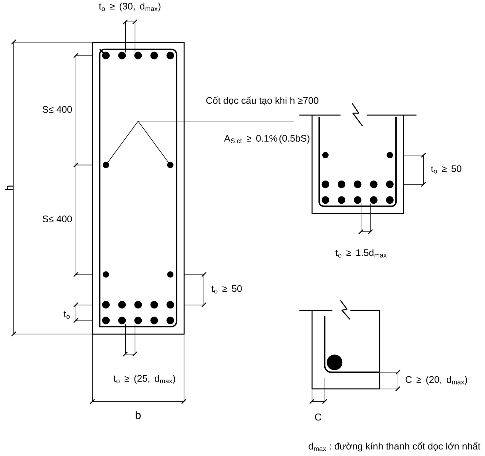
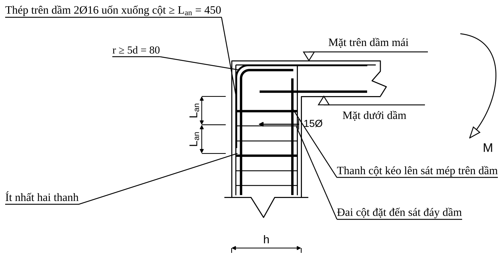

# TÀI LIỆU HỢP NHẤT — Rule Base Chọn Thép Khung BTCT

Tài liệu này là "cẩm nang" (Skill) dành cho **Rule Engine Agent** để thiết kế cốt thép cho khung bê tông cốt thép toàn khối, dựa trên TCVN 5574:2018 và TCVN 2737:2023.

> **NGUYÊN TẮC TỐI THƯỢNG:** 
> - **Bạn không bao giờ tự tính các con số (As, x, lực cắt, neo, đai, v.v.).** Mọi phép tính toán đều được mã hóa cứng trong `src/rule_engine/`. Nhiệm vụ của bạn là gọi Tool tương ứng, lấy kết quả, và đưa ra quyết định tiếp theo dựa trên các **Luật (Rule R1-R52)** dưới đây.

## I. KIẾN TRÚC & PHÂN CHIA NHIỆM VỤ

1. **Python (`src/rule_engine/*.py`)**: Chịu trách nhiệm 100% tính toán toán học (diện tích thép, khoảng hở, kiểm tra chịu lực, neo/nối).
2. **AI Agent (Bạn)**: Chịu trách nhiệm 100% việc ĐIỀU PHỐI (gọi hàm gì, truyền số liệu gì, xử lý ra sao nếu kết quả không đạt).
3. **Drawing Agent**: Chịu trách nhiệm 100% việc vẽ AutoCAD. Bạn chỉ cần trả JSON hợp đồng dữ liệu hợp lệ.

---

## II. QUY TRÌNH THIẾT KẾ DẦM (16 BƯỚC)

Dưới đây là tóm tắt quy trình thiết kế Dầm. Tại mỗi bước, gọi đúng Tool và tuân thủ các cổng chặn an toàn.

| Bước | Nhiệm vụ của AI Agent | Công cụ sử dụng | Lỗi cần tránh (Kinh nghiệm) |
|---|---|---|---|
| **1-4** | Chốt nội lực $M^+, M^-$, lực cắt $Q$ từ Input. Khai báo vật liệu. | `tra_vat_lieu` | Lấy nhầm $M$ giữa nhịp cho gối. |
| **5-8** | Chọn thép dọc chịu uốn.   **R1:** Nếu $\alpha_m > 0,5$ -> **Báo tăng tiết diện** (Không tự ý tăng thép).   **R2-R3:** $\mu \in [0,1\% ; 2,0\%]$. Nếu thiếu chỗ bố trí -> xếp 2 hàng. | `chon_thep_doc` (truyền `loai="dam"`) | Cố nhồi 5 thanh lớn vào dầm 250 (không đủ khoảng hở). |
| **9-11** | Tính cốt đai.   **R5:** $Q \le 0,3 R_b b h_0$ (Đạt). Nếu không đạt -> **Báo tăng tiết diện**.   **R6:** Đai đầu dầm: $s \le \min(h/2; 300)$. Giữa dầm $s \le \min(3h/4; 500)$. | `tinh_cot_dai` | Đặt đai giữa dầm dày bằng đai đầu dầm (lãng phí). |
| **12-13** | Tính cốt treo (giật đứt) tại vị trí dầm phụ gác lên dầm chính.   **R23:** Đặt tối thiểu 4 đai phụ ở mỗi bên dầm phụ. | `tinh_cot_dai` | Bỏ quên cốt treo tại dầm phụ. |
| **14-16** | Cắt thép, uốn thép và neo cốt dọc.   **R20:** Thép gối kéo dài thêm một đoạn $W \ge 20d$ qua điểm cắt lý thuyết. Neo thép vào cột $\ge L_{an}$ | `tinh_neo_noi`, `tu_kiem_tra` | Cắt thép sát điểm lý thuyết mà không kéo dài thêm đoạn $W$. |

> **Cảnh báo (Dầm cao):** Nếu $L/h < 3$ (dầm quá sâu), dừng lại và báo kỹ sư vì công thức thường không còn đúng. (R51)

---

## III. QUY TRÌNH THIẾT KẾ CỘT (14 BƯỚC)

Cột khung chịu nén lệch tâm, tính toán rất nhạy cảm với lực dọc $N$ và mô men $M$.

| Bước | Nhiệm vụ của AI Agent | Công cụ sử dụng | Lỗi cần tránh (Kinh nghiệm) |
|---|---|---|---|
| **1-3** | Chốt cặp nội lực $(N, M)$ nguy hiểm nhất. | `tra_vat_lieu` | Lấy thiếu tổ hợp dài hạn. |
| **4-6** | Phân loại lệch tâm. Độ lệch tâm $e = M/N$.   **R9:** Nếu $x \le \xi_R h_0$ -> Lệch tâm lớn. | `tinh_lech_tam_cot` (Tuỳ chọn) | Quên nhân hệ số uốn dọc $\eta$ vào mô men. |
| **7-9** | Chọn thép dọc (bố trí đều chu vi).   **R8:** Hàm lượng thép mục tiêu $\mu_t \in [1\% ; 4\%]$. | `chon_thep_doc` (truyền `loai="cot"`, $h$) | Dùng hàm chọn thép của Dầm cho Cột. Cột cần xếp chu vi! |
| **10-11** | Kiểm tra biểu đồ tương tác N-M. Mọi cặp nội lực đều phải nằm trong đường bao.   **R10:** Nếu vượt -> **Tăng tiết diện hoặc tăng thép**. | `tu_kiem_tra` (truyền mảng các cặp nội lực) | Chỉ kiểm tra 1 cặp nội lực duy nhất. Cần kiểm mọi tổ hợp. |
| **12-14** | Chọn cốt đai cột và kiểm tra neo nối.   **R26:** Vùng nối chồng/hai đầu cột: đai dày $s \le \min(10d_{min}; 300)$. Ngoài vùng nối: $s \le \min(15d_{min}; 500)$. | `tinh_cot_dai`, `tinh_neo_noi` | Không đặt đai phụ khi cạnh $>400$mm. |

---

## IV. CỔNG CHẶN KHI XUẤT BẢN VẼ (HÌNH HỌC NÚT)

AI Agent **không được phát hành bản vẽ** (không gắn cờ "ĐẠT") nếu vi phạm các điều kiện sau:

1. **R41 (Không lọt khe):** Thép dầm phải lọt qua khe giữa các thanh thép cột. Gọi Tool kiểm tra `kiem_tra_lot_khe_nut`. Nếu không lọt -> Dừng, yêu cầu kỹ sư tăng bề rộng cột hoặc giảm số thanh dầm.
2. **R43 (Dầm giao nhau):** Hai dầm vuông góc cùng cao độ mặt trên thì một dầm phải nằm dưới dầm kia ($h_0$ giảm). Phải tính lại và kiểm tra.
3. **R45 (Mâu thuẫn dữ liệu):** Bất cứ dữ liệu nào bị thiếu, mâu thuẫn giữa 2 tài liệu, hoặc cần xác nhận thực tế -> Gắn nhãn **"Chưa đủ để phát hành"**.

---

## V. CÁC TRƯỜNG HỢP ĐẶC BIỆT

Nếu thông số Input có đánh dấu các trường hợp sau, hãy cẩn trọng:

1. **Kháng chấn (R31-R40):** 
   - Đai dầm vùng tới hạn rất dày: $s \le h/4$.
   - Cột phải tuân thủ cột mạnh - dầm yếu: $\sum M_{Rc} \ge 1,3 \sum M_{Rb}$.
   - *Luật:* Cần xác nhận cấp độ dẻo (DCM/DCH) trước khi thiết kế.
2. **Chịu Xoắn (R47-R50):**
   - *Luật:* Nếu có mô men xoắn $T > 0$, hãy kiểm tra $T \le 0,1 R_b b^2 h$. Nếu không đạt -> báo Tăng tiết diện. Tính toán cốt đai riêng theo Chương 15.

---

## VI. HÌNH ẢNH MINH HỌA CHO DRAWING AGENT

*(Lưu ý cho Drawing Agent: Hãy sử dụng cấu trúc CAD hoặc các mẫu dưới đây để vẽ các cấu tạo chi tiết. Bạn có thể tham khảo thư mục `docs/agents/huongdanchonthep/img/`)*

- **Khoảng hở thông thủy dầm:** 
- **Mặt cắt cột và đai phụ (ví dụ Cột 22):** 
- **Cấu tạo giật đứt dầm phụ:** 
- **Nút góc tầng mái (Uốn thép):** 
- **Biểu đồ tương tác Cột:** 

> **Luật R30:** Luôn gọi phiếu kiểm tra cuối cùng (đếm đai, tính khối lượng, khớp mã) trước khi trả file JSON.
