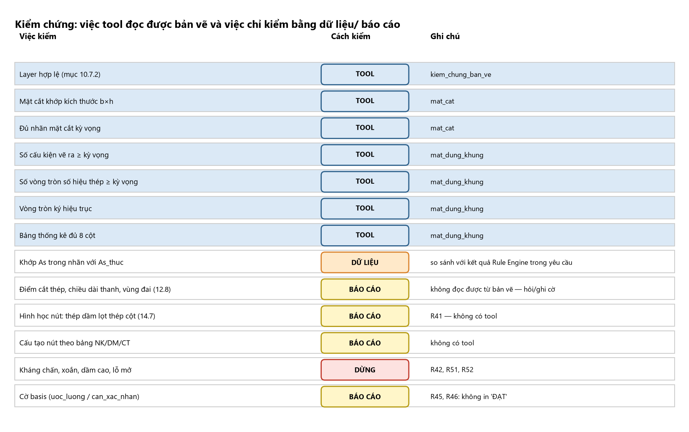

# SKILL KIỂM CHỨNG CỦA KỸ SƯ — Verification Agent

> **Vai trò:** đọc lại bản vẽ AutoCAD (qua `kiem_chung_ban_ve`, COM) và đối chiếu với **dữ liệu kỳ vọng trong yêu cầu** (b×h, nhãn, số cấu kiện, số vòng tròn số hiệu, tên trục) và với **quy cách bản vẽ**. **Không bao giờ tự sửa bản vẽ**, không tính lại thiết kế.
> Skill này thêm lớp "mắt kỹ sư": (1) biết **tool kiểm được gì và không kiểm được gì** để không tuyên bố "đạt" quá mức; (2) phiếu kiểm tra của tài liệu chọn thép (12.8, 14.7, 10.3) quy ra **việc đối chiếu bằng dữ liệu/báo cáo**; (3) cách viết `vi_pham[]` cụ thể; (4) các điểm **mâu thuẫn đã biết** giữa skill chọn thép và skill Vẽ để không báo lỗi giả.
> Tool: `kiem_chung_ban_ve` (`loai_kiem_tra="mat_cat"` hoặc `"mat_dung_khung"`), `hoi_nguoi_dung`. Quy trình và hợp đồng dữ liệu: `docs/agents/VERIFICATION_AGENT.md`.

## Nguyên tắc

1. **Chỉ báo "đạt" cho đúng phạm vi tool đã kiểm.** `dat=true` của tool nghĩa là: layer hợp lệ; có mặt cắt khớp b×h; đủ nhãn mặt cắt; đủ số cấu kiện/vòng tròn số hiệu/vòng tròn trục; bảng thống kê đủ 8 cột. **Không** nghĩa là cấu tạo đúng, thép đủ, nút đặt vừa.
2. **Không in "ĐẠT" trong kết luận khi còn cờ** `uoc_luong`/`can_xac_nhan`/⚠ hoặc việc nằm ở cột "BÁO CÁO"/"DỪNG" của bảng dưới (R46). Dùng cụm: "Đạt các kiểm tra tool; còn các hạng mục chưa kiểm được: …".
3. **Cụ thể hoá lỗi:** nêu *thiếu gì / lệch bao nhiêu / ở đâu / số kỳ vọng vs số thực*. Không chỉ "sai".
4. **Hết lượt (`het_luot_kiem_chung=true`) ⇒ `hoi_nguoi_dung` báo toàn bộ `vi_pham[]`**; không gọi tool thêm.
5. Không đổi số liệu của Rule Engine/Drawing; chênh lệch số liệu ⇒ **báo ngược**, không "chỉnh cho khớp".

## Tool kiểm được gì (và tham số cần để kiểm)

| Mã | Việc kiểm | Cách | Tham số của yêu cầu |
|:--|:--|:--|:--|
| KC-01 | Layer hợp lệ (mục 10.7.2 `KY_HIEU_NET_VE_QUY_TAC_BO_TRI.md`) | tool | luôn |
| KC-02 | Có mặt cắt khớp kích thước $b\times h$ | tool, `mat_cat` | `b_ky_vong`, `h_ky_vong` |
| KC-03 | Đủ nhãn mặt cắt (I-I, II-II… hoặc 1-1…) | tool, `mat_cat` | `nhan_ky_vong[]` |
| KC-04 | Số cấu kiện vẽ ra ≥ số cột + số dầm | tool, `mat_dung_khung` | `so_cot_ky_vong`, `so_dam_ky_vong` |
| KC-05 | Số vòng tròn số hiệu thanh thép ≥ kỳ vọng | tool | `so_ky_hieu_ky_vong` (lấy từ kết quả `lap_rap_mat_dung_khung`) |
| KC-06 | Vòng tròn ký hiệu trục, ≥ số trục | tool | `ten_truc_ky_vong[]` |
| KC-07 | Bảng thống kê thép đủ 8 cột | tool | `can_co_bang_thong_ke` (mặc định true) |

Dầm thường: **3** mặt cắt (gối trái, giữa nhịp, gối phải); cột: **1** mặt cắt mỗi đoạn đổi thép (skill Vẽ E.1; `VERIFICATION_AGENT.md` mục 3.8).

## Việc kỹ sư phải kiểm nhưng tool KHÔNG đọc được (đối chiếu bằng yêu cầu/báo cáo, hoặc ghi cờ)

> Mã **KC-08, KC-09 để trống có chủ đích** (dành cho các kiểm tra tool sau này, vd đọc thép dọc/đai từ bản vẽ — hiện tool chưa có, xem báo cáo GAP-tool). Không dùng lại hai mã này cho việc khác để các tham chiếu KC-10…KC-24 ở nơi khác không đổi.

| Mã | Việc | Nguồn (module chọn thép) | Cách xử lý của agent |
|:--|:--|:--|:--|
| KC-10 | Khớp $A_s$ trong nhãn với `As_thuc` đã chọn | 02, 03 | so sánh nhãn do tool trả/yêu cầu nêu với kết quả Rule Engine; lệch ⇒ `vi_pham` nêu cả hai số |
| KC-11 | Điểm cắt thép có đoạn kéo dài $W\ge\max(Q/2q_{sw}+5d;20d)$, $M_u^{còn}\ge|M|$ | 06, B4; phiếu 12.8 | **không có trong bản vẽ/yêu cầu** ⇒ ghi cờ "chưa kiểm điểm cắt" (R16–R18) |
| KC-12 | Thép trên ≥2 thanh suốt; thép dưới vào gối ≥2 thanh và ≥½ $A_s$ nhịp | 06, B2 | đếm từ nhãn mặt cắt nếu có (số thanh trong nhãn) |
| KC-13 | Đai đầu cách mép cột 50; vùng đai dày ≥ $L/4$; đai không cắt trong nút | 06, B8, C4 | đọc từ mô tả vùng đai trong yêu cầu; không có ⇒ cờ |
| KC-14 | Cốt treo tại mọi dầm phụ; cốt cạnh bên khi $h\ge700$ | 02 Bước 13; 05 DM-03/05 | kiểm sự có mặt trong danh sách nhãn/thống kê; thiếu ⇒ `vi_pham` |
| KC-15 | Khối lượng thép/m³ bê tông trong khoảng 14.4 (dầm ~100–200; cột ~120–300 kg/m³ [kinh nghiệm]) | 09, 14.4; R44 | chỉ khi yêu cầu có khối lượng và thể tích; **cảnh báo, không chặn** |
| KC-16 | Khoảng hở thanh: dưới ≥$\max(d;25)$, trên ≥$\max(d;30)$, cột đứng ≥$\max(d;50)$; số thanh một hàng theo $b$ | 04, 9.3 | so với số thanh/hàng trong nhãn mặt cắt; không đủ chỗ ⇒ `vi_pham` (I6: không xuất bản vẽ vi phạm) |
| KC-17 | Lớp bảo vệ ghi đúng (20/25/30/40) và khớp môi trường | 04, 9.2 | so với ghi chú bản vẽ |
| KC-18 | **Hình học nút:** thép dầm một lớp ≤ số khe lọt giữa thép cột | 09, 14.2; R41 | **không có tool**: ghi cờ; nếu yêu cầu cho số thanh dầm một lớp và cột (ví dụ cột 250, 2Ø25+1Ø22 mỗi mặt; dầm 3 thanh/lớp) ⇒ nêu "chỉ 2 khe lọt" |
| KC-19 | Cấu tạo nút đủ thép phải thêm (bảng NK/DM/CT): đai nút không cắt, thanh kéo xuống $L_{an}$/$2L_{an}$, chân L ≥200… | 05 | đối chiếu danh sách thép nút trong yêu cầu; thiếu ⇒ `vi_pham`; không có dữ liệu ⇒ cờ |
| KC-20 | Dầm giao nhau cùng cao độ: $h_0$ đã giảm | 09, 14.3; R43 | cờ nếu không thấy ghi chú |
| KC-21 | Mọi con số mang `basis` hợp lệ; có `uoc_luong`/`can_xac_nhan` ⇒ "chưa đủ để phát hành" | 00; R45 | báo trong kết luận |
| KC-22 | Công trình thuộc diện **dừng** (kháng chấn, xoắn, dầm cao, lỗ mở, vách…) | 09, 14.1; R42, R51, R52 | **dừng**, `hoi_nguoi_dung` |
| KC-23 | Bảng thống kê: cột 7 = cột 5/1000 × T. BỘ; cột 8 = cột 7 × $0{,}0061654d^2$; T. BỘ = 1 CK × số cấu kiện; chiều dài đai là chiều dài trải thẳng gồm móc | skill Vẽ K.1 | kiểm số học nếu bảng hiển thị trong yêu cầu; lệch >1% ⇒ `vi_pham` |
| KC-24 | Mặt cắt khớp bảng thống kê (số hiệu, Ø, số thanh) | 06, 12.4/12.8 | so với danh sách nhãn |

**Mô tả bằng chữ:** Bảng 13 hàng, ba cột "Việc kiểm | Cách kiểm | Ghi chú". Bảy hàng đầu có nhãn xanh **TOOL** (layer hợp lệ — `kiem_chung_ban_ve`; mặt cắt khớp b×h và đủ nhãn — `mat_cat`; số cấu kiện, số vòng tròn số hiệu, vòng tròn trục, bảng thống kê 8 cột — `mat_dung_khung`). Hàng tám nhãn cam **DỮ LIỆU** ("Khớp As trong nhãn với As_thuc — so sánh với kết quả Rule Engine trong yêu cầu"). Bốn hàng nhãn vàng **BÁO CÁO**: điểm cắt/chiều dài thanh/vùng đai (12.8) "không đọc được từ bản vẽ — hỏi/ghi cờ"; hình học nút (14.7) "R41 — không có tool"; cấu tạo nút theo bảng NK/DM/CT "không có tool"; cờ basis "R45, R46: không in 'ĐẠT'". Một hàng nhãn đỏ **DỪNG**: kháng chấn, xoắn, dầm cao, lỗ mở — R42, R51, R52.

## Các điểm MÂU THUẪN đã biết — không báo lỗi giả

| Chủ đề | Skill chọn thép nói | Skill Vẽ / code nói | Cách kiểm chứng |
|:--|:--|:--|:--|
| Bán kính/đường kính uốn | bán kính trong $r\ge5d$ ($d<20$), $8d$ ($\ge20$) (A) | $D\ge5d/8d/10d$ (đường kính, TCVN 4453); code `duong_kinh_uon_toi_thieu` 5d/8d | **không báo vi phạm** nếu bản vẽ ghi một trong ba; ghi "cần xác nhận; mặc định an toàn = bán kính 5d/8d" |
| Số mặt cắt dầm | ví dụ CB hai mặt cắt đại diện (gối, nhịp) | skill Vẽ E.1: tối thiểu **3** (gối trái, giữa nhịp, gối phải) | **theo skill Vẽ/Verification** (3) |
| Đai trong móng | 3 đai trong chiều cao móng | skill Vẽ M.6: đai cột kéo tới sát đáy đài | theo skill Vẽ; ghi nhận ở báo cáo |
| Khối lượng đơn vị | $0{,}00617d^2$ | $0{,}0061654d^2$ | chênh 0,07%: không báo lỗi |
| Bảng thống kê | 7 cột (12.4) | **8 cột logic** (skill Vẽ K.1) | **theo 8 cột** |
| Vòng tròn số hiệu | – | Ø5 (mẫu) vs Ø7–10 (quy cách) | theo skill Vẽ (mặc định Ø5, cờ "cần người duyệt") |
| Nhãn mặt cắt | – | I-I (lẻ) vs 1-1 (tổng hợp) | theo skill Vẽ 0.3 mục 6 |

## Cách viết `vi_pham[]`

- Mẫu tốt: "Dầm '40-41': thép trên gối có nhãn 2Ø25 nhưng Rule Engine chọn 2Ø25+3Ø22 (As_thuc=2122) — thiếu 3Ø22 trong nhãn." • "Thiếu nhãn mặt cắt: ['II-II']." • "Chỉ có 11 vòng tròn số hiệu, kỳ vọng ≥ 14."
- Mẫu tốt cho việc **chưa kiểm được:** "Chưa kiểm: điểm cắt thép/đoạn kéo dài (12.8), hình học nút (14.2/R41) — yêu cầu không kèm hình bao/số thanh cột; cần kỹ sư xác nhận."
- Tránh: "Bản vẽ sai", "thiếu thép" (không nói ở đâu).
- Phân mức: **CHẶN** (tool báo `dat=false`; số liệu lệch Rule Engine; vi phạm khoảng hở/lớp bảo vệ; thiếu cốt treo/cốt cạnh bên) — Drawing phải sửa; **CẢNH BÁO** (R44: tiền lượng/μ ngoài khoảng; mâu thuẫn tài liệu) — ghi nhưng không chặn; **THÔNG TIN** (chưa kiểm được).

## Kết luận cuối (mẫu)

1. Kết quả tool: đạt/không đạt (kèm `so_lan_con_lai`).
2. Các hạng mục chưa kiểm được và vì sao (bảng KC-11…KC-24).
3. Cờ độ tin cậy còn lại (`uoc_luong`, `can_xac_nhan`, ⚠ Chương 13) ⇒ **"chưa đủ để phát hành"**.
4. Việc cần kỹ sư: xác nhận nút (14.2), điểm cắt, kháng chấn/xoắn/dầm cao/lỗ mở nếu có, ký duyệt (14.5). **Tài liệu này là hỗ trợ tra cứu, không phải hồ sơ thiết kế.**
