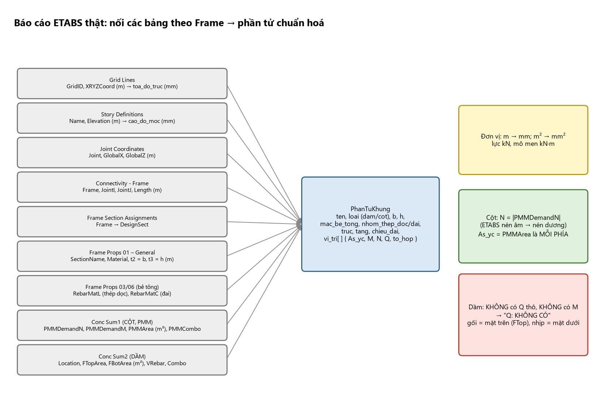

# SKILL NHẬP DỮ LIỆU ETABS — Input Adapter Agent (Chương 1–6 của tài liệu nguồn)

> **Vai trò:** biến một file ETABS/Excel/CSV thành `BoDuLieuKhungChuanHoa` (phần tử, vị trí, `As_yc`, `M`, `N`, `Q`, trục, cao độ). **Không tính** bất kỳ con số kỹ thuật nào (As, μ, $R_b$…), **không** chọn thép, **không** vẽ.
> Skill này cho agent biết: (1) cần những dữ liệu gì và vì sao (Chương 1); (2) đọc báo cáo ETABS thật như thế nào và đổi đơn vị/dấu ra sao (Chương 6); (3) các kiểm tra hợp lý nên làm/ghi cờ (6.4, 1.3); (4) kiến thức nền Chương 2–5 để **nhận ra dữ liệu bất thường** (không để tính lại tải/tổ hợp); (5) **sàng lọc phạm vi** để Rule Engine không nhận cấu kiện ngoài khả năng (R42).
> Tool: `doc_etabs_that` (thử đầu tiên) → `doc_va_do_schema` → `de_xuat_anh_xa` → `xac_nhan_anh_xa_voi_nguoi_dung` → `chuan_hoa_du_lieu` → `suy_luan_hinh_hoc`; `hoi_nguoi_dung` cho mọi điểm mơ hồ. Quy trình từng bước và lỗi thật đã gặp: `docs/agents/INPUT_ADAPTER_AGENT.md`.

## Quy tắc không thương lượng

1. `doc_etabs_that` **trước tiên**; `la_etabs_that=true` ⇒ dữ liệu (kể cả `toa_do_truc`, `cao_do_moc`) đã chính xác — **dừng**, không suy luận lại.
2. **Mọi trường** trong `can_xac_nhan` ∪ `thieu_bat_buoc` phải qua `xac_nhan_anh_xa_voi_nguoi_dung`, kể cả khi tên cột trông rõ ràng.
3. `truong_bat_buoc` chỉ dùng **tên trường chuẩn** (`ten_phan_tu, loai, vi_tri, b, h, mac_be_tong, nhom_thep, combo, M, N, Q, As_yc`); `loai_mac_dinh` chỉ khi ánh xạ **không** có `loai`.
4. Không tự bịa toạ độ trục/cao độ tầng, mác bê tông, nhóm thép, $Q$ — thiếu thì `hoi_nguoi_dung`.
5. **Dầm nguồn ETABS design summary:** $Q$ **không có** (chỉ `VRebar`), $M$ không có (chỉ `FTopArea`/`FBotArea`) ⇒ đặt `Q=None`, **không** điền 0, và để pipeline báo "Q: KHÔNG CÓ" cho Rule Engine.
6. **`As_yc` của cột (PMMArea) là As MỖI PHÍA** — chỉ chuyển m² → mm², không chia đôi, không nhân đôi.

# CHƯƠNG 1. DỮ LIỆU ĐẦU VÀO

**Nguyên tắc số 1:** thiếu một dữ liệu đầu vào là không thể chọn thép đúng. Chương này liệt kê *đầy đủ* những gì phải có, cách kiểm tra từng dữ liệu, và bộ số liệu ví dụ.

## 1.1. Dữ liệu đầu vào gồm những nhóm nào

| Nhóm | Nội dung | Nếu thiếu thì sai ở đâu |
|:--|:--|:--|
| **A. Công trình** | công năng, địa điểm, số tầng, cấp công trình, môi trường, bậc chịu lửa | sai hoạt tải, gió, $\gamma_n$, lớp bảo vệ |
| **B. Hình học** | lưới trục, nhịp, bước khung, chiều cao tầng, tiết diện, liên kết chân cột | sai sơ đồ tính, chiều dài tính toán $l_0$, tải truyền |
| **C. Vật liệu** | cấp bền bê tông, mác thép dọc/đai, mô đun, độ ẩm | sai $R_b,R_s,\xi_R$, $\varphi_{b,cr}$ |
| **D. Tải trọng** | cấu tạo sàn, tường, hoạt tải, gió, (động đất) | sai nội lực toàn khung |
| **E. Mô hình & kết quả ETABS** | đơn vị, tên tổ hợp, tên phần tử, bảng xuất | đọc nhầm phần tử/tổ hợp/dấu |
| **F. Yêu cầu thiết kế riêng** | mác/đường kính ưu tiên, hàm lượng mục tiêu, giới hạn võng–nứt | thép không thi công được hoặc vượt chỉ tiêu |
| **G. Quy định cấu tạo của dự án** | lớp bảo vệ, kiểu nối, chiều dài nối–neo, tiêu chuẩn | bản vẽ không khớp tính toán |

## 1.2. Bảng điền dữ liệu đầu vào (dùng cho mọi dự án)

Cột "Ví dụ" là bộ số liệu thống nhất (1.5). Cột "Dùng ở" cho biết chương dùng dữ liệu. **Cột cuối thêm của skill:** agent lấy từ đâu / hỏi ai.

### A. Công trình và môi trường

| Hạng mục | Cách lấy / nguồn | Ví dụ | Agent |
|:--|:--|:--|:--|
| Công năng | hồ sơ kiến trúc | Trường học | hỏi nếu cần (ảnh hưởng hoạt tải — Input không tính) |
| Vùng gió $W_0$ (kN/m²) | QCVN 02:2022 / TCVN 2737:2023 | TP Ninh Bình – vùng IV, $W_0=1{,}55$ | không dùng (ETABS đã chạy) |
| Dạng địa hình | TCVN 2737:2023 | C | không dùng |
| Số tầng $n$; chiều cao tầng (m) | hồ sơ kiến trúc | 6 tầng + mái; 3,9 | từ `Story Definitions` |
| Cốt mặt móng/ngàm so với ±0,000 (m) | hồ sơ nền móng | −1,3 | **quan trọng cho $l_0$ tầng 1**: lấy từ cao độ joint chân cột |
| Cấp hậu quả → $\gamma_n$ | TCVN 2737:2023 | C2 → 1,0 | không dùng |
| Vùng động đất ($a_{gR}$) | QCVN 02:2022, TCVN 9386:2012 | Không xét | **hỏi người dùng: có thiết kế kháng chấn không? cấp dẻo?** (R31) |
| Điều kiện môi trường | khảo sát | Trong nhà, ẩm thông thường | **hỏi** — quyết định lớp bảo vệ 20/25/30/40 |
| Độ ẩm tương đối $RH$ (%) | khí hậu | >75% | hỏi (từ biến/lớp bảo vệ) |
| Bậc chịu lửa | QCVN 06 | Không yêu cầu thêm | hỏi nếu có |

### B. Hình học

| Hạng mục | Cách lấy / nguồn | Ví dụ | Agent |
|:--|:--|:--|:--|
| Lưới trục, nhịp $L_i$ (m) | mặt bằng kết cấu | C–D 3,45; D–B 3,45; B–A 2,1; console A–E 2,1 | `Grid Lines` → `toa_do_truc` |
| Bước khung $B$ | mặt bằng | 3,9 | không dùng |
| Tiết diện dầm $b\times h$ | chọn sơ bộ | CB 250×700; AB 250×400; dầm dọc/phụ 220×300 | `Frame Props 01` (t2 = b, t3 = h) |
| Tiết diện cột | chọn sơ bộ | B, C 250×600; A 250×250 | như trên |
| Chiều dày sàn | chọn sơ bộ | 100 | không dùng |
| Liên kết chân cột | địa chất | Ngàm tại mặt móng | **hỏi** nếu không rõ (ảnh hưởng $l_0$) |
| Chiều cao tầng 1 từ ngàm (m) | $H_t$ + chiều sâu ngàm | $3{,}9+1{,}3=5{,}2$ | `Connectivity - Frame` `Length` của cột |
| Độ dốc mái | kiến trúc | 13° | không dùng |

### C. Vật liệu

| Hạng mục | Nguồn | Ví dụ | Agent |
|:--|:--|:--|:--|
| Cấp độ bền bê tông | thiết kế | B30 | `Material` của section (**kiểm bằng ETABS có gán B25 trong khi thiết kế B30 không**) |
| Thép dọc | thiết kế | CB500-V | `RebarMatL`; ký hiệu nước ngoài (A-III, HRB400…) đã có bảng quy đổi trong `vat_lieu` |
| Thép đai, cốt treo | thiết kế | CB240-T | `RebarMatC` — **đừng nhập đai bằng mác thép dọc** |
| $\gamma_{b2}$ | TCVN 5574:2018 | 1,0 | không dùng |
| $d_{max}$ cốt liệu | thi công | 20 | hỏi nếu cần |

### D. Tải trọng

Cấu tạo sàn/mái/tường, hoạt tải, $\gamma_f$, gió, tải đặc biệt: **thuộc người lập mô hình ETABS**; Input Adapter chỉ cần biết tên các trường hợp tải/tổ hợp để nhận diện `combo`.

### E. Mô hình và kết quả ETABS/SAP2000

| Hạng mục | Ví dụ |
|:--|:--|
| Hệ đơn vị xuất kết quả | kN, m (kN·m) |
| Tên trường hợp tải (Load Case/Pattern) | TT, HT1, HT2, GIOT, GIOP |
| Tên tổ hợp (Combo) | TH1 … TH17, THBAO |
| Tên/số hiệu phần tử | dầm 40–41, 9, 15; cột 22 |
| Bảng nội lực đã xuất | Element Forces – Beams/Columns |

### F. Yêu cầu thiết kế riêng của dự án

Đường kính ưu tiên/tối đa (dầm Ø16–Ø25; cột Ø16–Ø25); số lớp tối đa dầm ≤2 hàng; hàm lượng mục tiêu (dầm ≈1,0–1,5%; cột $\mu_t\approx1$–2%); giới hạn $a_{crc,dài\,hạn}\le0{,}3$ mm. **Agent hỏi người dùng** để truyền cho `chon_thep_doc` (`duong_kinh_cho_phep`, `cover`).

### G. Quy định cấu tạo của dự án

Lớp bảo vệ cốt đai $c$ (dầm, cột: 20); kiểu nối cốt dọc (buộc/nối chồng); chiều dài thanh thương phẩm (11,7 m); tiêu chuẩn thiết kế (TCVN 5574:2018; TCVN 2737:2023).
**Lỗi thường gặp ở dữ liệu đầu vào:** (1) hoạt tải theo công năng cũ; (2) quên chiều sâu ngàm ⇒ $l_0$ cột tầng 1 sai; (3) nhập mác thép đai bằng mác thép dọc; (4) chọn $\gamma_n$ theo công trình thấp tầng cho nhà quan trọng; (5) không ghi dạng địa hình khi tính gió.

## 1.3. Cách kiểm tra dữ liệu đầu vào trước khi tính

1. **Đơn vị nhất quán:** ETABS kN–m; tiết diện bằng mm khi thay vào công thức.
2. **Tiết diện theo ván khuôn:** cạnh ≤600 làm tròn bội 50; >600 bội 100 (không đúng ⇒ **cờ**, không tự sửa; Phần Q, I4).
3. **Vật liệu trong mô hình = vật liệu thiết kế** (ETABS có thể gán B25 trong khi thiết kế B30).
4. **Tải:** $\sum$ phản lực chân cột so với tải tính tay (6.4).
5. **Tên phần tử:** chép tên dầm/cột cần thiết kế từ sơ đồ phần tử trước khi đọc bảng.

## 1.4. Dữ liệu cần để chương trình/AI tự động chọn thép

Giao diện dữ liệu giữa mô hình và bước chọn thép (mỗi phần tử):

| Trường | Ví dụ | Ghi chú | Input Adapter hiện có? |
|:--|:--|:--|:--|
| `story`, `element`, `section` | Tầng 1, C22, 250×600 | tên theo mô hình | ✓ (`tang`, `ten`, `b`,`h`) |
| `b, h, a, a', L, l0` | 250, 600, 40, 40, 5200, 3640 | mm | `b,h`, `chieu_dai` ✓; **`a`, `l0` không có** (Rule Engine tự đặt 40; $l_0=0{,}7H$ do agent) |
| `Rb, Rbt, Rs, Rsc, Rsw, Es, Eb` | 17; 1,15; 435; … | MPa | không — Rule Engine `tra_vat_lieu` |
| `combo, station, M, N, Q` | TH12, chân cột, 417,74; −1514,38 | kN·m; kN | cột: 1 dòng PMM đại diện; **dầm: không có M, Q** |
| `Mdh, Ndh` | 18,06; 1168,39 | nội lực do tải dài hạn | **không có** |
| `loại cấu kiện` | cột / dầm / console | | ✓ (không phân biệt console) |
| `ràng buộc cấu tạo` | cover, spacing, diameters | từ nhóm F, G | **không có** — phải hỏi |

**Thiếu so với yêu cầu của các skill sau** (`BAO_CAO_GAP_TOOL.md`): $M_{dh},N_{dh}$ (η cột); hình bao $M$, $Q$ dầm (điểm cắt, đai); các cặp nội lực khác của cột; cờ kháng chấn/cấp dẻo; dấu $M$ đầu dầm (nút đóng/mở); $T$ (xoắn); thông tin hình học nút (số thanh cột mỗi mặt, $e_0/h$, $\tan\beta$); lỗ mở.

## 1.5. Bộ số liệu ví dụ thống nhất (dùng xuyên suốt tài liệu)

**Đề bài (A, ví dụ 1 chương 6):** khung ngang (trục 3) nhà trường học 6 tầng tại Ninh Bình; BTCT toàn khối; dài ~50 m (khe biến dạng tại trục 7–8); bước khung 3,9 m; mái dốc 13° lợp tôn.
- **Sơ đồ khung trục 3:** trục C, B, A là cột; **D không phải cột** (vị trí dầm phụ 220×300 gác lên dầm khung CB, truyền lực tập trung $G_D$, $P_D$); C–D = D–B = 3,45; B–A = 2,1; console A–E = 2,1 (chỉ tầng 2).
- **Chiều cao:** tầng 1: 3,9 + 1,3 (từ mặt ngàm lên ±0,000) = 5,2; tầng 2–6: 3,9; $h=25{,}05$ từ cốt ngoài nhà; $H=26{,}35$ từ mặt móng.
- **Vật liệu:** B30; CB500-V (dọc); CB240-T (đai). **Tiết diện:** dầm CB 250×700, AB 250×400, dầm dọc/phụ 220×300, cột 250×600 (B, C), 250×250 (A), sàn 100.
- **Nội lực:** ETABS giải khung phẳng trục 3 (số liệu từ A). Đây là ví dụ duy nhất có đủ chuỗi mặt bằng → tải → tổ hợp → nội lực → thép dầm, cột, cốt treo, nút khung.

# CHƯƠNG 2. CHỌN SƠ BỘ KÍCH THƯỚC CẤU KIỆN

Kích thước chọn ở đây chỉ là giả thiết ban đầu để chạy ETABS. Input Adapter **không** chọn kích thước; chỉ cần hiểu để nhận ra tiết diện bất thường.

## 2.1. Thứ tự chọn

Chiều dày sàn → tiết diện dầm → tiết diện cột (theo lực dọc sơ bộ) → kiểm tỉ lệ độ cứng, độ mảnh, bội số ván khuôn.

## 2.2. Chiều dày bản sàn

$h_b=\dfrac{D}{m}L_1$ ($D=0{,}8$–$1{,}4$, bình thường 1; $m=40$–$45$ bản kê 4 cạnh); $L_2/L_1\le2$: hai phương. Ví dụ $3{,}45\times3{,}9$: $h_b=86{,}25\to$ **100 mm** (làm tròn bội 10).

## 2.3. Tiết diện dầm

$h_d=(\tfrac1{10}\div\tfrac1{14})L$, $b_d=(\tfrac13\div\tfrac12)h_d$ (dầm *khung*; C cho dầm phụ $h=(1/8\div1/20)L$); $b_d\le b_c$; tỉ lệ độ cứng đơn vị dầm kề nhau $i_{CB}/i_{AB}\in(1;2)$ (ví dụ 1,63); hàm lượng kinh tế $\tfrac13$–$\tfrac12\mu_{max}$. Ví dụ: CB $h=493$–$690\to700$, $b=250$; AB 250×400; dầm dọc/phụ 220×300.

## 2.4. Tiết diện cột

### 2.4.1. Diện tích sơ bộ theo lực dọc

$A_{sb}=k\dfrac{N}{R_b}$, $N=nSq$; $k=1{,}2$–$1{,}3$ (biên/tầng trên đến 1,5); $q=8$–$10$ (nhà ở), $10$–$13$ (văn phòng, trường học), $13$–$16$ kN/m². Ví dụ cột B: $S=17{,}55$ m², $N=1053$ kN, $A_{sb}=805$ cm² ⇒ chọn **250×600**; cột A: $A_{sb}=188$ cm² ⇒ **250×250**.

### 2.4.2. Điều kiện về độ mảnh

$\lambda=l_0/i\le120$; $\lambda_b=l_0/b\le35$ (A) — **D (2018) $\le31$**; $l_0=0{,}7H$ (tầng 1 từ mặt ngàm). Ví dụ $\lambda_b=3640/250=14{,}56$.

### 2.4.3. Thống nhất hoá

Cạnh ≤600 bội 50, >600 bội 100; giữ tiết diện không đổi, giảm cấp bền và thép ở tầng trên; $\mu_t\approx2\%$ (nén lớn), $\approx1\%$ (nén nhỏ tầng trên).

## 2.5. Kiểm tra lại sau khi có nội lực

$\alpha_m\le\alpha_R$ ($\approx0{,}37$; nên ≤0,3); $Q\le0{,}3R_bbh_0$; $\mu_{min}\le\mu\le\mu_{max}$; cột $\mu_t\le3$–$4\%$ (8% nối); chuyển vị ngang theo TCVN; $i_{dầm}/i_{cột}\in(1;2)$. Không đạt ⇒ sửa tiết diện và **chạy lại** ETABS (Rule Engine báo "tăng tiết diện").

# CHƯƠNG 3. LẬP SƠ ĐỒ TÍNH KHUNG

## 3.1. Khung phẳng hay khung không gian

Khung phẳng khi: thuần khung, mặt bằng chữ nhật đều ($L/B\ge2$), xoắn nhỏ, không tải đặc biệt; chọn khung ngang **nguy hiểm nhất** (ví dụ khung trục 3). **Khung không gian/khung–vách/lõi lệch tâm ⇒ ngoài phạm vi (R42): báo người dùng.**

## 3.2. Quy tắc lập sơ đồ tính

Trục thanh trùng trục hình học; nút cứng; **chân cột ngàm tại mặt móng**; nhịp = khoảng cách **trục cột**; chiều cao tầng = giữa trục dầm hai tầng (tầng 1 từ ngàm); bỏ độ cứng sàn; tiết diện nguyên, $E_b$ ban đầu; tải đưa về trục dầm.

## 3.3. Các phép đơn giản hoá cho phép (A, theo [7])

Nhịp chênh <10% coi bằng nhau; lệch trục cột ≤5% nhịp dịch về một đường; vị trí tải dịch ≤5% nhịp; độ dốc xà <1/8 coi nằm ngang; từ 5 lực tập trung trở lên đổi thành tải phân bố; khung nhiều nhịp bằng nhau đổi 3 nhịp. Ít cần với ETABS, dùng khi kiểm tay.

## 3.4. Mô hình hoá trong ETABS/SAP2000 (checklist dựng mô hình)

kN–m; lưới theo nhịp tính toán; vật liệu B30; tiết diện đúng $b\times h$; **Fixed** tại cốt ngàm; TT, HT1, HT2 (xếp lệch tầng/nhịp), GIOT, GIOP; *Self Weight Multiplier* (không nhập lại bản thân dầm/cột); tổ hợp (Chương 5); chạy và kiểm (6.4) rồi mới xuất.

## 3.5. Sơ đồ tính của khung trục 3 (ví dụ)

Khung phẳng 6 tầng, nút cứng, ngàm cốt −1,3; nhịp tim cột C–D 3,45, D–B 3,45 (dầm CB dài 6,9, D là dầm phụ gác lên), B–A 2,1, console A–E 2,1 (tầng 2); tầng 1 5,2, tầng 2–6 3,9; $l_0$ cột tầng 1 $=0{,}7\times5{,}2=3{,}64$ m. **Điểm D ở giữa nhịp CB là lực tập trung, không phải gối cột** ⇒ dầm CB thiết kế như dầm một nhịp 6,9 m kèm cốt treo tại D.

# CHƯƠNG 4. XÁC ĐỊNH VÀ ĐƯA TẢI TRỌNG VÀO MÔ HÌNH

Tải là **giá trị tiêu chuẩn** (nhân $\gamma_f$ ở tổ hợp). Input Adapter **không tính tải**; mục này để hiểu các trường hợp tải trong ETABS và nhận lỗi.

## 4.1. Quy trình xác định tải trọng

Bảng tải đơn vị → mặt bằng truyền tải → tải phân bố/tập trung lên khung → gió → bảng tải theo trường hợp (TT, HT1, HT2, GIOT, GIOP).

## 4.2. Tải trọng thường xuyên (tĩnh tải) đơn vị

$g^{tc}_i=\delta_i\gamma_i$, $g^{tt}_i=g^{tc}_i\gamma_{f,i}$. Trọng lượng riêng/$\gamma_f$: BTCT 25/1,1; vữa 18/1,3; gạch đặc 18/1,1; gạch rỗng 15/1,3; mái tôn 0,2/1,05… Sàn phòng học (gạch 8 mm + vữa 20 + sàn 100 + trát 20): $g^{tc}=3{,}38$, $g^{tt}=3{,}862$ ($\gamma_f=1{,}14$); vệ sinh 4,49; mái 3,22; console 3,42; tường 220 = 4,50; tường 110 = 2,52. **Quy ước A:** $\gamma_f=1{,}15$ cho lớp cấu tạo/tường, $1{,}1$ cho bản thân kết cấu.

## 4.3. Tải trọng tạm thời (hoạt tải) đơn vị

Phòng học 2,0; hành lang/cầu thang 3,0; mái không sử dụng 0,3 kN/m² ($\gamma_f=1{,}3$); nước sê nô $\gamma=10$ kN/m³ × 0,3 m ($\gamma_f=1{,}0$; A ghi nhầm đơn vị kN/m²).

## 4.4. Truyền tải từ sàn lên khung

### 4.4.1. Nguyên tắc

Phân giác từ góc ô bản; kích thước tính từ tim dầm; cạnh ngắn → tam giác, cạnh dài → hình thang; bản một phương → chữ nhật; tải tập trung lên khung = phản lực gối dầm đơn giản.

### 4.4.2. Công thức

$q_{max}=g_SL_1/2$; $q_{td}^{\triangle}=\tfrac58q_{max}$; $q_{td}^{thang}=(1-2\beta^2+\beta^3)q_{max}$, $\beta=L_1/2L_2$. **Không dùng $q_{td}$ để nhập mô hình** (không tương đương về lực cắt và lực dọc); chỉ để kiểm tay.

### 4.4.3. Ví dụ – tĩnh tải sàn tầng 2 lên khung trục 3

Nhịp CB: tường 220 cao 3,2 ⇒ 14,40 kN/m; sàn S1 tam giác 5,83; WC chữ nhật 4,38; nhịp BA: S2 tam giác 7,10; console: tường 110 1,76, sàn 3,59; mái CB: 2,89 + 11,11; BA 1,56 + 6,76. Lực tập trung tầng 2: $G_C=72{,}11$; $G_B=82{,}22$; $G_A=30{,}51$; $G_D=15{,}90$; $G_E=8{,}33$ (A in 8,66). Sai khác nhỏ của A: $q_{max}$ mái CB 11,11 (A 12,11); $G_E$; sàn S1 tầng 3–6: 5,83 (A 6,662 đã nhân $g^{tt}$).

### 4.4.4. Hoạt tải đứng – hai phương án xếp lệch

HT1: cách tầng, cách nhịp (bàn cờ); HT2: phương án bù. Chất đầy cho $N_{max}$ cột; xếp lệch cho $M^+$ nhịp. HT1: CB–S1 3,45; WC 1,95; BA 6,30; $P_C=P_B=10{,}48$; $P_D=7{,}50$; nước sê nô $P_{Cm}=8{,}42$, $M_{pm}=3{,}37$ kN·m.

## 4.5. Tải trọng gió

### 4.5.1. Công thức (TCVN 2737:2023; A, 3.2.3)

$W_k=W_{3s,10}k(z_e)cG_f$; $W_{3s,10}=\alpha_TW_0$ ($\alpha_T=0{,}852$ trong ví dụ; A in 0,864 ⇒ tra TCVN); $k(z_e)=2{,}01(z_e/z_g)^{2/\alpha}$; địa hình C: $z_g=365{,}76$, $\alpha=7$; $G_f=0{,}85$ khi $T_1\le1$ s; $T_1=0{,}075H^{3/4}$; $W=2{,}1W_k$; vùng $W_0$: I 0,65; II 0,95; III 1,25; **IV 1,55**; V 1,85.

### 4.5.2. Thay số – gió lên khung trục 3

$W_{3s,10}=1{,}32$; $k=0{,}93$; $c_D=+0{,}8$, $c_E=-0{,}59$; $T_1=0{,}87$ s; $W_{k,D}=+0{,}83$, $W_{k,E}=-0{,}62$ kN/m²; lên khung ($B=3{,}9$): $q_D=+3{,}24$, $q_E=-2{,}42$ kN/m. Mái dốc 13°: hai lực đỉnh $S_1=0{,}78$, $S_2=3{,}71$ kN (trường hợp 2). A ghi $J=-0{,}76/-0{,}92$ ngược thứ tự so với số tính ⇒ tra lại bảng F.5a.

### 4.5.3. Gió lên cột khung phẳng

Gió đẩy lên cột phía đón gió; gió hút phía khuất; hàng cột biên không tường ⇒ tải vào cột bên trong; phân bố đều theo chiều cao; **GIOT, GIOP là hai trường hợp riêng, không cộng chung một tổ hợp**; khung độ cứng khác nhau ⇒ phân phối theo độ cứng.

## 4.6. Bảng tổng hợp tải đưa vào ETABS (khung trục 3)

TT: bản thân dầm/cột (Self Weight=1), tải sàn tam giác/thang/chữ nhật, tường, lực tập trung $G_C,G_B,G_A,G_D,G_E$, mô men sê nô 3,74; HT1/HT2; GIOT ($+X$): $q_D$, $q_E$, $S_1$, $S_2$; GIOP ($-X$). **Lỗi:** nhập tải tính toán rồi nhân $\gamma_f$ lần nữa; dùng $q_{td}$; quên sê nô/lan can/mô men lệch tâm; sai chiều dương gió.

# CHƯƠNG 5. TỔ HỢP TẢI TRỌNG THEO TCVN 2737:2023

## 5.1. Hai loại tổ hợp

Cơ bản (TTGH1 — tính thép; **chương này**); đặc biệt (động đất, nổ, va chạm: tra TCVN 2737:2023 mục 6 và TCVN 9386:2012); tiêu chuẩn (TTGH2: $\gamma_f=1$ — không có trong 4 tài liệu).

## 5.2. Công thức tổng quát

$E_d=\gamma_n\big[\sum\gamma_{fj}G_{k,j}+\sum\gamma_{fi}\psi_{Li}Q_{k,Li}+\sum\gamma_{fk}\psi_{tk}Q_{k,tk}\big]$; $\psi_{L1}=1{,}0$, $\psi_{L2,\ldots}=0{,}95$; $\psi_{t1}=1{,}0$ (chủ đạo), $\psi_{t2}=0{,}9$, $\psi_{t3,\ldots}=0{,}7$. $\gamma_n$: C1 0,87; **C2 1,00**; C3 1,15 (nhà >75 m, bệnh viện ≥1000 giường…; ≥1,2 khi >250 m). Hệ số dùng (C2): bản thân 1,1; lớp cấu tạo 1,15; tường 1,15; hoạt tải 1,3 (chủ đạo) hoặc 1,17; gió 2,1 hoặc 1,89. **Không dùng** hệ số TCVN 2737:1995 (hoạt tải 1,2; gió 1,2; $n_c=0{,}9$).

## 5.3. Bảng tổ hợp cho khung phẳng (đơn giản hoá)

17 tổ hợp cơ bản + THBAO (Envelope). TH1: TT + (Q1+Q2) đầy ($N_{max}$ cột); TH2/TH3: TT+Q1 / TT+Q2; TH4/TH5: TT + gió trái/phải ×2,1; TH6–TH11: hoạt tải chủ đạo (1,3) + gió (1,89); TH12–TH17: gió chủ đạo (2,1) + hoạt tải (1,17) — TH12 = gió trái + Q1 + Q2; TH13 gió phải; TH14–TH17 chỉ một phương án hoạt tải. Hệ số bản thân/lớp cấu tạo/tường luôn 1,1/1,15/1,15.

## 5.4. Nguyên tắc lập tổ hợp

Tải thường xuyên có mặt **mọi** tổ hợp; mỗi tổ hợp một tải tạm thời chủ đạo; Q1, Q2 bổ sung nhau (không lặp); **gió trái và phải không cùng tổ hợp**; mỗi tổ hợp là Linear Add, THBAO là Envelope; **cặp $(M,N)$ cột chỉ lấy trong cùng một tổ hợp**.

## 5.5. Nội lực dài hạn $M_{dh}, N_{dh}$ (cho cột)

Tổ hợp chỉ có tải thường xuyên: $1{,}1G_{bt}+1{,}15G_{cs}+1{,}15G_{tg}$ (cùng $\gamma_f$ với tổ hợp chính). Cột 22 tầng 1: $M_{dh}=18{,}06$, $N_{dh}=1168{,}39$ (chỉ tĩnh tải).

## 5.6. Ví dụ – tổ hợp TH12 cho cột 22

TH12 $=1{,}1G_{bt}+1{,}15G_{cs}+1{,}15G_{tg}+1{,}17Q_1+1{,}17Q_2+2{,}1W_t$ ⇒ chân cột 22: $M=417{,}74$ kN·m, $N=1514{,}38$ kN (nén); $N_{dh}/N=0{,}77$.

# CHƯƠNG 6. NỘI LỰC: ĐỌC, KIỂM TRA VÀ CHỌN CẶP NỘI LỰC TỪ ETABS/SAP2000

Menu/bảng có thể khác theo phiên bản — luôn kiểm tra lại trên phiên bản đang dùng.

## 6.1. Quy trình xác định nội lực bằng phần mềm

Chuẩn bị (Chương 3–4) → chạy từng trường hợp tải rồi tổ hợp (Chương 5) → xử lý kết quả (xem biểu đồ, kiểm tra, xuất bảng, chọn cặp). Phần mềm đàn hồi tuyến tính, tiết diện nguyên, không xét nứt/từ biến/phân phối lại mô men — chấp nhận được, thiên về an toàn.

## 6.2. Cách xuất nội lực

| Việc | ETABS | SAP2000 |
|:--|:--|:--|
| Biểu đồ M, V, N | Display → Force/Stress Diagram → Frame/Pier/Spandrel Forces | Display → Show Forces/Stresses → Frames/Cables |
| Bảng nội lực thanh | Display → Show Tables → **Element Forces – Beams/Columns** | … → Frame Output → Element Forces – Frames |
| Cột bảng | Story, Element, Unique Name, Output Case, **Station**, **P**, **V2**, V3, T, M2, **M3** | Frame, Station, OutputCase, **P**, **V2**, V3, T, M2, **M3** |
| Hình bao | tổ hợp THBAO, hiển thị Max/Min | tương tự |
| Phản lực chân cột | Joint Reactions | Joint Reactions |

Khung phẳng X–Z: mô men trong mặt phẳng thường **M3**, cắt **V2** (chắc nhất: vẽ từng thành phần, thành phần khác 0 là thành phần cần). **Dấu:** $P$ nén **âm** ⇒ $N$ nội bộ dương khi nén (`abs`); $M3$ không suy thớ căng từ dấu; dầm âm ở gối (căng thớ trên), dương ở nhịp. **Station:** 0 = đầu I, max = đầu J; cần hai đầu, giữa nhịp và điểm lực tập trung. **Đổi đơn vị:** kN·m × $10^6$ = N·mm; kN × $10^3$ = N.
**Báo cáo "Concrete Design Summary" (đã đọc bởi `etabs_reader.py`):** CỘT: `ConcSum1` — `PMMDemandN`, `PMMDemandM`, `PMMArea` (m²), `PMMCombo` (một dòng đại diện/cột); DẦM: `Conc Sum2` — `Location` (m), `FTopArea`, `FBotArea` (m²), `FTopCombo/FBotCombo`, `VRebar`. Phân vị trí dầm: mặt trên (`FTopArea` ≥ dưới) ⇒ gối trái/phải theo `Location` so với $L/2$; ngược lại ⇒ giữa nhịp. Với nhịp ngắn hai mặt cắt có thể trùng `Location` — phân biệt theo **mặt chi phối**.

**Mô tả bằng chữ:** Bên trái là chín hộp xám xếp dọc, mỗi hộp là một bảng ETABS kèm tên cột chính: Grid Lines (GridID, XRYZCoord (m) → `toa_do_truc` mm); Story Definitions (Name, Elevation (m) → `cao_do_moc` mm); Joint Coordinates (Joint, GlobalX, GlobalZ); Connectivity - Frame (Frame, JointI, JointJ, Length); Frame Section Assignments (Frame → DesignSect); Frame Props 01 – General (SectionName, Material, t2 = b, t3 = h); Frame Props 03/06 (RebarMatL, RebarMatC); Conc Sum1 cột (PMMDemandN, PMMDemandM, PMMArea, PMMCombo); Conc Sum2 dầm (Location, FTopArea, FBotArea, VRebar, Combo). Chín đường xám hội tụ vào một hộp xanh ở giữa "PhanTuKhung" (ten, loai, b, h, mac_be_tong, nhom_thep_doc/dai, truc, tang, chieu_dai, vi_tri[ ] {As_yc, M, N, Q, to_hop}). Bên phải ba hộp ghi chú: vàng "m → mm; m² → mm²; lực kN, mô men kN·m"; xanh lá "Cột: N = |PMMDemandN|, As_yc = PMMArea là MỖI PHÍA"; đỏ "Dầm: không có Q thô, không có M ⇒ 'Q: KHÔNG CÓ'; gối = mặt trên, nhịp = mặt dưới".

## 6.3. Cách chọn cặp nội lực nguy hiểm cho thiết kế

**Tiết diện:** cột — chân và đỉnh mỗi tầng; dầm — ≥3 (hai gối + giữa; thêm tại lực tập trung). **Cặp:** cột (1) $M^{(+)}_{max}$ và $N_{tu}$; (2) $M^{(-)}_{min}$ và $N_{tu}$; (3) $N_{max}$ và $M_{tu}$; thêm cặp $e_0=M/N$ lớn nhất (chọn kiểu nút góc). Dầm: $M^{+}_{max}$, $M^{-}_{min}$, $|Q|_{max}$; thêm $N$ nếu $|N|>0{,}1R_bbh_0$ và $Q$ tại lực tập trung. Dầm có $N$ nén lớn ⇒ coi như cột. Mô men gối lấy tại **tim nút** (thiên về an toàn) trừ khi mô hình có vùng cứng. Hình bao THBAO dùng để chọn điểm cắt và bố trí đai. Phân phối lại mô men (≈20–30%, tra TCVN) chỉ cho vài đầu dầm biên — Input Adapter **không** áp dụng.
**Hiện trạng nguồn:** ETABS thật chỉ cho **một** cặp PMM/cột và `FTop/FBot` cho dầm ⇒ báo cáo `canh_bao`: "chỉ một cặp nội lực mỗi cột; chưa có hình bao".

## 6.4. Kiểm tra kết quả ETABS (bắt buộc trước khi tính thép)

**Định tính:** biểu đồ do tải đứng gần đối xứng (nếu tải đối xứng); do gió đổi dấu giữa cột; chuyển vị ngang tăng dần, không nhảy.
**Định lượng:** (1) $\sum N_{chân\ cột}=$ tổng tải đứng; (2) tổng cắt chân cột tầng $i$ = tổng lực ngang từ tầng $i$ lên; (3) dầm đều: $M_{nhịp}+\tfrac{|M_{trái}|+|M_{phải}|}{2}\approx qL^2/8$; (4) kiểm tay bậc độ lớn: điểm không mô men (dầm giữa đơn giản nhịp $0{,}8L$: $M_{nhịp}=0{,}08qL^2$, $M_{gối}=0{,}035qL^2$), khung cổng/công xôn cho gió; sai vài chục % có thể bình thường, gấp nhiều lần ⇒ kiểm mô hình.
**Ví dụ:** GIOT: $q_D=3{,}24$, $|q_E|=2{,}42$ kN/m trên chiều cao 24,7 m, hai lực mái 4,49 ⇒ $\sum H=(3{,}24+2{,}42)\times24{,}7+4{,}49=144{,}3$ kN ⇒ cắt chân cột tầng 1 phải ≈144,3. **Minh hoạ giả định:** $qL^2/8$ với $q=30$, $L=6{,}9$ ⇒ 178,5; nếu $M_{gối}=-130$ thì $M_{nhịp}\approx48{,}5$.
**Vai trò của agent:** Input Adapter thường **không** có $\sum N$ hay tổng gió ⇒ **không tự thực hiện**; ghi cờ "chưa kiểm cổng ETABS" và đề nghị người dùng xác nhận.

## 6.5. Bảng nội lực dùng trong ví dụ (ETABS – khung trục 3)

| Cấu kiện | Tiết diện | Tổ hợp | $M$ (kN·m) | $N$ (kN) | $Q$ (kN) |
|:--|:--|:--|:--:|:--:|:--:|
| Cột 22, tầng 1 (250×600) | chân cột | TH12 | 417,74 | 1514,38 (nén) | – |
| Cột 22 – dài hạn | chân cột | tĩnh tải | 18,06 | 1168,39 | – |
| Dầm 40–41 (CB 250×700) | gối C | bao | $-462{,}37$ | – | – |
| | gối B | bao | $-434{,}67$ | – | $Q_{max}=240{,}3$ |
| | nhịp | bao | $+315{,}47$ | – | – |
| Dầm 9 (BA 250×400) | nhịp | bao | $+99{,}37$ | – | – |
| | gối B | bao | $-106{,}99$ | – | 117,99 |
| Dầm 15 (console) | ngàm | bao | $-35{,}43$ | – | 24,89 |
| Nút góc mái – cột 17 / dầm 50 | đầu cột | TH17 | 8,71 (*) | 119,5 | – |
| Nút góc – cột 29 / dầm 10 | đầu cột | – | 8,1 | 56,01 | – |
| Lực treo tại D (dầm CB) | – | – | – | – | $F=28{,}035$ |

(*) Số liệu của A **không khớp**: $e_0$ in là 57,5 cm nhưng $8{,}71/119{,}5=7{,}3$ cm (Phụ lục B, mục 17). Lỗi thường gặp khi đọc nội lực: đọc nén là dương; lấy M2 thay M3; ghép $M_{max}$ tổ hợp này với $N$ tổ hợp khác; bỏ mô men giữa nhịp; dùng giá trị Output Case tải đơn thay tổ hợp; lấy $Q_{max}$ ở giữa nhịp thay mép gối; quên đổi kN·m → N·mm.

## Sàng lọc phạm vi (cho R42 — việc thêm của skill)

Khi chuẩn hoá, **ghi `canh_bao`** (và hỏi người dùng nếu cần) nếu thấy: (1) dầm có $L/h<3$ (dầm cao, R51); (2) tiết diện cột tròn/chữ I/L hoặc $b=h$ nhưng tên section gợi tròn; (3) mô hình 3D hoặc có vách/lõi (Pier/Spandrel, Wall); (4) dầm có $T\ne0$ hoặc console đỡ sàn lệch tâm (xoắn, R47); (5) công trình có yêu cầu động đất (R31); (6) cột có $N\le0$ (kéo, R12); (7) dầm nguồn không có $Q$/$M$ thô; (8) có lỗ mở xuyên dầm trong hồ sơ (R52); (9) tiết diện không phải bội số 50/100 (I4); (10) `As_yc=0`/N.A. (I1: không phải "không cần thép"). Các cờ này đi theo `canh_bao` để Rule Engine và Verification đọc.
