# Kỹ năng vẽ bản vẽ bố trí thép khung bê tông cốt thép — hướng dẫn chi tiết từng thao tác

Tài liệu này là **cẩm nang thao tác vẽ**, viết cho người/agent trực tiếp cầm cây vẽ (hoặc phát lệnh dựng
hình trong AutoCAD) — không phải tài liệu tra cứu lý thuyết. Mọi con số, thứ tự, quy ước dưới đây là quy
tắc trình bày đã được duyệt, áp dụng thống nhất cho bản vẽ bố trí cốt thép khung BTCT. Đọc hết một lượt
trước khi vẽ, sau đó dùng Phần N như trình tự thao tác chính và tra lại các phần trước khi cần đúng con số.

Nguyên tắc xuyên suốt, chi phối mọi quyết định khi vẽ: **mọi con số, kích thước, số lượng/đường kính thép
xuất hiện trên bản vẽ phải lấy đúng từ kết quả tính toán/dữ liệu đầu vào của công trình đang vẽ — không
được lấy theo trí nhớ, không suy đoán, không dùng lại số liệu của một bản vẽ mẫu khác.**

**Nguồn tài liệu** (2 nhóm, vai trò khác nhau): *Giáo Trình Vẽ Kỹ Thuật Xây Dựng* (Nguyễn Quang Cự, Nguyễn
Mạnh Dũng) — nguồn chính, toàn bộ nội dung nét vẽ/hình chiếu/hình cắt/mặt cắt/ký hiệu vật liệu/bản vẽ kết
cấu BTCT/bản vẽ nhà; và các TCVN được giáo trình trích dẫn, dùng để chốt số liệu chính xác khi cần: TCVN
7285-2003 (khổ giấy), TCVN 7286:2003 (tỷ lệ), TCVN 7284-2-2003 + TCVN 2233-77 (chữ viết), TCVN 8-20:2002
(nét vẽ), TCVN 5705-1993 (ghi kích thước), TCVN 4612-88 (ký hiệu cốt thép), TCVN 7-1993 (ký hiệu vật liệu
mặt cắt), TCVN 5-78/ISO 5456 (hình chiếu/hình cắt), TCVN 5574:2018 (cấu tạo bố trí cốt thép), TCVN
4453:1995 (bán kính uốn/móc). Danh sách đầy đủ + vai trò từng nguồn ở Phần P cuối tài liệu.

**Phạm vi chủ động KHÔNG đưa vào cẩm nang này**: phần hình học hoạ hình thuần tuý của giáo trình (vẽ hình
học bằng compa/thước, phép chiếu điểm-đường-mặt, bài toán giao tuyến, hình chiếu trục đo, hình chiếu phối
cảnh, vẽ bóng) — vì đây là kỹ thuật dựng hình bằng tay, không phục vụ việc AutoCAD dựng hình trực tiếp từ
toạ độ/kích thước đã tính sẵn (không cần giải bài toán tìm hình chiếu thứ ba hay giao tuyến vật thể). Chi
tiết ở Phần P.

---

## Phần A — Thiết lập bản vẽ trước khi đặt nét đầu tiên

### A.1 Chọn khổ giấy (TCVN 7285-2003)

Chọn khổ giấy theo kích thước tổng thể của khung/cấu kiện cần thể hiện, theo đúng dãy sau (mỗi khổ nhỏ
hơn bằng đúng một nửa cạnh dài của khổ liền kề lớn hơn):

| Khổ giấy | Kích thước (mm) | Dùng khi |
| --- | --- | --- |
| A0 | 841 × 1189 | Khung nhiều tầng, nhiều nhịp cần thể hiện trên 1 tờ |
| A1 | 594 × 841 | Khung trung bình |
| A2 | 420 × 594 | Khung nhỏ, hoặc 1 cấu kiện dài |
| A3 | 297 × 420 | Bản vẽ chi tiết 1 cấu kiện, mặt cắt |
| A4 | 210 × 297 | Bảng biểu, thuyết minh — không dùng để vẽ hình |

Nếu bản vẽ dài hơn khổ chuẩn nhưng chưa đến mức cần lên khổ lớn hơn, được phép kéo dài nguyên lần kích
thước cạnh ngắn, giữ nguyên cạnh còn lại (ví dụ A3×3, A3×4).

### A.2 Kẻ khung bản vẽ

Khung bản vẽ là hình chữ nhật, vẽ bằng nét liền **đậm**, lùi vào từ mép giấy đã xén:

- 10mm nếu dùng khổ A0 hoặc A1.
- 5mm nếu dùng khổ A2, A3, A4.
- Nếu hồ sơ sẽ đóng tập, cạnh **trái** của khung lùi vào 25mm (chừa gáy đóng), các cạnh còn lại giữ mức
  lùi ở trên.

### A.3 Đặt khung tên và vị trí bảng thống kê thép

Khung tên đặt ở **góc dưới, bên phải**, sát khung bản vẽ, cùng hướng đọc với bản vẽ (tuyệt đối không xoay
ngược). Điền tối thiểu: tên đơn vị/lớp thực hiện, tên công trình, tên bản vẽ/hạng mục, tỷ lệ, họ tên người
vẽ — người kiểm tra — người duyệt, ngày thực hiện, số hiệu bản vẽ.

Bảng thống kê cốt thép (8 cột — xem Phần K) luôn đặt **ngay phía trên khung tên**, không đặt ở vị trí khác
trên tờ giấy.

### A.4 Chọn tỷ lệ (TCVN 7286:2003)

| Nhóm tỷ lệ | Giá trị dùng | Áp dụng |
| --- | --- | --- |
| Thu nhỏ | 1:2 / 1:2,5 / 1:4 / 1:5 / 1:10 / 1:15 / 1:20 / 1:25 / 1:50 / 1:100 / 1:200 / 1:500 / 1:1000 | Mặt bằng, mặt đứng, mặt cắt tổng thể; hình chiếu chính của dầm/cột |
| Nguyên hình | 1:1 | Chi tiết nhỏ cần đúng kích thước thật |
| Phóng to | 2:1 / 2,5:1 / 4:1 / 5:1 / 10:1 | Chi tiết neo thép, nút khung, mối nối |

Tỷ lệ chính ghi trong khung tên. Nếu một chi tiết trong cùng bản vẽ dùng tỷ lệ khác tỷ lệ chung, ghi chú
riêng sát chi tiết đó theo mẫu `A / T.L 10:1`.

### A.5 Cỡ chữ dùng trên bản vẽ (TCVN 7284-2-2003, TCVN 2233-77)

Chọn khổ chữ h (chiều cao chữ hoa, mm) trong dãy: 2,5 — 3,5 — 5 — 7 — 10 — 14 — 20 — 28 — 40.

- Ghi kích thước, ghi chú trên khổ giấy nhỏ (A3/A4): dùng h = 2,5–3,5mm để không rối hình.
- Tên bản vẽ, tiêu đề: dùng h lớn hơn, 5–10mm.
- Tỷ lệ dựng chữ (lấy h làm gốc): bề rộng chữ hoa ≈ 0,6h; chiều cao chữ thường ≈ 0,7h; bề rộng chữ thường
  ≈ 0,5h; bề rộng nét chữ ≈ 0,1h.
- Dùng một kiểu chữ đứng, đều nét, thống nhất cho toàn bộ nội dung kỹ thuật (số liệu, ghi chú, bảng biểu)
  để đảm bảo dễ đọc khi in ở tỷ lệ nhỏ — không trộn nhiều kiểu chữ trên cùng một bản vẽ kết cấu.

Ghi chú (TCVN 2233-77): ngoài kiểu chữ đứng/nghiêng cơ bản, tiêu chuẩn còn định nghĩa 2 kiểu chữ dùng cho
tiêu đề cần nhấn mạnh — chữ mỹ thuật (nét đều, có chân, dùng cho tiêu đề trang bìa) và chữ gầy nét đậm
(thân hẹp hơn chữ thường, nét dày, dùng cho tiêu đề cỡ lớn trên khổ giấy hẹp). Cẩm nang này KHÔNG dùng hai
kiểu này cho bản vẽ kết cấu — giữ nguyên khuyến nghị ở trên: một kiểu chữ đứng cơ bản, thống nhất toàn bộ
nội dung.

---

## Phần B — Hệ thống nét vẽ (TCVN 8-20:2002)

### B.1 Nguyên tắc bề rộng nét

- Trên **một bản vẽ chỉ dùng tối đa 2 bề rộng**: nét đậm (s) và nét mảnh. Nét mảnh không được mảnh hơn
  1/2 nét đậm.
- Chọn s trong dãy: 0,18 — 0,25 — 0,35 — 0,5 — 0,7 — 1 — 1,4 — 2 (mm). Với khổ A3/A4, tỷ lệ nhỏ: dùng
  s = 0,5–0,7mm.
- Mọi nét cùng loại trên một bản vẽ phải đồng nhất bề rộng và mật độ đứt/chấm — không đổi tuỳ tiện giữa
  các hình.

### B.2 Bảy loại nét và công dụng — bảng bắt buộc thuộc lòng trước khi vẽ

| Ký hiệu | Tên nét | Bề rộng | Dùng để vẽ |
| --- | --- | --- | --- |
| A | Nét liền đậm | s | Đường bao thấy của cấu kiện; khung bản vẽ, khung tên; đường bao mặt cắt rời đặt ngoài hình chiếu |
| B1 | Nét liền mảnh | s/2–s/3 | Đường dóng, đường kích thước, đường gạch ký hiệu vật liệu, đường dẫn ghi số hiệu thép/ghi chú |
| B2 | Nét liền mảnh | s/2–s/3 | Đường bao mặt cắt chập, đường tâm/trục đối xứng ngắn của hình nhỏ |
| B3 | Nét liền mảnh | s/2–s/3 | Đường kẻ ô lưới, đường giới hạn hình cắt/chiếu riêng phần khi không tiện dùng nét lượn sóng |
| C | Nét đứt | s/2 | Đường bao khuất — bộ phận bị che khuất phía sau |
| D1 | Nét gạch chấm mảnh | s/3 | Đường tâm, trục đối xứng, trục lưới cột/tường |
| D2 | Nét gạch chấm mảnh | s/3 | Vết mặt phẳng đối xứng, quỹ đạo, trục xoay |
| E | Nét cắt | 1s–1,5s | Vị trí đầu/cuối/chuyển tiếp của mặt phẳng cắt tưởng tượng — kèm mũi tên và tên mặt cắt (I-I, II-II…). Không được chạm đường bao vật thể |
| F | Nét dích dắc | s/2 | Giới hạn hình cắt/chiếu riêng phần dạng gấp khúc — ít dùng, ưu tiên thay bằng nét G |
| G1 | Nét lượn sóng | s/2 | Giới hạn hình cắt/chiếu riêng phần, hình chiếu phụ |
| G2 | Nét lượn sóng | s/2 | Ranh giới giữa phần hình cắt và phần hình chiếu khi ghép chung trên 1 hình có trục đối xứng |

### Ảnh mẫu từng loại nét — đối chiếu hình dạng thật trước khi vẽ

Nét A — liền đậm:

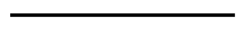

Nét B — liền mảnh (mảnh hơn hẳn nét A, cùng là nét liền):

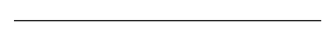

Nét C — đứt (đoạn ngắn, cách quãng đều, đều tăm tắp):

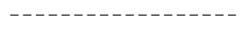

Nét D — gạch chấm mảnh (gạch dài — chấm — gạch dài, lặp lại đều):

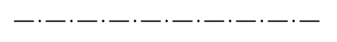

Nét E — nét cắt (đoạn đậm, ngắn hơn và dày hơn nét A — không nhầm với nét C):

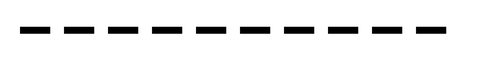

Nét F — dích dắc (gấp khúc nhọn, đều đặn):

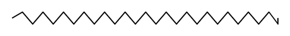

Nét G — lượn sóng (đường cong mềm, không có góc nhọn — phân biệt rõ với nét F):

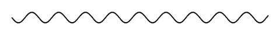

### B.3 Quy tắc khi các nét giao nhau

- Hai nét đứt (C) giao nhau đúng tại đoạn gạch — không giao ở khoảng hở. Nét đứt bắt đầu/kết thúc bằng
  đoạn gạch.
- Nét gạch chấm mảnh (D) giao nhau tại đoạn gạch dài, không giao tại chấm; vẽ vượt quá đường bao 3–5mm để
  thấy rõ đây là đường tâm/trục.
- Chỗ nét đứt (C) chạm nét liền đậm (A): để **hở**, không nối liền.

Khi nhiều loại nét trùng vị trí, chỉ vẽ một nét theo thứ tự ưu tiên giảm dần: **A → C → E → D → B**. Áp
dụng máy móc quy tắc này mỗi khi hai đối tượng chồng lên nhau trên bản vẽ — không tự chọn theo cảm tính.

---

## Phần C — Quy ước nét riêng bắt buộc khi vẽ cấu kiện bê tông cốt thép (TCVN 4612-88)

Đây là điểm khác biệt lớn nhất so với quy ước nét thông thường ở Phần B, và là quy tắc quan trọng nhất của
toàn bộ cẩm nang này — áp dụng cho mọi hình chiếu chính, mọi mặt cắt, mọi hình tách thanh của dầm/cột:

### Khái niệm chung về cốt thép — đọc trước khi áp dụng quy ước nét dưới đây

Bê tông cốt thép phối hợp bê tông (chịu nén tốt, chịu kéo/uốn kém) với cốt thép (chịu kéo tốt). Phân loại
cốt thép cần nắm để áp dụng đúng bề rộng nét ở mục dưới:

- **Theo tiết diện**: cốt mềm (tiết diện tròn — phổ biến nhất trong BTCT) và cốt cứng (thép hình chữ
  L/I/U/T).
- **Theo bề mặt**: cốt trơn (hai đầu PHẢI uốn móc để neo bám bê tông) và cốt gai/cốt vằn (không cần uốn
  móc vì gân thép tự tạo lực bám dính) — cấu kiện chịu tải trọng lớn (móng, cột, dầm) hoặc chịu chấn động
  bắt buộc dùng cốt gai.
- **Theo chức năng chịu lực** — đây là căn cứ để chọn bề rộng nét ở mục dưới: **cốt chịu lực** (gồm cốt
  chịu lực chính, cốt chịu lực cục bộ, cốt tăng cường, cốt phân bố) dùng nét đậm s (hoặc 2s); **cốt
  đai/cốt cấu tạo** (định vị cốt chịu lực, cùng tham gia chịu lực cắt) dùng nét đậm s/2 (hoặc s).

Áp dụng quy ước nét riêng sau đây:

1. **Coi bê tông là trong suốt.** Đường bao cấu kiện (mép ngoài bê tông) vẽ bằng nét liền **mảnh**, bề
   rộng khoảng s/3 — ngược hẳn với cảm giác thông thường là "đường bao phải đậm nhất". Không bao giờ tô
   đậm đường bao bê tông trên loại bản vẽ này.
2. **Cốt thép vẽ đậm để nổi bật lên trên nền bê tông trong suốt.** Chọn một trong hai cách sau và áp dụng
   thống nhất cho toàn bộ bản vẽ, không trộn lẫn giữa các cấu kiện:
   - Cách (a): cốt chịu lực dùng bề rộng s; cốt phân bố và cốt đai dùng s/2.
   - Cách (b): cốt chịu lực dùng 2s; cốt phân bố và cốt đai dùng s.
3. **Trên mặt cắt ngang:** cốt thép dọc (bị cắt ngang qua thân thanh) vẽ dạng hình tròn đặc, tô đen hoàn
   toàn; cốt đai vẽ dạng đường bao khép kín ôm quanh các thanh dọc, nét đậm nhưng có thể mảnh hơn nét vẽ
   thanh dọc để hai loại phân biệt được với nhau bằng mắt.

Ngoại lệ duy nhất — **không áp dụng quy tắc "bê tông trong suốt" ở trên** khi vẽ mặt cắt định vị thông
thường (ví dụ mặt cắt tường/sàn/cột trên mặt bằng chỉ để định vị, không thể hiện thép bên trong): trường
hợp đó quay lại quy ước thông thường — đường bao mặt cắt của bộ phận chịu lực vẽ đậm, phần thấy phía sau
mặt phẳng cắt vẽ mảnh. Chỉ dùng quy tắc "bê tông trong suốt" cho bản vẽ tách riêng, chi tiết hoá cốt thép.

---

## Phần D — Dựng hình chiếu chính của cấu kiện

Hình chiếu chính là hình chiếu của cấu kiện ở đúng vị trí làm việc thực tế (dầm nằm ngang đúng vị trí,
cột đứng đúng vị trí), chọn hướng chiếu sao cho thể hiện đầy đủ nhất hình dáng và kích thước.

Thứ tự dựng:

1. Dựng trục cấu kiện (tim dầm/tim cột) trước, làm chuẩn để đặt mọi kích thước khác.
2. Dựng đường bao cấu kiện bằng nét liền mảnh s/3 theo đúng Phần C, khớp chiều dài/chiều cao thật (chiều
   dài dầm = khoảng cách giữa 2 trục nó nối; chiều cao đoạn cột = hiệu 2 cao độ liền kề nó nối).
3. Bố trí cốt thép chịu lực dọc theo chiều dài cấu kiện bằng nét đậm (Phần C.2), đặt đúng vị trí thực tế
   thép bắt đầu, kết thúc, uốn xiên, hoặc cắt lý thuyết — các vị trí này chính là nơi cần đặt mặt cắt
   (xem Phần E).
4. Bố trí cốt đai dọc theo cấu kiện bằng nét đậm mảnh hơn cốt chịu lực, đúng bước đai đã tính cho từng
   đoạn (đầu dầm/giữa dầm khác bước; theo cột khác bước theo từng đoạn).

---

## Phần E — Đặt mặt cắt: vị trí, số lượng và cách ghi số hiệu

### E.1 Vị trí và số lượng mặt cắt theo loại cấu kiện

Mặt cắt phải đặt tại các vị trí dọc cấu kiện có **thay đổi bố trí thép** (thép uốn xiên, cắt bớt, đổi số
lượng hoặc đường kính):

| Loại cấu kiện | Số mặt cắt tối thiểu | Vị trí |
| --- | --- | --- |
| Dầm | 3 | Gối trái, giữa nhịp, gối phải. Dầm nhịp lớn/tải trọng phức tạp: thêm mặt cắt tại chỗ đổi tiết diện hoặc đổi số lượng thép |
| Cột | 1 mặt cắt / đoạn giữa 2 tầng | Nếu cột đổi tiết diện hoặc đổi số lượng/đường kính thép giữa các tầng, MỖI đoạn phải có mặt cắt riêng, không dùng chung |
| Sàn | 1 mặt cắt / loại ô sàn có cách bố trí thép khác nhau | Theo phương chịu lực chính của ô sàn (thường là phương cạnh ngắn) |

### E.2 Hai loại mặt cắt và cách chọn

- **Mặt cắt rời**: đặt ngoài hình chiếu tương ứng hoặc tại chỗ cắt lìa của hình chiếu; đường bao vẽ nét
  liền đậm.
- **Mặt cắt chập**: vẽ chồng ngay trên hình chiếu chính, đúng tại vị trí mặt phẳng cắt đi qua; đường bao
  vẽ nét liền **mảnh** để không nhầm với đường bao thật của hình chiếu.

### E.3 Ghi chú vị trí mặt cắt

Đánh dấu vị trí mặt phẳng cắt bằng nét cắt (loại E): đoạn thẳng liền đậm tại đầu, cuối và chỗ chuyển
hướng của mặt phẳng cắt, nối với nhau bằng nét gạch chấm mảnh; đoạn nét cắt ngoài cùng **không được chạm**
đường bao cấu kiện. Đặt mũi tên sát nét cắt, đầu nhọn chạm vào nét cắt, chỉ hướng nhìn; đặt tên bằng số La
Mã cặp đôi ngay cạnh mũi tên (I-I, II-II, III-III…).

Được phép bỏ nét cắt và tên gọi khi: mặt phẳng cắt trùng mặt đối xứng của cấu kiện VÀ mặt cắt đặt đúng vị
trí liên hệ chiếu (mặt cắt chập/rời đặt ngay tại vị trí cắt); hoặc khi mặt cắt có trục đối xứng thì không
cần vẽ mũi tên chỉ hướng nhìn (nhưng vẫn cần nét cắt + tên nếu không đặt tại đúng vị trí).

Ảnh mẫu — cách đặt nét cắt (A, B, C, D, E) tại các vị trí mặt phẳng cắt chuyển bậc, mũi tên chỉ hướng nhìn
và cách đặt tên A-A, cách đánh số 1/2 cho các mặt phẳng trung gian:

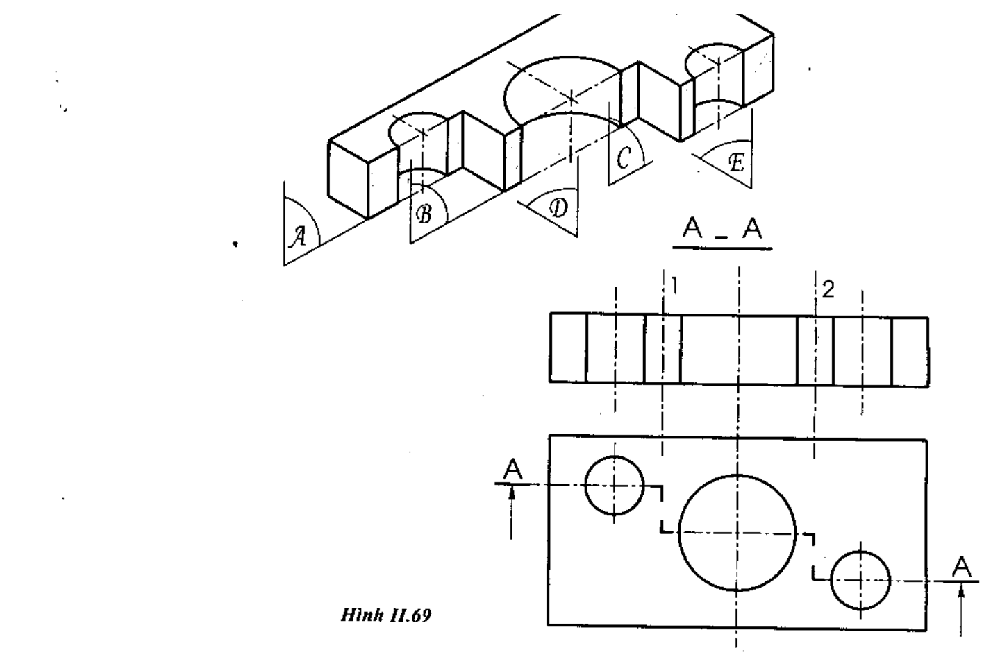

### E.4 Nguyên tắc ghi số hiệu thanh thép trên các mặt cắt liên tiếp — quy tắc dễ làm sai nhất

- **Mặt cắt đầu tiên (I-I): bắt buộc ghi số hiệu của TẤT CẢ các thanh thép có mặt tại vị trí cắt đó.**
  Không được bỏ sót bất kỳ thanh nào, kể cả thanh cấu tạo phụ.
- **Các mặt cắt tiếp theo (II-II, III-III…): CHỈ ghi số hiệu của các thanh có thay đổi** so với mặt cắt
  liền ngay trước nó — nghĩa là thanh mới xuất hiện thêm, hoặc thanh đã kết thúc/biến mất. **Không lặp lại**
  số hiệu của các thanh không đổi đã ghi ở mặt cắt trước.
- Nếu bỏ qua quy tắc này và ghi lặp lại toàn bộ số hiệu ở mọi mặt cắt (hoặc ngược lại, chỉ giữ đúng 1
  nhãn cho mỗi vị trí thay vì đủ 3 vị trí gối trái/giữa nhịp/gối phải của một dầm), bản vẽ bị coi là sai
  quy cách — đây là lỗi hay gặp nhất khi lắp ráp nhiều mặt cắt vào một hình chiếu chính, cần rà lại kỹ
  từng dầm sau khi ghép.

### E.5 Ví dụ mẫu đầy đủ — đọc kỹ ảnh này trước khi vẽ dầm đầu tiên

Ảnh dưới đây là một dầm hoàn chỉnh, gộp đủ mọi quy tắc từ Phần D đến Phần G vào một ví dụ duy nhất — dùng
làm mẫu đối chiếu bắt buộc:

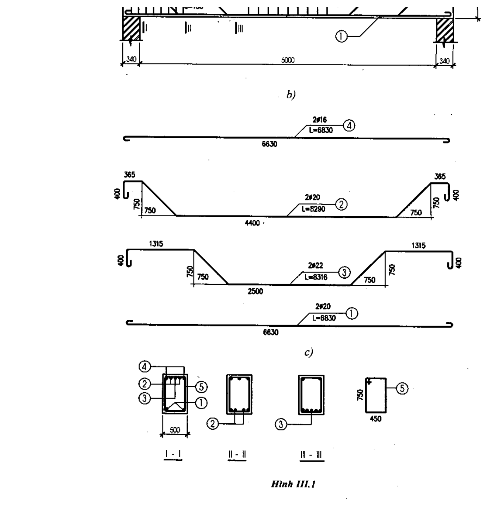

Đọc ảnh theo đúng thứ tự sau để hiểu vì sao mỗi chi tiết được vẽ như vậy:

- **Hàng trên (b):** hình chiếu chính của dầm — đường bao mảnh, nhịp 6000, hai đầu gối rộng 340; vị trí 3
  mặt cắt I-I, II-II, III-III đánh dấu bằng nét cắt ngay trên hình; số hiệu ① của thanh cấu tạo phía trên
  dẫn ra ngoài bằng đường dẫn liền mảnh, đúng quy tắc "đường dẫn nằm ngang ghi số lượng/đường kính, đầu
  mút là vòng tròn số hiệu" ở Phần G.
- **4 hình tách thanh (c):** mỗi thanh số ①②③④ vẽ tách riêng, đúng hình dạng thật kể cả đoạn uốn xiên và
  móc ở hai đầu (móc 400, đoạn xiên 750 theo đúng độ dốc thật) — chiều dài từng đoạn ghi trực tiếp dọc
  thân thanh (365, 750, 1315…), không vẽ đường dóng/đường kích thước đầy đủ, đúng như Phần F quy định.
  Ngay trên mỗi thanh ghi đúng mẫu "số lượng+đường kính — vòng tròn số hiệu — chiều dài", ví dụ `2Ø16 ④
  L=6830`.
- **3 mặt cắt I-I / II-II / III-III (dưới cùng):** đây chính là ví dụ sống động của quy tắc Phần E.4 —
  mặt cắt I-I (đầu dầm) ghi đủ tất cả các thanh có mặt tại đó (①②③ + đai ⑤); mặt cắt II-II chỉ còn ②③ vì
  thanh ① đã kết thúc trước đó; mặt cắt III-III chỉ còn ③ vì thanh ② cũng đã kết thúc — không mặt cắt nào
  lặp lại số hiệu của thanh đã hết. Thép dọc trên mặt cắt vẽ tròn đặc (tô đen); cốt đai ⑤ vẽ đường bao khép
  kín ôm quanh các thanh dọc, kèm kích thước tiết diện 500×750 (hoặc 450×750) đúng Phần C.3.

---

## Phần F — Vẽ tách từng thanh thép và ghi kích thước riêng

Vẽ tách riêng từng loại thanh (đoạn thẳng, đoạn uốn xiên, đoạn có móc) ra khỏi hình chiếu chính để thể
hiện đúng hình dáng thật và kích thước chính xác của thanh đó, dùng nét liền đậm theo đúng Phần C.2.

Ghi kích thước trên hình tách thanh được **đơn giản hoá** so với quy tắc ghi kích thước thông thường ở
Phần H: không cần vẽ đủ đường dóng + đường kích thước, chỉ cần ghi trực tiếp con số chiều dài từng đoạn
dọc theo thân thanh thép.

### Bán kính uốn/móc (TCVN 4453:1995) — áp dụng khi vẽ đoạn uốn/móc trên hình tách thanh

| Vị trí uốn | Đường kính uốn trong D (tối thiểu) | Ghi chú |
| --- | --- | --- |
| Móc 180° của thép trơn | D ≥ 2,5d | Đoạn thẳng kéo dài sau móc ≥ 3d |
| Uốn thép gai 90°–135° (uốn xiên, uốn đai), d ≤ 10mm | D ≥ 5d | |
| Uốn thép gai 90°–135°, d = 12–28mm | D ≥ 8d | |
| Uốn thép gai 90°–135°, d > 28mm | D ≥ 10d | Lấy giá trị lớn hơn so với mức tối thiểu của cốt đai nếu hai quy định chồng nhau |
| Cốt đai trơn | D ≥ 2,5d | |
| Cốt đai gai | D ≥ 4d | Đoạn neo sau móc đai (đầu 135° hoặc 90°) kéo dài tối thiểu 5d–10d tuỳ điều kiện chịu động đất |

(d = đường kính danh nghĩa của thanh thép đang uốn.)

---

## Phần G — Ghi số hiệu — số lượng/đường kính — chiều dài lên bản vẽ

Áp dụng thống nhất cho hình chiếu chính, hình tách thanh, và mọi mặt cắt:

| Vị trí ghi | Nội dung | Ví dụ |
| --- | --- | --- |
| Trong vòng tròn Ø7–10mm ở cuối đường dẫn | Số hiệu (số thứ tự) của thanh/nhóm thanh — số hiệu này dùng thống nhất ở MỌI nơi thanh đó xuất hiện | ①②③ |
| Trên phần nằm ngang của đường dẫn | Số lượng thanh + đường kính danh nghĩa | 2Ø20 |
| Dưới phần nằm ngang của đường dẫn (cốt dọc) | Chiều dài thanh, tính cả đoạn móc uốn nếu có | L=6830 |
| Dưới phần nằm ngang của đường dẫn (cốt đai) | Khoảng cách giữa 2 cốt đai liền nhau | a=200 |

**Quy tắc ghi một lần:** số liệu đầy đủ (số lượng, đường kính, chiều dài) của mỗi loại thanh chỉ ghi đầy
đủ đúng **một lần duy nhất** trên toàn bộ bản vẽ — thường ghi tại hình vẽ tách thanh (Phần F). Ở mọi vị
trí khác (hình chiếu chính, các mặt cắt), chỉ ghi lại số hiệu trong vòng tròn, không lặp lại số liệu chi
tiết đã ghi ở hình tách thanh.

### Quy ước riêng khi vẽ mặt bằng thép sàn

Tại vị trí làm việc thật, các thanh thép sàn nằm trong mặt phẳng thẳng đứng, nên hình chiếu bằng đúng của
chúng chỉ là các đoạn thẳng, không thể hiện hình dạng. Quy ước: quay các thanh sang trái hoặc lên trên
90° trước khi chiếu, để hình dạng thật hiện rõ trên mặt bằng. Nếu các thanh cùng loại, bố trí cách đều
nhau, được phép chỉ vẽ tượng trưng một số thanh đại diện, không cần vẽ hết.

---

## Phần H — Ghi kích thước hình học (TCVN 5705-1993)

Một kích thước hoàn chỉnh luôn gồm đúng ba thành phần, vẽ theo đúng thứ tự:

1. **Đường dóng** — nét liền mảnh, kẻ vuông góc (hoặc song song có chủ đích) với đường bao đối tượng cần
   ghi kích thước, vượt quá đường kích thước khoảng 2–3mm.
2. **Đường kích thước** — nét liền mảnh, song song với phương cần đo, giới hạn hai đầu bằng mũi tên (dài
   4–6 lần s, rộng khoảng 2s); nếu khoảng cách quá hẹp, thay mũi tên bằng gạch chéo 45° hoặc chấm tròn
   nhỏ.
3. **Con số kích thước** — đặt giữa, phía trên đường kích thước, cách khoảng 1–1,5mm; viết theo hướng đọc
   từ trái sang phải hoặc từ dưới lên trên tuỳ phương đường kích thước.

**Quy tắc ghi:** mỗi kích thước chỉ ghi một lần duy nhất, tại hình biểu diễn dễ đọc nhất. Đơn vị chiều dài
mặc định là milimét, không ghi đơn vị sau số; diện tích ghi bằng m² cũng không kèm đơn vị (ví dụ 24,00).
Cho phép ghi lặp lại có kiểm soát khi phục vụ mục đích đọc/tính toán thuận tiện hơn (ví dụ ba dãy kích
thước lồng nhau trên mặt bằng — xem Phần M.2) — trường hợp này không vi phạm nguyên tắc ghi một lần.

### Ký hiệu đặc biệt đi kèm con số kích thước

| Ký hiệu | Ý nghĩa | Cách ghi | Ví dụ |
| --- | --- | --- | --- |
| R | Bán kính đường tròn/cung tròn | Đặt ngay trước con số | R150 |
| Ø | Đường kính (mặt cắt tròn, lỗ khoan, thanh thép) | Đặt ngay trước con số | Ø20 |
| □ | Cạnh hình vuông | Đặt ngay trước con số | □300 |
| ∠ | Góc | Đặt trước con số, kèm đơn vị độ | ∠45° |
| ▽ | Cao độ so với mốc chuẩn ±0,00 | Đặt trước con số, đơn vị mét, 2 số lẻ | ▽+3,00 ; ▽−0,45 |
| L (kèm cung nhỏ phía trên) | Chiều dài cung tròn | Ghi trên con số, kèm cung tròn nhỏ phân biệt với dây cung | L=620 |

---

## Phần I — Ký hiệu vật liệu trên mặt cắt (TCVN 7-1993)

Phần đặc của cấu kiện bị mặt phẳng cắt đi qua được gạch bằng các nét liền mảnh song song, cách đều, nghiêng
45° so với đường nằm ngang (hoặc so với đường bao/trục chính của hình); thay bằng ký hiệu vật liệu tương
ứng khi cần phân biệt loại vật liệu:

| Vật liệu | Ký hiệu (gạch mặt cắt) |
| --- | --- |
| Kim loại | Nét liền mảnh song song, nghiêng 45°, cách đều |
| Bê tông cốt thép | Gạch chéo 45° kết hợp đoạn ngắn xen kẽ, mật độ dày hơn bê tông thường — phân biệt rõ ràng, không dùng lẫn với ký hiệu bê tông thường |
| Bê tông (không cốt thép) | Nét liền mảnh song song 45°, đều, không có đoạn ngắn xen kẽ |
| Đá (khối xây đá) | Gạch chéo ngắn, không đều, mô phỏng vân đá |
| Đất tự nhiên | Gạch ngắn xiên liên tiếp dọc biên, dạng răng cưa nghiêng |
| Kính/vật liệu trong suốt | Chấm/gạch ngắn xiên rải rác, không kín mặt cắt |
| Chất lỏng | Gạch ngang ngắn, đứt quãng, song song nằm ngang |
| Gỗ | Đường cong lượn sóng song song mô phỏng vân gỗ |
| Chất dẻo, cách điện/nhiệt/âm | Lưới gạch chéo hai chiều (caro chéo) |
| Gạch xây | Nét liền mảnh song song 45°, khoảng cách thưa hơn kim loại theo tỷ lệ vẽ |

Ảnh mẫu — đối chiếu đúng mật độ/góc nghiêng từng ký hiệu trước khi gạch mặt cắt (chú ý kỹ: ký hiệu bê tông
cốt thép có thêm đoạn ngắn xen kẽ giữa các nét gạch 45°, còn bê tông thường chỉ là nét gạch 45° đều, không
xen đoạn ngắn — hai ký hiệu này dễ vẽ nhầm lẫn nhất):

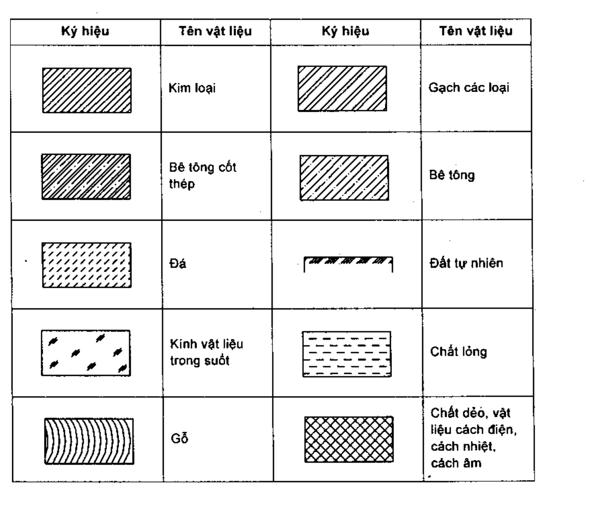

Quy định bổ sung:

- Không cần chỉ rõ loại vật liệu cụ thể → dùng ký hiệu kim loại (gạch chéo 45° đơn giản).
- Mặt cắt hẹp (bề rộng theo tỷ lệ vẽ ≤ 2mm) → được phép tô đen thay vì gạch ký hiệu.
- Mặt cắt quá rộng → chỉ cần vẽ ký hiệu vật liệu ở vùng biên, để trống phần giữa (ghi chú bằng chữ nếu
  cần).
- Ký hiệu bê tông cốt thép và bê tông thường **không được dùng lẫn nhau**.
- Khi nhiều chi tiết vật liệu liền kề nhau (ví dụ nhiều lớp vật liệu cạnh nhau trên cùng mặt cắt), đường
  kẻ gạch ký hiệu của mỗi chi tiết phải đổi hướng nghiêng hoặc đổi khoảng cách giữa các nét để phân biệt
  rõ ràng — không gạch cùng một kiểu cho các lớp liền kề.

Vật liệu chưa có ký hiệu chuẩn (đất đắp, đất sét, bê tông gạch vỡ…): dùng ký hiệu phụ tự quy định, nhưng
**bắt buộc ghi chú tên vật liệu bằng chữ ngay trên mặt cắt**:

| Vật liệu | Ký hiệu phụ | Ghi chú bắt buộc |
| --- | --- | --- |
| Đất đắp | Chấm nhỏ rải đều kèm dấu chấm than xiên | "Đất đắp" |
| Đất sét | Đường cong lượn sóng dày đặc | "Đất sét" |
| Bê tông gạch vỡ | Chấm nhỏ xen kẽ mảng gạch chéo thưa | "Bê tông gạch vỡ" |

---

## Phần J — Ký hiệu trục lưới và tên mặt cắt

Trục lưới (trục định vị cột, tường, dầm) vẽ bằng nét gạch chấm mảnh (loại D). Số hiệu trục đặt trong vòng
tròn nét liền mảnh, đường kính khoảng 7–8mm, đặt thẳng hàng tại đầu mút của mỗi trục: dùng chữ hoa (A, B,
C…) cho một phương, chữ số (1, 2, 3…) cho phương vuông góc còn lại.

**Trục lưới trên bản vẽ kết cấu phải khớp tuyệt đối với trục lưới trên mặt bằng công trình cùng dự án** —
không được lệch, không được đổi tên trục giữa hai loại bản vẽ.

Ký hiệu vị trí và tên mặt cắt dùng chung quy tắc ở Phần E.3: nét cắt (loại E) đặt tại vị trí cắt, kèm mũi
tên chỉ hướng nhìn, tên gọi bằng số La Mã cặp đôi (I-I, II-II, III-III…), tuân theo đúng nguyên tắc ghi số
hiệu ở Phần E.4 khi áp dụng cho cấu kiện BTCT.

---

## Phần K — Bảng thống kê cốt thép (8 cột bắt buộc)

Mọi bản vẽ cấu kiện BTCT bắt buộc có bảng thống kê cốt thép, đặt ngay phía trên khung tên (xem Phần A.3),
gồm đúng 8 cột theo đúng thứ tự sau — không thêm, không bớt, không đảo thứ tự:

| Cột | Nội dung |
| --- | --- |
| 1 | Tên cấu kiện |
| 2 | Số hiệu thanh |
| 3 | Hình dáng thanh |
| 4 | Đường kính (mm) |
| 5 | Chiều dài 1 thanh (mm) |
| 6 | Số lượng thanh |
| 7 | Tổng chiều dài (m) |
| 8 | Tổng trọng lượng (kg) |

Cách điền từng cột đặc biệt:

- **Cột 3 (Hình dáng thanh)**: vẽ phác thảo đơn giản dạng thanh — thẳng / có móc hai đầu / uốn xiên /
  khung đai kín — không cần đúng tỷ lệ, chỉ cần đúng dạng hình học để đối chiếu nhanh với hình vẽ tách
  thanh ở Phần F.
- **Cột 7 (Tổng chiều dài)** = cột 5 (chiều dài 1 thanh, quy đổi ra mét) × cột 6 (số lượng thanh).
- **Cột 8 (Tổng trọng lượng)** = cột 7 quy đổi ra trọng lượng theo đơn trọng tiêu chuẩn của từng đường
  kính thép tương ứng.

---

## Phần L — Bối cảnh phối hợp với mặt bằng, mặt đứng, hình cắt đứng công trình

Bản vẽ khung/cấu kiện BTCT không đứng độc lập — luôn phải khớp trục và cao độ với mặt bằng/mặt đứng công
trình. Khi cần thể hiện thêm vị trí cấu kiện trong bối cảnh tổng thể, áp dụng các quy tắc sau.

### L.0 Ký hiệu loại bản vẽ trong hồ sơ công trình

| Ký hiệu | Loại bản vẽ | Nội dung |
| --- | --- | --- |
| KT | Kiến trúc | Hình dáng ngoài, bố cục tầng/phòng |
| KC | Kết cấu | Khả năng chịu lực: móng, cột, dầm, sàn, cầu thang |
| Đ | Cấp điện | Sơ đồ đường dây, thiết bị điện |
| CN | Cấp nước | Sơ đồ đường ống cấp nước |
| NT | Thoát nước | Sơ đồ đường ống thoát nước |

Hồ sơ tối thiểu cho nhà dân dụng thông thường: bản vẽ kiến trúc toàn nhà + bản vẽ kết cấu các bộ phận chủ
yếu + bản vẽ hệ thống cấp điện–cấp thoát nước. Bản vẽ kết cấu BTCT mà cẩm nang này hướng dẫn thuộc nhóm KC.

### L.1 Mặt đứng

Vẽ bằng nét liền mảnh, chỉ thể hiện bộ phận trông thấy được (bậc thềm, cửa, ban công, mái…); riêng đường
mặt đất luôn vẽ nét liền đậm để phân biệt. Không cần ghi kích thước trên mặt đứng; nếu cần, ghi tên trục
tường biên khớp với mặt bằng. Nếu trình bày trên bản vẽ độc lập, ghi rõ tên gọi theo trục biên và hướng
nhìn, ví dụ "MẶT ĐỨNG 1–3" hoặc "MẶT ĐỨNG A–D".

### L.2 Mặt bằng các tầng

Là hình cắt bằng của từng tầng, mặt phẳng cắt tưởng tượng nằm ngang cách mặt sàn 1–1,5m. Nhà từ 2 tầng
trở lên vẽ riêng mặt bằng tầng một và mặt bằng các tầng trên (tầng trung gian giống nhau dùng chung 1 mặt
bằng).

Trình tự vẽ: (1) trục tường/cột bằng nét gạch chấm mảnh, đánh số trong vòng tròn Ø7–8mm tại đầu mút; (2)
đường bao cột/tường/vách bằng nét liền đậm (cột BTCT có thể tô đen để phân biệt tường xây); bộ phận dưới
mặt phẳng cắt (bậu cửa, thiết bị) vẽ nét liền mảnh; (3) ký hiệu cửa, ký hiệu cầu thang (mặt phẳng cắt luôn
cắt ngang cánh thang thứ nhất; hướng đi lên thể hiện bằng 1 nét liền mảnh giữa cánh thang, bắt đầu bằng
chấm tròn ở bậc đầu, kết thúc bằng mũi tên ở bậc cuối).

Ảnh mẫu ký hiệu cửa đi (1/2/4 cánh) và cửa sổ (đơn/kép) dùng trên mặt bằng:

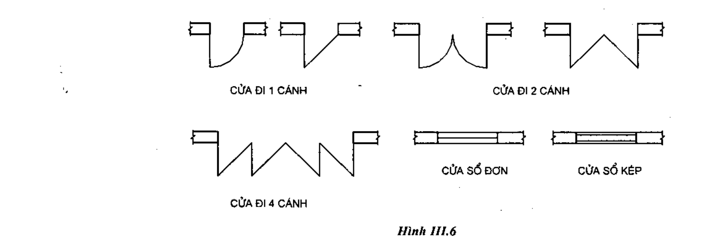

Ghi kích thước theo 2 nhóm — ngoài (3 dãy lồng nhau, từ trong ra ngoài: chiều rộng mảng tường/lỗ cửa →
khoảng cách trục cột/tường → khoảng cách trục các tường bao ngoài) và trong (chiều dài–rộng thông thuỷ
phòng, vị trí/chiều rộng lỗ cửa, chiều dày tường/vách, kích thước mặt cắt cột, diện tích phòng m² không
kèm đơn vị, cao độ sàn ▽ nếu cần).

### L.3 Hình cắt đứng

Mặt phẳng cắt thẳng đứng, cắt từ tầng một đến mái; đánh dấu vị trí trên mặt bằng tầng một bằng nét cắt +
tên chữ hoa (ví dụ hình cắt A-A). Trình tự vẽ: (1) trục cột/tường bị cắt, đánh số khớp mặt bằng; (2)
đường bao cột/tường/vách/dầm/sàn/cầu thang bị cắt — nét liền đậm; (3) ký hiệu cửa sổ trên mảng tường bị
cắt + hình chiếu bộ phận trông thấy phía sau (cánh cửa, cầu thang) — nét liền mảnh; (4) ghi kích thước
chiều cao/rộng cửa, cánh thang, lan can, và cao độ sàn từng tầng.

### L.4 Trình tự thiết lập khi vẽ chung trên 1 tờ

Bố cục trước: mặt đứng chính ở góc trên-trái, hình cắt đứng đặt bên phải mặt đứng theo đúng liên hệ dóng
ngang, mặt bằng các tầng đặt hàng dưới có liên hệ dóng đứng với mặt đứng chính — chừa đủ khoảng trống
quanh mặt bằng để ghi kích thước và đánh số trục. Vẽ mờ lần lượt theo thứ tự: mặt bằng → hình cắt đứng →
mặt đứng; sau đó mới tô đậm toàn bộ.

### L.5 Trình tự đọc bản vẽ nhà (tham khảo khi đối chiếu, không phải thứ tự vẽ)

Đọc mặt đứng trước để hình dung sơ bộ hình dáng kiến trúc ngoài → đọc mặt bằng các tầng để hiểu bố trí
không gian chức năng → đối chiếu vị trí mặt phẳng cắt trên mặt bằng tầng một với hình cắt đứng để hiểu
không gian bên trong mỗi tầng → đọc bản vẽ kết cấu (móng, cột, sàn, cầu thang) để hiểu cấu tạo chịu lực.
Dùng thứ tự này khi kiểm tra chéo bản vẽ kết cấu vừa sinh ra có khớp với bối cảnh kiến trúc/mặt bằng hay
không.

---

## Phần M — Hình chiếu, hình cắt, mặt cắt: các trường hợp mở rộng cần biết

### M.1 Sáu hình chiếu cơ bản (TCVN 5-78 / ISO 5456)

Đặt tên và bố trí: hình chiếu từ trước (chính) ở trung tâm; hình chiếu từ trên đặt ngay phía dưới hình
chiếu đứng; hình chiếu từ trái đặt bên phải hình chiếu đứng; hình chiếu từ phải/dưới/sau chỉ vẽ thêm khi
thật cần thiết. Giới hạn số lượng hình chiếu ở mức cần và đủ, tránh trùng lặp thông tin. Nếu vì bố cục mà
đặt sai vị trí quy định, bắt buộc vẽ mũi tên chỉ hướng chiếu trên hình chiếu chính và ghi tên hình chiếu
bằng chữ hoa ở góc trên-trái của hình chiếu đó.

### M.2 Hình chiếu phụ, riêng phần, mở rộng

- **Hình chiếu riêng phần**: hình chiếu thẳng góc 1 bộ phận lên đúng mặt phẳng cơ bản tương ứng; giới hạn
  bằng nét lượn sóng (G); nếu không đặt đúng vị trí liên hệ chiếu, ghi tên (ví dụ "hình chiếu riêng phần
  C").
- **Hình chiếu phụ**: hình chiếu 1 bộ phận nghiêng lên mặt phẳng phụ song song với nó; giới hạn nét lượn
  sóng, kèm mũi tên chỉ hướng nhìn trên hình chiếu chính, ghi tên nếu không đặt đúng vị trí (ví dụ
  "hình chiếu phụ 3 đã xoay").
- **Hình chiếu cơ bản mở rộng**: bộ phận đã xoay quanh trục về vị trí song song mặt phẳng cơ bản trước
  khi chiếu; trên hình chiếu chính vẽ cung tròn chỉ chiều xoay (tâm là trục xoay); trên hình mở rộng vẽ
  trục xoay bằng nét gạch chấm mảnh (D).

### M.3 Phân loại hình cắt

Theo vị trí mặt phẳng: hình cắt đứng (A-A, song song mặt phẳng chiếu đứng), hình cắt bằng (B-B, song song
mặt phẳng chiếu bằng), hình cắt cạnh (C-C, song song mặt phẳng chiếu cạnh).

Theo số mặt phẳng cắt:

- **Đơn giản** (1 mặt phẳng): nếu trùng mặt đối xứng và đặt đúng vị trí liên hệ chiếu → không cần vẽ nét
  cắt và đặt tên.
- **Phức tạp — bậc** (≥2 mặt phẳng song song): không cần thể hiện mặt phẳng chuyển tiếp giữa các mặt cắt
  song song; tại vị trí chuyển bậc không vẽ nét liền đậm cho giao tuyến các mặt phẳng chuyển tiếp.
- **Phức tạp — xoay** (≥2 mặt phẳng giao nhau): xoay mặt phẳng cắt về vị trí song song mặt phẳng cơ bản
  rồi mới chiếu.

### M.4 Quy ước riêng của hình cắt xây dựng (khác hình cắt cơ khí)

Đường bao mặt cắt (phần đặc bị cắt qua) vẽ nét liền đậm; đường bao phần thấy phía sau mặt phẳng cắt vẽ
nét liền **mảnh** — đây là điểm khác biệt riêng của bản vẽ xây dựng, nhấn mạnh các bộ phận chịu lực
(tường, sàn, cột, dầm).

Khi cấu kiện có trục đối xứng, được phép ghép nửa hình chiếu + nửa hình cắt trên cùng 1 hình: phần hình
cắt đặt bên phải hoặc bên dưới trục đối xứng; đường phân chia là trục đối xứng (nếu nét khuất trùng trục:
phần hình cắt vẽ vượt qua trục một chút, đường phân cách là nét lượn sóng lệch trái; nếu nét thấy trùng
trục: phần hình chiếu vẽ vượt qua trục một chút, đường phân cách lệch phải); phần hình chiếu được bỏ nét
khuất đã thể hiện tương đương ở phần hình cắt.

### M.5 Mặt cắt (khác hình cắt — không có phần thấy phía sau)

Mặt cắt chỉ là phần đặc bị mặt phẳng cắt đi qua, không gồm phần thấy phía sau. Ghi chú như hình cắt: nét
cắt, mũi tên, tên chữ hoa — với 2 đơn giản hoá: (1) nếu đặt đúng vị trí mặt phẳng cắt/chỗ cắt lìa, chỉ cần
nét cắt + mũi tên, không cần đặt tên; (2) nếu mặt cắt có trục đối xứng, không cần vẽ mũi tên hướng nhìn.

---

## Phần N — Trình tự thao tác vẽ thực tế (theo đúng thứ tự cần làm)

Thực hiện đúng thứ tự sau khi dựng một bản vẽ bố trí thép khung/cấu kiện BTCT — không đảo thứ tự, vì mỗi
bước là chuẩn hình học/tham chiếu cho bước sau:

1. Xác định khổ giấy và tỷ lệ theo kích thước tổng thể của khung/cấu kiện cần vẽ (Phần A.1, A.4).
2. Kẻ khung bản vẽ; chừa sẵn vị trí khung tên (góc dưới-phải) và vị trí bảng thống kê thép (ngay trên
   khung tên) (Phần A.2, A.3).
3. Dựng lưới trục công trình bằng nét gạch chấm mảnh; đánh số/chữ trong vòng tròn Ø7–8mm tại đầu mút mỗi
   trục (Phần J).
4. Dựng đường bao cấu kiện (nét liền mảnh s/3, coi là trong suốt) của toàn bộ dầm/cột theo đúng lưới trục
   và cao độ đã xác định — chiều dài/chiều cao mỗi cấu kiện suy ra từ khoảng cách trục/hiệu cao độ, không
   tự đặt cứng (Phần D, Phần C.1).
5. Bố trí cốt thép chịu lực dọc theo chiều dài từng cấu kiện bằng nét đậm, đặt đúng điểm bắt đầu/kết
   thúc/uốn xiên/cắt lý thuyết theo số liệu thép đã chọn cho cấu kiện đó (Phần D, Phần C.2).
6. Bố trí cốt đai dọc theo cấu kiện, đúng bước đai từng đoạn (Phần D bước 4).
7. Xác định vị trí cần đặt mặt cắt trên mỗi cấu kiện — nơi bố trí thép thay đổi (Phần E.1).
8. Vẽ từng mặt cắt ngang tại các vị trí đã xác định, đúng loại (rời/chập) và đúng nguyên tắc ghi số hiệu
   mặt cắt đầu tiên ghi đủ / mặt cắt sau chỉ ghi thanh thay đổi (Phần E.2, E.3, E.4).
9. Vẽ tách riêng từng loại thanh thép ra khỏi hình chiếu chính, đúng hình dạng thật kể cả đoạn uốn/móc
   theo đúng bán kính tối thiểu (Phần F).
10. Gán số hiệu thống nhất (vòng tròn Ø7–10mm) cho từng thanh/nhóm thanh — dùng đúng 1 số hiệu duy nhất
    cho cùng 1 loại thanh ở mọi nơi nó xuất hiện (Phần G).
11. Ghi số lượng+đường kính phía trên đường dẫn, chiều dài (cốt dọc) hoặc bước đai (cốt đai) phía dưới —
    ghi đầy đủ đúng 1 lần tại hình tách thanh, các nơi khác chỉ ghi lại số hiệu (Phần G).
12. Ghi kích thước hình học tổng thể (nhịp, chiều cao, kích thước tiết diện b×h…) — đủ 3 thành phần đường
    dóng/đường kích thước/con số, dùng đúng ký hiệu đặc biệt khi cần (Phần H).
13. Gạch ký hiệu vật liệu trên các mặt cắt bê tông/BTCT theo đúng bảng, không lẫn ký hiệu bê tông thường
    với BTCT (Phần I).
14. Lập bảng thống kê cốt thép đủ 8 cột, đặt ngay trên khung tên (Phần K).
15. Điền đầy đủ khung tên (Phần A.3).
16. Rà lại toàn bộ bề rộng nét theo đúng phân loại A/B/C/D/E/F/G — sửa mọi chỗ dùng sai bề rộng hoặc sai
    loại nét trước khi coi là hoàn chỉnh (Phần B).
17. Kiểm tra chéo lần cuối theo checklist ở Phần O.

---

## Phần O — Checklist tự kiểm tra trước khi coi bản vẽ đã hoàn chỉnh

- [ ] Khổ giấy, tỷ lệ, khung bản vẽ, khung tên đã chọn đúng và điền đầy đủ thông tin (Phần A).
- [ ] Toàn bộ chữ/số dùng đúng khổ chữ tiêu chuẩn, không dùng font/kiểu tuỳ tiện (Phần A.5).
- [ ] Đường bao cấu kiện dùng đúng nét liền mảnh s/3, coi là trong suốt; cốt thép dùng đúng nét liền đậm
      theo đúng tỷ lệ đã chọn cho toàn bộ bản vẽ — không lẫn với quy ước nét hình cắt định vị thông
      thường (Phần C).
- [ ] Mọi kích thước có đủ 3 thành phần, chỉ ghi 1 lần, đúng ký hiệu đặc biệt khi cần (Phần H).
- [ ] Mặt cắt đặt đúng vị trí có thay đổi bố trí thép; mặt cắt đầu tiên ghi đủ mọi thanh, các mặt cắt sau
      chỉ ghi thanh thay đổi (Phần E.4) — kiểm tra riêng từng dầm: đủ cả 3 vị trí gối trái/giữa
      nhịp/gối phải, không chỉ còn 1 nhãn duy nhất sau khi lắp ráp.
- [ ] Ký hiệu vật liệu trên mọi mặt cắt đúng bảng, phân biệt rõ bê tông cốt thép và bê tông thường
      (Phần I).
- [ ] Mỗi thanh/nhóm thanh có số hiệu trong vòng tròn Ø7–10mm, ghi số lượng+đường kính phía trên đường
      dẫn, chiều dài/bước đai phía dưới — số liệu đầy đủ chỉ ghi 1 lần tại hình tách thanh (Phần G).
- [ ] Bảng thống kê cốt thép đủ 8 cột đúng thứ tự, đặt ngay trên khung tên (Phần K).
- [ ] Trục lưới kết cấu khớp tuyệt đối với trục lưới công trình (nếu có bản vẽ tổng thể đối chiếu)
      (Phần J).
- [ ] Mọi giá trị hình học và số liệu thép thể hiện trên bản vẽ đều truy được về đúng dữ liệu/kết quả
      tính toán của công trình đang vẽ — không có con số nào tự đặt cứng hoặc lấy từ bản vẽ khác.

---

## Phần P — Tài liệu tham khảo & phạm vi áp dụng

### Danh sách tiêu chuẩn / nguồn tham khảo

- Nguyễn Quang Cự, Nguyễn Mạnh Dũng — *Giáo Trình Vẽ Kỹ Thuật Xây Dựng* (nguồn chính: nét vẽ, hình chiếu,
  hình cắt, mặt cắt, ký hiệu vật liệu, bản vẽ kết cấu BTCT, bản vẽ nhà).
- TCVN 7285-2003 — Khổ giấy (Phần A.1).
- TCVN 7286:2003 — Tỷ lệ bản vẽ (Phần A.4).
- TCVN 7284-2-2003 — Chữ viết dùng trong tài liệu kỹ thuật (Phần A.5).
- TCVN 2233-77 — Chữ và số vẽ kỹ thuật, bổ sung kiểu chữ mỹ thuật/chữ gầy nét đậm (Phần A.5).
- TCVN 8-20:2002 (tương đương ISO 128) — Nét vẽ, 7 loại nét và thứ tự ưu tiên (Phần B).
- TCVN 4612-88 — Ký hiệu quy ước cấu kiện bê tông cốt thép: quy ước nét riêng, số hiệu thanh thép, mặt
  cắt, bảng thống kê (Phần C, E, F, G, J, K).
- TCVN 5705-1993 — Ghi kích thước và ghi vật liệu trên bản vẽ xây dựng (Phần H).
- TCVN 7-1993 — Ký hiệu vật liệu trên mặt cắt (Phần I).
- TCVN 5-78 / ISO 5456 — Nguyên tắc chung về hình chiếu, hình cắt (Phần M).
- TCVN 5574:2018 — Thiết kế kết cấu bê tông và bê tông cốt thép: quy tắc cấu tạo bố trí cốt thép (lớp bảo
  vệ, khoảng cách, neo, nối) — chi tiết công thức ở `RULES_TCVN5574.md`, không lặp lại ở cẩm nang này.
- TCVN 4453:1995 — Kết cấu bê tông và bê tông cốt thép toàn khối, quy phạm thi công/nghiệm thu: bán kính
  uốn/móc cốt thép (Phần F).

### Phạm vi chủ động không đưa vào cẩm nang này

Phần hình học hoạ hình thuần tuý của giáo trình nguồn (vẽ hình học bằng compa/thước, phép chiếu
điểm/đường/mặt phẳng, bài toán giao tuyến, hình chiếu trục đo, hình chiếu phối cảnh, vẽ bóng) được chủ
động bỏ qua — đây là kỹ thuật dựng hình bằng tay cho người học vẽ kỹ thuật cơ bản, không phục vụ trực tiếp
việc AutoCAD dựng hình từ toạ độ/kích thước đã tính sẵn (không cần giải bài toán tìm hình chiếu thứ ba hay
giao tuyến vật thể bằng phương pháp hoạ hình thủ công).
